# 📚 Awesome System Design Book & Course: System Design


## ❣️ Support

There are many ways to support us; in exchange, you'll get this material in a proper format:

- ❤️ [shop.ditectrev.com, in EPUB or PDF formats](https://shop.ditectrev.com/product/TODO),
- ▶️ [Udemy, in an interactive video course format](https://www.udemy.com/course/TODO),
- 🆓 [Shorter, but free, part of our Udemy course is available on YouTube](https://www.youtube.com/playlist?list=TODO),
- 🖨️ [Amazon, printable physical book in paperback or hardcover (Kindle available, too)](https://www.amazon.com/dp/TODO),
- 📚 [Google Play Books, in PDF format](https://play.google.com/store/books/details?id=TODO),
- 🛍️ [Etsy, in PDF format](https://ditectrev.etsy.com/listing/TODO),
- 🛒 [eBay, in PDF format](https://www.ebay.com/itm/TODO),
- 🔄 [Patreon subscription allows you to get access to all of the materials in EPUB and PDF formats. You can also buy separate items on Patreon, but the subscription technically allows us to include all updates for EPUB and PDF formats. Hence, you get EPUB and PDF updates when you subscribe to Patreon](https://patreon.com/Ditectrev?utm_medium=unknown&utm_source=join_link&utm_campaign=creatorshare_creator&utm_content=copyLink).

💰 If you work for a company, you could probably easily claim this expense while learning this topic. For us, it's about being in the game or not.

⭐ Good ratings & reviews help us to survive. Please don't forget to leave a nice one when you purchase an item.

## ✨ This book & course is unlike any System Design book & course you will find online.

✋ Join a live online community and a book & course taught by industry experts and learn about System Design. We aim to build an ecosystem of Information Technology (IT) certifications and online courses in cooperation with the technology industry. We believe it will give our students 100% confidence in the pacing market in an open-source environment. We are just at the beginning of our way, so it's even better for you to join now!

[](https://discord.gg/RFjtXKfJy3)

## ⌛️ Short and to the point; why should you take the book & course:

1. Always happy to answer your questions 😊
2. Unhappy? Please raise a refund; we'll always accept it 💸
3. Learn about topics, such as 😱
   - Introduction to System Design:
     - What is System Design?;
     - What Problem System Design Solves;
     - System Design vs Software Design vs Architecture;
     - Building Blocks You Will Name;
   - Large-Scale Systems: Scalability, Availability, Reliability, and Performance:
     - Scalability;
     - Availability;
     - Fault Tolerance;
     - Reliability;
     - Performance;
     - Disaster Recovery;
   - Networking, Protocols, and Web Concepts:
     - TCP and UDP;
     - Domain Name System;
     - HTTP, HTTPS, and the Web Request Path;
     - Load Balancing;
   - API Design:
     - REST;
     - GraphQL;
     - gRPC and RPC;
     - API Gateways;
   - Databases and Storage:
     - SQL vs NoSQL;
     - Replication;
     - Sharding, Partitioning, and Federation;
   - Caching and Content Delivery Networks:
     - Eviction Policies;
     - Content Delivery Networks;
   - Message Queues, Streams, and Real-Time Communication:
     - Message Queues;
     - Publish-Subscribe and Event Streams;
     - Long Polling, WebSockets, and Server-Sent Events;
   - Architectural Patterns, Microservices, and Cloud-Native Architecture:
     - Monoliths, Modular Monoliths, and Microservices;
     - Event-Driven Architecture;
     - Cloud-Native Architecture;
   - Distributed Systems:
     - Consensus and Leader Election;
     - Split Brain and Network Partitions;
   - Algorithms and Data Structures for System Design:
     - Consistent Hashing;
     - Bloom Filters;
     - Rate-Limit Algorithms;
   - Security and Authentication:
     - OAuth 2.0 and OpenID Connect;
     - Encryption in Transit and at Rest;
   - Monitoring and Observability:
     - Logs, Metrics, and Traces;
     - Golden Signals;
   - Payment Systems:
     - Money Movement and Double-Entry Ledgers;
     - Idempotency Keys and Exactly-Once Charging;
   - AI and ML Systems:
     - Training vs Inference Architectures;
     - Vector Search and RAG;
     - LLM Inference, Batching, and Streaming;
   - System Design Interviews (Optional):
     - What is a System Design Interview?;
     - Product Interviews vs Infrastructure Interviews;
     - Junior vs Senior vs Staff Expectations;
   - The Interview Working Loop:
     - Clarify Functional and Non-Functional Requirements;
     - Back-of-the-Envelope Estimates;
     - High-Level Design First;
     - Diagramming Under Time Pressure;
   - Classic Warm-Up Problems:
     - Design a URL Shortener;
     - Design a Unique ID Generator;
     - Design a Rate Limiter;
     - Design Pastebin;
   - Social and Content Platforms:
     - Design Twitter;
     - Design Instagram;
     - Design a News Feed;
     - Design YouTube;
     - Design Netflix;
   - Messaging and Notifications:
     - Design WhatsApp;
     - Design a Notification System;
     - Design Zoom;
   - Marketplace, Maps, and Realtime:
     - Design Uber;
     - Design Airbnb;
     - Design Yelp;
     - Design Ticketmaster;
     - Design a Stock Exchange;
   - Storage, Search, and Collaboration:
     - Design Dropbox;
     - Design a Web Crawler;
     - Design Typeahead;
     - Design a Search Engine;
     - Design Google Docs;
   - Infrastructure and Platform Problems:
     - Design a Key-Value Store;
     - Design a Distributed Cache;
     - Design a Message Queue;
     - Design a Metrics System;
     - Design a Payment System;
     - Design an LLM Inference Platform;
   - Common Challenges and Debugging Tips;
   - Additional Resources and Reading Materials;
   - **Much More!**
4. Real Life examples ✅
5. The book & course explains the topic fully in-depth 🔬

## ☝️ Book & Course Updates

**[v1.0.0](../../releases/tag/v1.0.0): November 19, 2026.**

- Launch of the book.

**[v1.1.0](../../releases/tag/v1.1.0): December X, 2026.**

- Post-recording improvements.

**[v1.1.0](../../releases/tag/v1.1.0): December X, 2026.**

- Launch of the course.

## 🙋‍♀️ & 🙋‍♂️ Contribution

We are so thankful for every contribution, which makes sure we can deliver top-notch content. Whenever you find a missing resource, broken link in a [Table of Contents](#table-of-contents), the wrong answer, please submit an [issue](../../issues). Even better would be a [Pull Request (PR)](../../pulls).

## Who this book & course is for:

- 👨‍🎓 Enthusiasts of practical education;
- 👨‍🎓 Everyone who has heard about System Design and would like to know more;
- 👨‍🎓 Professionalists daily working with technology who want to have a basic grasp of System Design without burnout;
- 👨‍🎓 Sceptical Engineers about a book & course solely focused on System Design;
- 👨‍🎓 Self-paced Learners for whom expensive Bootcamps are unaffordable;
- 👨‍🎓 Students interested in Software Engineering and Distributed Systems;
- 👨‍🎓 Students willing to start a career as a Backend or Platform Engineer;
- 👨‍🎓 Specialists willing to know A to Z about System Design;

## Requirements

- 🤩 Excitement to learn!
- 0️⃣ Prior knowledge is required;
- ✅ You can learn System Design solely based on our book & course.

## Table of Contents

- [Introduction to System Design](#introduction-to-system-design)
  - [What is System Design?](#what-is-system-design)
  - [What Problem System Design Solves](#what-problem-system-design-solves)
  - [System Design vs Software Design vs Architecture](#system-design-vs-software-design-vs-architecture)
  - [Qualities You Design For](#qualities-you-design-for)
  - [Building Blocks You Will Name](#building-blocks-you-will-name)
    - [Cloud and Compute](#cloud-and-compute)
    - [Datastores, Caches, and Object Storage](#datastores-caches-and-object-storage)
    - [Async Paths, Edge, and Observability](#async-paths-edge-and-observability)
  - [How We Practice](#how-we-practice)
    - [Excalidraw as the Default Canvas](#excalidraw-as-the-default-canvas)
    - [diagrams.net and Cloud Icon Sets](#diagramsnet-and-cloud-icon-sets)
    - [Miro, FigJam, and Other Whiteboards You May Be Handed](#miro-figjam-and-other-whiteboards-you-may-be-handed)
  - [How this book is organized](#how-this-book-is-organized)
  - [Summary: Introduction to System Design](#summary-introduction-to-system-design)
- [Large-Scale Systems: Scalability, Availability, Reliability, and Performance](#large-scale-systems-scalability-availability-reliability-and-performance)
  - [What Large-Scale Means](#what-large-scale-means)
  - [Scalability](#scalability)
    - [Vertical Scaling](#vertical-scaling)
    - [Horizontal Scaling](#horizontal-scaling)
    - [Performance vs Scalability](#performance-vs-scalability)
  - [Availability](#availability)
    - [The Nines of Availability](#the-nines-of-availability)
    - [Availability in Sequence vs Parallel](#availability-in-sequence-vs-parallel)
    - [High Availability vs Fault Tolerance](#high-availability-vs-fault-tolerance)
  - [Fault Tolerance](#fault-tolerance)
    - [Single Points of Failure](#single-points-of-failure)
    - [Failover and Redundancy](#failover-and-redundancy)
    - [Active-Active vs Active-Passive](#active-active-vs-active-passive)
  - [Reliability](#reliability)
    - [Availability vs Reliability](#availability-vs-reliability)
    - [SLA, SLO, and SLI](#sla-slo-and-sli)
  - [Performance](#performance)
    - [Latency vs Throughput vs Bandwidth](#latency-vs-throughput-vs-bandwidth)
    - [Tail Latency and Percentiles](#tail-latency-and-percentiles)
    - [Numbers Worth Memorizing](#numbers-worth-memorizing)
  - [Disaster Recovery](#disaster-recovery)
    - [RPO, RTO, and Backup Strategies](#rpo-rto-and-backup-strategies)
    - [Multi-Region and Multi-Datacenter Failover](#multi-region-and-multi-datacenter-failover)
  - [Capacity Planning and Back-of-the-Envelope Math](#capacity-planning-and-back-of-the-envelope-math)
  - [Summary: Large-Scale Systems: Scalability, Availability, Reliability, and Performance](#summary-large-scale-systems-scalability-availability-reliability-and-performance)
- [Networking, Protocols, and Web Concepts](#networking-protocols-and-web-concepts)
  - [IP Addressing](#ip-addressing)
    - [IPv4 and IPv6](#ipv4-and-ipv6)
    - [Public vs Private Addresses](#public-vs-private-addresses)
  - [The OSI Model](#the-osi-model)
  - [TCP and UDP](#tcp-and-udp)
  - [Domain Name System](#domain-name-system)
    - [How DNS Resolution Works](#how-dns-resolution-works)
    - [Record Types and Caching](#record-types-and-caching)
  - [HTTP, HTTPS, and the Web Request Path](#http-https-and-the-web-request-path)
    - [Methods, Status Codes, and Headers](#methods-status-codes-and-headers)
    - [Cookies, Sessions, and CORS](#cookies-sessions-and-cors)
  - [TLS, SSL, and mTLS](#tls-ssl-and-mtls)
  - [Proxies](#proxies)
    - [Forward Proxy vs Reverse Proxy](#forward-proxy-vs-reverse-proxy)
    - [Load Balancer vs Reverse Proxy](#load-balancer-vs-reverse-proxy)
  - [Load Balancing](#load-balancing)
    - [Layer 4 vs Layer 7 Load Balancing](#layer-4-vs-layer-7-load-balancing)
    - [Routing Algorithms](#routing-algorithms)
    - [Health Checks, Sticky Sessions, and Failover](#health-checks-sticky-sessions-and-failover)
  - [Clustering vs Load Balancing](#clustering-vs-load-balancing)
  - [Checksums and Integrity on the Wire](#checksums-and-integrity-on-the-wire)
  - [Summary: Networking, Protocols, and Web Concepts](#summary-networking-protocols-and-web-concepts)
- [API Design](#api-design)
  - [What an API Must Make Obvious](#what-an-api-must-make-obvious)
  - [REST](#rest)
    - [Resources, Verbs, and Status Contracts](#resources-verbs-and-status-contracts)
    - [Pagination, Filtering, and Versioning](#pagination-filtering-and-versioning)
  - [GraphQL](#graphql)
  - [gRPC and RPC](#grpc-and-rpc)
  - [REST vs GraphQL vs gRPC](#rest-vs-graphql-vs-grpc)
  - [API Gateways](#api-gateways)
    - [Backend for Frontend](#backend-for-frontend)
  - [Webhooks](#webhooks)
  - [Idempotency in APIs](#idempotency-in-apis)
  - [Rate Limiting as an API Concern](#rate-limiting-as-an-api-concern)
  - [Error Contracts and Backward Compatibility](#error-contracts-and-backward-compatibility)
  - [Summary: API Design](#summary-api-design)
- [Databases and Storage](#databases-and-storage)
  - [What a Database Is in System Design](#what-a-database-is-in-system-design)
  - [Storage Layers](#storage-layers)
    - [File, Block, and Object Storage](#file-block-and-object-storage)
    - [RAID, NAS, and HDFS](#raid-nas-and-hdfs)
  - [SQL Databases](#sql-databases)
    - [Indexes, Materialized Views, and the N+1 Problem](#indexes-materialized-views-and-the-n1-problem)
    - [Normalization and Denormalization](#normalization-and-denormalization)
  - [NoSQL Databases](#nosql-databases)
    - [Key-Value, Document, Wide-Column, and Graph](#key-value-document-wide-column-and-graph)
  - [SQL vs NoSQL](#sql-vs-nosql)
  - [ACID, BASE, CAP, and PACELC](#acid-base-cap-and-pacelc)
  - [Transactions](#transactions)
    - [Local Transactions](#local-transactions)
    - [Distributed Transactions, Two-Phase Commit, and Sagas](#distributed-transactions-two-phase-commit-and-sagas)
  - [Replication](#replication)
    - [Single-Leader, Multi-Leader, and Leaderless](#single-leader-multi-leader-and-leaderless)
    - [Synchronous vs Asynchronous Replication](#synchronous-vs-asynchronous-replication)
  - [Sharding, Partitioning, and Federation](#sharding-partitioning-and-federation)
    - [Shard Keys That Age Well](#shard-keys-that-age-well)
    - [Resharding and Directory-Based Routing](#resharding-and-directory-based-routing)
  - [When to Pick SQL vs NoSQL](#when-to-pick-sql-vs-nosql)
  - [Summary: Databases and Storage](#summary-databases-and-storage)
- [Caching and Content Delivery Networks](#caching-and-content-delivery-networks)
  - [Why Caching Shows Up in Almost Every Design](#why-caching-shows-up-in-almost-every-design)
  - [Cache Hits, Misses, and Stampede](#cache-hits-misses-and-stampede)
  - [Where to Cache](#where-to-cache)
    - [Client, CDN, Application, and Database Caches](#client-cdn-application-and-database-caches)
  - [Write-Through, Write-Around, and Write-Back](#write-through-write-around-and-write-back)
  - [Eviction Policies](#eviction-policies)
  - [Distributed Cache and Hot Keys](#distributed-cache-and-hot-keys)
  - [Content Delivery Networks](#content-delivery-networks)
    - [Push CDNs vs Pull CDNs](#push-cdns-vs-pull-cdns)
    - [What a CDN Does Not Solve](#what-a-cdn-does-not-solve)
  - [Summary: Caching and Content Delivery Networks](#summary-caching-and-content-delivery-networks)
- [Message Queues, Streams, and Real-Time Communication](#message-queues-streams-and-real-time-communication)
  - [Synchronous vs Asynchronous Paths](#synchronous-vs-asynchronous-paths)
  - [Message Brokers](#message-brokers)
  - [Message Queues](#message-queues)
    - [At-Most-Once, At-Least-Once, and Exactly-Once](#at-most-once-at-least-once-and-exactly-once)
    - [Backpressure and Poison Messages](#backpressure-and-poison-messages)
  - [Publish-Subscribe and Event Streams](#publish-subscribe-and-event-streams)
    - [Queue vs Log vs Pub/Sub](#queue-vs-log-vs-pubsub)
  - [Task Queues](#task-queues)
  - [Long Polling, WebSockets, and Server-Sent Events](#long-polling-websockets-and-server-sent-events)
  - [WebRTC and Real-Time Media Paths](#webrtc-and-real-time-media-paths)
  - [Summary: Message Queues, Streams, and Real-Time Communication](#summary-message-queues-streams-and-real-time-communication)
- [Architectural Patterns, Microservices, and Cloud-Native Architecture](#architectural-patterns-microservices-and-cloud-native-architecture)
  - [N-Tier and Layered Architectures](#n-tier-and-layered-architectures)
  - [Monoliths, Modular Monoliths, and Microservices](#monoliths-modular-monoliths-and-microservices)
    - [When Microservices Are the Wrong Answer](#when-microservices-are-the-wrong-answer)
    - [Microservices vs SOA](#microservices-vs-soa)
    - [The Distributed Monolith](#the-distributed-monolith)
  - [Service Discovery and Service Mesh](#service-discovery-and-service-mesh)
  - [Circuit Breakers and Bulkheads](#circuit-breakers-and-bulkheads)
  - [Event-Driven Architecture](#event-driven-architecture)
  - [Event Sourcing](#event-sourcing)
  - [CQRS](#cqrs)
  - [Big Data Architecture Patterns](#big-data-architecture-patterns)
    - [Batch vs Stream Processing](#batch-vs-stream-processing)
    - [Lambda and Kappa](#lambda-and-kappa)
    - [Data Lakes, Warehouses, and Lakehouses](#data-lakes-warehouses-and-lakehouses)
    - [MapReduce and Its Descendants](#mapreduce-and-its-descendants)
  - [Cloud-Native Architecture](#cloud-native-architecture)
    - [VMs vs Containers](#vms-vs-containers)
    - [Orchestration, Twelve-Factor, and Stateless Services](#orchestration-twelve-factor-and-stateless-services)
    - [Managed Building Blocks vs Running Your Own](#managed-building-blocks-vs-running-your-own)
  - [Summary: Architectural Patterns, Microservices, and Cloud-Native Architecture](#summary-architectural-patterns-microservices-and-cloud-native-architecture)
- [Distributed Systems](#distributed-systems)
  - [Why Distributed Systems Fail Differently](#why-distributed-systems-fail-differently)
  - [Clocks, Time, and Ordering](#clocks-time-and-ordering)
  - [Consensus and Leader Election](#consensus-and-leader-election)
  - [Quorum, Gossip, and Membership](#quorum-gossip-and-membership)
  - [Distributed Locks and Coordination](#distributed-locks-and-coordination)
  - [Split Brain and Network Partitions](#split-brain-and-network-partitions)
  - [Idempotency, Dedup, and Exactly-Once Illusions](#idempotency-dedup-and-exactly-once-illusions)
  - [Multi-Datacenter Designs](#multi-datacenter-designs)
  - [Summary: Distributed Systems](#summary-distributed-systems)
- [Algorithms and Data Structures for System Design](#algorithms-and-data-structures-for-system-design)
  - [Which Algorithms Show Up in System Design](#which-algorithms-show-up-in-system-design)
  - [Consistent Hashing](#consistent-hashing)
  - [Bloom Filters](#bloom-filters)
  - [Count-Min Sketch and HyperLogLog](#count-min-sketch-and-hyperloglog)
  - [Tries and Prefix Indexes](#tries-and-prefix-indexes)
  - [Geohashes and Quadtrees](#geohashes-and-quadtrees)
  - [LSM Trees vs B-Trees](#lsm-trees-vs-b-trees)
  - [Merkle Trees](#merkle-trees)
  - [Rate-Limit Algorithms](#rate-limit-algorithms)
    - [Token Bucket, Leaky Bucket, and Sliding Window](#token-bucket-leaky-bucket-and-sliding-window)
  - [Summary: Algorithms and Data Structures for System Design](#summary-algorithms-and-data-structures-for-system-design)
- [Security and Authentication](#security-and-authentication)
  - [What Security Must Make Obvious](#what-security-must-make-obvious)
  - [Authentication vs Authorization](#authentication-vs-authorization)
  - [OAuth 2.0 and OpenID Connect](#oauth-20-and-openid-connect)
  - [Single Sign-On and SAML](#single-sign-on-and-saml)
  - [Sessions, Cookies, and Tokens](#sessions-cookies-and-tokens)
  - [Encryption in Transit and at Rest](#encryption-in-transit-and-at-rest)
  - [Secrets, Keys, and Least Privilege](#secrets-keys-and-least-privilege)
  - [DDoS, Abuse, and API Security](#ddos-abuse-and-api-security)
  - [Summary: Security and Authentication](#summary-security-and-authentication)
- [Monitoring and Observability](#monitoring-and-observability)
  - [Logs, Metrics, and Traces](#logs-metrics-and-traces)
  - [Golden Signals](#golden-signals)
  - [Alerting Without Pager Fatigue](#alerting-without-pager-fatigue)
  - [Dashboards You Can Sketch](#dashboards-you-can-sketch)
  - [Profiling and Continuous Profiling](#profiling-and-continuous-profiling)
  - [Summary: Monitoring and Observability](#summary-monitoring-and-observability)
- [Payment Systems](#payment-systems)
  - [What Makes Payments Different](#what-makes-payments-different)
  - [Money Movement and Double-Entry Ledgers](#money-movement-and-double-entry-ledgers)
  - [Idempotency Keys and Exactly-Once Charging](#idempotency-keys-and-exactly-once-charging)
  - [PSPs, Webhooks, and Reconciliation](#psps-webhooks-and-reconciliation)
  - [Wallets, Holds, and Settlement](#wallets-holds-and-settlement)
  - [PCI, Fraud, and Risk Controls](#pci-fraud-and-risk-controls)
  - [Summary: Payment Systems](#summary-payment-systems)
- [AI and ML Systems](#ai-and-ml-systems)
  - [Training vs Inference Architectures](#training-vs-inference-architectures)
  - [Feature Stores and Online vs Offline Features](#feature-stores-and-online-vs-offline-features)
  - [Recommendation and Ranking Pipelines](#recommendation-and-ranking-pipelines)
  - [Vector Search and RAG](#vector-search-and-rag)
  - [LLM Inference, Batching, and Streaming](#llm-inference-batching-and-streaming)
  - [GPU Scheduling, Cost, and Safety](#gpu-scheduling-cost-and-safety)
  - [Summary: AI and ML Systems](#summary-ai-and-ml-systems)
- [System Design Interviews (Optional)](#system-design-interviews-optional)
  - [What is a System Design Interview?](#what-is-a-system-design-interview)
  - [Product Interviews vs Infrastructure Interviews](#product-interviews-vs-infrastructure-interviews)
  - [Junior vs Senior vs Staff Expectations](#junior-vs-senior-vs-staff-expectations)
  - [What Interviewers Actually Score](#what-interviewers-actually-score)
  - [Summary: System Design Interviews (Optional)](#summary-system-design-interviews-optional)
- [The Interview Working Loop](#the-interview-working-loop)
  - [Clarify Functional and Non-Functional Requirements](#clarify-functional-and-non-functional-requirements)
  - [Back-of-the-Envelope Estimates](#back-of-the-envelope-estimates)
  - [Sketch the API and Data Model](#sketch-the-api-and-data-model)
  - [High-Level Design First](#high-level-design-first)
  - [Pick the Right Deep Dives](#pick-the-right-deep-dives)
  - [Wrap-Up, Trade-offs, and Failure Modes](#wrap-up-trade-offs-and-failure-modes)
  - [Diagramming Under Time Pressure](#diagramming-under-time-pressure)
    - [What to Draw in the First Five Minutes](#what-to-draw-in-the-first-five-minutes)
    - [Excalidraw, diagrams.net, and Whiteboard Habits](#excalidraw-diagramsnet-and-whiteboard-habits)
  - [Talking Out Loud Without Rambling](#talking-out-loud-without-rambling)
  - [Summary: The Interview Working Loop](#summary-the-interview-working-loop)
- [Classic Warm-Up Problems](#classic-warm-up-problems)
  - [Design a URL Shortener](#design-a-url-shortener)
    - [Requirements for a URL Shortener](#requirements-for-a-url-shortener)
    - [Hash vs Counter vs Base62](#hash-vs-counter-vs-base62)
    - [Redirect Path, 301 vs 302, and Analytics](#redirect-path-301-vs-302-and-analytics)
    - [Custom Aliases, Expiry, and Abuse](#custom-aliases-expiry-and-abuse)
  - [Design a Unique ID Generator](#design-a-unique-id-generator)
    - [Requirements for Unique IDs](#requirements-for-unique-ids)
    - [UUID vs Ticket Servers vs Snowflake](#uuid-vs-ticket-servers-vs-snowflake)
    - [Clock Drift and Datacenter IDs](#clock-drift-and-datacenter-ids)
  - [Design a Rate Limiter](#design-a-rate-limiter)
    - [Requirements for Rate Limiting](#requirements-for-rate-limiting)
    - [Distributed Rate Limits and Race Conditions](#distributed-rate-limits-and-race-conditions)
    - [Where the Rate Limiter Sits in the Path](#where-the-rate-limiter-sits-in-the-path)
  - [Design Pastebin](#design-pastebin)
    - [Requirements for Pastebin](#requirements-for-pastebin)
    - [Paste Metadata vs Blob Storage](#paste-metadata-vs-blob-storage)
    - [Expiry, Privacy, and Read-Heavy Traffic](#expiry-privacy-and-read-heavy-traffic)
  - [Summary: Classic Warm-Up Problems](#summary-classic-warm-up-problems)
- [Social and Content Platforms](#social-and-content-platforms)
  - [Design Twitter](#design-twitter)
    - [Requirements for Twitter](#requirements-for-twitter)
    - [Fan-out on Write vs Fan-out on Read](#fan-out-on-write-vs-fan-out-on-read)
    - [Home Timeline, User Timeline, and Search](#home-timeline-user-timeline-and-search)
    - [Celebrities, Trends, and Hot Partitions](#celebrities-trends-and-hot-partitions)
  - [Design Instagram](#design-instagram)
    - [Requirements for Instagram](#requirements-for-instagram)
    - [Upload Path, Thumbnails, and CDN](#upload-path-thumbnails-and-cdn)
    - [Follow Graph and Photo Feed](#follow-graph-and-photo-feed)
    - [Stories, Likes, and Counters](#stories-likes-and-counters)
  - [Design a News Feed](#design-a-news-feed)
    - [Requirements for a News Feed](#requirements-for-a-news-feed)
    - [Ranking, Freshness, and Personalization](#ranking-freshness-and-personalization)
    - [Feed Cache, Pagination, and Dedup](#feed-cache-pagination-and-dedup)
  - [Design YouTube](#design-youtube)
    - [Requirements for YouTube](#requirements-for-youtube)
    - [Upload, Transcoding, and Adaptive Bitrate](#upload-transcoding-and-adaptive-bitrate)
    - [Playback, CDN, and Thumbnails](#playback-cdn-and-thumbnails)
    - [Comments, Views, and Recommendations](#comments-views-and-recommendations)
  - [Design Netflix](#design-netflix)
    - [Requirements for Netflix](#requirements-for-netflix)
    - [Catalog, Playback, and Open Connect](#catalog-playback-and-open-connect)
    - [Personalization and A/B at Scale](#personalization-and-ab-at-scale)
  - [Summary: Social and Content Platforms](#summary-social-and-content-platforms)
- [Messaging and Notifications](#messaging-and-notifications)
  - [Design WhatsApp](#design-whatsapp)
    - [Requirements for WhatsApp](#requirements-for-whatsapp)
    - [One-to-One Messages and Delivery Receipts](#one-to-one-messages-and-delivery-receipts)
    - [Group Chat Fan-out](#group-chat-fan-out)
    - [Online Presence and Media Messages](#online-presence-and-media-messages)
  - [Design a Notification System](#design-a-notification-system)
    - [Requirements for Notifications](#requirements-for-notifications)
    - [Push, Email, SMS, and In-App Channels](#push-email-sms-and-in-app-channels)
    - [Priority, Batching, and Quiet Hours](#priority-batching-and-quiet-hours)
    - [Retries, Dedup, and User Preferences](#retries-dedup-and-user-preferences)
  - [Design Zoom](#design-zoom)
    - [Requirements for Zoom](#requirements-for-zoom)
    - [Signaling vs Media Paths](#signaling-vs-media-paths)
    - [SFU, MCU, and Bandwidth](#sfu-mcu-and-bandwidth)
    - [Recording, Chat, and Meeting State](#recording-chat-and-meeting-state)
  - [Summary: Messaging and Notifications](#summary-messaging-and-notifications)
- [Marketplace, Maps, and Realtime](#marketplace-maps-and-realtime)
  - [Design Uber](#design-uber)
    - [Requirements for Uber](#requirements-for-uber)
    - [Location Updates and Nearby Drivers](#location-updates-and-nearby-drivers)
    - [Matching, Dispatch, and Surge](#matching-dispatch-and-surge)
    - [Trip State, ETA, and Payments](#trip-state-eta-and-payments)
  - [Design Airbnb](#design-airbnb)
    - [Requirements for Airbnb](#requirements-for-airbnb)
    - [Search, Filters, and Availability](#search-filters-and-availability)
    - [Booking, Overbooking, and Idempotency](#booking-overbooking-and-idempotency)
    - [Host Calendar and Photos](#host-calendar-and-photos)
  - [Design Yelp](#design-yelp)
    - [Requirements for Yelp](#requirements-for-yelp)
    - [Geospatial Indexes and Nearby Search](#geospatial-indexes-and-nearby-search)
    - [Reviews, Photos, and Ranking](#reviews-photos-and-ranking)
  - [Design Ticketmaster](#design-ticketmaster)
    - [Requirements for Ticketmaster](#requirements-for-ticketmaster)
    - [Inventory, Holds, and Fair Queues](#inventory-holds-and-fair-queues)
    - [Flash Sales and Waiting Rooms](#flash-sales-and-waiting-rooms)
  - [Design a Stock Exchange](#design-a-stock-exchange)
    - [Requirements for a Stock Exchange](#requirements-for-a-stock-exchange)
    - [Matching Engine and Order Books](#matching-engine-and-order-books)
    - [Latency, Fairness, and Durability](#latency-fairness-and-durability)
  - [Summary: Marketplace, Maps, and Realtime](#summary-marketplace-maps-and-realtime)
- [Storage, Search, and Collaboration](#storage-search-and-collaboration)
  - [Design Dropbox](#design-dropbox)
    - [Requirements for Dropbox](#requirements-for-dropbox)
    - [Chunking, Dedup, and Sync](#chunking-dedup-and-sync)
    - [Metadata Service vs Block Store](#metadata-service-vs-block-store)
    - [Sharing, Versions, and Conflict](#sharing-versions-and-conflict)
  - [Design a Web Crawler](#design-a-web-crawler)
    - [Requirements for a Web Crawler](#requirements-for-a-web-crawler)
    - [Frontier, Politeness, and Robots](#frontier-politeness-and-robots)
    - [Dedup, DNS, and Storage](#dedup-dns-and-storage)
    - [Freshness and Recrawl Priority](#freshness-and-recrawl-priority)
  - [Design Typeahead](#design-typeahead)
    - [Requirements for Typeahead](#requirements-for-typeahead)
    - [Tries, Ranking, and Personalization](#tries-ranking-and-personalization)
    - [Caching Prefixes at the Edge](#caching-prefixes-at-the-edge)
  - [Design a Search Engine](#design-a-search-engine)
    - [Requirements for a Search Engine](#requirements-for-a-search-engine)
    - [Crawling, Indexing, and Ranking](#crawling-indexing-and-ranking)
    - [Serving, Sharding, and Freshness](#serving-sharding-and-freshness)
  - [Design Google Docs](#design-google-docs)
    - [Requirements for Google Docs](#requirements-for-google-docs)
    - [OT vs CRDT](#ot-vs-crdt)
    - [Presence, Cursors, and Persistence](#presence-cursors-and-persistence)
  - [Summary: Storage, Search, and Collaboration](#summary-storage-search-and-collaboration)
- [Infrastructure and Platform Problems](#infrastructure-and-platform-problems)
  - [Design a Key-Value Store](#design-a-key-value-store)
    - [Requirements for a Key-Value Store](#requirements-for-a-key-value-store)
    - [Partitioning, Replication, and Quorum](#partitioning-replication-and-quorum)
    - [Hinted Handoff, Gossip, and Rebalancing](#hinted-handoff-gossip-and-rebalancing)
  - [Design a Distributed Cache](#design-a-distributed-cache)
    - [Requirements for a Distributed Cache](#requirements-for-a-distributed-cache)
    - [Client Routing and Consistent Hashing Rings](#client-routing-and-consistent-hashing-rings)
    - [Replication, Failover, and Cache Warming](#replication-failover-and-cache-warming)
  - [Design a Message Queue](#design-a-message-queue)
    - [Requirements for a Message Queue](#requirements-for-a-message-queue)
    - [Topics, Partitions, and Consumer Groups](#topics-partitions-and-consumer-groups)
    - [Retention, Replay, and Dead-Letter Handling](#retention-replay-and-dead-letter-handling)
  - [Design a Metrics System](#design-a-metrics-system)
    - [Requirements for a Metrics System](#requirements-for-a-metrics-system)
    - [Ingestion, Aggregation, and Cardinality](#ingestion-aggregation-and-cardinality)
    - [Query Path, Downsampling, and Alerting](#query-path-downsampling-and-alerting)
  - [Design a Payment System](#design-a-payment-system)
    - [Requirements for a Payment System](#requirements-for-a-payment-system)
    - [Ledgers, Idempotency Keys, and Reconciliation](#ledgers-idempotency-keys-and-reconciliation)
    - [PSPs, Webhooks, and Failure Handling](#psps-webhooks-and-failure-handling)
  - [Design an LLM Inference Platform](#design-an-llm-inference-platform)
    - [Requirements for LLM Inference](#requirements-for-llm-inference)
    - [Token Streaming, Batching, and KV Cache](#token-streaming-batching-and-kv-cache)
    - [Rate Limits, Safety, and Cost Controls](#rate-limits-safety-and-cost-controls)
  - [Summary: Infrastructure and Platform Problems](#summary-infrastructure-and-platform-problems)
- [Common Challenges and Debugging Tips](#common-challenges-and-debugging-tips)
  - [Challenge: The Prompt is Huge and the Clock is Short](#challenge-the-prompt-is-huge-and-the-clock-is-short)
  - [Challenge: Estimates Were Wrong](#challenge-estimates-were-wrong)
  - [Challenge: You Deep-Dived the Wrong Bottleneck](#challenge-you-deep-dived-the-wrong-bottleneck)
  - [Challenge: The Interviewer Keeps Changing Requirements](#challenge-the-interviewer-keeps-changing-requirements)
  - [Challenge: You Went Silent at the Whiteboard](#challenge-you-went-silent-at-the-whiteboard)
  - [Challenge: Single Points of Failure You Missed](#challenge-single-points-of-failure-you-missed)
  - [Debug Order When a Design Falls Apart](#debug-order-when-a-design-falls-apart)
  - [A 30-Day System Design Practice Plan](#a-30-day-system-design-practice-plan)
  - [What Done Looks Like in a 45-Minute Loop](#what-done-looks-like-in-a-45-minute-loop)
  - [Summary: Common Challenges and Debugging Tips](#summary-common-challenges-and-debugging-tips)
- [Additional Resources and Reading Materials](#additional-resources-and-reading-materials)
  - [Recommended Tools and Software for System Design](#recommended-tools-and-software-for-system-design)
    - [Diagramming](#diagramming)
    - [Cloud Building Blocks](#cloud-building-blocks)
    - [Datastores, Caches, and Queues](#datastores-caches-and-queues)
  - [Further Reading and Industry Publications](#further-reading-and-industry-publications)
  - [Summary: Additional Resources and Reading Materials](#summary-additional-resources-and-reading-materials)

## Introduction to System Design

System design is how you choose components, contracts, and operational qualities so a product still works as load, data, and failure grow. This chapter defines the skill, names the problem it solves, separates it from software design and architecture, and shows the building blocks and canvases we will keep naming. We then show how the rest of this book is organized: foundations first, then an optional interview add-on, then applied designs such as Design Netflix and Design Twitter. The next chapter is Large-Scale Systems: Scalability, Availability, Reliability, and Performance.

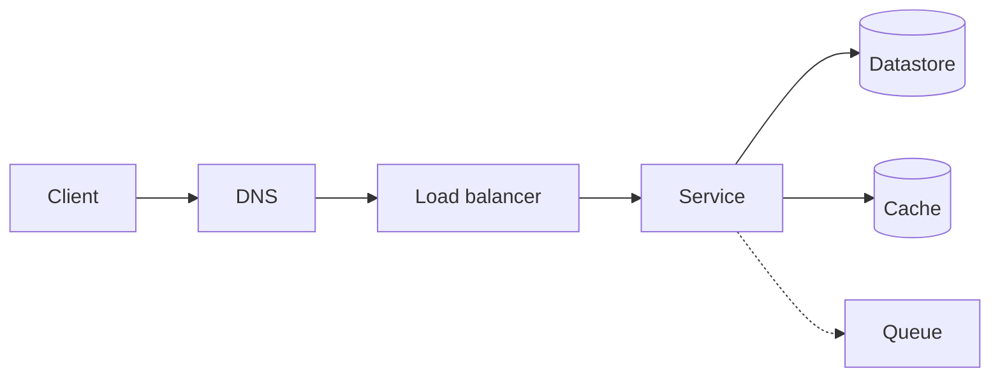

*A system is a request path plus the async fork, not a process. Draw this in [Excalidraw](https://excalidraw.com/) before you name [Kubernetes](https://kubernetes.io/).*


### What is System Design?

**System design** is the work of choosing components, contracts, and operational qualities so a product can meet its requirements as load, data, and failure grow. A system is not one process. It is clients, DNS, load balancing, application services, datastores, caches, asynchronous pipelines, and the telemetry that tells you the path is sick.

The job on a product team is not to "use the cloud." The job is to wrap a request path you can test, operate, and change: who calls, what the contract is, where data lives, and what happens when a box dies.

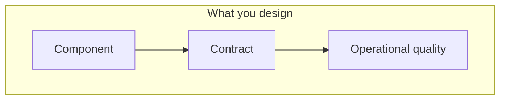

*Three words on every sketch: a box, a promise, a quality. A logo without those three is a collage.*


A few words we will keep using:

- **Component:** a box on the path with a job — a load balancer, an application service, a datastore, a cache, a queue, an edge. You will name real products for these boxes later in this chapter.
- **Contract:** the API, the schema, the delivery guarantee, the timeout. Two services talk through a contract, not through hope.
- **Operational quality:** a non-functional requirement the path must hold: scale, availability, reliability, latency, durability. Large-Scale Systems: Scalability, Availability, Reliability, and Performance is the next chapter.
- **Trade-off:** two options, a criterion, a pick. You cannot maximize every quality at once.

**What system design is not:**

- Not software design inside one service. Classes, modules, and in-process APIs matter. They are a different skill. We separate the three layers in System Design vs Software Design vs Architecture.
- Not a logo collage. Naming [Kubernetes](https://kubernetes.io/) without a request path is not a design. "Reads go through [Redis](https://redis.io/) with a 30-second TTL because the feed is read-heavy and a slightly stale post is acceptable" is a design.
- Not a coding exercise. You may sketch a tiny interface or a schema. You will not implement a service in this book. There are no [CodeSandboxes](https://codesandbox.io/). You practice by drawing, estimating, and naming real products on purpose.

System design is trade-offs under constraints. "Put [Redis](https://redis.io/) and [Apache Kafka](https://kafka.apache.org/) everywhere" is not a design. The rest of this book trains the sentence that picks.

### What Problem System Design Solves

Without system design, a product is one process on one machine that only the happy path can describe. That works until traffic, data, or failure shows up. System design replaces that hope with a path you can scale, fail over, and operate.

**The daily problems system design is for:**

1. **Load**
   - One instance cannot take every request. A second instance needs a load balancer, a shared store, and a story for sessions.
   - System design is how you add capacity without rewriting the product: vertical first when it is cheaper, horizontal when a bigger box is not enough. Scalability is the next chapter.
2. **Data**
   - A single disk fills. A single primary cannot take every write. Blobs do not belong in a row store.
   - You choose [PostgreSQL](https://www.postgresql.org/) versus a cache versus object storage on purpose. Databases and Storage and Caching and Content Delivery Networks are those chapters.
3. **Failure**
   - Disks, processes, racks, and regions die. A dependency hangs. A deploy goes bad.
   - System design is redundancy, failover, timeouts, and the telemetry that tells you the path is sick — not a wish that hardware will be kind.
4. **Latency versus correctness**
   - Users feel tail latency. Finance and inventory feel stale writes.
   - You cannot always have both. A cache with a TTL, an asynchronous queue, a strongly consistent primary: each pick is a trade-off you can explain in a sentence.
5. **Change**
   - New features arrive. Traffic shape changes. Yesterday's bottleneck is not today's.
   - A contract you can version, a path you can split, and a quality you can measure are how you change the system without starting over.

**What you get once a path exists:**

- **A request you can trace.** Client → edge → load balancer → service → store, plus the async fork. Networking, Protocols, and Web Concepts is that path on the wire.
- **A place data lives on purpose.** Rows, blobs, caches, and logs are different jobs. Mixing them is how designs rot.
- **A failure story.** What dies, what still serves, what you postpone. Distributed Systems is why that story is surprising.
- **A way to operate it.** Logs, metrics, traces. Monitoring and Observability is the chapter.

A bigger virtual machine is not system design by itself. It is one lever. When that lever runs out, you need the rest of this book.

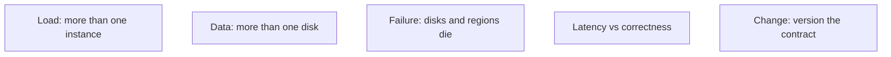

*The daily problems. If you cannot point at which one you are solving, you are decorating the sketch.*


### System Design vs Software Design vs Architecture

Three layers show up in every later chapter. Mixing them up is the most common beginner trap, so we separate them now.

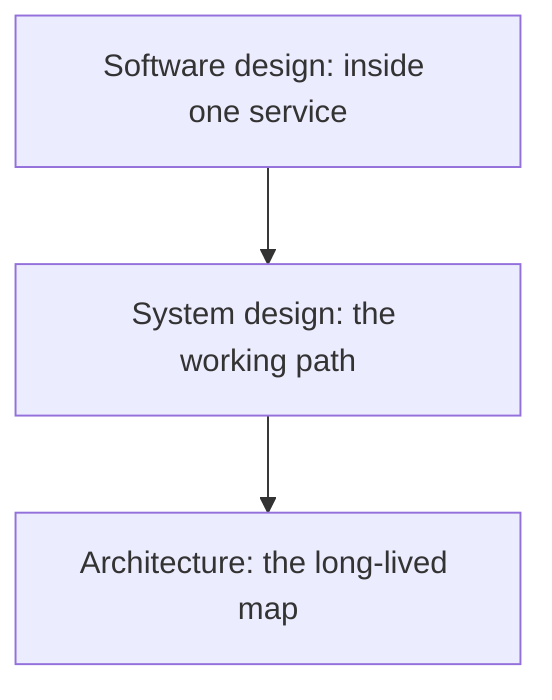

*Name the layer before you pick a box. A clean module layout does not make a feed scale. A [Kubernetes](https://kubernetes.io/) cluster does not make a schema right.*


**1. Software design — inside one service**

- Modules, types, in-process APIs, tests, and how a single codebase is structured.
- The unit is a process you could run on a laptop. Latency is function calls. Failure is an exception you catch.
- This book does not teach that layer. You still sketch a tiny interface when a contract must be obvious. API Design is the contract between services, not the class diagram inside one of them.

**2. System design — the working path between services**

- Components, contracts, and operational qualities. The unit is a request path: who calls, what is stored, what is cached, what is async, what happens when a replica dies.
- You choose products on purpose: [PostgreSQL](https://www.postgresql.org/) versus [Redis](https://redis.io/), a queue versus [Apache Kafka](https://kafka.apache.org/), [NGINX](https://nginx.org/) or a cloud load balancer as the front door.
- This book is that layer. Foundations teach the levers. Applied designs at the end (Design a URL Shortener, Design Twitter, Design Netflix) use them on a full path.

**3. Architecture — the long-lived map**

- Domains, bounded contexts, which system owns which data, which team owns which path, what you will not build this year.
- Architectural Patterns, Microservices, and Cloud-Native Architecture is where monoliths, events, and [Kubernetes](https://kubernetes.io/) live. Architecture is the map. System design is how a request walks that map today.

**Working rule:** when we say software design, we mean inside one service. When we say system design, we mean the path and its qualities. When we say architecture, we mean the long-lived map those paths sit on. A clean module layout does not make a feed scale. A [Kubernetes](https://kubernetes.io/) cluster does not make a schema right. Name the layer you are in before you pick a box.

### Qualities You Design For

Functional requirements are what the product does: shorten a URL, fan out a post, charge a card. **Non-functional requirements** are the qualities the path must hold while it does that. Specs often start from the functional list; the skill starts from both. We teach the qualities first so later designs have words for the constraint.

The qualities we will spend the next chapter on:

- **Scalability.** The path still works as load and data grow. Vertical scaling is a bigger box. Horizontal scaling is more boxes. They are not the same, and performance is not a synonym for either.
- **Availability.** The path answers when a user asks. Nines, sequence versus parallel, high availability versus fault tolerance.
- **Fault tolerance.** What happens when a component dies: single points of failure, failover, active-active versus active-passive.
- **Reliability.** The path is correct over time, not only up. Availability versus reliability; SLA, SLO, and SLI.
- **Performance.** Latency, throughput, bandwidth, tail percentiles, and the numbers worth memorizing so estimates are not fiction.
- **Disaster recovery.** RPO, RTO, backups, multi-region. A second process in one rack is not a region story.

You cannot maximize all of them. A strongly consistent multi-region write path will cost latency. A cache that hides the primary will cost freshness. Write the qualities that matter for *this* path, then pick. Capacity planning and back-of-the-envelope math is how those picks get numbers. We do that in the next chapter, not as a 45-minute ritual.

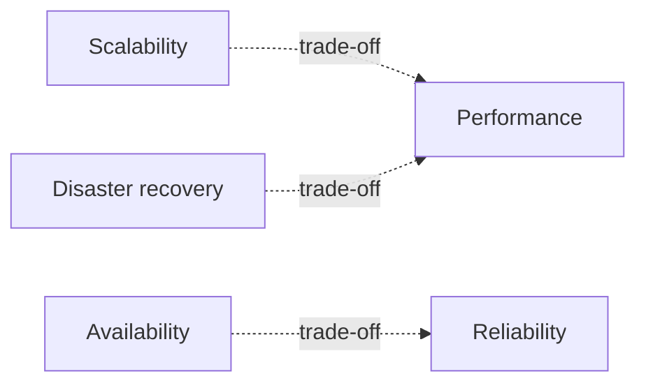

*You cannot maximize all of them. Write the qualities that matter for this path, then pick.*


### Building Blocks You Will Name

We teach these later. We link them now so "the cloud" is not a fog. Name a product when the choice matters. A box labeled "database" is fine on the first sketch; a box labeled [PostgreSQL](https://www.postgresql.org/) that you cannot explain is worse than the unlabeled box.

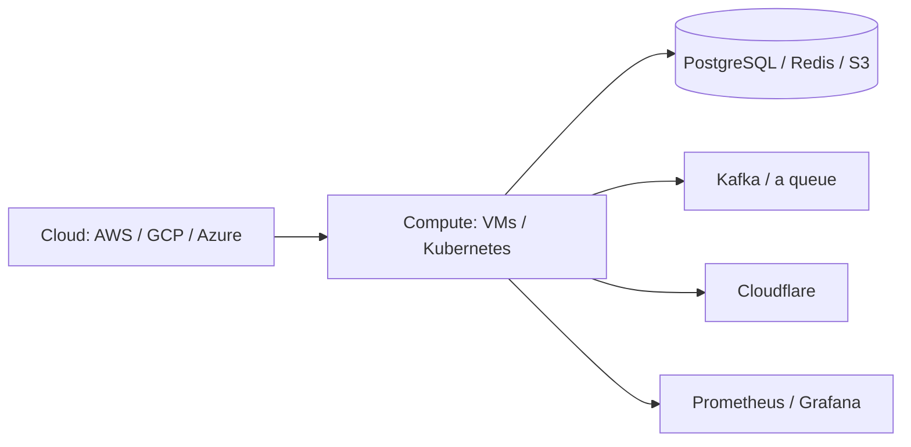

*Building blocks you will keep naming. An unlabeled "database" beats a [PostgreSQL](https://www.postgresql.org/) box you cannot explain.*


#### Cloud and Compute

**[Amazon Web Services (AWS)](https://aws.amazon.com/)**, **[Google Cloud](https://cloud.google.com/)**, and **[Microsoft Azure](https://azure.microsoft.com/)** are the three hosted platforms most teams will accept as a sketch. They sell compute, networking, stores, and managed building blocks. You do not need an account today. You do need to know they are vendors, not designs.

- **Primary function:** rent regions, instances, load balancers, and managed services so you do not rack hardware for the first path.
- **When we send you here:** when a later chapter names a managed building block (object storage, a load balancer, a managed queue) and you need a product you can point at.
- **What they are not:** not a reason to draw every product in the catalog. Reciting [AWS](https://aws.amazon.com/) names without a why is weaker than naming "blob store" and the trade-off.

**[Kubernetes](https://kubernetes.io/)** is how many teams run containers. Official site: [kubernetes.io](https://kubernetes.io/). Docs: [Kubernetes documentation](https://kubernetes.io/docs/). It is a later chapter (Cloud-Native Architecture), not a default first box. A request path that cannot be explained without a cluster is usually a path you have not designed yet.

**[NGINX](https://nginx.org/)** and **[Envoy](https://www.envoyproxy.io/)** are reverse proxies you can put in front of application servers. Cloud load balancers are the hosted equivalent. Load Balancing in Networking, Protocols, and Web Concepts is the chapter. For a first sketch, "load balancer" plus who it health-checks is enough.

#### Datastores, Caches, and Object Storage

**[PostgreSQL](https://www.postgresql.org/)** is the default relational answer in this book. Official site: [postgresql.org](https://www.postgresql.org/). Docs: [PostgreSQL documentation](https://www.postgresql.org/docs/). Use it when you need rows, transactions, and a schema you can query. SQL Databases is the later write-up.

**[Redis](https://redis.io/)** is the default cache and fast key-value answer. Official site: [redis.io](https://redis.io/). Docs: [Redis documentation](https://redis.io/docs/). Use it when reads dominate and a TTL is an acceptable lie. It is not a durable primary because you named it. Caching and Content Delivery Networks is the chapter.

**Object storage** is where blobs and media go. Products: [Amazon S3](https://aws.amazon.com/s3/), [Google Cloud Storage](https://cloud.google.com/storage), [Azure Blob Storage](https://azure.microsoft.com/products/storage/blobs). Metadata stays in a row store. The blob stays in object storage. Mixing those jobs is how photo and video paths explode a database.

Databases and Storage unpacks SQL versus NoSQL, replication, and sharding. This section only names the defaults so later sentences have somewhere to point.

#### Async Paths, Edge, and Observability

**[Apache Kafka](https://kafka.apache.org/)** is the log/stream name you will keep seeing. Official site: [kafka.apache.org](https://kafka.apache.org/). Docs: [Apache Kafka documentation](https://kafka.apache.org/documentation/). A simpler message queue is often the right first async box. Jumping to a log because the name is famous is the same mistake as putting [Redis](https://redis.io/) on every arrow. Message Queues, Streams, and Real-Time Communication is the chapter.

**[Cloudflare](https://www.cloudflare.com/)** is a CDN and edge product you can point at. Official site: [cloudflare.com](https://www.cloudflare.com/). Docs: [Cloudflare Docs](https://developers.cloudflare.com/). A CDN is not a cache for personalized, write-heavy data. What a CDN Does Not Solve lives under Caching and Content Delivery Networks.

**Observability** is how you prove the path is operable. **[Prometheus](https://prometheus.io/)** and **[Grafana](https://grafana.com/)** are the default open metrics-and-dashboard pair. **[Datadog](https://www.datadoghq.com/)** is a hosted equivalent. **[OpenTelemetry](https://opentelemetry.io/)** is how traces and metrics get a vendor-neutral shape. Monitoring and Observability is the chapter. A design with no "how would you know this is sick?" is unfinished.

### How We Practice

This book is tools-heavy and has no code snippets, so it has no [CodeSandboxes](https://codesandbox.io/). You practice by drawing the path, estimating the numbers that change the design, and naming products only when the choice matters. This section is a map, not a lab. You do not need a cloud account to finish this chapter.

**What you need for the main path:**

- A web browser.
- A canvas: [Excalidraw](https://excalidraw.com/) by default, [diagrams.net](https://www.diagrams.net/) for notes.
- No paid cloud plan. No [Kubernetes](https://kubernetes.io/) cluster. No local database to install.

**The canvases we will keep naming:**

#### [Excalidraw](https://excalidraw.com/) as the Default Canvas

**[Excalidraw](https://excalidraw.com/)**

- **Primary function:** a fast infinite canvas. Boxes, arrows, and handwriting without a stencil library getting in the way.
- **When we send you here:** after a foundations chapter, redraw the core picture from memory (request path, replication, cache placement). After an applied design, draw the whole path before you peek.
- **How you open it:** [excalidraw.com](https://excalidraw.com/). Developer docs: [Excalidraw documentation](https://docs.excalidraw.com/). Source: [excalidraw/excalidraw](https://github.com/excalidraw/excalidraw).
- **What it is not:** not an [AWS](https://aws.amazon.com/) / [Google Cloud](https://cloud.google.com/) / [Azure](https://azure.microsoft.com/) shape kit. For those libraries, use [diagrams.net](https://www.diagrams.net/).

#### [diagrams.net](https://www.diagrams.net/) and Cloud Icon Sets

**[diagrams.net](https://www.diagrams.net/)** (also called [draw.io](https://www.drawio.com/))

- **Primary function:** structured diagrams with official cloud shape libraries.
- **When we send you here:** study notes, take-home diagrams, and when you want [AWS Architecture Icons](https://aws.amazon.com/architecture/icons/), [Google Cloud icons](https://cloud.google.com/icons), or [Azure architecture icons](https://learn.microsoft.com/azure/architecture/icons/) on the page.
- **How you open it:** [app.diagrams.net](https://app.diagrams.net/). Product: [diagrams.net](https://www.diagrams.net/).
- **What it is not:** not the fastest first sketch. Prefer [Excalidraw](https://excalidraw.com/) unless you already need stencils.

Use the icon sets in [diagrams.net](https://www.diagrams.net/) when you write notes. Do not pause a working sketch to hunt a perfect [Amazon S3](https://aws.amazon.com/s3/) stencil. Pretty diagrams are not the skill. A readable path is.

#### [Miro](https://miro.com/), [FigJam](https://www.figma.com/figjam/), and Other Whiteboards You May Be Handed

**[Miro](https://miro.com/)** and **[FigJam](https://www.figma.com/figjam/)** (from [Figma](https://www.figma.com/)) are company whiteboards. **[CoderPad](https://coderpad.io/)** is often a coding pad with a drawing mode. **[Google Drawings](https://docs.google.com/drawings)** shows up when the loop is a shared doc. A physical whiteboard is still a canvas.

- **Primary function:** collaborative boards other people already opened.
- **When we send you here:** when your team, your recruiter, or a later optional interview chapter named the tool. Do not make them the study default.
- **How you open them:** [miro.com](https://miro.com/), [FigJam](https://www.figma.com/figjam/), [coderpad.io](https://coderpad.io/), [Google Drawings](https://docs.google.com/drawings).
- **What they are not:** not required for this book. The skill does not change with the canvas. Freezing because the tool is new is a communication problem, not a system design problem.

**Working loop we will repeat:**

1. Read the chapter (this README is the lesson).
2. Redraw the picture in [Excalidraw](https://excalidraw.com/) (or [diagrams.net](https://www.diagrams.net/) for notes).
3. Name real products only when the choice matters: [Redis](https://redis.io/) versus [PostgreSQL](https://www.postgresql.org/), [Apache Kafka](https://kafka.apache.org/) versus a simpler queue, [Cloudflare](https://www.cloudflare.com/) as an edge, [Prometheus](https://prometheus.io/) plus [Grafana](https://grafana.com/) or [Datadog](https://www.datadoghq.com/) as telemetry.
4. Change one constraint (load, data size, a region dying) and redraw. That is the skill. Timed 45-minute practice waits until the optional interview add-on.

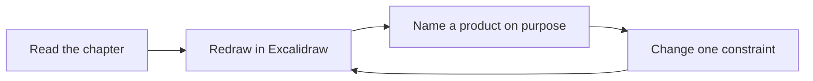

*The working loop. The canvas is [Excalidraw](https://excalidraw.com/); [diagrams.net](https://www.diagrams.net/) is for notes.*


### How this book is organized

Every later chapter is a working loop: read the lever, draw it, name a product on purpose. We stay tools-heavy. There are no [CodeSandboxes](https://codesandbox.io/) in this book. Chapter names in the Table of Contents are the contract; when we say Large-Scale Systems: Scalability, Availability, Reliability, and Performance, that is the next heading you will meet.

- **Foundations.** Qualities, networking, APIs, databases, caches, queues, patterns, distributed systems, algorithms, security, observability, payments, and AI systems. This is the skill.
- **System Design Interviews (Optional)** and **The Interview Working Loop.** Skip these if you are here to design systems at work. Read them if you also need a 45-minute conversation on a shared canvas.
- **Applied designs.** Classic Warm-Up Problems through Infrastructure and Platform Problems: Design a URL Shortener, Design Twitter, Design Netflix, Design a Key-Value Store, and the rest. They apply the foundations. They are not a substitute for the foundations.
- **Common Challenges and Debugging Tips** and **Additional Resources and Reading Materials.** Debug order, a 30-day practice plan, and the catalog.

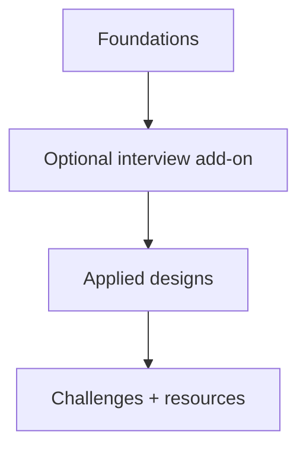

*Foundations first. Interviews are optional. Applied designs at the end are not a substitute for the levers.*


We will not invent company case studies. Each chapter ends with `Summary: {that chapter's title}` and points to the next heading. There is no `Conclusion` heading.

Do not collect twenty cloud accounts today. Collect a canvas ([Excalidraw](https://excalidraw.com/)), then draw.

Your loop for the rest of today: finish this chapter, then in Large-Scale Systems: Scalability, Availability, Reliability, and Performance learn the qualities every later path is judged by.

### Summary: Introduction to System Design

System design is choosing components, contracts, and operational qualities so a path still works as load, data, and failure grow — not software design inside one service, not an architecture map, and not a cloud-logo collage. The problems it solves are load, data, failure, latency versus correctness, and change. The building blocks you will keep naming are products such as [Amazon Web Services (AWS)](https://aws.amazon.com/), [Google Cloud](https://cloud.google.com/), [Microsoft Azure](https://azure.microsoft.com/), [PostgreSQL](https://www.postgresql.org/), [Redis](https://redis.io/), [Apache Kafka](https://kafka.apache.org/), and [Cloudflare](https://www.cloudflare.com/). Practice on [Excalidraw](https://excalidraw.com/), keep [diagrams.net](https://www.diagrams.net/) for notes, and treat [Miro](https://miro.com/), [FigJam](https://www.figma.com/figjam/), and [CoderPad](https://coderpad.io/) as tools you may be handed. This book is foundations first, then an optional interview add-on, then applied designs. Next is **Large-Scale Systems: Scalability, Availability, Reliability, and Performance**.

## Large-Scale Systems: Scalability, Availability, Reliability, and Performance

Introduction to System Design named the qualities every later path is judged by. This chapter is those qualities, with numbers attached: what "large-scale" actually means, how you grow a path, how you keep it answering, how you keep it correct, how you make it fast enough, what you do when a region dies, and how back-of-the-envelope math keeps the sketch honest. We stay tools-heavy. There are no [CodeSandboxes](https://codesandbox.io/). You practice by drawing the path in [Excalidraw](https://excalidraw.com/) and naming products only when the choice matters. The next chapter is Networking, Protocols, and Web Concepts — the request path on the wire.

You cannot maximize every quality at once. Write the ones that matter for *this* path, then pick.

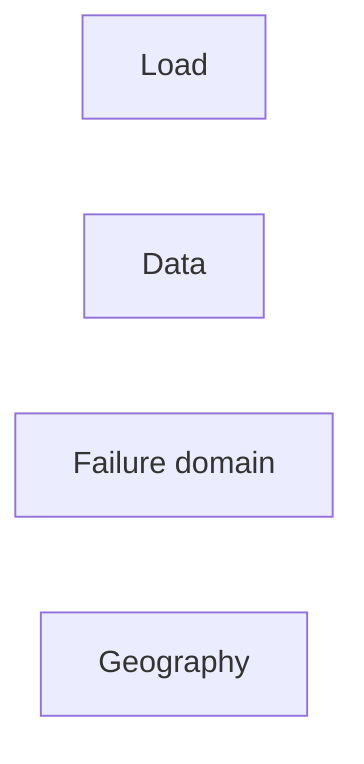

*Large-scale starts when one box, one disk, or one failure domain is no longer the whole story. Name the axis.*


### What Large-Scale Means

**Large-scale** is not a slogan and not a user-count trophy. A path is large-scale when **one box, one disk, or one failure domain is no longer a complete story**. The questions change: how does load grow, where does data live, what dies together, and how far away is the user.

**The four axes you actually mean:**

1. **Load.** Requests per second, concurrent sessions, peak versus average. One instance of an application, one [Amazon EC2](https://aws.amazon.com/ec2/) size, or one [Google Compute Engine](https://cloud.google.com/compute) machine type stops being enough.
2. **Data.** Rows, blobs, logs, and indexes. A single disk fills. A single [PostgreSQL](https://www.postgresql.org/) primary cannot take every write. Blobs belong in object storage ([Amazon S3](https://aws.amazon.com/s3/), [Google Cloud Storage](https://cloud.google.com/storage), [Azure Blob Storage](https://azure.microsoft.com/products/storage/blobs)), not in a row.
3. **Failure domain.** What dies together: a process, a host, a rack, an availability zone, a region. [AWS Regions and Availability Zones](https://aws.amazon.com/about-aws/global-infrastructure/regions_az/), [Google Cloud locations](https://cloud.google.com/about/locations), and [Azure geographies](https://azure.microsoft.com/explore/global-infrastructure/geographies/) are the maps vendors publish. Two processes on one host are not two failure domains.
4. **Geography.** Users in more than one place. Light is fast and still slow across an ocean. A [Cloudflare](https://www.cloudflare.com/) edge or a [Amazon CloudFront](https://aws.amazon.com/cloudfront/) cache is a geography story, not a "we used a CDN" sticker.

**What large-scale is not:**

- Not "we will have a million users." Say the QPS, the data size, and the region story, or you have not scoped the path.
- Not a reason to draw [Kubernetes](https://kubernetes.io/) on slide one. Orchestration is a later chapter. Scale is a quality of the path.
- Not a reason to skip the single-box design. Vertical scaling is often the right first lever. We teach it before horizontal scaling on purpose.

**Working rule:** large-scale starts when you can name what a bigger box cannot fix. Until then, say the numbers and stay honest.

### Scalability

**Scalability** is whether the path still meets its other qualities as load and data grow. You add resources. You do not rewrite the product every time traffic doubles.

Two levers exist. They are not synonyms, and they are not equally cheap.

- **Vertical scaling** — a bigger box: more CPU, RAM, disk, IOPS.
- **Horizontal scaling** — more boxes: replicas behind a load balancer, shards, partitions.

Vendors sell both. [Amazon EC2](https://aws.amazon.com/ec2/) instance families, [Google Compute Engine](https://cloud.google.com/compute) machine types, and [Azure Virtual Machines](https://azure.microsoft.com/products/virtual-machines) are the vertical catalog. [AWS Auto Scaling](https://aws.amazon.com/autoscaling/), [Kubernetes Horizontal Pod Autoscaler](https://kubernetes.io/docs/tasks/run-application/horizontal-pod-autoscale/), and a load balancer ([AWS Elastic Load Balancing](https://aws.amazon.com/elasticloadbalancing/), [Google Cloud Load Balancing](https://cloud.google.com/load-balancing), [Azure Load Balancer](https://azure.microsoft.com/products/load-balancer), [NGINX](https://nginx.org/), [HAProxy](https://www.haproxy.org/), [Envoy](https://www.envoyproxy.io/)) are the horizontal catalog.

**Working rule:** say which lever you are pulling, why the other one is worse *here*, and what state the new box shares.

#### Vertical Scaling

**Vertical scaling** (scale up) means you give the same component more hardware. One [PostgreSQL](https://www.postgresql.org/) primary on a larger [Amazon RDS](https://aws.amazon.com/rds/) instance. One API process with more RAM. One disk with more IOPS.

**[Amazon EC2](https://aws.amazon.com/ec2/)**, **[Google Compute Engine](https://cloud.google.com/compute)**, and **[Azure Virtual Machines](https://azure.microsoft.com/products/virtual-machines)**

- **Primary function:** rent a machine whose size you can change. CPU, memory, network, and (on some families) local disk come in a menu.
- **When we send you here:** the path is one stateful box, the bottleneck is that box, and a larger size is cheaper than splitting state.
- **What they are not:** not infinite. Every family has a largest size. Licensing, RAM, and IOPS ceilings are real. A bigger primary is still one failure domain.

**Why vertical is the default first move:**

1. **The application does not change.** No load balancer, no shared session store, no shard key.
2. **Operations stay simple.** One primary to backup, one box to watch in [Amazon CloudWatch](https://aws.amazon.com/cloudwatch/), [Google Cloud Monitoring](https://cloud.google.com/monitoring), or [Azure Monitor](https://azure.microsoft.com/products/monitor).
3. **It is often cheaper at small scale.** Two small instances plus a load balancer plus a shared [Redis](https://redis.io/) can cost more than one medium instance, and fail in more ways.

**The ceilings you will hit:**

- A largest instance type. After that, money does not buy another core on that box.
- A single-writer datastore. [PostgreSQL](https://www.postgresql.org/) on one primary still serializes writes that touch the same rows, no matter how large the VM.
- Blast radius. The bigger the box, the more of the product dies with it.
- Deploy and reboot time. Vertical changes often mean a restart. Horizontal adds a replica beside a live one.

**Working rule:** scale up until the next size is more expensive, slower to change, or still a single point of failure you cannot accept. Then scale out.

#### Horizontal Scaling

**Horizontal scaling** (scale out) means you add instances of the same role and split work across them. Stateless API replicas behind a load balancer. Read replicas. Shards. Partitions of a log.

This only works if the new box can do useful work without owning all the state.

**What has to be true:**

1. **A front door that spreads traffic.** [AWS Elastic Load Balancing](https://aws.amazon.com/elasticloadbalancing/), [Google Cloud Load Balancing](https://cloud.google.com/load-balancing), [Azure Load Balancer](https://azure.microsoft.com/products/load-balancer), or software such as [NGINX](https://nginx.org/), [HAProxy](https://www.haproxy.org/), and [Envoy](https://www.envoyproxy.io/). Networking, Protocols, and Web Concepts is the load-balancing chapter. For this quality, you only need: health checks, and a story for what happens when an instance disappears.
2. **State that is shared or partitioned on purpose.** Sessions in [Redis](https://redis.io/) (or [Amazon ElastiCache](https://aws.amazon.com/elasticache/)), rows in a shared [PostgreSQL](https://www.postgresql.org/) (or [Amazon RDS](https://aws.amazon.com/rds/)), blobs in [Amazon S3](https://aws.amazon.com/s3/). Sticky sessions on the load balancer are a patch, not a design.

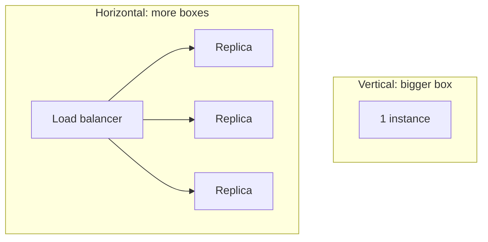

*Vertical is a larger size. Horizontal is a front door plus shared or partitioned state. Say which lever you are pulling.*

3. **A way to add and remove boxes without a meeting.** [AWS Auto Scaling](https://aws.amazon.com/autoscaling/) for VMs and target groups. [Kubernetes Horizontal Pod Autoscaler](https://kubernetes.io/docs/tasks/run-application/horizontal-pod-autoscale/) when you are already on [Kubernetes](https://kubernetes.io/). Autoscaling that cannot see a meaningful metric is a fan.

**[AWS Auto Scaling](https://aws.amazon.com/autoscaling/)**

- **Primary function:** add or remove instances from a group from a metric (CPU, request count, a custom metric in [Amazon CloudWatch](https://aws.amazon.com/cloudwatch/)).
- **When we send you here:** VM-shaped compute on [AWS](https://aws.amazon.com/), a load balancer in front, and a metric that actually tracks work.
- **What it is not:** not a substitute for a shard key. It will not split a single-writer primary for you.

**[Kubernetes Horizontal Pod Autoscaler](https://kubernetes.io/docs/tasks/run-application/horizontal-pod-autoscale/)**

- **Primary function:** change the replica count of a workload from CPU, memory, or custom metrics.
- **When we send you here:** the path is already containers on [Kubernetes](https://kubernetes.io/). Docs: [Kubernetes documentation](https://kubernetes.io/docs/).
- **What it is not:** not a reason to introduce [Kubernetes](https://kubernetes.io/) so you can scale. A managed load balancer plus [AWS Auto Scaling](https://aws.amazon.com/autoscaling/) is a complete horizontal story.

**What horizontal does not fix:**

- A hot key. Ten replicas still serialize on one popular row or one [Redis](https://redis.io/) slot.
- A chatty database. More app boxes can make the datastore worse.
- A stateful process that stores uploads on local disk. The next replica does not have the file.

**Working rule:** scale out the *stateless* hop first. Partition the *stateful* hop only when one box cannot hold the writes or the data. Databases and Storage is that later split.

#### Performance vs Scalability

**Performance** is how a path behaves at a given load: latency, throughput, resource cost per request. **Scalability** is whether those numbers stay acceptable when load and data grow. A fast system can be unscalable. A scalable system can be slow.

**The mix-up you will hear:**

- "It is slow, so we need to scale." Maybe. First ask whether the current box is idle. An N+1 query, a missing index, a lock, or a remote call in a loop is a performance bug. Adding replicas copies the bug.
- "It is fast, so it will scale." A single in-memory [Redis](https://redis.io/) on one host can be extremely fast and still be one disk, one NIC, and one failure domain.
- "We put it on [Kubernetes](https://kubernetes.io/), so it scales." Orchestration does not invent a shard key or a cache TTL.

**How you tell them apart on a sketch:**

1. Hold load constant. Can you make one request faster? That is performance: indexes, a [Redis](https://redis.io/) TTL, a [Cloudflare](https://www.cloudflare.com/) cache, a smaller payload, fewer hops.
2. Hold the code constant. Can you add resources and take more work? That is scalability: a bigger [Amazon RDS](https://aws.amazon.com/rds/) size, more API replicas behind [AWS Elastic Load Balancing](https://aws.amazon.com/elasticloadbalancing/), a second shard.

You usually need both. Tune the request you have. Then pick the lever that grows capacity. Performance later in this chapter is the vocabulary (latency, throughput, tails, numbers). Scalability is the growth story.

**Working rule:** fast ≠ scalable. Say which one you are fixing before you add a box.

### Availability

**Availability** is whether the path answers when a client asks. The usual forms:

- **Time-based:** uptime / (uptime + downtime). Simple for a single box.
- **Yield-based:** successful requests / valid requests. The form [Site Reliability Engineering](https://sre.google/sre-book/table-of-contents/) prefers for multi-replica services that are never fully "down" everywhere. Canonical write-up: [Embracing Risk](https://sre.google/sre-book/embracing-risk/).

A 200 that took 30 seconds may still count as available if your SLI is "HTTP not 5xx." It is not a performance win. Write the definition before you quote a percentage.

Vendors publish **service level agreements** for their building blocks ([AWS Service Level Agreements](https://aws.amazon.com/legal/service-level-agreements/), [Google Cloud SLAs](https://cloud.google.com/terms/sla), [Azure SLAs](https://www.microsoft.com/licensing/docs/view/Service-Level-Agreements-SLA-for-Online-Services)). Those are *their* promises about *their* products, not your product's availability. Your number is composed from every hop you added.

#### The Nines of Availability

People say "three nines" instead of 99.9%. Each extra nine is roughly **ten times less** allowed unavailability, not a rounding error. The [Google SRE availability table](https://sre.google/sre-book/availability-table/) is the sheet everyone else is quoting.

| Availability | Name | Allowed unavailability per year |
| --- | --- | --- |
| 90% | one nine | 36.5 days |
| 99% | two nines | 3.65 days |
| 99.9% | three nines | 8.76 hours |
| 99.95% | three and a half nines | 4.38 hours |
| 99.99% | four nines | 52.6 minutes |
| 99.999% | five nines | 5.26 minutes |

*Allowed unavailability in a year from the [Google SRE availability table](https://sre.google/sre-book/availability-table/), assuming no planned downtime.*

**How to use the table:**

- **99% (two nines)** is a weekend of downtime a year. Fine for an internal tool. Not fine for a checkout path.
- **99.9% (three nines)** is a working day of downtime a year. A common first SLO for a user-facing path that is not money movement.
- **99.99% (four nines)** is under an hour a year. Deploys, failovers, and paging have to be measured in minutes. [Embracing Risk](https://sre.google/sre-book/embracing-risk/) is explicit: 100% is not a target.
- **99.999% (five nines)** is a coffee break a year. You do not get there by adding one more replica in the same zone.

**Error budget.** If the SLO is 99.9%, the budget is the 0.1% you are allowed to spend on deploys, incidents, and experiments. [Service Level Objectives](https://sre.google/sre-book/service-level-objectives/) in the [Google SRE book](https://sre.google/sre-book/table-of-contents/) is the definition. Spend it on purpose. Hide it and you will spend it on accidents.

**Working rule:** pick nines from the user and the cost, not from a slide that says "highly available." Each extra nine is an architecture change, not a nicer dashboard.

#### Availability in Sequence vs Parallel

Hops **in sequence** multiply. Replicas **in parallel** recover what multiplication lost.

**Sequence (the request walks A, then B, then C):**

If each hop is independently available with probability `A`, `B`, `C`, the path is available with `A × B × C`. Three hops at 99.9% are about **99.7%** together, not 99.9%. Every extra synchronous dependency is a haircut. Timeouts, retries, and caches exist because of this arithmetic, not because they look like "production."

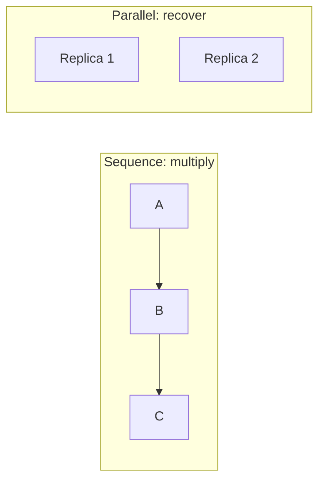

*Sequence costs nines. Independent replicas buy nines. Shared fate is still sequence, even if you drew two boxes.*


**Parallel (the request can use replica 1 *or* replica 2):**

If each replica fails independently with probability `F`, two replicas fail together with `F × F`. Two hops at 99% in parallel are about **99.99%**, if failover actually works and they do not share a failure domain. Two processes on one host share a host. Two instances in one availability zone share a zone.

**What "independent" actually requires:**

- Separate hosts, preferably separate [AWS Availability Zones](https://aws.amazon.com/about-aws/global-infrastructure/regions_az/) (or the [Google Cloud](https://cloud.google.com/about/locations) / [Azure](https://azure.microsoft.com/explore/global-infrastructure/geographies/) equivalent).
- Separate connection pools, disks, and deploy waves. A lockstep deploy of both replicas is one failure.
- A load balancer that **health-checks** and stops sending to the dead one. [AWS Elastic Load Balancing](https://aws.amazon.com/elasticloadbalancing/) target health, [Kubernetes](https://kubernetes.io/) [liveness and readiness probes](https://kubernetes.io/docs/tasks/configure-pod-container/configure-liveness-readiness-startup-probes/), and [Amazon Route 53](https://aws.amazon.com/route53/) health checks are that switch. A replica that is up in the config and dead in reality is still sequence math.

**Working rule:** count synchronous hops (they cost nines). Count independent replicas (they buy nines). Shared fate is still sequence, even if you drew two boxes.

#### High Availability vs Fault Tolerance

These phrases get used as synonyms. They are not.

**High availability (HA)** is a *target and a posture*: the path keeps answering through the failures you planned for, usually by hiding them behind redundancy and failover. An [Amazon RDS Multi-AZ](https://aws.amazon.com/rds/features/multi-az/) deployment, two API replicas in two zones, a load balancer with health checks — that is HA work. The user may not notice the failover. The system did fail; you masked it.

**Fault tolerance (FT)** is a *property of the design*: the path continues to provide *correct* service while a component is actually broken, not only after you have replaced it. Replicated writes with a quorum, a retry that cannot double-charge, a replica that was already serving. Fault Tolerance is the next heading; we separate the words here so you do not write "HA/FT" and sit down.

**Practical differences on a sketch:**

- HA often accepts a brief interruption (DNS failover, a 30-second [Amazon RDS](https://aws.amazon.com/rds/) failover, a crashed pod while [Kubernetes](https://kubernetes.io/) starts another). The SLO still holds if the budget allows it.
- FT means a client that retried, or a replica that was already in the set, still got a correct answer *during* the fault. That is harder. It is also how you spend money: extra replicas, extra regions, extra coordination.
- An HA pair that shares a disk is not fault tolerant to that disk. An FT replica set that returns stale data may still be "up." Availability versus reliability is coming.

Vendor checklists ([AWS Well-Architected Reliability Pillar](https://docs.aws.amazon.com/wellarchitected/latest/reliability-pillar/welcome.html), [Google Cloud Architecture Framework](https://cloud.google.com/architecture/framework), [Azure Well-Architected Framework](https://learn.microsoft.com/azure/well-architected/)) mix these words. You will not. On the sketch, write **what dies**, **what still serves**, and **whether the answer is still correct**.

**Working rule:** HA is "users still get an answer." Fault tolerance is "the answer is still right while something is broken." Buy them separately.

### Fault Tolerance

**Fault tolerance** is the story you tell when a component dies, hangs, or lies. Disks fail. Processes OOM. Zones flood. Dependencies time out. A design with no death story is a hope.

The loop is always the same:

1. Name the component and its failure domain.
2. Say what the client sees (error, retry, stale data, a queue).
3. Say what brings the path back (a replica, a failover, a human).

You will measure whether that story is true with [Prometheus](https://prometheus.io/) and [Grafana](https://grafana.com/), [Datadog](https://www.datadoghq.com/), [Amazon CloudWatch](https://aws.amazon.com/cloudwatch/), or [OpenTelemetry](https://opentelemetry.io/) traces. Monitoring and Observability is the chapter. A failover you cannot see in telemetry did not happen; you got lucky.

#### Single Points of Failure

A **single point of failure (SPOF)** is a component whose death takes the path with it. One [PostgreSQL](https://www.postgresql.org/) primary with no replica. One [Redis](https://redis.io/) without a replica or a cache-miss fallback. One availability zone. One [Amazon S3](https://aws.amazon.com/s3/) bucket in one region if that region *is* the product. One operator's laptop with the only credentials.

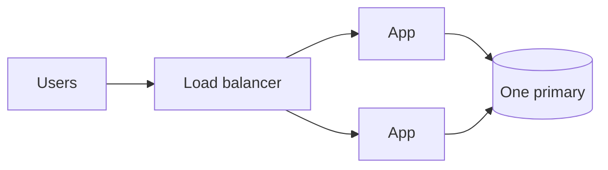

*Two app boxes do not remove a SPOF if they share one primary. Put a finger on every box and kill it.*


**How you hunt them on a sketch:**

- Put a finger on every box and every arrow. Kill it. If the user-facing request has nowhere to go, you found one.
- Shared fate counts. Two app boxes in one zone are one zone SPOF. A primary and a replica on one host are one host SPOF.
- Control planes count. A single load balancer instance, a single [Amazon Route 53](https://aws.amazon.com/route53/) record with no failover policy, a single CI that cannot roll back.
- People count. A runbook that lives in one head is a SPOF. This book will not pretend otherwise.

**What you do with one:**

1. **Remove it** — a replica, a second zone, a queue so a worker death does not drop the write.
2. **Shrink the blast radius** — timeouts, bulkheads (later, Architectural Patterns), so one dependency cannot stall every request.
3. **Name it on purpose.** A single-writer primary is often an accepted SPOF for writes, with a replica for reads and a failover plan. Pretending it is not there is worse than writing "writes die with the primary for 60 seconds."

Managed products hide some SPOFs and create others. [Amazon RDS Multi-AZ](https://aws.amazon.com/rds/features/multi-az/) removes the single-AZ disk as a write SPOF and leaves you a failover window. [Amazon S3](https://aws.amazon.com/s3/) is multi-AZ inside a region; it is not multi-region unless you turn on [S3 Replication](https://aws.amazon.com/s3/features/replication/). Read the failure domain the vendor actually sells.

**Working rule:** every box gets a kill test. The ones you keep as SPOFs get a sentence: what dies, how long, what the client sees.

#### Failover and Redundancy

**Redundancy** is extra capacity that can do the same job. **Failover** is the act of using it when the primary cannot.

Redundancy without failover is a spare in a warehouse. Failover without health checks is a coin flip.

**The pieces that have to exist:**

1. **A replica that is actually ready.** [Amazon RDS Multi-AZ](https://aws.amazon.com/rds/features/multi-az/) keeps a standby in another zone and fails over on host or AZ loss. [Redis](https://redis.io/) replication plus [Redis Sentinel](https://redis.io/docs/latest/operate/oss_and_stack/management/sentinel/) or [Amazon ElastiCache](https://aws.amazon.com/elasticache/) Multi-AZ is the cache analog. A replica that is 4 hours behind is not a failover target for a 30-second RTO.
2. **A detector.** Load balancer health checks, [Kubernetes](https://kubernetes.io/) [readiness probes](https://kubernetes.io/docs/tasks/configure-pod-container/configure-liveness-readiness-startup-probes/), [Amazon Route 53](https://aws.amazon.com/route53/) health checks, a metric alert in [Amazon CloudWatch](https://aws.amazon.com/cloudwatch/) or [Datadog](https://www.datadoghq.com/). If you cannot tell it is dead, you cannot fail over.
3. **A mover.** DNS failover ([Amazon Route 53](https://aws.amazon.com/route53/), [Google Cloud DNS](https://cloud.google.com/dns), [Azure Traffic Manager](https://azure.microsoft.com/products/traffic-manager), [Cloudflare](https://www.cloudflare.com/)), a load balancer that pulls a target, a [Kubernetes](https://kubernetes.io/) pod replacement, an [Amazon RDS](https://aws.amazon.com/rds/) Multi-AZ promotion. DNS TTLs are part of the failover time. Lie about that and your RTO is fiction.
4. **A client that survives the move.** Retries with backoff, idempotent writes (API Design later), a timeout shorter than the user's patience. Infinite retries against a dead dependency are how you turn one fault into a cascade.

**[Amazon RDS Multi-AZ](https://aws.amazon.com/rds/features/multi-az/)**

- **Primary function:** a synchronous standby in another availability zone and automatic failover for the primary endpoint.
- **When we send you here:** [PostgreSQL](https://www.postgresql.org/) or another engine on [Amazon RDS](https://aws.amazon.com/rds/), and you will not run your own replica promotion on the first path.
- **What it is not:** not multi-region. Not a zero-downtime promise. Failover is typically tens of seconds, and in-flight transactions break.

Practice failover. Restore a backup. Kill a replica in a test account. [AWS Fault Injection Service](https://aws.amazon.com/fis/) exists so you do not wait for a real zone to do the teaching. A runbook you never ran is a story.

**Working rule:** redundancy is a box. Failover is a tested path: detect, move, survive.

#### Active-Active vs Active-Passive

Two ways to spend the extra box.

**Active-passive (active-standby):** one side takes traffic. The other is ready (or almost ready) and takes over on failover. [Amazon RDS Multi-AZ](https://aws.amazon.com/rds/features/multi-az/) is this shape. A hot standby that already has the data is faster than a cold spare you boot from a snapshot. You pay for the standby the whole time. You get a simpler consistency story: one writer.

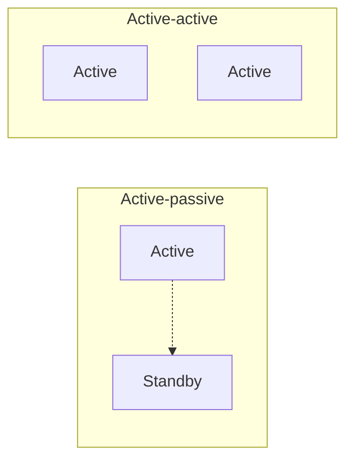

*Stateless hops want active-active. Stateful hops start active-passive with a tested failover.*


**Active-active:** both (or all) sides take traffic at once. API replicas behind [AWS Elastic Load Balancing](https://aws.amazon.com/elasticloadbalancing/) are the easy version — stateless workers, shared datastore. Multi-region active-active is the hard version: writes in more than one place, conflict, replication lag. [Amazon DynamoDB](https://aws.amazon.com/dynamodb/) [global tables](https://aws.amazon.com/dynamodb/global-tables/) and multi-primary [PostgreSQL](https://www.postgresql.org/) topologies exist. They are not the default. Distributed Systems is where conflict and quorum live.

**How you pick:**

| Shape | You buy | You pay |
| --- | --- | --- |
| Cold passive | Cheap spare | Long RTO; restore from backup |
| Hot passive | Fast failover, one writer | Idle capacity; failover still a blip |
| Active-active (same region) | Capacity and nines on the stateless hop | Shared state must already scale |
| Active-active (multi-region) | Regional survival, lower read latency | Conflict, lag, and a much harder data model |

**Working rule:** stateless hops want active-active. Stateful hops start active-passive with a tested failover. Multi-region active-active is a data-model decision, not a load-balancer checkbox.

### Reliability

**Reliability** is whether the path is *correct over time*, not only reachable. A checkout that is up and charges twice is available and not reliable. A store that is up and returns yesterday's inventory may still meet an availability SLI.

[Site Reliability Engineering](https://sre.google/sre-book/table-of-contents/) treats reliability as the quality you engineer with error budgets, SLIs, and the operational loop. You will not get it from a logo. You get it from a definition you can measure in [Prometheus](https://prometheus.io/), [Datadog](https://www.datadoghq.com/), or [Amazon CloudWatch](https://aws.amazon.com/cloudwatch/).

#### Availability vs Reliability

Keep the words apart on the sketch.

- **Availability:** did the path answer? (time up, or fraction of valid requests that got a non-error)
- **Reliability:** was the answer right, complete, and on the contract you promised? (correct writes, durable reads, no silent drops)

**Examples you will actually meet:**

- A load balancer that returns 200 from a stale cache while the primary is down: available, possibly acceptable, not the same as "the write succeeded."
- A queue that accepts a message and then drops it: the client got 202, the work never happened.
- A replica that is easy to reach and 15 minutes behind: available reads, wrong reads if the client needed the write they just did.
- Five nines of uptime with weekly data corruption is not a reliable store.

Durability (the bit did not disappear) sits next to reliability for stores. [Amazon S3](https://aws.amazon.com/s3/) quotes eleven nines of durability inside a region — that is "the object is still there," not "GET always works." Availability and durability are different contracts. Do not paste the durability number onto an availability SLO.

**Working rule:** up ≠ correct. Write both. Measure both.

#### SLA, SLO, and SLI

Three documents, three audiences. Mixing them is how you promise nines you cannot measure.

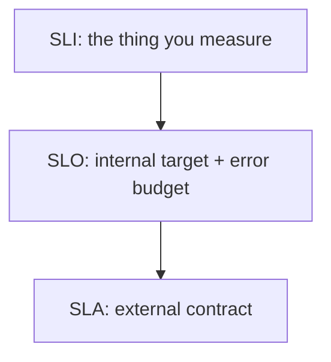

*SLI = measure. SLO = internal target. SLA = customer or vendor contract. A vendor SLA is not your SLO.*


**SLI — Service Level Indicator.** The *thing you measure*. Ratio of successful probes, p99 latency, freshness of a replica, fraction of captured payments that later reconcile. [Service Level Objectives](https://sre.google/sre-book/service-level-objectives/) is the canonical chapter. You implement the measurement in [Prometheus](https://prometheus.io/) (plus [Grafana](https://grafana.com/) for the picture), [Datadog](https://www.datadoghq.com/), [Amazon CloudWatch](https://aws.amazon.com/cloudwatch/), [Google Cloud Monitoring](https://cloud.google.com/monitoring), [Azure Monitor](https://azure.microsoft.com/products/monitor), or traces via [OpenTelemetry](https://opentelemetry.io/). If you cannot query it, it is not an SLI.

**SLO — Service Level Objective.** The *target you aim at* for an SLI, internally. "99.9% of well-formed GETs in 300 ms over 30 days." The error budget is `1 − SLO`. [Implementing SLOs](https://sre.google/workbook/implementing-slos/) in the [SRE Workbook](https://sre.google/workbook/table-of-contents/) is the practical follow-on. Product and engineering share this number. It is how you decide whether to ship or freeze.

**SLA — Service Level Agreement.** The *contract with a customer* (or a vendor's contract with you). Miss it and money or legal consequences move. It is usually looser than the SLO so you have budget left. Vendor examples: [AWS Service Level Agreements](https://aws.amazon.com/legal/service-level-agreements/), [Google Cloud SLAs](https://cloud.google.com/terms/sla), [Azure SLAs](https://www.microsoft.com/licensing/docs/view/Service-Level-Agreements-SLA-for-Online-Services). Those compensate *their* downtime, not your composed path.

**A working set for a user-facing read path:**

1. Pick one availability SLI (yield) and one latency SLI (a percentile, not the mean).
2. Set SLOs a product person would actually defend.
3. Leave the SLA looser, or omit it if you have no customer contract yet.
4. Alert on budget burn, not on every blip. [PagerDuty](https://www.pagerduty.com/) (or the equivalent your team already pages with) is for budget-threatening faults, not for a single 5xx.

**Working rule:** SLI = measure. SLO = internal target plus error budget. SLA = external contract. Never let a vendor SLA stand in for your SLO.

### Performance

**Performance** is the quality users feel as delay and the quality operators feel as capacity. It is not a synonym for scalability. A path can be fast for one thousand QPS and fall over at two thousand. A path can be slow at one hundred QPS and still add boxes.

You will talk about three different quantities (latency, throughput, bandwidth), then about the tail, then about the physical numbers that keep estimates from being fiction.

#### Latency vs Throughput vs Bandwidth

Three words. Three different axes. Mixing them is how you "fix latency" by buying a fatter NIC.

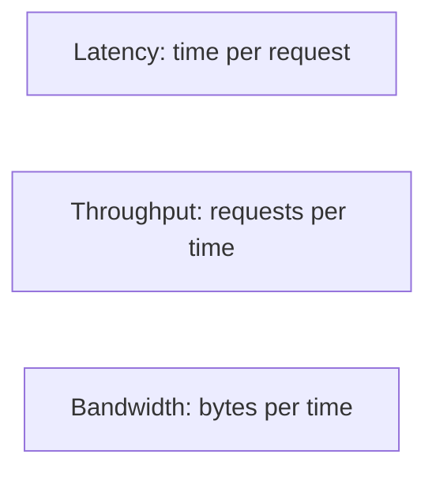

*Say which axis you are moving. "Make it faster" is not a requirement. "p99 GET under 200 ms at 5k QPS" is.*


**Latency** is time for one unit of work: a request, a disk read, a packet round trip. Users feel this. Units: ms, µs, ns. Lower is better.

**Throughput** is units of work per unit time: requests per second, records per second, transactions per second. Operators feel this as capacity. Units: QPS, RPS, TPS. Higher is better.

**Bandwidth** is raw volume per unit time on a link or a disk: Gbps, MB/s. It is a ceiling on throughput × payload size. A 1 Gbps NIC moves about 125 MB/s. That is not 125,000 requests/s unless each request is 1 KB and nothing else is on the wire.

**How they fight:**

- Batching **raises throughput** and usually **raises latency** for the first item in the batch. [Apache Kafka](https://kafka.apache.org/) producers batch for this reason.
- More concurrent in-flight requests can **raise throughput** until queues explode, then **latency** goes non-linear. That knee is the capacity number you wanted.
- A [Cloudflare](https://www.cloudflare.com/) or [Amazon CloudFront](https://aws.amazon.com/cloudfront/) cache cuts **latency** for hits and cuts **bandwidth** into the origin. It does not increase origin **throughput** except by subtracting work.

**Working rule:** say which axis you are moving. "Make it faster" is not a requirement. "p99 GET under 200 ms at 5k QPS" is.

#### Tail Latency and Percentiles

The **mean** is a liar. One slow request in a hundred is a rounding error on the average and the entire user experience for that user. Report **percentiles**.

- **p50 (median):** half of requests were faster. A healthy "typical" number.
- **p95 / p99 / p99.9:** the tail. This is what you SLO, because this is what humans and fan-out see.

**Why tails exist even when the median is fine:**

- Garbage collection, compaction, a noisy neighbor, a cold cache, a lock, a slow disk.
- **Fan-out:** one user request waits for *N* backend calls and takes the slowest. If each backend has a 1% chance of a slow call, a 50-way fan-out is slow often. Tail at scale is a coordination problem, not a mean problem.

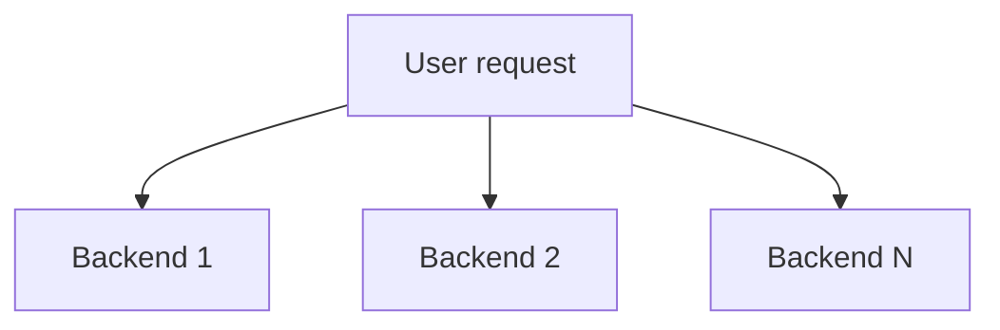

*The user waits for the slowest of N. SLO the tail (p99), not the mean. If the request fans out, the tail is the product.*

- Retries: a timeout plus a retry can turn a slow tail into a stampede. Timeout < user patience, retry with jitter, cap the attempts.

Measure tails in [Prometheus](https://prometheus.io/) histograms, [Datadog](https://www.datadoghq.com/) distribution metrics, [Amazon CloudWatch](https://aws.amazon.com/cloudwatch/) percentile statistics, or [OpenTelemetry](https://opentelemetry.io/) traces. Averages in [Grafana](https://grafana.com/) are for finding out you need percentiles.

**Working rule:** SLO the tail (p99 or p99.9), not the mean. If the request fans out, the tail is the product.

#### Numbers Worth Memorizing

Back-of-the-envelope math is only as honest as the physical numbers you plug in. The set everyone else is using is Jeff Dean / Peter Norvig's "numbers every programmer should know," kept current as an interactive chart at [Colin Scott's latency visualization](https://colin-scott.github.io/personal_website/research/interactive_latency.html) and listed in [Peter Norvig's Teach Yourself Programming in Ten Years notes](https://norvig.com/21-days.html#answers). Orders of magnitude matter more than the last digit. They move as hardware moves; the *gaps* between memory, SSD, disk, and WAN do not disappear.

| Operation | Order of magnitude |
| --- | --- |
| L1 cache reference | 1 ns |
| Main memory reference | 100 ns |
| Round trip inside a datacenter | 0.5 ms |
| SSD random read | 0.1 ms |
| Disk seek | 10 ms |
| Read 1 MB sequentially from memory | 0.25 ms |
| Read 1 MB sequentially from SSD | 1 ms |
| Read 1 MB sequentially from disk | 20 ms |
| Round trip CA ↔ Europe | 100–150 ms |

*Orders of magnitude, not a benchmark of your cluster. Refresh the picture on [Colin Scott's latency visualization](https://colin-scott.github.io/personal_website/research/interactive_latency.html).*

**What this does to a design:**

- **Memory vs disk.** A [Redis](https://redis.io/) GET is a memory reference plus a network hop. A disk-backed [PostgreSQL](https://www.postgresql.org/) primary that misses cache pays seeks. Caching is not a fashion; it is a 100×–1000× gap.
- **In-datacenter vs WAN.** A same-zone call is sub-millisecond to a few milliseconds. A cross-region call is 50–150 ms before you wrote any code. Multi-region consistency pays this on every write.
- **Sequential vs random.** Streaming 1 MB is cheap relative to seeking all over a disk. Logs and scans like sequential. Point lookups like memory or SSD.
- **Packet vs payload.** Sending 1 KB on a 1 Gbps link is tens of microseconds of *wire* time and still loses to a WAN RTT. Chatty APIs die from round trips, not from megabytes.

You do not memorize every row for a quiz. You memorize the **gaps** so that "we will just call the other region on the read path" is a number, not a vibe.

**Working rule:** if the sketch crosses memory → SSD → disk → zone → region, write the order of magnitude on the arrow.

### Disaster Recovery

**Disaster recovery (DR)** is the plan for a failure domain you do not fail over inside of: a region, a provider outage, a corrupted dataset, a bad deploy that ate the data. High availability in one zone is not DR. A second process on the same host is not DR.

The [AWS Well-Architected Reliability Pillar](https://docs.aws.amazon.com/wellarchitected/latest/reliability-pillar/welcome.html), [Google Cloud Architecture Framework](https://cloud.google.com/architecture/framework), and [Azure Well-Architected Framework](https://learn.microsoft.com/azure/well-architected/) all separate *resiliency in a region* from *recovery across regions*. You should too.

#### RPO, RTO, and Backup Strategies

Two numbers, then a backup you have actually restored.

**RPO — Recovery Point Objective.** How much *data* you can lose, measured in time. RPO of 0 means every acknowledged write survives the disaster (synchronous replication to the DR site). RPO of 24 hours means yesterday's backup is an acceptable truth.

**RTO — Recovery Time Objective.** How long the path can stay wrong or down while you recover. RTO of 5 minutes is automatic failover. RTO of 24 hours is "we restore from backup on Monday."

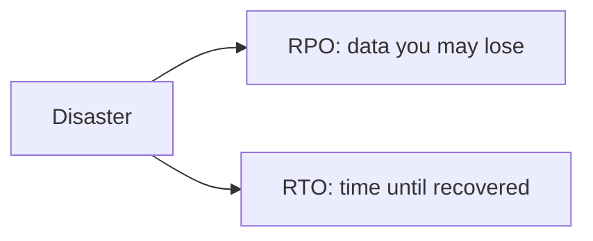

*Write RPO and RTO as times. Then pick the cheapest strategy that meets both. Then restore it once on purpose.*


These are product numbers. Engineering maps them onto a strategy:

| Rough RPO / RTO | Typical strategy | Tools you can point at |
| --- | --- | --- |
| Hours / hours | Periodic backups, restore into a new box | [AWS Backup](https://aws.amazon.com/backup/), [Azure Backup](https://azure.microsoft.com/products/backup), [Google Cloud Backup and DR](https://cloud.google.com/backup-disaster-recovery), [Amazon RDS](https://aws.amazon.com/rds/) snapshots |
| Minutes / minutes | Continuous replication, hot or warm standby | [Amazon RDS Multi-AZ](https://aws.amazon.com/rds/features/multi-az/) (in-region), cross-region read replicas, [S3 Replication](https://aws.amazon.com/s3/features/replication/) |
| ~0 / seconds | Synchronous multi-site, active-active | Multi-region datastores, conflict rules; this is a data-model tax |

**Backups are not a strategy until restore is a drill.**

- **What you back up:** databases ([Amazon RDS](https://aws.amazon.com/rds/) snapshots, [PostgreSQL](https://www.postgresql.org/) dumps), object stores (versioning on [Amazon S3](https://aws.amazon.com/s3/), [Google Cloud Storage](https://cloud.google.com/storage), [Azure Blob Storage](https://azure.microsoft.com/products/storage/blobs)), and the *config* that knows how to rebuild the path.
- **Where it lives:** a different failure domain than the primary. Same-zone snapshots die with the zone.
- **[AWS Backup](https://aws.amazon.com/backup/)** is a control plane for scheduling and restoring across [AWS](https://aws.amazon.com/) services. **[Azure Backup](https://azure.microsoft.com/products/backup)** and **[Google Cloud Backup and DR](https://cloud.google.com/backup-disaster-recovery)** are the sibling products. They do not pick your RPO for you.
- Encrypt, restrict who can delete, and test a restore on a schedule. An untested backup is a story you tell yourself.

**Working rule:** write RPO and RTO as times. Then pick the cheapest strategy that meets both. Then restore it once on purpose.

#### Multi-Region and Multi-Datacenter Failover

An **availability zone** is a failure domain inside a region (separate buildings, independent power, short metro latency). A **region** is a geography with its own control plane and a WAN RTT to other regions. [AWS Regions and Availability Zones](https://aws.amazon.com/about-aws/global-infrastructure/regions_az/), [Google Cloud locations](https://cloud.google.com/about/locations), [Azure geographies](https://azure.microsoft.com/explore/global-infrastructure/geographies/). Multi-AZ is the default HA move. Multi-region is the DR move, and it costs latency and consistency.

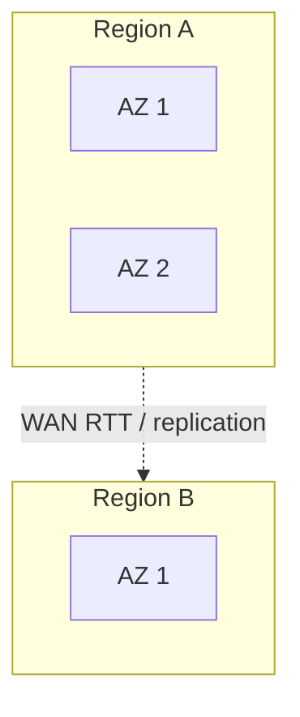

*Multi-AZ first. Multi-region when the threat is the region. Writes that cross a region buy a WAN RTT or a conflict.*


**Multi-AZ (usually the right first redundancy):**

- API replicas in at least two zones, a regional load balancer ([AWS Elastic Load Balancing](https://aws.amazon.com/elasticloadbalancing/), [Google Cloud Load Balancing](https://cloud.google.com/load-balancing), [Azure Load Balancer](https://azure.microsoft.com/products/load-balancer)).
- [Amazon RDS Multi-AZ](https://aws.amazon.com/rds/features/multi-az/) or the equivalent for the primary.
- [Amazon S3](https://aws.amazon.com/s3/) already replicates inside the region; do not confuse that with cross-region.

**Multi-region (when a region dying is in the threat model):**

1. **Data.** Asynchronous replica in the second region (nonzero RPO) or a multi-primary topology (conflicts). [S3 Replication](https://aws.amazon.com/s3/features/replication/) for blobs. A cross-region [Amazon RDS](https://aws.amazon.com/rds/) replica for rows. Active-active at this layer is a Distributed Systems chapter, not a checkbox.
2. **Traffic.** DNS or anycast failover: [Amazon Route 53](https://aws.amazon.com/route53/) (failover / latency policies), [Azure Traffic Manager](https://azure.microsoft.com/products/traffic-manager), [Azure Front Door](https://azure.microsoft.com/products/frontdoor), [AWS Global Accelerator](https://aws.amazon.com/global-accelerator/), [Cloudflare](https://www.cloudflare.com/). Health checks plus a TTL you can live with. A 60-second TTL is part of the RTO.
3. **Stateless compute.** You can run API replicas in two regions tomorrow. They are useless if the only [PostgreSQL](https://www.postgresql.org/) primary still lives in the dead region.
4. **Config, secrets, and identity.** The control plane you forgot is the SPOF you will discover during the incident.

**Active-passive multi-region** is the default DR shape: one region serves, the other is warm, DNS or a global front door swings. **Active-active multi-region** is a product that must read and write near the user in more than one geography. Do not "do active-active" to feel safe. Do it because the latency number on the WAN arrow is unacceptable and you have a conflict story.

**Working rule:** multi-AZ first. Multi-region when the threat is the region. Writes that cross a region buy a WAN RTT or a conflict. Draw that cost.

### Capacity Planning and Back-of-the-Envelope Math

Qualities without numbers are wishes. **Capacity planning** is the napkin that tells you whether one box, ten boxes, or a different design is the path. **Back-of-the-envelope math** is how we do it in this book: orders of magnitude, not a spreadsheet of 14 decimals. The optional interview add-on reuses this skill under a clock. The skill is the same at work.

You do not need a cloud account. You do need a canvas ([Excalidraw](https://excalidraw.com/)) and the numbers from Numbers Worth Memorizing. When you want a cost sanity check later, [AWS Pricing Calculator](https://calculator.aws/), [Google Cloud Pricing Calculator](https://cloud.google.com/products/calculator), and [Azure Pricing Calculator](https://azure.microsoft.com/pricing/calculator/) turn instance shapes into money. Money is a constraint. It is not the first line on the napkin.

**The four lines we always write:**

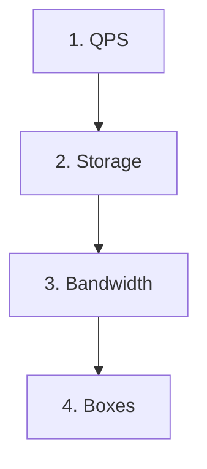

*QPS, storage, bandwidth, boxes — in that order — with powers of ten. Then pick vertical vs horizontal vs a different data path.*


1. **QPS (throughput).** `peak QPS ≈ (daily active users × requests per user per day × peak factor) / 86,400`. 86,400 seconds in a day is ~10^5. Peak factor is often 2–5× average. If you cannot name requests per user, you cannot name QPS.
2. **Storage.** `bytes ≈ objects × average size × copies × retention`. Copies include replicas, backups, and versions. A 1 KB row and a 1 MB blob are different designs. Blobs go to [Amazon S3](https://aws.amazon.com/s3/) (or [Google Cloud Storage](https://cloud.google.com/storage), [Azure Blob Storage](https://azure.microsoft.com/products/storage/blobs)); metadata stays in [PostgreSQL](https://www.postgresql.org/).
3. **Bandwidth.** `bytes/s ≈ QPS × payload size` on each hop (client ↔ edge, edge ↔ origin, service ↔ datastore). Compare to NIC and disk sequential numbers. A 1 Gbps link is ~125 MB/s. Video and image paths die here first; JSON APIs usually die on QPS or datastore IOPS instead.
4. **Boxes.** `instances ≈ peak QPS / QPS per instance`, then add headroom (often 2×) so a zone or a deploy does not sit at 100%. QPS per instance comes from a rough budget: CPU, RAM, and the datastore in front of it — not from hope. Vertical versus horizontal is the lever you already picked.

**Rules that keep the napkin honest:**

- **Powers of ten.** 10^3 = thousand, 10^6 = million, 10^9 = billion. If two estimates disagree by 100×, one of them is wrong; find it before you draw [Kubernetes](https://kubernetes.io/).
- **Peak, not average.** SLOs fail at peak. Size for peak. Average is for the bill.
- **The datastore is usually the ceiling.** App replicas are cheap to add ([AWS Auto Scaling](https://aws.amazon.com/autoscaling/), [Kubernetes Horizontal Pod Autoscaler](https://kubernetes.io/docs/tasks/run-application/horizontal-pod-autoscale/)). A single [PostgreSQL](https://www.postgresql.org/) primary is not. Estimate writes/s on the primary before you estimate app pods.
- **Memory vs disk vs WAN.** If the working set fits in [Redis](https://redis.io/), latency is a network hop. If it does not, you are on SSD or disk numbers. If the hop is another region, you are on 100 ms.
- **Write the unit.** "A lot of traffic" is not a number. "5k QPS of 2 KB reads, p99 50 ms, one region" is a design input.

**Worked order of magnitude (so you see the shape, not a case study):**

- 10 million daily users, 10 reads per user per day, peak 3× average → about `10^7 × 10 × 3 / 10^5 ≈ 3,000` QPS at peak. An API that does 500 QPS per instance needs ~6 instances before headroom, ~12 after. That is a load balancer and [AWS Auto Scaling](https://aws.amazon.com/autoscaling/), not a rewrite.
- 10 million objects, 200 KB each, 3 copies (primary, replica, backup), 1 year retained → about `10^7 × 2×10^5 × 3 ≈ 6×10^12` bytes, a few terabytes. That is object storage, not a row in [PostgreSQL](https://www.postgresql.org/).
- Cross-region on every read at p99 50 ms **cannot work**. The WAN arrow is already ~100 ms. Cache near the user ([Cloudflare](https://www.cloudflare.com/), [Amazon CloudFront](https://aws.amazon.com/cloudfront/)) or keep the read in-region.

Draw the four numbers on the [Excalidraw](https://excalidraw.com/) sketch next to the boxes they constrain. If a box cannot name a number, it is still a logo.

**Working rule:** QPS, storage, bandwidth, boxes — in that order — with powers of ten. Then pick vertical vs horizontal vs a different data path.

### Summary: Large-Scale Systems: Scalability, Availability, Reliability, and Performance

Large-scale starts when one box, one disk, or one failure domain is no longer the whole story. **Scalability** is growth: vertical first ([Amazon EC2](https://aws.amazon.com/ec2/), [Amazon RDS](https://aws.amazon.com/rds/) sizes), then horizontal ([AWS Auto Scaling](https://aws.amazon.com/autoscaling/), [Kubernetes Horizontal Pod Autoscaler](https://kubernetes.io/docs/tasks/run-application/horizontal-pod-autoscale/), a load balancer). Fast is not scalable. **Availability** is whether the path answers — nines from the [Google SRE availability table](https://sre.google/sre-book/availability-table/), sequence multiplies, independent replicas recover, and HA is not the same as fault tolerance. **Fault tolerance** is the death story: SPOFs, redundancy plus tested failover ([Amazon RDS Multi-AZ](https://aws.amazon.com/rds/features/multi-az/), health checks, [Amazon Route 53](https://aws.amazon.com/route53/)), active-passive versus active-active. **Reliability** is correctness over time, measured as SLIs, targeted as SLOs, contracted as SLAs ([Service Level Objectives](https://sre.google/sre-book/service-level-objectives/), [Prometheus](https://prometheus.io/), [Datadog](https://www.datadoghq.com/), vendor [AWS Service Level Agreements](https://aws.amazon.com/legal/service-level-agreements/)). **Performance** is latency, throughput, and bandwidth as separate axes; SLO the tail; memorize the gaps on [Colin Scott's latency visualization](https://colin-scott.github.io/personal_website/research/interactive_latency.html). **Disaster recovery** is RPO, RTO, backups you restore ([AWS Backup](https://aws.amazon.com/backup/)), and multi-region as a WAN-and-data decision, not a second process. **Capacity planning** is QPS, storage, bandwidth, and boxes on a napkin — [Excalidraw](https://excalidraw.com/) for the picture, a pricing calculator when money is the constraint. Next is **Networking, Protocols, and Web Concepts**.

## Networking, Protocols, and Web Concepts

Large-Scale Systems: Scalability, Availability, Reliability, and Performance judged the path. This chapter is the path on the wire: how a packet is addressed, which transport carries it, how a name becomes an IP, how HTTP and TLS wrap the request, and which box — proxy or load balancer — sits in front of your replicas. We stay tools-heavy. There are no [CodeSandboxes](https://codesandbox.io/). You practice by drawing the hops in [Excalidraw](https://excalidraw.com/) and naming products only when the choice matters. The next chapter is API Design — the contract those hops carry.

A request is not "the internet." It is DNS, then a TCP (or QUIC) handshake, then TLS, then HTTP, then a reverse proxy or load balancer, then an application. Miss a hop and you cannot explain latency, sticky sessions, or why a 60-second DNS TTL is part of failover.

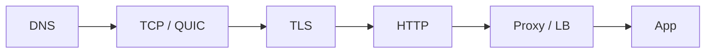

*Name the six hops. A missing hop is where your p99 went. Draw this in [Excalidraw](https://excalidraw.com/).*


### IP Addressing

An **IP address** is the identifier routing uses to deliver a packet to a host (or to a load balancer that owns the host's public face). System design does not start at "pick [NGINX](https://nginx.org/)." It starts at "which addresses are public, which are private, and which box performs Network Address Translation (NAT)." The addressing plan lives in a Virtual Private Cloud: **[Amazon Virtual Private Cloud (VPC)](https://aws.amazon.com/vpc/)**, **[Google Cloud VPC](https://cloud.google.com/vpc)**, or **[Azure Virtual Network](https://azure.microsoft.com/products/virtual-network)**.

**Working rule:** every box on the sketch gets an address class (public, private, link-local) and a failure domain. An unlabeled arrow is not a network.

#### IPv4 and IPv6

**IPv4** ([RFC 791](https://www.rfc-editor.org/rfc/rfc791)) is a 32-bit address, usually written dotted-decimal (`203.0.113.10`). That space is about 4.3 billion addresses and it is exhausted as a public pool. **[IANA](https://www.iana.org/)** publishes the [IPv4 address space](https://www.iana.org/assignments/ipv4-address-space/ipv4-address-space.xhtml). You still design with IPv4 because clients, corporate networks, and a large fraction of the internet still speak it.

**IPv6** ([RFC 8200](https://www.rfc-editor.org/rfc/rfc8200), addressing in [RFC 4291](https://www.rfc-editor.org/rfc/rfc4291)) is a 128-bit address, usually written hexadecimal (`2001:db8::1`). The pool is not the constraint. Dual-stack (both families on the same host) is the common production shape. A load balancer that only has an A record is an IPv4-only front door, even if the backends speak IPv6.

**CIDR** ([RFC 4632](https://www.rfc-editor.org/rfc/rfc4632)) is how you write a network: `10.0.0.0/16` is 65,536 IPv4 addresses, `10.0.1.0/24` is 256. Prefix length is the subnet. Cloud VPCs are CIDR plans with route tables. A `/32` is one IPv4 host. A `/128` is one IPv6 host.

**[Amazon VPC](https://aws.amazon.com/vpc/)**, **[Google Cloud VPC](https://cloud.google.com/vpc)**, **[Azure Virtual Network](https://azure.microsoft.com/products/virtual-network)**

- **Primary function:** a private IP space, subnets, route tables, and security groups / firewall rules so your boxes are not on the public internet by accident.
- **When we send you here:** the first time the sketch has more than one box that must talk privately, or when you need a public subnet (load balancer, NAT) and a private subnet (application, datastore).
- **What they are not:** not a substitute for a load balancer, and not IPv6 by default on every account. Read the dual-stack checkbox before you claim "we are on IPv6."

**What you write on the sketch:** the VPC CIDR, public versus private subnets, and whether the front door has an IPv4 address, an IPv6 address, or both. DNS `A` versus `AAAA` records (coming) have to match.

**Working rule:** IPv4 is still the default client path. IPv6 is extra reach, not a personality. Size subnets for the replica count you actually expect, plus headroom — not `/16` because it looks round.

#### Public vs Private Addresses

**Public** addresses are globally routable. [IANA](https://www.iana.org/) and the Regional Internet Registries allocate them. Your users hit a public address (or anycast anycasted to one). Cloud catalogs call this an [Elastic IP](https://docs.aws.amazon.com/AWSEC2/latest/UserGuide/elastic-ip-addresses-eip.html) on [AWS](https://aws.amazon.com/), an external IP on [Google Cloud](https://cloud.google.com/), a public IP on [Azure](https://azure.microsoft.com/).

**Private** addresses are not globally routable. [RFC 1918](https://www.rfc-editor.org/rfc/rfc1918) reserved three IPv4 blocks for this:

| Block | CIDR | Typical use on a sketch |
| --- | --- | --- |
| 10.0.0.0/8 | ~16 million | Large VPC, several environments |
| 172.16.0.0/12 | ~1 million | Medium VPC |
| 192.168.0.0/16 | ~65 thousand | Small VPC, home-shaped labs |

*[RFC 1918](https://www.rfc-editor.org/rfc/rfc1918) private IPv4 space. [RFC 6890](https://www.rfc-editor.org/rfc/rfc6890) is the broader special-purpose registry.*

IPv6 unique-local (`fc00::/7`) is the analog; most cloud VPCs hand you a global unicast IPv6 prefix instead and control exposure with firewall rules. Loopback (`127.0.0.1`, `::1`) never leaves the host. Link-local (`169.254.0.0/16`, `fe80::/10`) never leaves the link — on [AWS](https://aws.amazon.com/) the [instance metadata service](https://docs.aws.amazon.com/AWSEC2/latest/UserGuide/instancedata-data-retrieval.html) famously lives at `169.254.169.254`.

**NAT** is how a private host originates a connection to a public address without owning one. The box that rewrites is a **[NAT gateway](https://docs.aws.amazon.com/vpc/latest/userguide/vpc-nat-gateway.html)** ([Google Cloud NAT](https://cloud.google.com/nat), [Azure NAT Gateway](https://azure.microsoft.com/products/azure-nat-gateway)). The box that lets a public subnet reach the internet is an **[Internet gateway](https://docs.aws.amazon.com/vpc/latest/userguide/VPC_Internet_Gateway.html)**. Do not mix them: an internet gateway does not hide private IPs; a NAT gateway does not accept unsolicited inbound.

```mermaid
flowchart LR
  user[User]
  igw[Internet gateway]
  lb[Public LB]
  app[Private app]
  nat[NAT gateway]
  net[Internet]
  user --> igw --> lb --> app
  app --> nat --> net
```

*Users see public addresses. App processes live on [RFC 1918](https://www.rfc-editor.org/rfc/rfc1918) private space. NAT is egress; the internet gateway is the door.*


**Dynamic vs static** is orthogonal. [DHCP](https://www.rfc-editor.org/rfc/rfc2131) leases are how most private addresses get assigned inside a VPC. A static public IP is what you attach to a front door so DNS can point at it. Ephemeral public IPs on instances are a trap: reboot, new address, DNS lie.

**Working rule:** users and peer networks see public addresses. Application processes and datastores live on private addresses. The NAT/internet-gateway pair is the door. A [PostgreSQL](https://www.postgresql.org/) primary with a public IP is a sketch you redraw.

### The OSI Model

The **Open Systems Interconnection (OSI) model** ([ITU-T X.200](https://www.itu.int/rec/T-REC-X.200), [ISO/IEC 7498-1](https://www.iso.org/standard/20269.html)) splits communication into seven layers so you can say *which* hop you are designing. Production networks run the **Internet protocol suite** (TCP/IP), not a literal seven-stack. You still use OSI numbers because load balancers, packet captures, and vendor SKUs are sold as "Layer 4" and "Layer 7."

```mermaid
flowchart TB
  l7[L7 Application: HTTP]
  l4[L4 Transport: TCP / UDP]
  l3[L3 Network: IP / VPC]
  l2[L2 Data link]
  l1[L1 Physical]
  l7 --> l4 --> l3 --> l2 --> l1
```

*The working layers on a sketch are L3, L4, and L7. Reciting all seven without picking L4 vs L7 for the front door is trivia.*


| Layer | Name | What you actually design |
| --- | --- | --- |
| 7 | Application | HTTP, DNS, TLS as the app sees it, gRPC |
| 6 | Presentation | Encryption and encoding; in practice folded into TLS + HTTP |
| 5 | Session | Folded into TCP/TLS; not a box you buy |
| 4 | Transport | TCP, UDP, QUIC; port, connection |
| 3 | Network | IP, routing, VPC CIDR |
| 2 | Data link | Ethernet, AZ-local switching; you rarely draw it |
| 1 | Physical | Fiber, NIC; capacity-planning bandwidth, not a product logo |

*OSI names from [ITU-T X.200](https://www.itu.int/rec/T-REC-X.200). The working layers on a system-design sketch are L3, L4, and L7.*

**Why this chapter needs the numbers:**

- **Layer 4 load balancing** looks at IP + port (and protocol). It cannot read a URL. [AWS Network Load Balancer](https://aws.amazon.com/elasticloadbalancing/network-load-balancer/) is this SKU.
- **Layer 7 load balancing** looks at HTTP host, path, headers, cookies. [AWS Application Load Balancer](https://aws.amazon.com/elasticloadbalancing/application-load-balancer/) is this SKU.
- **Layer 3** is the VPC and the route table. Getting L4/L7 wrong is how you terminate TLS in the wrong place.

**[Wireshark](https://www.wireshark.org/)** and **[tcpdump](https://www.tcpdump.org/)**

- **Primary function:** capture and decode frames so you can see the layer you thought you were on.
- **When we send you here:** a timeout you cannot explain, a TLS handshake that never finishes, a health check that uses the wrong port.
- **What they are not:** not a substitute for [Prometheus](https://prometheus.io/) metrics. A pcap is a microscope. Metrics tell you which request to put under it.

Reciting all seven layers without picking L4 versus L7 for the front door is trivia. The model is a vocabulary, not a design.

**Working rule:** say L3 (addressing), L4 (connection), or L7 (HTTP) for every front-door box. If you cannot, you have not chosen a load balancer yet.

### TCP and UDP

Two transport protocols carry almost every request you will draw. **TCP** ([RFC 9293](https://www.rfc-editor.org/rfc/rfc9293)) is connection-oriented: three-way handshake (SYN, SYN-ACK, ACK), ordered byte stream, retransmission, congestion control. **UDP** ([RFC 768](https://www.rfc-editor.org/rfc/rfc768)) is datagrams: no handshake, no retransmission, no ordering. Neither is "better." They optimize different failure modes.

```mermaid
sequenceDiagram
  participant C as Client
  participant S as Server
  Note over C,S: TCP handshake
  C->>S: SYN
  S->>C: SYN-ACK
  C->>S: ACK
  Note over C,S: UDP: just datagrams
  C-->>S: datagram
```

*TCP if a missing byte is a bug. UDP if a late byte is worse than a missing one. HTTP/3 is UDP on the wire and TCP-like in the contract.*


| | TCP | UDP |
| --- | --- | --- |
| Connection | Handshake, teardown | None |
| Delivery | Retransmits until it gives up | Best-effort |
| Order | Byte stream is ordered | Per-datagram; app orders if it cares |
| Congestion | Built in | App or a layer above (QUIC) |
| Head-of-line | A lost packet stalls the stream | A lost datagram is just gone |
| Typical use | HTTP/1.1, HTTP/2, [PostgreSQL](https://www.postgresql.org/) wire, SSH | DNS queries, video, VoIP, HTTP/3 |

*TCP as [RFC 9293](https://www.rfc-editor.org/rfc/rfc9293); UDP as [RFC 768](https://www.rfc-editor.org/rfc/rfc768). HTTP/3 runs on [QUIC](https://www.rfc-editor.org/rfc/rfc9000), which is UDP plus its own handshake, crypto, and retransmission.*

**What TCP costs you on a sketch:**

- **Handshake + slow start.** A new connection to a far region pays a WAN RTT before the first byte. Connection reuse (HTTP keep-alive, HTTP/2 multiplexing) exists because of this.
- **Head-of-line blocking.** HTTP/2 multiplexes streams on one TCP connection; a lost packet still stalls every stream. That is a reason HTTP/3 exists.
- **Retries.** TCP already retried. An impatient application retry on top of that is how you amplify a blip into a stampede. Timeouts belong at the application; they must be longer than the TCP recovery you are willing to wait for, and shorter than the user.

**What UDP costs you:**

- **You own loss.** DNS, games, and media accept a missing packet. A file transfer over raw UDP does not, unless you rebuild TCP.
- **Firewalls and NAT.** Stateful NAT boxes remember TCP connections more happily than UDP flows. UDP keepalives and QUIC connection IDs exist because of NAT.

**[QUIC](https://www.rfc-editor.org/rfc/rfc9000)** (and **[HTTP/3](https://www.rfc-editor.org/rfc/rfc9114)** on top of it) takes UDP, adds a crypto handshake that combines TCP+TLS into one round trip, and retransmits *per stream* so one loss does not stall the others. [Cloudflare](https://www.cloudflare.com/) and [Amazon CloudFront](https://aws.amazon.com/cloudfront/) terminate HTTP/3 at the edge so origins can stay on HTTP/1.1 or HTTP/2. You do not have to run QUIC on [PostgreSQL](https://www.postgresql.org/).

**When we pick TCP:** request/response with a correctness contract (almost every API, every datastore protocol you will name in this book). **When we pick UDP:** latency-sensitive media, DNS, or a protocol that already rebuilt reliability (QUIC, parts of [WebRTC](https://webrtc.org/) — that last one waits for Message Queues, Streams, and Real-Time Communication).

**Working rule:** TCP if a missing byte is a bug. UDP if a late byte is worse than a missing one. HTTP/3 is UDP on the wire and TCP-like in the contract; name it when the edge already speaks it, not to sound current.

### Domain Name System

**DNS** ([RFC 1034](https://www.rfc-editor.org/rfc/rfc1034), [RFC 1035](https://www.rfc-editor.org/rfc/rfc1035)) translates a name (`api.example.com`) into a record set (addresses, aliases, mail exchangers, text). It is the first hop of almost every user request and a control plane for failover. A 60-second TTL is part of your RTO. Pretending DNS is "just a name" is how failovers take an hour.

You will operate DNS in two roles: **authoritative** (the records for your zones) and **recursive** (what clients ask). Products: **[Amazon Route 53](https://aws.amazon.com/route53/)**, **[Google Cloud DNS](https://cloud.google.com/dns)**, **[Azure DNS](https://azure.microsoft.com/products/dns)**, **[Cloudflare DNS](https://www.cloudflare.com/application-services/products/dns/)**. On [Kubernetes](https://kubernetes.io/), **[CoreDNS](https://coredns.io/)** is the in-cluster recursive/authoritative hybrid. Public recursors you can point a laptop at: **[Google Public DNS](https://developers.google.com/speed/public-dns)** (`8.8.8.8`), **[1.1.1.1](https://one.one.one.one/)** from [Cloudflare](https://www.cloudflare.com/).

#### How DNS Resolution Works

A lookup is a chain. The stub resolver on the client asks a **recursive resolver**. If the answer is not cached, the recursor walks:

```mermaid
sequenceDiagram
  participant Stub
  participant Recursor
  participant Root
  participant TLD
  participant Auth
  Stub->>Recursor: api.example.com
  Recursor->>Root: who owns .com
  Root-->>Recursor: TLD NS
  Recursor->>TLD: who owns example.com
  TLD-->>Recursor: Auth NS
  Recursor->>Auth: A / AAAA
  Auth-->>Recursor: address + TTL
  Recursor-->>Stub: address + TTL
```

*Stub → recursor → root / TLD / auth. The TTL is failover math. On a product sketch, draw the authoritative product and the TTL.*


1. **Root** — the [IANA root servers](https://www.iana.org/domains/root/servers) (13 named identities, many anycast instances). They do not know `example.com`. They know who owns `.com`.
2. **TLD** — the `.com` (or `.io`, `.dev`) nameservers. They know which authoritative servers own `example.com`.
3. **Authoritative** — your zone. They return the `A`/`AAAA`/`CNAME` (or `NXDOMAIN`).

The recursor caches each step for that record's **TTL**. The client caches too (OS and browser). So do [Cloudflare](https://www.cloudflare.com/) and [Amazon CloudFront](https://aws.amazon.com/cloudfront/) if they sit on the path. Three caches in a row means a TTL of 60 seconds is a *lower bound* on how fast you can move traffic by changing a record, not a guarantee.

**[dig](https://bind9.readthedocs.io/en/latest/manpages.html#dig-dns-lookup-utility)** (ships with **[BIND](https://www.isc.org/bind/)**) and **[curl](https://curl.se/)**

- **Primary function:** [`dig`](https://bind9.readthedocs.io/en/latest/manpages.html#dig-dns-lookup-utility) prints the record set and the TTL the recursor handed you. [`curl`](https://curl.se/) (`-I`, `-v`, `--resolve`) is how you see the HTTP hop after DNS.
- **When we send you here:** "DNS is wrong" and "TLS is wrong" are the two most common first-hop bugs. Prove which hop before you redraw the VPC.
- **What they are not:** not load tests. One lookup is a fact. A thousand QPS of lookups is a recursor and a TTL design.

**Anycast** is how those 13 root identities are actually thousands of machines: the same prefix, announced from many places, so the client hits a nearby instance. [Cloudflare](https://www.cloudflare.com/) and [Amazon Route 53](https://aws.amazon.com/route53/) use the same trick for your zone. Anycast is routing, not a health check. A dead anycast instance still needs the operator to withdraw the route.

**Working rule:** draw stub → recursor → (root / TLD / auth) only when you are debugging DNS. On a product sketch, draw the **authoritative product** and the **TTL**. The TTL is failover math.

#### Record Types and Caching

Records are the contract. TTL is the cache lease. Wrong type is a silent outage (CNAME at the zone apex, `A` where you needed `ALIAS`, missing `AAAA` on a dual-stack front door).

| Type | Job | Watch-out |
| --- | --- | --- |
| `A` | Name → IPv4 | One address is a SPOF unless you have several, or a load balancer in front |
| `AAAA` | Name → IPv6 | Absence means IPv6 clients may fail or Happy-Eyeballs to IPv4 |
| `CNAME` | Name → another name | Cannot sit at the zone apex in classic DNS; follow the chain, add the TTLs |
| `NS` | Delegates a zone | Wrong NS is "the internet thinks someone else owns you" |
| `MX` | Mail routing | Not your API path; still a zone you can break |
| `TXT` | Arbitrary text | SPF/DKIM, ACME challenges for [Let's Encrypt](https://letsencrypt.org/) |
| `SRV` | Service location | gRPC and some meshes; most HTTP skips this |
| `CAA` | Which CAs may issue | Blocks a mis-issued cert if you set it |
| `PTR` | Reverse DNS (IP → name) | Mail and some allowlists; not the user request path |

*Record types as used on [Amazon Route 53](https://aws.amazon.com/route53/) and [Cloudflare DNS](https://www.cloudflare.com/application-services/products/dns/). Apex "ALIAS" / "ANAME" / [Amazon Route 53](https://aws.amazon.com/route53/) alias records are vendor flatteners so you can point the zone root at a load balancer without a forbidden CNAME.*

**[Amazon Route 53](https://aws.amazon.com/route53/)**

- **Primary function:** authoritative DNS plus health-checked failover, latency, geolocation, and weighted routing. Alias records target [AWS Elastic Load Balancing](https://aws.amazon.com/elasticloadbalancing/), [Amazon CloudFront](https://aws.amazon.com/cloudfront/), and similar without a CNAME-at-apex fight.
- **When we send you here:** the name of a public path on [AWS](https://aws.amazon.com/), or DNS failover as the traffic mover from the previous chapter.
- **What it is not:** not a recursor for your laptops (use [1.1.1.1](https://one.one.one.one/) or [Google Public DNS](https://developers.google.com/speed/public-dns) for that). Not a load balancer. Health checks plus a 60-second TTL still leave a minute of bad answers in caches you do not control.

**Caching rules that bite:**

- **Positive TTL.** Lower it before a move, wait out the old TTL, then change the record. Changing first and lowering after does nothing for already-cached answers.
- **Negative TTL** (`NXDOMAIN` / `NODATA`) comes from the zone's `SOA` minimum. A mistyped cutover can cache "does not exist" longer than you wanted.
- **CNAME chains** add. The client follows every hop; each hop has its own TTL.
- **Browser and OS caches** ignore your wishes. [`dig`](https://bind9.readthedocs.io/en/latest/manpages.html#dig-dns-lookup-utility) against `8.8.8.8` is not what [Google Chrome](https://www.google.com/chrome/) has in memory.

**Working rule:** the record type must match the front door (A/AAAA or vendor alias, not a hope). The TTL is a failover number. Write both on the [Excalidraw](https://excalidraw.com/) name box.

### HTTP, HTTPS, and the Web Request Path

**HTTP** is the application protocol most user-facing paths speak. The current semantics live in [RFC 9110](https://www.rfc-editor.org/rfc/rfc9110). **[MDN Web Docs](https://developer.mozilla.org/en-US/docs/Web/HTTP)** is the readable map. **HTTPS** is HTTP over TLS (next heading). The version on the wire matters:

- **HTTP/1.1** — one request at a time per connection unless you pipeline (almost nobody does, well). Browsers open several connections. [RFC 9112](https://www.rfc-editor.org/rfc/rfc9112).
- **HTTP/2** ([RFC 9113](https://www.rfc-editor.org/rfc/rfc9113)) — multiplexed streams on one TCP connection, HPACK headers, still TCP head-of-line blocking.
- **HTTP/3** ([RFC 9114](https://www.rfc-editor.org/rfc/rfc9114)) — HTTP over [QUIC](https://www.rfc-editor.org/rfc/rfc9000)/UDP, per-stream loss recovery.

The **web request path** you should be able to draw without looking:

```mermaid
flowchart LR
  c[Client]
  d[DNS]
  e[Edge / LB]
  a[App]
  s[(Store)]
  c --> d --> e --> a --> s
```

*DNS, handshake, TLS, HTTP, proxy, app. [Cloudflare](https://www.cloudflare.com/) or [Amazon CloudFront](https://aws.amazon.com/cloudfront/) may sit at the edge — still a hop that speaks HTTP and TLS.*


1. DNS lookup for the host.
2. TCP or QUIC handshake to the address (often a load balancer or edge, not the app).
3. TLS handshake (HTTPS), with SNI so the front door knows which certificate to present.
4. HTTP request: method, path, headers, optional body.
5. Reverse proxy / load balancer: TLS termination or passthrough, routing, health, maybe buffering.
6. Application, then the datastore/cache/queue the previous chapters named.

[Cloudflare](https://www.cloudflare.com/) or [Amazon CloudFront](https://aws.amazon.com/cloudfront/) may sit at step 2 as an edge. Caching and Content Delivery Networks is that chapter. Here, the edge is just another hop that speaks HTTP and TLS.

**Working rule:** name the protocol version only when it changes a hop (HTTP/2 to an [Envoy](https://www.envoyproxy.io/) mesh, HTTP/3 at the edge). Always name the six steps. A missing step is where your p99 went.

#### Methods, Status Codes, and Headers

**Methods** ([MDN request methods](https://developer.mozilla.org/en-US/docs/Web/HTTP/Reference/Methods), [RFC 9110](https://www.rfc-editor.org/rfc/rfc9110)) are the verb. **Idempotent** means repeating the request has the same *resource* effect (GET, PUT, DELETE, HEAD, OPTIONS). **Safe** means no intended state change (GET, HEAD, OPTIONS). POST is neither. PATCH is not idempotent unless you design it to be. API Design will make this a contract. Here you only need: load balancers and caches treat GET as replayable; a retried POST can double-charge unless you add an idempotency key later.

**Status codes** ([MDN status codes](https://developer.mozilla.org/en-US/docs/Web/HTTP/Reference/Status)):

- **2xx** — the hop that generated the response thinks it succeeded. `200 OK`, `201 Created`, `204 No Content`, `206 Partial Content`.
- **3xx** — look elsewhere. `301` is permanent (caches, SEO, URL shorteners later). `302`/`307` are temporary. `304` is a cache hit via conditional GET.
- **4xx** — the client (or the token) is the problem. `400`, `401` unauthenticated, `403` authenticated but not allowed, `404`, `409` conflict, `429` rate-limited.
- **5xx** — this hop, or a hop behind it, failed. `500` bug, `502` bad gateway (proxy got garbage), `503` overloaded or draining, `504` gateway timeout.

A load balancer that turns an app `500` into a `502` is a hop you have to know about when you SLO. Yield-based availability from the previous chapter is "not 5xx" unless you said otherwise; a `404` is usually a successful *path*.

**Headers** are how hops talk about the request without changing the path:

- **`Host` / `:authority`** — virtual hosting. One [NGINX](https://nginx.org/) or [AWS Application Load Balancer](https://aws.amazon.com/elasticloadbalancing/application-load-balancer/) can route many names.
- **`Content-Type`, `Accept`** — body contract. Wrong type is a 415, not a mystery.
- **`Cache-Control`, `ETag`, `If-None-Match`** — HTTP caching. [MDN ETag](https://developer.mozilla.org/en-US/docs/Web/HTTP/Reference/Headers/ETag). CDN behavior waits for the caching chapter; the headers start here.
- **`Authorization`** — a token, not a design. Security and Authentication is later.
- **`X-Forwarded-For` / `Forwarded`** ([RFC 7239](https://www.rfc-editor.org/rfc/rfc7239)) — the client IP as rewritten by proxies. The app must *trust* the hop that set it or clients will spoof it.
- **`X-Forwarded-Proto`** — whether the original client used HTTPS. Mixed content and cookie `Secure` flags depend on this if TLS terminated at the load balancer.

**[curl](https://curl.se/)** is how you inspect this without a browser. [`curl -I`](https://curl.se/docs/manpage.html) for headers, `-v` for the TLS and HTTP dance, `-X` for the method. It is a tool, not a load test.

**Working rule:** method = verb + idempotency story. Status = which hop failed. Headers = how the proxy and the app share facts (client IP, proto, cache). Write `Host` on every virtual-hosted front door.

#### Cookies, Sessions, and CORS

**Cookies** ([MDN HTTP cookies](https://developer.mozilla.org/en-US/docs/Web/HTTP/Guides/Cookies), [RFC 6265](https://www.rfc-editor.org/rfc/rfc6265)) are the browser's way to send a small blob back on later requests to the same site. `Set-Cookie` on the response; `Cookie` on the next request. Flags that matter on a sketch:

- **`HttpOnly`** — not visible to JavaScript. Use it for session IDs.
- **`Secure`** — only on HTTPS. Required if you terminated TLS correctly.
- **`SameSite`** (`Strict` / `Lax` / `None`) — whether the cookie rides on cross-site requests. `None` requires `Secure`.
- **`Domain` / `Path` / `Max-Age`** — scope and lifetime. A cookie on `.example.com` is visible to every subdomain; that is a blast radius.

A **session** is server-side state keyed by that cookie (or by a token). Sticky sessions on a load balancer pin the client to the replica that holds the session in memory. That is a patch. The design is a shared store: **[Redis](https://redis.io/)** or **[Amazon ElastiCache](https://aws.amazon.com/elasticache/)**. Tokens (JWT and friends) wait for Security and Authentication. Here: if the replica is allowed to die, the session cannot live only in that replica's RAM.

**CORS** (Cross-Origin Resource Sharing, [MDN CORS](https://developer.mozilla.org/en-US/docs/Web/HTTP/Guides/CORS), [Fetch Living Standard](https://fetch.spec.whatwg.org/#http-cors-protocol)) is the browser rule that a page at `https://app.example.com` may not read `https://api.example.com` unless the API opts in with headers (`Access-Control-Allow-Origin`, methods, headers, credentials). A **preflight** (`OPTIONS`) happens when the request is not a simple GET/POST. [NGINX](https://nginx.org/), [Envoy](https://www.envoyproxy.io/), [AWS Application Load Balancer](https://aws.amazon.com/elasticloadbalancing/application-load-balancer/), and API gateways (next chapter) can answer preflights so the app never sees them.

CORS is a *browser* policy. `curl` does not care. A mobile app does not care. Do not "fix" a server-to-server 403 by adding CORS headers.

**Working rule:** cookies are a client-side pointer; sessions are server-side state that must survive replica death. CORS is only for browsers on another origin. Sticky sessions are not a session store.

### TLS, SSL, and mTLS

**SSL** is the old name. **TLS** is the protocol you use. The current version is **TLS 1.3** ([RFC 8446](https://www.rfc-editor.org/rfc/rfc8446)). SSLv3 is broken; TLS 1.0/1.1 are retired. If a vendor still says "SSL certificate," they mean a certificate you present during a TLS handshake.

TLS gives you three properties on the wire: **authentication** of the server (and optionally the client), **confidentiality**, **integrity**. It is not authorization (that is an application token). It is not a web application firewall ([AWS WAF](https://aws.amazon.com/waf/)). A terminated TLS session that then travels HTTP across a VPC is only as trusted as that VPC.

**The handshake, as a designer sees it:**

1. Client connects (TCP, or QUIC where crypto is built in).
2. **SNI** (Server Name Indication) tells the front door which hostname — and therefore which certificate — is requested.
3. Server presents a certificate chain. The client checks signatures up to a trusted CA, expiry, hostname, and optionally **[Certificate Transparency](https://certificate.transparency.dev/)** logs.
4. Keys are agreed. Application data (HTTP) follows, integrity-protected.

**Where you terminate:**

```mermaid
flowchart LR
  client[Client]
  edge[Edge]
  lb[Load balancer]
  app[App]
  client -->|TLS| edge
  edge -->|TLS or HTTP| lb
  lb -->|HTTP or TLS| app
```

*Say where TLS terminates, who issued the cert, and whether the next hop is HTTP or TLS again. After termination, say what still protects the next hop.*


- **At the edge** — [Cloudflare](https://www.cloudflare.com/), [Amazon CloudFront](https://aws.amazon.com/cloudfront/), [Azure Front Door](https://azure.microsoft.com/products/frontdoor). Origin may see HTTP or a second TLS session (re-encrypt).
- **At the load balancer** — [AWS Application Load Balancer](https://aws.amazon.com/elasticloadbalancing/application-load-balancer/), [Google Cloud Load Balancing](https://cloud.google.com/load-balancing), [Azure Application Gateway](https://azure.microsoft.com/products/application-gateway), [NGINX](https://nginx.org/), [Envoy](https://www.envoyproxy.io/), [Caddy](https://caddyserver.com/), [Traefik](https://traefik.io/traefik/). Apps see HTTP and `X-Forwarded-Proto`.
- **At the application** — passthrough L4 ([AWS Network Load Balancer](https://aws.amazon.com/elasticloadbalancing/network-load-balancer/)) or TLS in the process. You keep cookies and client certs intact. You pay operational cost.

**Certificates you actually obtain:**

**[Let's Encrypt](https://letsencrypt.org/)**

- **Primary function:** free public CA via ACME. Short-lived certs, automated renewal.
- **When we send you here:** public hostnames, especially with **[Caddy](https://caddyserver.com/)** (ACME built in), **[Traefik](https://traefik.io/traefik/)**, or **[cert-manager](https://cert-manager.io/)** on [Kubernetes](https://kubernetes.io/).
- **What it is not:** not a private CA for mTLS between services. Rate limits and HTTP-01/DNS-01 challenges are real constraints.

**[AWS Certificate Manager](https://aws.amazon.com/certificate-manager/)** (and [Google Cloud Certificate Manager](https://cloud.google.com/certificate-manager/docs), [Azure Key Vault certificates](https://learn.microsoft.com/azure/key-vault/certificates/about-certificates))

- **Primary function:** issue or import certs and attach them to that cloud's load balancers and CDNs. ACM public certs on [AWS](https://aws.amazon.com/) do not leave ACM — they attach to [Elastic Load Balancing](https://aws.amazon.com/elasticloadbalancing/) and [CloudFront](https://aws.amazon.com/cloudfront/).
- **When we send you here:** the front door is already a managed load balancer in that cloud.
- **What they are not:** not a reason to copy a private key onto twelve VMs. If the cert has to live on a VM, use [Let's Encrypt](https://letsencrypt.org/) plus automation, or a secrets store the Security chapter will name.

**[SSL Labs Server Test](https://www.ssllabs.com/ssltest/)** and **[Mozilla SSL Configuration Generator](https://ssl-config.mozilla.org/)**

- **Primary function:** grade a public handshake; emit a known-good [NGINX](https://nginx.org/) / [Apache HTTP Server](https://httpd.apache.org/) / [HAProxy](https://www.haproxy.org/) config.
- **When we send you here:** after you think TLS works. The generator is how you pick a cipher policy on purpose.
- **What they are not:** not an mTLS test. They speak like a browser, not like a sidecar. Clients still include old [Android](https://www.android.com/).

**mTLS (mutual TLS)** is TLS plus a client certificate the server verifies. Service-to-service identity, not user login. **[SPIFFE](https://spiffe.io/)** / **[SPIRE](https://spiffe.io/spire/)** is the identity document many meshes issue. **[Istio](https://istio.io/)** and **[Envoy](https://www.envoyproxy.io/)** can enforce it; Architectural Patterns, Microservices, and Cloud-Native Architecture is the mesh chapter. Here: mTLS authenticates *workloads*. It does not replace an authorization policy. Rotating client certs is the operational cost you just bought.

**[OpenSSL](https://www.openssl.org/)** is the CLI you use to print a chain (`s_client`, `x509`). It is not a CA.

**Working rule:** say where TLS terminates, who issued the cert, and whether the next hop is HTTP or TLS again. mTLS is for workload identity, issued by a private CA or [SPIFFE](https://spiffe.io/), not by [Let's Encrypt](https://letsencrypt.org/).

### Proxies

A **proxy** is a hop that takes a request and forwards it, optionally changing TLS, headers, buffering, auth, or the destination. "We put a proxy in front" is not a design until you say **forward or reverse**, and whether it is also the load balancer.

#### Forward Proxy vs Reverse Proxy

**Forward proxy:** the *client* (or the egress NAT of a company) chooses the proxy. The origin sees the proxy's IP. Use cases: corporate egress, allowlists, developers reaching the public internet from private subnets, some crawling. Product: **[Squid](https://www.squid-cache.org/)**. Cloud analog: an HTTP proxy on a central egress, or [AWS PrivateLink](https://aws.amazon.com/privatelink/) / VPC endpoints when you are avoiding the public internet altogether rather than forwarding HTTP.

**Reverse proxy:** the *server operator* puts the proxy in front of origin servers. The client thinks it is talking to the origin. TLS, routing, compression, static files, authn, buffering, WebSocket upgrade. Products: **[NGINX](https://nginx.org/)**, **[Envoy](https://www.envoyproxy.io/)**, **[HAProxy](https://www.haproxy.org/)**, **[Caddy](https://caddyserver.com/)**, **[Traefik](https://traefik.io/traefik/)**, plus every cloud HTTP load balancer.

```mermaid
flowchart LR
  subgraph fwd [Forward proxy]
    cli[Client] --> fp[Proxy] --> origin1[Origin]
  end
  subgraph rev [Reverse proxy]
    user[User] --> rp[Proxy] --> origin2[Your origin]
  end
```

*Forward proxy is chosen by the client (egress). Reverse proxy is chosen by you (ingress). Draw the arrow of who configured it.*


**[NGINX](https://nginx.org/)**

- **Primary function:** reverse proxy, static file server, TLS terminator, optional L4 (`stream`) proxy. The software you can actually draw as a box in front of app processes.
- **When we send you here:** you need path-based routing, TLS, and buffering on VMs or as a sidecar, and you are not yet on a managed ALB.
- **What it is not:** not automatically a cluster. One [NGINX](https://nginx.org/) is a SPOF until there are two and a balancer in front, or a managed equivalent.

**[Envoy](https://www.envoyproxy.io/)**

- **Primary function:** programmable L4/L7 proxy: HTTP/2 and HTTP/3, gRPC, retries, outlier detection, TLS/mTLS. The data plane inside many meshes.
- **When we send you here:** sidecar or gateway with dynamic config, or when you need consistent L7 policy across languages.
- **What it is not:** not a reason to start with a mesh. A managed load balancer plus [NGINX](https://nginx.org/) still reverse-proxies.

**[Squid](https://www.squid-cache.org/)**

- **Primary function:** forward / caching proxy for *outbound* HTTP.
- **When we send you here:** explicit egress control, not a public front door.
- **What it is not:** not an [AWS Application Load Balancer](https://aws.amazon.com/elasticloadbalancing/application-load-balancer/). Putting [Squid](https://www.squid-cache.org/) on the inbound path is the wrong direction.

**Working rule:** forward proxy is chosen by the client (egress). Reverse proxy is chosen by you (ingress). Draw the arrow of who configured it.

#### Load Balancer vs Reverse Proxy

These boxes overlap in products and split in jobs.

**Reverse proxy** emphasizes *what you do to the request*: TLS, headers, buffering, routing on host/path, serving `/static`, gzip, auth. It may have one origin.

**Load balancer** emphasizes *which origin*: health checks, spreading, failover, sometimes L4 only. It may not read HTTP.

[NGINX](https://nginx.org/), [HAProxy](https://www.haproxy.org/), [Envoy](https://www.envoyproxy.io/), [AWS Application Load Balancer](https://aws.amazon.com/elasticloadbalancing/application-load-balancer/), and [Google Cloud Load Balancing](https://cloud.google.com/load-balancing) are often **both**. [AWS Network Load Balancer](https://aws.amazon.com/elasticloadbalancing/network-load-balancer/) and [Azure Load Balancer](https://azure.microsoft.com/products/load-balancer) are L4 balancers that do not pretend to be HTTP reverse proxies.

**How you choose the words on a sketch:**

- One app box behind [NGINX](https://nginx.org/) for TLS and `Host` routing → reverse proxy.
- Many app boxes, health checks, no HTTP inspection → load balancer (L4).
- Many app boxes, path routing, TLS, health checks → both; name the product and the layer.

**Working rule:** "proxy" is the hop. "Load balancer" is the spreading behavior. If there is only one origin and no health check, you drew a reverse proxy, not a balancer.

### Load Balancing

**Load balancing** is how you spread traffic across healthy replicas so no single instance is the path. Large-Scale Systems named it as the horizontal front door. This is the layer, the algorithm, and the health-check story.

Managed products: **[AWS Elastic Load Balancing](https://aws.amazon.com/elasticloadbalancing/)** (ALB, NLB, Gateway), **[Google Cloud Load Balancing](https://cloud.google.com/load-balancing)**, **[Azure Load Balancer](https://azure.microsoft.com/products/load-balancer)**, **[Azure Application Gateway](https://azure.microsoft.com/products/application-gateway)**, **[Azure Front Door](https://azure.microsoft.com/products/frontdoor)**, **[AWS Global Accelerator](https://aws.amazon.com/global-accelerator/)**. Software: **[NGINX](https://nginx.org/)**, **[HAProxy](https://www.haproxy.org/)**, **[Envoy](https://www.envoyproxy.io/)**. DNS is a crude balancer (multiple `A` records, [Route 53](https://aws.amazon.com/route53/) weighted/failover). DNS does not connection-drain a dying replica; a real balancer does.

#### Layer 4 vs Layer 7 Load Balancing

**Layer 4** (transport): decide on IP, port, protocol (TCP/UDP). The balancer may NAT or pass through. It cannot read `/api/v1` or a cookie. Pros: cheap, fast, protocol-agnostic (databases, TLS passthrough, gRPC-on-TCP). Cons: no path routing, no HTTP header rewrites, no browser-friendly redirects.

**Layer 7** (application): decide on HTTP host, path, header, method, cookie. Can terminate TLS, attach a web application firewall ([AWS WAF](https://aws.amazon.com/waf/)), route gRPC, set sticky cookies. Pros: one front door for many services. Cons: it is in the HTTP business now — header size, timeouts, WebSocket upgrade, HTTP/2.

```mermaid
flowchart TB
  subgraph l4 [Layer 4]
    nlb[IP + port]
    nlb --> t1[Target]
    nlb --> t2[Target]
  end
  subgraph l7 [Layer 7]
    alb[Host / path / header]
    alb -->|/api| api[API]
    alb -->|/static| static[Static]
  end
```

*HTTP user traffic → L7. Anything that is not HTTP, or TLS you must not terminate → L4. Write the layer on the box.*


| | Layer 4 | Layer 7 |
| --- | --- | --- |
| Sees | IP, port, TCP/UDP | HTTP/gRPC |
| TLS | Passthrough (or terminate blindly) | Usually terminates, can re-encrypt |
| Routing | 5-tuple / IP hash | Host, path, header, cookie |
| Typical SKU | [AWS Network Load Balancer](https://aws.amazon.com/elasticloadbalancing/network-load-balancer/), [Azure Load Balancer](https://azure.microsoft.com/products/load-balancer), [HAProxy](https://www.haproxy.org/) `mode tcp`, [NGINX](https://nginx.org/) `stream` | [AWS Application Load Balancer](https://aws.amazon.com/elasticloadbalancing/application-load-balancer/), [Azure Application Gateway](https://azure.microsoft.com/products/application-gateway), [NGINX](https://nginx.org/) `http`, [Envoy](https://www.envoyproxy.io/) |
| Use when | Databases, TLS passthrough, extreme PPS, non-HTTP | HTTP APIs, host/path routing, cookie stickiness, [AWS WAF](https://aws.amazon.com/waf/) at the edge |

*L4 vs L7 is an OSI number plus a SKU. [Google Cloud Load Balancing](https://cloud.google.com/load-balancing) sells both under one family; read the proxy vs pass-through row of their docs.*

**[AWS Application Load Balancer](https://aws.amazon.com/elasticloadbalancing/application-load-balancer/)** vs **[AWS Network Load Balancer](https://aws.amazon.com/elasticloadbalancing/network-load-balancer/)**

- **ALB primary function:** L7 HTTP/HTTPS/gRPC, host and path rules, TLS via [ACM](https://aws.amazon.com/certificate-manager/), target groups of instances, IPs, or [Lambda](https://aws.amazon.com/lambda/).
- **NLB primary function:** L4 TCP/UDP/TLS, source-IP preservation, static per-AZ addresses, passthrough to a TLS origin.
- **When we send you here:** ALB for user HTTP. NLB for TLS passthrough, for a [Kubernetes](https://kubernetes.io/) `LoadBalancer` Service that should not parse HTTP, or for non-HTTP.
- **What they are not:** not interchangeable. An NLB will not route `/payments` to a different target group. An ALB will not front a [PostgreSQL](https://www.postgresql.org/) port.

**Working rule:** HTTP user traffic → L7. Anything that is not HTTP, or TLS you must not terminate → L4. Write the layer on the box.

#### Routing Algorithms

The algorithm is how the balancer picks a *healthy* target. Unhealthy targets are not in the set (next heading). Famous names:

- **Round robin** — next replica in a loop. Fine when replicas are equal and connections are short.
- **Weighted round robin** — bigger replica gets more. Useful while you migrate instance sizes.
- **Least connections** — send to whoever has fewer open connections. Better when requests have heavy-tailed duration.
- **Least response time / least load** — needs a metric. Lies if the metric is CPU and the bottleneck is the datastore.
- **Random / two choices (power of two)** — pick two, take the less loaded. Cheap and surprisingly even.
- **IP hash / cookie hash** — stickiness by key. Session affinity. Not a session store.
- **Consistent hashing** — minimize remapping when a replica joins or leaves. Algorithms and Data Structures for System Design is the chapter; [Envoy](https://www.envoyproxy.io/) and some caches use it here. Do not start with it for a stateless API.
- **[Maglev](https://cloud.google.com/blog/products/networking/google-cloud-networking-in-depth-how-and-why-we-chose-maglev-as-our-load-balancer)** — Google's large-scale L4 consistent-hashing balancer; [Google Cloud Load Balancing](https://cloud.google.com/load-balancing) documents the idea in that same post. You name it when the SKU is that shape, not to decorate a sketch.

[HAProxy](https://www.haproxy.org/) and [NGINX](https://nginx.org/) expose these as `balance` / `upstream` directives. [AWS Application Load Balancer](https://aws.amazon.com/elasticloadbalancing/application-load-balancer/) defaults to round robin (with slow-start and, for some target types, least outstanding requests). Read the default before you invent a hash.

**Working rule:** stateless equal replicas → round robin or least connections. Stickiness → a shared [Redis](https://redis.io/) first, a hash only if you cannot. Consistent hashing → when adding a replica must not reshuffle all connections (caches, some stateful streams).

#### Health Checks, Sticky Sessions, and Failover

**Health checks** are how the balancer knows a replica may receive traffic. Without them you have round-robin to the dead.

```mermaid
flowchart LR
  lb[Load balancer]
  healthy[Healthy replica]
  dead[Dead replica]
  lb -->|GET /healthz ok| healthy
  lb -.->|fail: no new traffic| dead
```

*Readiness (or the cloud health check) gates traffic. Liveness restarts a process. Drain before you kill.*


- **Active** — the balancer probes (`GET /healthz`, TCP connect). [AWS Elastic Load Balancing](https://aws.amazon.com/elasticloadbalancing/) target health, [Google Cloud Load Balancing](https://cloud.google.com/load-balancing) health checks, [Azure Load Balancer](https://azure.microsoft.com/products/load-balancer) probes, [HAProxy](https://www.haproxy.org/) `option httpchk`.
- **Passive / outlier** — [Envoy](https://www.envoyproxy.io/) ejects a target that is already 5xx-ing. Faster to notice; easier to eject everyone during a bad deploy.
- **[Kubernetes](https://kubernetes.io/) [liveness, readiness, and startup probes](https://kubernetes.io/docs/tasks/configure-pod-container/configure-liveness-readiness-startup-probes/)** — liveness restarts a stuck process; **readiness** is the one that looks like a load-balancer health check (remove from Service endpoints). Do not point liveness at a dependency: a down [PostgreSQL](https://www.postgresql.org/) should not restart every pod in a loop.

A **health endpoint** that checks the datastore on every probe can DDoS the datastore. Check the process, cheaply; check dependencies less often, or as a separate "deep" probe the balancer does not use to flap.

**Sticky sessions (session affinity):** the balancer sends the same client to the same replica (cookie on L7, IP hash on L4). Use them to drain in-memory sessions you have not moved yet. Do not design new paths on them: a replica death still drops those sessions; autoscaling becomes unfair; a hashed client can pin a hot user to one box. Put the session in [Redis](https://redis.io/) / [Amazon ElastiCache](https://aws.amazon.com/elasticache/).

**Failover and draining:**

- **Deregistration delay / connection draining** — stop sending *new* requests, wait for in-flight to finish, then kill the replica. [AWS Elastic Load Balancing](https://aws.amazon.com/elasticloadbalancing/) connection draining, [Kubernetes](https://kubernetes.io/) `preStop` + `terminationGracePeriodSeconds`.
- **DNS failover** — [Amazon Route 53](https://aws.amazon.com/route53/) health checks plus failover records, [Azure Traffic Manager](https://azure.microsoft.com/products/traffic-manager), [Cloudflare](https://www.cloudflare.com/). TTL is the RTO floor, as in the previous chapter.
- **Panic / fail-open** — some balancers send to everyone if *all* checks fail, on the theory that a bad probe is worse than a bad app. Know which SKU you bought.

**Working rule:** readiness (or the cloud health check) gates traffic. Liveness restarts a process. Stickiness is a migration crutch. Drain before you kill.

### Clustering vs Load Balancing

People say "we clustered it" when they mean "we load balanced it." They are different shapes.

```mermaid
flowchart LR
  subgraph balanced [Load balancing]
    x[LB] --> s1[Stateless]
    x --> s2[Stateless]
  end
  subgraph clustered [Clustering]
    p[(Primary)]
    r[(Replica)]
    p --> r
  end
```

*If nodes are interchangeable and stateless, you load balanced. If nodes vote, replicate, or own a key range, you clustered.*


**Load balancing** spreads *requests* across replicas that do not need to know about each other. State lives elsewhere ([PostgreSQL](https://www.postgresql.org/), [Redis](https://redis.io/), [Amazon S3](https://aws.amazon.com/s3/)). Adding a replica is a health check and a target group. This is the stateless hop.

**Clustering** is a set of nodes that **share membership and often share state**: replica sets, shards, quorum, gossip. [PostgreSQL](https://www.postgresql.org/) with a primary and standbys, [Redis Cluster](https://redis.io/docs/latest/operate/oss_and_stack/management/scaling/), [Apache Kafka](https://kafka.apache.org/) brokers, a [Kubernetes](https://kubernetes.io/) control plane. You cannot round-robin writes at a [PostgreSQL](https://www.postgresql.org/) primary and call it a cluster. The cluster protocol decides who is primary.

| | Load balancing | Clustering |
| --- | --- | --- |
| Unit of work | A request | Membership, replication, quorum |
| Who picks the node | The balancer | The cluster protocol (and sometimes a balancer in front) |
| Shared state | Avoided on the node | The point |
| Failure | Remove from the pool | Election, failover, split brain (Distributed Systems) |

**How they compose:**

- Stateless APIs: **load balancer** in front, no cluster required. [Kubernetes Service](https://kubernetes.io/docs/concepts/services-networking/service/) is an in-cluster balancer ([kube-proxy](https://kubernetes.io/docs/reference/command-line-tools-reference/kube-proxy/)). [Ingress](https://kubernetes.io/docs/concepts/services-networking/ingress/) or [Gateway API](https://gateway-api.sigs.k8s.io/) is L7 on top.
- Datastores: **cluster** (primary + replicas, or shards), *then* optionally a balancer or a smart client that speaks the protocol ([HAProxy](https://www.haproxy.org/) in TCP mode to a primary, not ALB path rules).
- Caches: a fleet behind a balancer is not [Redis Cluster](https://redis.io/docs/latest/operate/oss_and_stack/management/scaling/). Cluster means slots and a hash. Algorithms (consistent hashing) later.

**Working rule:** if nodes are interchangeable and stateless, you load balanced. If nodes vote, replicate, or own a key range, you clustered. Draw both when both exist; never use the words as synonyms.

### Checksums and Integrity on the Wire

A **checksum** is a compact fingerprint of bytes so a hop can ask "did this get flipped?" It is not encryption. It is not authentication by itself (anyone who can change the bytes can change a CRC). Integrity that *also* authenticates the sender is a MAC or an AEAD, which is what **TLS** does ([RFC 8446](https://www.rfc-editor.org/rfc/rfc8446)).

**Layers you will actually meet:**

- **Ethernet FCS (CRC-32)** — frames on a link. You never draw it; it is why L2 corruption rarely surfaces as application garbage.
- **IP header checksum** — IPv4 header only ([RFC 791](https://www.rfc-editor.org/rfc/rfc791)). IPv6 dropped it; L4 and L2 cover more.
- **TCP checksum** ([RFC 9293](https://www.rfc-editor.org/rfc/rfc9293), computation in [RFC 1071](https://www.rfc-editor.org/rfc/rfc1071)) — 16-bit, one's complement, covers header + payload + pseudo-header. Cheap and **weak**. Silent corruption through NICs and middleboxes is a known class of bug. Do not use "TCP already checksums" as an application integrity story.
- **UDP checksum** — optional in IPv4, required in IPv6. Zero means "not computed" on IPv4. DNS over UDP is in this world.
- **TLS AEAD** — encrypts and authenticates records. If you terminated TLS at the load balancer, the hop to the app is *not* covered unless you TLS again or you trust the VPC.
- **Application fingerprints** — [SHA-256](https://csrc.nist.gov/pubs/fips/180-4/upd1/final) of a blob in [Amazon S3](https://aws.amazon.com/s3/) (`ETag` is often MD5 of the object, and multipart ETags are not a simple MD5 — read the S3 docs before you compare). HTTP **[ETag](https://developer.mozilla.org/en-US/docs/Web/HTTP/Reference/Headers/ETag)** is a validator for caches, which may be a hash or a version token. **MD5** is collision-broken for security; it is still a fast accidental-corruption detector if you do not have an adversary.

**What to put on a sketch:**

- User ↔ edge: TLS. If there is no TLS, integrity is "hope plus TCP."
- Edge ↔ origin: TLS re-encrypt, a mesh mTLS, or an explicit decision to trust the private network.
- Object uploads: store a SHA-256 the client sent, verify on GET. S3's own checksum features ([Amazon S3 extra checksums](https://docs.aws.amazon.com/AmazonS3/latest/userguide/checking-object-integrity.html)) exist so you do not invent a parallel trailer.
- Payloads you cannot trust a proxy not to mutate: sign them (application MAC, later Security). A CRC on JSON is not a signature.

**Working rule:** checksums detect accidents; TLS (or a MAC) detects tampering. TCP's checksum is not your object store's integrity story. After TLS termination, say what still protects the next hop.

### Summary: Networking, Protocols, and Web Concepts

The request path on the wire is address, transport, name, HTTP, TLS, then a proxy or balancer. **IP** is public versus [RFC 1918](https://www.rfc-editor.org/rfc/rfc1918) private, planned as CIDR in [Amazon VPC](https://aws.amazon.com/vpc/) (or [Google Cloud VPC](https://cloud.google.com/vpc), [Azure Virtual Network](https://azure.microsoft.com/products/virtual-network)), with NAT and an internet gateway as the door. **OSI** is vocabulary: design at L3, L4, and L7. **TCP** is the reliable stream ([RFC 9293](https://www.rfc-editor.org/rfc/rfc9293)); **UDP** is datagrams; **HTTP/3** is [QUIC](https://www.rfc-editor.org/rfc/rfc9000) on UDP. **DNS** ([Amazon Route 53](https://aws.amazon.com/route53/), [Cloudflare DNS](https://www.cloudflare.com/application-services/products/dns/), [CoreDNS](https://coredns.io/)) is a lookup chain plus a TTL that *is* failover math; prove it with [dig](https://bind9.readthedocs.io/en/latest/manpages.html#dig-dns-lookup-utility). **HTTP** ([RFC 9110](https://www.rfc-editor.org/rfc/rfc9110), [MDN](https://developer.mozilla.org/en-US/docs/Web/HTTP)) is method, status, headers, cookies, and CORS-for-browsers; sessions survive replica death in [Redis](https://redis.io/), not in sticky RAM. **TLS 1.3** ([RFC 8446](https://www.rfc-editor.org/rfc/rfc8446)) terminates at an edge, a balancer, or the app, with certs from [Let's Encrypt](https://letsencrypt.org/), [ACM](https://aws.amazon.com/certificate-manager/), or [cert-manager](https://cert-manager.io/); mTLS is workload identity ([SPIFFE](https://spiffe.io/)), not a public CA. **Forward proxies** ([Squid](https://www.squid-cache.org/)) are egress; **reverse proxies** ([NGINX](https://nginx.org/), [Envoy](https://www.envoyproxy.io/)) are ingress. **Load balancing** is L4 vs L7 ([AWS Network Load Balancer](https://aws.amazon.com/elasticloadbalancing/network-load-balancer/) vs [AWS Application Load Balancer](https://aws.amazon.com/elasticloadbalancing/application-load-balancer/)), an algorithm, health checks, draining, and stickiness as a crutch. **Clustering** is membership and state; it is not a synonym for balancing. **Checksums** catch accidents; TLS AEAD catches tampering. Draw the hops in [Excalidraw](https://excalidraw.com/). Next is **API Design**.

## API Design

Networking, Protocols, and Web Concepts put the hops on the wire. This chapter is the **contract** those hops carry: what the client may ask, what the server will do, which errors mean "try again," and which mean "stop." We stay tools-heavy. There are no [CodeSandboxes](https://codesandbox.io/). You practice by writing the contract in [Excalidraw](https://excalidraw.com/) first — resources or RPCs, status, pagination, version — then naming a spec format ([OpenAPI Specification](https://www.openapis.org/), [GraphQL](https://graphql.org/) SDL, [Protocol Buffers](https://protobuf.dev/)) only when the choice matters. The next chapter is Databases and Storage — the state the contract reads and writes.

An API is not "we have HTTP." It is a promise you can version, test, and keep when the implementation behind it changes. Miss the promise and retries double-charge, mobile clients freeze on a renamed field, and a gateway cannot throttle what it cannot name.

```mermaid
flowchart LR
  client[Client]
  contract[Contract]
  gateway[API Gateway]
  service[Service]
  store[(Datastore)]
  client --> gateway
  gateway --> service
  service --> store
  client -. speaks .-> contract
  service -. implements .-> contract
```

*The contract sits between client and implementation. Draw it in [Excalidraw](https://excalidraw.com/) before you pick [Amazon API Gateway](https://aws.amazon.com/api-gateway/) or [Kong](https://konghq.com/).*

### What an API Must Make Obvious

A usable API makes seven facts obvious without a meeting:

1. **Audience.** Browser, mobile app, partner, or another service. [CORS](https://developer.mozilla.org/en-US/docs/Web/HTTP/Guides/CORS) is only for browsers; a partner integration is an identity and a quota.
2. **Surface.** Resources (REST), a graph ([GraphQL](https://graphql.org/)), or procedures ([gRPC](https://grpc.io/)). Mixed styles are allowed; mixed *stories* are not.
3. **Authn and authz.** Who is calling, and what they may touch. Security and Authentication is the later chapter. Here you only need: unauthenticated public GET is a choice, not a default.
4. **Failure.** Status or RPC code, a stable error code, a retry story. [RFC 9457](https://www.rfc-editor.org/rfc/rfc9457) Problem Details is the HTTP envelope we prefer later in this chapter.
5. **Replay.** Which operations are safe to retry. Idempotency is a heading below, not a comment in a handler.
6. **Shape over time.** Pagination, filtering, and versioning. A list without a cursor is a time bomb.
7. **Quota.** Rate limits, burst, and what `429` means. Rate Limiting as an API Concern is the heading; Algorithms and Data Structures for System Design owns the token bucket.

The **artifact** is how those facts leave the whiteboard. Pick one and keep it in source control:

**[OpenAPI Specification](https://www.openapis.org/)** (with **[Swagger UI](https://github.com/swagger-api/swagger-ui)** and **[Swagger Editor](https://editor.swagger.io/)**)

- **Primary function:** describe HTTP APIs (paths, methods, schemas, status codes, security schemes) so humans and machines share one contract. [OpenAPI](https://www.openapis.org/) is the spec; [Swagger](https://swagger.io/) is the tooling brand.
- **When we send you here:** REST or HTTP RPC that browsers, partners, and gateways must share. [Amazon API Gateway](https://aws.amazon.com/api-gateway/), [Azure API Management](https://azure.microsoft.com/products/api-management), and [Apigee](https://cloud.google.com/apigee) import it.
- **What it is not:** not a runtime. A pretty [Swagger UI](https://github.com/swagger-api/swagger-ui) that disagrees with production is a lie. Lint with **[Spectral](https://stoplight.io/open-source/spectral)** or **[Redocly CLI](https://redocly.com/docs/cli)** in CI so the lie cannot merge.

**[GraphQL](https://graphql.org/) SDL** and **[Protocol Buffers](https://protobuf.dev/)** are the other two artifacts; their headings below. **[JSON Schema](https://json-schema.org/)** is what [OpenAPI](https://www.openapis.org/) already embeds for bodies — do not invent a fourth schema language for the same JSON.

**How you exercise the contract** (not how you design it): **[curl](https://curl.se/)** for one request, **[Bruno](https://www.usebruno.com/)** or **[Insomnia](https://insomnia.rest/)** for collections that live next to the repo, **[Postman](https://www.postman.com/)** when the team already lives there. **[Pact](https://docs.pact.io/)** is consumer-driven contract tests when two teams cannot share a process. None of these replace the spec file.

**Working rule:** if you cannot point at the contract file, you do not have an API design. You have a server. Write audience, surface, failure, replay, shape, and quota on the [Excalidraw](https://excalidraw.com/) canvas before a product logo.

### REST

**REST** (Representational State Transfer) is Roy Fielding's architectural style ([Fielding dissertation, chapter 5](https://ics.uci.edu/~fielding/pubs/dissertation/rest_arch_style.htm)): resources identified by URLs, a uniform interface (HTTP methods and status codes from [RFC 9110](https://www.rfc-editor.org/rfc/rfc9110)), representations (usually JSON), and hypermedia as an option. Production "REST" is almost always **HTTP + JSON + resource URLs**. That is enough if you are honest about it. Reciting HATEOAS without shipping a `Link` is trivia.

[MDN HTTP](https://developer.mozilla.org/en-US/docs/Web/HTTP) is the readable map. [JSON:API](https://jsonapi.org/) and [HAL](https://datatracker.ietf.org/doc/html/draft-kelly-json-hal) are opinionated resource documents; use them when you want a standard for includes, errors, and links instead of inventing one. Most sketches still say "REST" and mean resource URLs plus [OpenAPI](https://www.openapis.org/).

REST is the default public API in this book: cacheable GETs, boring URLs, every gateway and browser already speaks it. GraphQL and gRPC have to win on a specific axis, not on fashion.

**Working rule:** nouns in the URL, verbs in the method, meaning in the status. `POST /deleteOrder` is RPC wearing HTTP.

#### Resources, Verbs, and Status Contracts

A **resource** is a thing with an identifier: `/orders`, `/orders/123`, `/orders/123/items`. Collections and items are different resources. Query parameters filter a collection (`?status=open`); they are not a second verb.

**Verbs** ([MDN request methods](https://developer.mozilla.org/en-US/docs/Web/HTTP/Reference/Methods)):

| Method | On a resource | Idempotent? | Typical success |
| --- | --- | --- | --- |
| `GET` | Read a representation | Yes (and safe) | `200` or `304` |
| `HEAD` | Headers only | Yes (and safe) | `200` |
| `POST` | Create, or a non-idempotent action | No | `201` + `Location`, or `202` if async |
| `PUT` | Replace the resource | Yes | `200` / `204`, or `201` if created |
| `PATCH` | Partial update ([RFC 5789](https://www.rfc-editor.org/rfc/rfc5789)) | Only if you design it so | `200` / `204` |
| `DELETE` | Remove | Yes | `204` or `200` |
| `OPTIONS` | What the resource allows | Yes (and safe) | `200` + `Allow`; CORS preflight |

*HTTP semantics from [RFC 9110](https://www.rfc-editor.org/rfc/rfc9110). Idempotent means repeating the request has the same resource effect, not "the response body is identical."*

**Status is the contract, not a debug string.** A create that returns `200` with an id buried in JSON cannot be distinguished from a replay by a gateway. A validation failure that returns `500` teaches clients to retry until they stampede. Map:

- **2xx** — this hop did the job. `201` created (send `Location`). `202` accepted (the work continues on a queue; Message Queues, Streams, and Real-Time Communication is later). `204` no body.
- **4xx** — the client must change something. `400` malformed, `401` unauthenticated, `403` authenticated but not allowed, `404` no such resource, `409` conflict (version, duplicate), `412` precondition failed (`If-Match` / ETag), `415` wrong `Content-Type`, `429` rate-limited.
- **5xx** — this hop (or one behind it) failed. `503` with `Retry-After` is "back off"; `500` is a bug you will page on.

**[curl](https://curl.se/)** is how you prove the contract: `-i` to see status and headers, `-X` for the method, `-H` for `Idempotency-Key` and `If-Match`. It is not a load test.

**Working rule:** method + URL + status must be enough to know what happened. If you need to parse JSON to learn "it failed," the status contract is missing.

#### Pagination, Filtering, and Versioning

Lists grow. Filters multiply. Fields change. These are three different knobs; do not version the API because you needed a cursor.

**Pagination**

| Style | How | Use when | Cost |
| --- | --- | --- | --- |
| Offset / limit | `?limit=20&offset=40` | Admin tables, tiny collections | Deep offsets are expensive; rows shift under writes |
| Page number | `?page=3&per_page=20` | Same as offset, friendlier | Same drift; clients invent last page |
| Cursor / keyset | `?cursor=eyJpZCI6MTIz` (opaque) | Feeds, anything write-heavy | No random access; you must sort on a stable key |
| Link headers | [RFC 8288](https://www.rfc-editor.org/rfc/rfc8288) `Link: rel=next` | When the body should stay a pure array | Clients must read headers; gateways must not strip them |

```mermaid
flowchart TB
  subgraph offset [Offset: page 2 under inserts]
    o1[Rows 1 to 20]
    o2[Insert at top]
    o3[Page 2 repeats a row]
    o1 --> o2 --> o3
  end
  subgraph cursor [Cursor: after id 20]
    c1[Rows 1 to 20]
    c2[Insert at top]
    c3[Next page still after id 20]
    c1 --> c2 --> c3
  end
```

*Offset pages drift when the collection is written. Opaque cursors (keyset on a stable sort) do not. Prefer cursors on any public list.*

Never let the client pass `ORDER BY` or a SQL fragment. Filtering is **named query parameters** (`?status=open&ship_after=2026-01-01`) with documented operators. If the client needs an arbitrary graph of fields and nested filters, that is a reason to consider [GraphQL](https://graphql.org/) — not a reason to embed a query language in a REST query string.

**Versioning** is how you change the contract without breaking shipped clients.

| Strategy | Example | When it is honest |
| --- | --- | --- |
| URL prefix | `/v1/orders` | Public HTTP; simplest for gateways and [OpenAPI](https://www.openapis.org/) servers |
| Header | `Accept: application/vnd.example.v2+json` | One URL, many representations; more work for caches |
| Query | `?api_version=2` | Easy to forget; caches and logs treat it as optional |
| Additive only | no `/v2` at all | Internal APIs with one client you ship; still need deprecation |

**Compatible changes:** add an optional field, add an endpoint, add an enum value the old client can ignore, add a query parameter with a default. **Breaking changes:** rename or remove a field, change a type, reuse a URL for a different resource, tighten validation on a field old clients send, change auth. Put breaking changes in a new version; run both; set a sunset ([RFC 8594](https://www.rfc-editor.org/rfc/rfc8594)) so `/v1` actually dies.

**Working rule:** paginate with an opaque cursor unless the list is tiny and admin-only. Filter with named params. Version in the URL for public HTTP. Do not bump `/v2` because you added a field.

### GraphQL

**[GraphQL](https://graphql.org/)** is a query language and a type system over a single HTTP endpoint (usually `POST /graphql`). The client asks for a tree of fields; the server returns that tree. The spec is at [graphql.org](https://graphql.org/learn/). Transport over HTTP is [GraphQL over HTTP](https://http-spec.graphql.org/). You still have HTTP in front: TLS, a gateway, auth headers. GraphQL does not replace them.

The problem it solves is **over-fetching and under-fetching** on REST: a mobile screen that needed three REST round trips, or a `GET /users/1` that returned fifty unused fields. One GraphQL query can ask for `user { name orders { total } }` and skip the rest.

```mermaid
flowchart LR
  subgraph restPath [REST]
    a[GET /users/1] --> b[GET /users/1/orders]
    b --> c[GET /orders/9/items]
  end
  subgraph gqlPath [GraphQL]
    q["query { user { orders { items } } }"]
  end
```

*Same screen. REST pays three round trips unless you add a custom BFF or an include parameter. GraphQL pays one — and shifts the N+1 problem into the resolver layer.*

**What you must still design:**

- **Schema as the contract.** Types, queries, mutations, (optionally) subscriptions. Subscriptions are a real-time path; Message Queues, Streams, and Real-Time Communication owns the wire ([WebSockets](https://developer.mozilla.org/en-US/docs/Web/API/WebSockets_API) / [Server-Sent Events](https://developer.mozilla.org/en-US/docs/Web/API/Server-sent_events)). Here: a subscription is another operation type in the SDL, not a reason to skip auth.
- **N+1.** A naive `orders { items }` resolver that hits the datastore per order will destroy you. **[DataLoader](https://github.com/graphql/dataloader)** (or your language's batching equivalent) batches and caches per request. The sketch must say "batched resolvers," not "GraphQL is fast."
- **Mutations are not REST POST.** They need the same idempotency story as any write. A mutation named `createOrder` retried by a mobile radio blip is a duplicate order unless you key it.
- **Authz is per field.** A hidden REST endpoint is not enough; a client can ask for `user { ssn }`. The schema is public-ish. Hide fields in the schema, or check in the resolver — preferably both.
- **Caching.** HTTP GET caching and CDNs like [Cloudflare](https://www.cloudflare.com/) understand `GET /orders/123`. A POST with a query string in the body does not, unless you add **persisted queries** (a hash the gateway can treat as a cache key) or Automatic Persisted Queries in **[Apollo](https://www.apollographql.com/)**.

**[GraphiQL](https://github.com/graphql/graphiql)**

- **Primary function:** in-browser IDE against a GraphQL endpoint: schema docs, query editor, response. This is [Swagger UI](https://github.com/swagger-api/swagger-ui) for a graph.
- **When we send you here:** exploring a schema you own. Never expose [GraphiQL](https://github.com/graphql/graphiql) with production credentials on the public internet.
- **What it is not:** not a load test, not an authz audit.

**[Apollo GraphQL](https://www.apollographql.com/)** (and managed **[AWS AppSync](https://aws.amazon.com/appsync/)**)

- **Primary function:** a GraphQL server, client tooling, persisted queries, and (in Apollo) **federation** so several services expose one graph.
- **When we send you here:** more than one team owns a slice of the graph, or you need managed GraphQL on [AWS](https://aws.amazon.com/).
- **What they are not:** not a datastore. Federation is an API composition layer. If every field is a SQL join you have not designed, you bought a slower [PostgreSQL](https://www.postgresql.org/) with extra hops.

**Working rule:** pick GraphQL when clients need many shapes of the same graph and you will invest in schema, batched resolvers, and authz. Do not pick it to avoid writing [OpenAPI](https://www.openapis.org/). A single public CRUD surface is still REST.

### gRPC and RPC

**RPC** (Remote Procedure Call) is "call this function on another process." The URL is not a resource; it is a verb: `CreateOrder`, `GetOrder`. **[JSON-RPC](https://www.jsonrpc.org/)** is RPC over JSON. **[Apache Thrift](https://thrift.apache.org/)** is an older multi-language RPC stack. **[gRPC](https://grpc.io/)** is the one you will draw for service-to-service work: [HTTP/2](https://www.rfc-editor.org/rfc/rfc9113) (or [HTTP/3](https://www.rfc-editor.org/rfc/rfc9114) in newer stacks), **[Protocol Buffers](https://protobuf.dev/)** as the IDL and codec, generated stubs, deadlines, and four call types.

| Call type | Shape | Use |
| --- | --- | --- |
| Unary | one request, one response | The default. Looks like a function. |
| Server streaming | one request, stream of responses | Subscribe, large result sets, tail a log. |
| Client streaming | stream of requests, one response | Upload, aggregate. |
| Bidirectional | both streams | Long-lived chats, collaborative editing — the real-time chapter owns the product; here it is a call type. |

```mermaid
flowchart TB
  u[Unary: req then res]
  ss[Server stream: req then many res]
  cs[Client stream: many req then res]
  bidi[Bidi: both streams]
```

*Four [gRPC](https://grpc.io/) call types. If you only needed unary JSON, you wanted REST or [Connect](https://connectrpc.com/), not a stream.*

**Why teams pick gRPC:** compact binary payloads, strict protobuf contracts, first-class deadlines (`grpc-timeout`), generated clients in many languages, streaming without inventing a second protocol. **Why they regret it at the public edge:** browsers do not speak gRPC-on-HTTP/2 natively. You add **[gRPC-Gateway](https://grpc-ecosystem.github.io/grpc-gateway/)** (protobuf annotations → REST), **[gRPC-Web](https://github.com/grpc/grpc-web)** (a proxy), or **[Connect](https://connectrpc.com/)** (protobuf over plain HTTP/1.1 that browsers and `curl` can call). Load balancers must be L7-aware of [HTTP/2](https://www.rfc-editor.org/rfc/rfc9113); an [AWS Network Load Balancer](https://aws.amazon.com/elasticloadbalancing/network-load-balancer/) that just forwards TCP will break many gRPC features (retries, multiplexing). Prefer [Envoy](https://www.envoyproxy.io/), [AWS Application Load Balancer](https://aws.amazon.com/elasticloadbalancing/application-load-balancer/) gRPC support, or a mesh.

**Status** is not HTTP. [gRPC status codes](https://grpc.io/docs/guides/status-codes/) (`OK`, `INVALID_ARGUMENT`, `NOT_FOUND`, `ALREADY_EXISTS`, `RESOURCE_EXHAUSTED`, `UNAVAILABLE`, `DEADLINE_EXCEEDED`, …) live in the trailer. A gateway that translates to HTTP must keep that map stable ([Connect](https://connectrpc.com/) and [gRPC-Gateway](https://grpc-ecosystem.github.io/grpc-gateway/) publish one). `RESOURCE_EXHAUSTED` is your `429`. `UNAVAILABLE` is retryable; `INVALID_ARGUMENT` is not.

**[Buf](https://buf.build/)**

- **Primary function:** lint, breaking-change detection, and generate code from protobuf. The [Buf Schema Registry](https://buf.build/product/bsr) is a catalog of schemas.
- **When we send you here:** more than one repo speaks protobuf. Breaking-change CI is the analog of [Spectral](https://stoplight.io/open-source/spectral) for [OpenAPI](https://www.openapis.org/).
- **What it is not:** not a transport. You still run [gRPC](https://grpc.io/) or [Connect](https://connectrpc.com/).

**[grpcurl](https://github.com/fullstorydev/grpcurl)**

- **Primary function:** `curl` for gRPC: list services, call a method, see metadata. Reflection or a `.proto` on disk.
- **When we send you here:** proving a method and a deadline the way [curl](https://curl.se/) proves REST.
- **What it is not:** not a browser tool. Public partners still need a REST or Connect façade.

Protobuf versioning is additive: new fields with new numbers, `reserved` for retired numbers, never reuse a field number, never change a type in place. That is the same compatibility rule as additive JSON, with a compiler that yells.

**Working rule:** gRPC is the service-to-service default when both ends are yours and you will generate stubs. Public browsers and partners get REST or Connect. Write the call type and the deadline on the sketch.

### REST vs GraphQL vs gRPC

These are not rivals you rank. They are surfaces for different clients and different hops.

| | REST | GraphQL | gRPC |
| --- | --- | --- | --- |
| Contract file | [OpenAPI](https://www.openapis.org/) | SDL | [Protocol Buffers](https://protobuf.dev/) |
| Unit | Resource URL | Field tree | Procedure |
| Typical codec | JSON | JSON (sometimes binary) | Protobuf |
| Caching | HTTP GET, CDNs, [ETag](https://developer.mozilla.org/en-US/docs/Web/HTTP/Reference/Headers/ETag) | Hard without persisted queries | Hop-by-hop; not a CDN page cache |
| Browsers | Native | Native HTTP | Needs [Connect](https://connectrpc.com/), [gRPC-Web](https://github.com/grpc/grpc-web), or a gateway |
| Best fit | Public HTTP, partners, CRUD | Many client shapes of one graph | Service-to-service, streaming, strict types |
| Failure | HTTP status | `errors[]` plus partial `data` | gRPC status in trailers |
| Gateway story | Trivial | Need query allowlists / depth limits | HTTP/2-aware L7 |

*Pick from the client and the hop, not from a blog post. A common production mix: REST at the public edge, gRPC inside the VPC, GraphQL only where a BFF would otherwise explode.*

```mermaid
flowchart TB
  browser[Browser / partner] --> rest[REST + OpenAPI]
  mobile[Mobile with many screens] --> gql[GraphQL]
  svc[Service to service] --> grpc[gRPC + protobuf]
  rest --> core[Domain services]
  gql --> core
  grpc --> core
```

*Three surfaces, one domain. The mistake is one surface for every client — or three surfaces for one client.*

**How you choose on a sketch:**

1. **One client, resource-shaped, cacheable reads** → REST.
2. **Several clients that each need a different slice of a large graph**, and you will staff schema + DataLoader + field authz → GraphQL.
3. **Internal, typed, latency-sensitive, maybe streaming** → gRPC (or Connect if you also want `curl`).
4. **All three** is normal at scale. Document which client uses which. Do not translate every gRPC method into a REST URL "just in case."

**Working rule:** name the client, then the surface. "We use GraphQL" is not a design. "iOS needs three REST round trips per screen, so a graph with batched resolvers" is.

### API Gateways

An **API gateway** is the reverse proxy from the previous chapter **plus API policy**: authentication, rate limits, API keys, request transformation, version routing, analytics, sometimes a developer portal. It is still L7. It is not where you hide a missing domain model.

Where the last chapter's [NGINX](https://nginx.org/) terminated TLS and picked a target, the gateway also asks "is this client allowed to call this route at this rate, in this version?" Products: **[Amazon API Gateway](https://aws.amazon.com/api-gateway/)**, **[Azure API Management](https://azure.microsoft.com/products/api-management)**, **[Apigee](https://cloud.google.com/apigee)**, **[Kong](https://konghq.com/)**, **[Traefik](https://traefik.io/traefik/)**, **[KrakenD](https://www.krakend.io/)**, **[Emissary-ingress](https://github.com/emissary-ingress/emissary)**, **[Envoy](https://www.envoyproxy.io/)** (as a gateway, not only as a sidecar), plus [Cloudflare](https://www.cloudflare.com/) when the edge *is* the gateway ([Cloudflare API Shield](https://www.cloudflare.com/products/api-shield/)).

| Hop | Job | Not its job |
| --- | --- | --- |
| Reverse proxy / L7 LB | TLS, host/path, health, spread | Quotas, API keys, developer portal |
| API gateway | Authn plug-in, rate limit, API key, transform, version route, OpenAPI import | Business rules, datastore writes |
| BFF | Per-client aggregation and shaping | Shared partner policy |

**[Amazon API Gateway](https://aws.amazon.com/api-gateway/)**

- **Primary function:** managed HTTP / REST / WebSocket APIs in front of [AWS Lambda](https://aws.amazon.com/lambda/), [Amazon Elastic Container Service](https://aws.amazon.com/ecs/), HTTP URLs, or [AWS Step Functions](https://aws.amazon.com/step-functions/). Usage plans, API keys, [AWS WAF](https://aws.amazon.com/waf/) attach, [OpenAPI](https://www.openapis.org/) import.
- **When we send you here:** the front door is already on [AWS](https://aws.amazon.com/) and you want throttling and auth without running [Kong](https://konghq.com/).
- **What it is not:** not cheap for huge, steady L7 PPS (compare a [AWS Application Load Balancer](https://aws.amazon.com/elasticloadbalancing/application-load-balancer/) plus [NGINX](https://nginx.org/)). Not a place to implement checkout.

**[Kong](https://konghq.com/)** (and **[KrakenD](https://www.krakend.io/)** as the aggregator-shaped alternative)

- **Primary function:** gateway with a plugin chain (auth, rate limit, transform, logging) in front of any upstream. [Kong](https://konghq.com/) is proxy + plugins; [KrakenD](https://www.krakend.io/) is a stateless aggregator you configure as a contract.
- **When we send you here:** you need the same policy on VMs or [Kubernetes](https://kubernetes.io/) across clouds, or you are aggregating many backends in one response without a BFF process.
- **What they are not:** not a substitute for [Envoy](https://www.envoyproxy.io/) inside a mesh. Gateway is the north-south door; mesh is east-west (Architectural Patterns later).

**Working rule:** a gateway enforces the contract. It does not invent it. Business logic behind the gateway; policy on it. If the box is only TLS + round robin, you drew a load balancer — go back to Networking.

#### Backend for Frontend

A **Backend for Frontend (BFF)** is an API tailored to **one client** (web, iOS, Android, a TV app). Sam Newman describes the pattern in [Backends for Frontends](https://samnewman.io/patterns/architectural/bff/). The BFF aggregates domain services, shapes the payload the UI needs, and speaks the auth the client already has (cookie for the web app, token for the mobile app). It is the opposite of one public API that every client must squeeze through.

```mermaid
flowchart LR
  web[Web app] --> bffWeb[Web BFF]
  ios[iOS app] --> bffIos[iOS BFF]
  partner[Partner] --> gw[API Gateway]
  bffWeb --> orders[Orders]
  bffWeb --> catalog[Catalog]
  bffIos --> orders
  bffIos --> catalog
  gw --> orders
  gw --> catalog
```

*Per-client BFFs plus a partner gateway. Domain services stay unaware of iOS screen density. Draw one BFF per client you are willing to staff.*

**What a BFF is for:**

- Kill chatty round trips without committing the public surface to [GraphQL](https://graphql.org/).
- Translate cookies ↔ tokens so the browser never holds a long-lived service credential.
- Version with the app: shipping iOS 14.2 can talk to `bff-ios` without bumping partner `/v1`.

**What a BFF is not:** a second copy of every domain rule. If "apply discount" lives in the iOS BFF and the web BFF, you will disagree. Domain services own writes; BFFs own *shape*. A BFF that talks to sixteen services on every tap is a distributed monolith you will meet again in Architectural Patterns.

A BFF can *be* a gateway route ([KrakenD](https://www.krakend.io/) aggregation, [Amazon API Gateway](https://aws.amazon.com/api-gateway/) HTTP integration) or a small service. The pattern is the per-client contract, not the SKU.

**Working rule:** one BFF per client team you will actually staff. Partners stay on the public gateway. Domain writes do not fork into the BFF.

### Webhooks

A **webhook** is an HTTP callback **you** send when something happened: `POST` a signed JSON body to a URL the subscriber registered. You become the client. The subscriber becomes the server. That reversal is the design: their endpoint will be slow, down, or lying; you still have to deliver.

```mermaid
sequenceDiagram
  participant API as Your API
  participant Q as Outbox / queue
  participant WH as Subscriber URL
  API->>Q: persist event
  Q->>WH: POST signed payload
  alt 2xx
    WH-->>Q: 200
  else timeout or 5xx
    Q->>WH: retry with backoff
  end
```

*Persist, then push. A webhook fired only from the request handler is lost when that process dies. Queues are the next foundations chapter; here you only need an outbox so delivery is not "best effort in RAM."*

**Contract you owe the subscriber (and that you demand when you *are* the subscriber):**

- **Event type + version** in a header or in the body (`X-Event`, CloudEvents `type`). Breaking the payload is a new type, not a silent field change.
- **Signature.** HMAC of the body with a shared secret, timestamp to prevent replay. **[Standard Webhooks](https://www.standardwebhooks.com/)** is the emerging header layout (`webhook-id`, `webhook-timestamp`, `webhook-signature`). **[CloudEvents](https://cloudevents.io/)** is the event envelope. **[AsyncAPI](https://www.asyncapi.com/)** is the spec file when the surface is events, the way [OpenAPI](https://www.openapis.org/) is for request/response.
- **At-least-once delivery.** Retries will duplicate. The subscriber must be idempotent (next heading). You cannot promise exactly-once over HTTP.
- **Timeouts and parallelism.** Two seconds, then retry. Fan-out that waits on the subscriber inside the user's POST will miss its own SLO.
- **Secret URLs are not auth.** A unguessable URL leaks into logs. Sign the body.

**[GitHub Webhooks](https://docs.github.com/en/webhooks)** is the documented shape to copy: event list, `X-Hub-Signature-256`, delivery retries, a redacted ping. Treat it as a spec example, not as a product pitch.

**Working rule:** webhooks are outbound HTTP with a signature, an event type, retries, and an idempotent receiver. If you cannot name the retry budget, you do not have a webhook; you have a hope.

### Idempotency in APIs

**Idempotent** means doing the request N times has the same *resource* effect as doing it once. GET, PUT, and DELETE already claim this in [RFC 9110](https://www.rfc-editor.org/rfc/rfc9110). POST and most GraphQL mutations do not. Networks retry. Mobile radios blip. Gateways retry on `503`. Without a key, a retried `POST /charges` is two charges.

The **Idempotency-Key** pattern (documented clearly in [Stripe's idempotent requests](https://docs.stripe.com/api/idempotent_requests)): the client sends a unique key per *logical* attempt (UUID). The server stores the key plus the response. A replay with the same key and the same body returns the stored response. A replay with the same key and a *different* body is `409`.

```mermaid
sequenceDiagram
  participant C as Client
  participant API as API
  participant S as Key store
  C->>API: POST + Idempotency-Key
  API->>S: lookup key
  alt hit
    S-->>API: stored response
    API-->>C: replay exact status and body
  else miss
    API->>API: execute once
    API->>S: store response TTL
    API-->>C: 201
  end
```

*The store is the contract. [Redis](https://redis.io/) with a TTL, a unique row in [PostgreSQL](https://www.postgresql.org/), or a conditional write in [Amazon DynamoDB](https://aws.amazon.com/dynamodb/) all work. In-memory maps on one replica do not survive the retry landing on another replica.*

**Design rules:**

- **The client owns the key.** Generate it before the first POST, reuse it on retry, mint a new one for a new logical action. A gateway-generated key cannot collapse two client retries into one.
- **TTL.** Long enough for the client's retry window (hours for payments, minutes for a search export). Forever is a leak.
- **Hash the body.** Same key, different payload → conflict, not a second execute.
- **PUT is already idempotent** if the URL identifies the resource. Do not add a key to paper over `POST /orders` when `PUT /orders/{id}` was the resource design.
- **Exactly-once** is still an illusion (Distributed Systems). You are aiming for **exactly-once *effect*** with at-least-once delivery.

**Working rule:** every public POST (and every GraphQL mutation that writes) names an idempotency key and a store. If the store is "the replica's RAM," you do not have idempotency.

### Rate Limiting as an API Concern

Rate limiting is how the API **refuses work on purpose** so one client cannot spend the whole SLO. Algorithms (token bucket, leaky bucket, sliding window) wait for Algorithms and Data Structures for System Design. This heading is **where the limit lives, what it keys on, and how the client is told**.

**Where it sits:**

| Layer | Product-shaped example | Sees |
| --- | --- | --- |
| Edge | [Cloudflare rate limiting](https://developers.cloudflare.com/waf/rate-limiting-rules/) | IP, TLS fingerprint, path — before your origin |
| Gateway | [Amazon API Gateway throttling](https://docs.aws.amazon.com/apigateway/latest/developerguide/api-gateway-request-throttling.html), [Kong Rate Limiting](https://developer.konghq.com/plugins/rate-limiting/), [Envoy ratelimit](https://www.envoyproxy.io/docs/envoy/latest/intro/arch_overview/other_features/global_rate_limiting) | API key, route, usage plan |
| Application | check in the handler, counter in [Redis](https://redis.io/) | User, tenant, a specific mutation |
| Mesh | sidecar policy | East-west QPS you do not want one service to aim at another |

Public abuse is an edge/gateway job. "This tenant may run 10 exports/hour" is an application job: the gateway does not know what an export is. Do both. Do not do *only* per-IP if your clients sit behind one corporate NAT (one IP, a thousand users, instant lockout).

**The HTTP contract:**

- **`429 Too Many Requests`** ([RFC 6585](https://www.rfc-editor.org/rfc/rfc6585)).
- **`Retry-After`** (seconds or HTTP date). Clients that ignore it are why you also need a ban path.
- **Headers that tell the truth:** many gateways emit `X-RateLimit-Limit`, `X-RateLimit-Remaining`, `X-RateLimit-Reset`. The IETF HTTPAPI [RateLimit header fields](https://datatracker.ietf.org/doc/html/draft-ietf-httpapi-ratelimit-headers) standardize `RateLimit-Limit` / `Remaining` / `Reset`. Pick one set in [OpenAPI](https://www.openapis.org/) and do not mix.

**Keying dimensions** (often AND-ed):

- IP — coarse, cheap, NAT-hostile.
- API key / app — partner integrations.
- User / tenant — product quotas.
- Route — `POST /search` is more expensive than `GET /healthz`.
- Resource — one hot object, not the whole API.

**Working rule:** name the key, the layer, the `429` body, and `Retry-After`. A limit you cannot explain to a client is just an outage. Cheap checks at the edge; semantic quotas in the app; counters in [Redis](https://redis.io/) (or the gateway's own store), not in the request path's RAM.

### Error Contracts and Backward Compatibility

Clients parse errors with code. A string poem in `message` is for humans; a **stable `code`** is for branches (`order_not_found`, `idempotency_conflict`). HTTP status is the class; the body is the instance.

**[RFC 9457](https://www.rfc-editor.org/rfc/rfc9457) Problem Details** (obsoletes [RFC 7807](https://www.rfc-editor.org/rfc/rfc7807)) is the HTTP envelope: `Content-Type: application/problem+json`, with `type`, `title`, `status`, `detail`, `instance`, plus your extensions (`code`, `request_id`). Put `request_id` on every error so Monitoring and Observability can join logs later. Do not put stack traces, SQL, or internal hostnames in `detail`.

| Change | Compatible? | What you do |
| --- | --- | --- |
| Add optional response field | Yes | Ship; old clients ignore it |
| Add endpoint or query param with default | Yes | Ship |
| Add enum value | Usually | Old clients must have an `unknown` branch |
| Remove / rename field | No | New version or a sunset period |
| Change field type | No | New version |
| Change status for the same situation | No | You just broke every retry policy |
| Tighten validation | No | Old payloads start failing; version or warn first |
| New error `code` | Yes | Document it; old clients take the `status` fallback |

**Deprecation is a protocol, not a Slack message.** `Deprecation` and `Sunset` headers ([RFC 8594](https://www.rfc-editor.org/rfc/rfc8594)), a changelog next to the [OpenAPI](https://www.openapis.org/) file, both versions live, metrics on `/v1` until they are actually zero. A version nobody can discover is not compatibility.

**Contract tests** keep you honest: **[Pact](https://docs.pact.io/)** between a client team and a provider; **[Spectral](https://stoplight.io/open-source/spectral)** / **[Buf](https://buf.build/)** breaking-change rules in CI so a renamed field cannot merge. [OpenAPI Generator](https://openapi-generator.tech/) can emit clients — generated clients still need a versioned spec, or you have generated breakage.

**Working rule:** status + stable `code` + `request_id`, in a Problem Details body for HTTP. Compatible means old clients keep working without a release. Everything else is a new version with a sunset.

### Summary: API Design

An API is a **contract**: audience, surface, failure, replay, shape, quota — written in [OpenAPI](https://www.openapis.org/), [GraphQL](https://graphql.org/) SDL, or [Protocol Buffers](https://protobuf.dev/), exercised with [curl](https://curl.se/) / [Bruno](https://www.usebruno.com/), linted with [Spectral](https://stoplight.io/open-source/spectral) or [Buf](https://buf.build/). **REST** is resources, verbs, and status ([RFC 9110](https://www.rfc-editor.org/rfc/rfc9110)); paginate with opaque cursors; version in the URL when you must break. **GraphQL** is one graph for many client shapes, with batched resolvers ([DataLoader](https://github.com/graphql/dataloader)) and field authz — not a datastore ([Apollo](https://www.apollographql.com/), [AWS AppSync](https://aws.amazon.com/appsync/)). **gRPC** is typed RPC on HTTP/2 for service-to-service; browsers get [Connect](https://connectrpc.com/) or REST. **Gateways** ([Amazon API Gateway](https://aws.amazon.com/api-gateway/), [Kong](https://konghq.com/), [Apigee](https://cloud.google.com/apigee)) enforce policy; **BFFs** ([Backends for Frontends](https://samnewman.io/patterns/architectural/bff/)) shape per client. **Webhooks** are signed outbound HTTP ([Standard Webhooks](https://www.standardwebhooks.com/), [CloudEvents](https://cloudevents.io/)) with retries. **Idempotency keys** plus a store ([Redis](https://redis.io/), [PostgreSQL](https://www.postgresql.org/), [Amazon DynamoDB](https://aws.amazon.com/dynamodb/)) make POST safe to retry. **Rate limits** name a key, a layer, and `429` + `Retry-After`. **Errors** are [RFC 9457](https://www.rfc-editor.org/rfc/rfc9457) plus a stable code; compatibility is additive or a sunset. Draw the contract in [Excalidraw](https://excalidraw.com/). Next is **Databases and Storage**.

## Databases and Storage

API Design is the contract. This chapter is the **state** that contract reads and writes: where bytes live, which product owns which job, and which trade-off you just bought. We stay tools-heavy. There are no [CodeSandboxes](https://codesandbox.io/). You practice by drawing the store in [Excalidraw](https://excalidraw.com/) first — what is durable, what is a cache, what is a blob, what is a replica — then naming a product ([PostgreSQL](https://www.postgresql.org/), [Amazon DynamoDB](https://aws.amazon.com/dynamodb/), [Amazon S3](https://aws.amazon.com/s3/)) only when the choice matters. The next chapter is Caching and Content Delivery Networks — the copies that sit *in front* of this state.

A database is not "we have SQL." It is a durability, consistency, and query contract you can operate when a disk dies, a replica lags, and a partition key starts to glow. Miss the contract and a retry double-writes, a photo blows up a row store, and a shard you cannot split becomes the availability incident.

```mermaid
flowchart LR
  api[API]
  meta[(Row store)]
  blob[Object storage]
  cache[Cache]
  replica[(Replica)]
  api --> meta
  api --> blob
  api -.-> cache
  meta --> replica
```

*Three different jobs. Metadata in a row store, bytes in object storage, hot reads in a cache. Draw those boxes in [Excalidraw](https://excalidraw.com/) before you pick [Amazon Aurora](https://aws.amazon.com/rds/aurora/) or [Amazon S3](https://aws.amazon.com/s3/).*

### What a Database Is in System Design

A **database** is software that stores data, finds it again, and (usually) survives a process restart. In this book it is the **system of record** for some slice of the product: orders, users, inventory, the mapping from short code to URL. Everything else — [Redis](https://redis.io/) with a TTL, a CDN, a materialized view, a search index — is a **derived** copy until you say otherwise.

A usable store makes six facts obvious without a meeting:

1. **Job.** System of record, cache, blob, search, analytics. Mixing two jobs in one product is how photo bytes land in [PostgreSQL](https://www.postgresql.org/) and how a cache becomes the only copy of a payment.
2. **Access.** Point lookup by key, relational query, scan, graph walk. The access path picks the model more honestly than a blog post about NoSQL.
3. **Durability.** What survives a crash, a zone, a region. [Amazon S3](https://aws.amazon.com/s3/) eleven nines of durability is not the same sentence as [Redis](https://redis.io/) AOF.
4. **Consistency.** What a reader is allowed to see after a write. Local ACID, session, eventual — pick one and write it on the sketch.
5. **Growth.** Vertical until it hurts, then replicas for reads, then shards for writes. Capacity Planning already taught the math; this chapter names the split.
6. **Failure.** Leader dies, replica lags, disk full, hot partition. If you cannot point at failover, you drew a single point of failure (Large-Scale Systems).

The **artifact** is the data model plus the product. Pick both:

**[PostgreSQL](https://www.postgresql.org/)** (with **[Amazon RDS](https://aws.amazon.com/rds/)**, **[Amazon Aurora](https://aws.amazon.com/rds/aurora/)**, or **[Cloud SQL](https://cloud.google.com/sql)** when you do not want to run it)

- **Primary function:** relational system of record: rows, schemas, transactions, indexes, SQL. Docs: [PostgreSQL documentation](https://www.postgresql.org/docs/).
- **When we send you here:** the default OLTP box in this book. Foreign keys, joins, and a query you can explain beat a document store you cannot.
- **What it is not:** not a blob store, not a cache, not a warehouse. A 20 MB JSON column of images is a design you will undo.

**Working rule:** name the job, the access path, and what happens when this process dies. A logo is not a database design. Write "system of record" or "derived" on every store box in [Excalidraw](https://excalidraw.com/).

### Storage Layers

Databases sit on storage. Confusing the layers is how you put a WAL on object storage and wait, or how you treat a network file system as a lock server. Three layers show up on sketches: **block**, **file**, and **object**. RAID, NAS, and [HDFS](https://hadoop.apache.org/docs/current/hadoop-project-dist/hadoop-hdfs/HdfsDesign.html) are how teams assemble those layers when the cloud SKU is not the whole story.

```mermaid
flowchart TB
  db[Database process]
  file[File / POSIX]
  block[Block volume]
  object[Object store]
  db --> file
  db --> block
  db -.-> object
```

*The database process usually talks POSIX or a block device. Object storage is a different API — HTTP, eventual listing, no POSIX locks. Do not mount [Amazon S3](https://aws.amazon.com/s3/) and pretend it is a disk.*

#### File, Block, and Object Storage

| Layer | Unit | API | Use on a sketch | Cost |
| --- | --- | --- | --- | --- |
| Block | Sectors / pages | Volume attached to one (or few) VMs | Database data directory, WAL, VM disks | Fast; one attacher; you manage filesystem |
| File | Files and directories | POSIX / NFS | Shared home dirs, lift-and-shift apps that *need* a filesystem | Locks and latency over the network; not a database |
| Object | Immutable blobs + key | HTTP PUT/GET | Media, backups, data lakes, anything big and cold | No POSIX; listing and rename are different; eventual consistency on some operations |

*Pick the layer from the access pattern, not from the brand. A photo is an object. A [PostgreSQL](https://www.postgresql.org/) data directory is a block volume. A "shared disk" for two database primaries is a split brain waiting to happen.*

**Block.** A volume that looks like a disk: [Amazon EBS](https://aws.amazon.com/ebs/), [Google Persistent Disk](https://cloud.google.com/persistent-disk), [Azure Disk Storage](https://azure.microsoft.com/products/storage/disks). You format it, mount it, put the database on it. IOPS and throughput are the knobs; bursting is a trap at p99. Multi-attach exists; using it as a cluster filesystem without a lock manager is how you corrupt a data directory.

**[Amazon EBS](https://aws.amazon.com/ebs/)**

- **Primary function:** network-attached block volumes for [Amazon EC2](https://aws.amazon.com/ec2/) (gp3 / io2, snapshots to [Amazon S3](https://aws.amazon.com/s3/)).
- **When we send you here:** self-managed [PostgreSQL](https://www.postgresql.org/) or [MySQL](https://www.mysql.com/) on a VM; you need provisioned IOPS and snapshot restore.
- **What it is not:** not object storage. Snapshots are backups, not a replica. Multi-attach is not a substitute for replication.

**File.** POSIX: open, read, write, rename, lock. Local ext4/XFS, or network: NFS ([RFC 7530](https://datatracker.ietf.org/doc/html/rfc7530)), [Amazon EFS](https://aws.amazon.com/efs/), [Google Filestore](https://cloud.google.com/filestore), [Azure Files](https://azure.microsoft.com/products/storage/files). Shared filesystems are for content that many machines must see as files. They are a poor primary for a latency-sensitive WAL.

**Object.** A key, a blob, metadata headers, HTTP. **[Amazon S3](https://aws.amazon.com/s3/)**, **[Google Cloud Storage](https://cloud.google.com/storage)**, **[Azure Blob Storage](https://azure.microsoft.com/products/storage/blobs)**, self-hosted **[MinIO](https://min.io/)** or **[Ceph](https://ceph.io/en/)** RADOS Gateway. Strong read-after-write for new keys on [Amazon S3](https://aws.amazon.com/s3/) today; listing, overwrite, and cross-region are still the sentences you must read. Versioning and object lock are how backups stop ransomware from being a delete.

**[Amazon S3](https://aws.amazon.com/s3/)** (and **[Google Cloud Storage](https://cloud.google.com/storage)**, **[Azure Blob Storage](https://azure.microsoft.com/products/storage/blobs)**)

- **Primary function:** durable object store: PUT/GET by key, lifecycle, versioning, replication. Eleven nines of durability is the marketing number; availability is a different SLO.
- **When we send you here:** media, exports, database dumps, data lakes. Metadata (owner, content-type, URL) stays in a row store.
- **What it is not:** not a filesystem, not a queue, not a database. [s3fs-fuse](https://github.com/s3fs-fuse/s3fs-fuse) is a demo, not an architecture.

**Working rule:** blobs in object storage, database files on block, POSIX only when the app truly needs files. If the sketch has one cylinder for "storage," you have not designed storage.

#### RAID, NAS, and HDFS

**RAID** is how disks inside one box pretend to be one disk: stripe for throughput (RAID 0), mirror for a disk failure (RAID 1), parity for capacity (RAID 5/6), mixes (RAID 10). It is a **device** story, not a **database** story. RAID 1 does not replace a replica in another zone. RAID 0 is speed you will restore from backup. Cloud block volumes already hide RAID; name it only when you are still buying spindles or when an on-prem diagram is the interview.

**NAS** (Network Attached Storage) is a file server on the network: NFS/SMB, a box like a [NetApp](https://www.netapp.com/) filer, or [Amazon EFS](https://aws.amazon.com/efs/). **SAN** is the block cousin (iSCSI, Fibre Channel): a LUN, not a path. NAS/SAN are shared storage. Two database writers on one LUN without a cluster filesystem and a lock manager is split brain (Large-Scale Systems: Active-Active vs Active-Passive).

**[HDFS](https://hadoop.apache.org/docs/current/hadoop-project-dist/hadoop-hdfs/HdfsDesign.html)** (Hadoop Distributed File System, part of [Apache Hadoop](https://hadoop.apache.org/)) is a **distributed** filesystem for large sequential files: 128 MB blocks, replication (default 3), a NameNode for metadata, DataNodes for bytes. It is how MapReduce used to read the warehouse. It is not a POSIX home directory and not an OLTP store. Today the same *job* is often object storage ([Amazon S3](https://aws.amazon.com/s3/)) plus a table format; Big Data Architecture Patterns owns lakes and warehouses. Here you only need: huge sequential files → HDFS or objects; tiny random writes → a database.

```mermaid
flowchart LR
  subgraph box [One machine]
    raid[RAID]
    disks[Disks]
    raid --> disks
  end
  subgraph net [Network]
    nas[NAS / NFS]
    san[SAN / LUN]
  end
  subgraph dist [Many machines]
    hdfs[HDFS]
    obj[Object store]
  end
```

*RAID is inside one box. NAS/SAN are a network hop. [HDFS](https://hadoop.apache.org/docs/current/hadoop-project-dist/hadoop-hdfs/HdfsDesign.html) and objects are many machines. A replica in another AZ is none of these — that is Replication below.*

**Working rule:** RAID survives a disk. NAS shares files. [HDFS](https://hadoop.apache.org/docs/current/hadoop-project-dist/hadoop-hdfs/HdfsDesign.html) / objects survive a machine. None of them is a second primary. If you need another copy of the database, you want replication, not a fancier disk.

### SQL Databases

**SQL** databases store **relations** (tables), enforce a **schema**, and speak **SQL**. The query optimizer picks indexes; transactions give you ACID on one node (and, with work, across nodes). This is the default system of record in this book.

**[PostgreSQL](https://www.postgresql.org/)** is the default we already named. **[MySQL](https://www.mysql.com/)** / **[MariaDB](https://mariadb.org/)** are the other open relational pair ([InnoDB](https://dev.mysql.com/doc/refman/en/innodb-storage-engine.html) is the engine that actually lasts). **[SQLite](https://www.sqlite.org/)** is embedded, one file, brilliant for a client or a test, not a multi-writer server. **[Microsoft SQL Server](https://www.microsoft.com/sql-server)** and **[Oracle Database](https://www.oracle.com/database/)** show up when the enterprise already owns them — the design sentences (indexes, transactions, replicas) still apply.

Hosted: **[Amazon RDS](https://aws.amazon.com/rds/)** (you still pick the engine), **[Amazon Aurora](https://aws.amazon.com/rds/aurora/)** (MySQL- and PostgreSQL-compatible, storage that replicates across AZs), **[Cloud SQL](https://cloud.google.com/sql)**, **[Azure Database for PostgreSQL](https://azure.microsoft.com/products/postgresql/)**, **[Azure SQL Database](https://azure.microsoft.com/products/azure-sql/database/)**. **NewSQL** (SQL plus distributed consensus): **[CockroachDB](https://www.cockroachlabs.com/)**, **[Google Cloud Spanner](https://cloud.google.com/spanner)**, **[YugabyteDB](https://www.yugabyte.com/)**, **[TiDB](https://www.pingcap.com/tidb/)**, **[PlanetScale](https://planetscale.com/)** ([Vitess](https://vitess.io/) in front of [MySQL](https://www.mysql.com/)). They buy you horizontal SQL at the cost of latency, operational model, and "not every PostgreSQL extension."

**[PostgreSQL](https://www.postgresql.org/)**

- **Primary function:** open relational database: MVCC, rich types (JSONB, arrays), [EXPLAIN](https://www.postgresql.org/docs/current/sql-explain.html), extensions, streaming replication.
- **When we send you here:** almost every OLTP sketch until a measured reason says otherwise.
- **What it is not:** not infinitely writable on one primary. JSONB is a column type, not a reason to skip a schema.

**[Amazon Aurora](https://aws.amazon.com/rds/aurora/)**

- **Primary function:** managed MySQL/PostgreSQL-compatible engine with a distributed storage layer, automated multi-AZ, fast crash recovery, read replicas that share storage.
- **When we send you here:** you want [PostgreSQL](https://www.postgresql.org/) / [MySQL](https://www.mysql.com/) on [AWS](https://aws.amazon.com/) without running [Patroni](https://patroni.readthedocs.io/) yourself, and storage-level replication matters more than a particular extension.
- **What it is not:** not [Google Cloud Spanner](https://cloud.google.com/spanner). One writer ([Aurora PostgreSQL Limitless Database](https://docs.aws.amazon.com/AmazonRDS/latest/AuroraUserGuide/limitless.html) is a different product). Failover is still a failover.

**Working rule:** start from [PostgreSQL](https://www.postgresql.org/). Name a different SQL engine when the team already runs it, or when a distributed SQL product is the *measured* answer to multi-region writes — not because "cloud native."

#### Indexes, Materialized Views, and the N+1 Problem

An **index** is a derived structure that makes one access path cheap. B-trees are the default for equality and range (Algorithms and Data Structures for System Design owns **LSM Trees vs B-Trees**). Hash indexes are equality only. Partial and covering indexes exist so you do not index a column you never filter. Every index speeds some reads and **slows every write** that touches those columns. An index you cannot name the query for is a write tax.

You prove it with **[EXPLAIN](https://www.postgresql.org/docs/current/sql-explain.html)** / `EXPLAIN ANALYZE` (and [MySQL `EXPLAIN`](https://dev.mysql.com/doc/refman/en/explain.html)). **[pg_stat_statements](https://www.postgresql.org/docs/current/pgstatstatements.html)** tells you which queries actually burn time. **[pgAdmin](https://www.pgadmin.org/)** and **[DBeaver](https://dbeaver.io/)** are the GUIs; they do not replace the plan. A sequential scan on a 200 GB table is not "SQL is slow"; it is a missing predicate or a missing index.

A **materialized view** is a stored query result you refresh on a schedule or on demand ([PostgreSQL materialized views](https://www.postgresql.org/docs/current/rules-materializedviews.html)). It is a cache with a schema. Stale by construction. Concurrent refresh exists; "always up to date" does not. If the view is the system of record, you built a second database and forgot.

The **N+1 problem** is a loop that does one query per parent row after a list query: 1 query for 50 orders, then 50 queries for items. ORMs do this by default. [GraphQL](https://graphql.org/) resolvers do this without [DataLoader](https://github.com/graphql/dataloader) (API Design). The fix is a join, an `IN` list, or a batched loader — not a bigger instance.

```mermaid
flowchart TB
  subgraph nplus [N+1]
    q1[SELECT orders]
    q2[SELECT items WHERE order_id = 1]
    q3[SELECT items WHERE order_id = 2]
    qn[SELECT items WHERE order_id = N]
    q1 --> q2
    q1 --> q3
    q1 --> qn
  end
  subgraph batched [Batched]
    b1[SELECT orders]
    b2[SELECT items WHERE order_id IN ...]
    b1 --> b2
  end
```

*Same screen. N+1 pays a round trip per parent. A join or a batched `IN` pays one or two. Measure with [EXPLAIN](https://www.postgresql.org/docs/current/sql-explain.html), not with hope.*

**Working rule:** every hot query names an index (or a reason it is a scan). Materialized views are explicit staleness. N+1 is a round-trip bug, not a hardware problem.

#### Normalization and Denormalization

**Normalization** puts each fact in one place (3NF is the working target: no repeating groups, no fact that belongs to another key). Updates are correct; joins reconstruct the screen. **Denormalization** copies a fact next to the query that needs it: `customer_name` on `orders`, a counters table, a JSON snapshot of a cart.

| | Normalized | Denormalized |
| --- | --- | --- |
| Writes | One place to update | Many copies; they will drift |
| Reads | Joins | Cheap, shaped like the screen |
| Integrity | Constraints can help | You own the repair |
| Use | System of record | Read models, feeds, search, caches |

*Denormalize a **read path** you have measured. Do not denormalize the ledger. Payment Systems will refuse a denormalized balance as the only truth.*

```mermaid
flowchart LR
  cust[customers]
  orders[orders]
  items[order_items]
  cust --> orders --> items
  readModel[orders_read: customer_name + totals]
  orders -.-> readModel
  cust -.-> readModel
```

*Record on the left. Read model on the right. CQRS (Architectural Patterns) is this split with a proper name. Here: copy on purpose, with a refresh story.*

**Working rule:** normalize the system of record. Denormalize copies you can rebuild. If you cannot name who updates the copy, you have a bug, not a speedup.

### NoSQL Databases

**NoSQL** is a marketing umbrella for stores that are **not** "one SQL schema plus joins as the primary API." The useful split is the **data model**: key-value, document, wide-column, graph. Each makes one access path cheap and the others expensive. "NoSQL for scale" without a model is how you buy [MongoDB](https://www.mongodb.com/) and then join in the application forever.

**Working rule:** pick the model from the query, then the product. A product that can pretend to be two models still has one cheap path.

#### Key-Value, Document, Wide-Column, and Graph

| Model | Unit | Cheap path | Painful path | Products |
| --- | --- | --- | --- | --- |
| Key-value | opaque value by key | `GET` / `PUT` key | Query by value, secondary index you did not build | [Amazon DynamoDB](https://aws.amazon.com/dynamodb/), [Redis](https://redis.io/), [etcd](https://etcd.io/), [Memcached](https://memcached.org/) |
| Document | JSON/BSON document, often nested | Fetch document by id; indexes you declared | Cross-document joins, multi-doc transactions you did not plan | [MongoDB](https://www.mongodb.com/), [Amazon DocumentDB](https://aws.amazon.com/documentdb/), [Couchbase](https://www.couchbase.com/), [Cloud Firestore](https://firebase.google.com/docs/firestore) |
| Wide-column | row key + column families, sparse columns | Query by primary/partition key, sequential clustering | Ad-hoc SQL, multi-partition transactions | [Apache Cassandra](https://cassandra.apache.org/), [ScyllaDB](https://www.scylladb.com/), [Apache HBase](https://hbase.apache.org/), [Google Cloud Bigtable](https://cloud.google.com/bigtable) |
| Graph | nodes and edges | Walk a neighborhood | Global aggregations, "just store the social graph as SQL forever" without a plan | [Neo4j](https://neo4j.com/), [Amazon Neptune](https://aws.amazon.com/neptune/), [JanusGraph](https://janusgraph.org/) |

```mermaid
flowchart TB
  kv[Key-value: key to blob]
  doc[Document: id to JSON tree]
  wc[Wide-column: row key to sparse columns]
  g[Graph: node to neighbors]
```

*Four cheap paths. If your sketch needs two of these equally, you probably need two stores — or SQL.*

**[Amazon DynamoDB](https://aws.amazon.com/dynamodb/)**

- **Primary function:** managed key-value / document store: partition key (+ optional sort key), single-digit millisecond, on-demand or provisioned capacity, streams, global tables, transactions on a few items.
- **When we send you here:** known access patterns, huge write or item-lookup scale, you will **not** ad-hoc query. Session stores, idempotency keys, a metadata table next to [Amazon S3](https://aws.amazon.com/s3/).
- **What it is not:** not [PostgreSQL](https://www.postgresql.org/). A partition key you cannot name is a hot partition. `Scan` is a bill, not a query language.

**[MongoDB](https://www.mongodb.com/)** (and **[Amazon DocumentDB](https://aws.amazon.com/documentdb/)** as the API-compatible managed cousin)

- **Primary function:** document database: collections of BSON, secondary indexes, aggregation pipeline, replica sets, sharding.
- **When we send you here:** documents that *are* the API shape, and you will invest in indexes and schema validation. Not because JSON is trendy.
- **What it is not:** not a substitute for transactions across many collections unless you use the transaction API and accept the cost. Unbounded arrays in one document are a shard you cannot split.

**[Apache Cassandra](https://cassandra.apache.org/)** / **[ScyllaDB](https://www.scylladb.com/)**

- **Primary function:** wide-column, peer-to-peer, LSM, query-from-the-primary-key. High write throughput, multi-DC with tunable consistency (`ONE`, `QUORUM`, `ALL`).
- **When we send you here:** time-series, inbox, write-heavy appends where you can name the partition key and the clustering columns. [ScyllaDB](https://www.scylladb.com/) is the C++ / shard-per-core implementation of the same model.
- **What they are not:** not SQL. `ALLOW FILTERING` is a confession. Multi-row ACID is not the product.

**[Neo4j](https://neo4j.com/)** / **[Amazon Neptune](https://aws.amazon.com/neptune/)**

- **Primary function:** graph: Cypher or Gremlin, neighborhood queries, path finding.
- **When we send you here:** the product *is* the walk (recommendations, authorization graphs, fraud rings). A follow graph with a few hops can still be SQL or a cache; measure first.
- **What they are not:** not a row store for the rest of the app. Keep the system of record; project the graph.

**[Redis](https://redis.io/)** appears here as a **data structure server** (strings, hashes, sorted sets, streams) with optional persistence. Caching and Content Delivery Networks owns it as a cache. As a primary: only if you accept persistence limits (AOF/RDB are not [PostgreSQL](https://www.postgresql.org/) WAL shipping) and a simple key model. **[etcd](https://etcd.io/)** is a consistent KV for *coordination* (Distributed Systems), not your user table. **[Memcached](https://memcached.org/)** is cache-only: no persistence story worth drawing as a database.

**Working rule:** one cheap query per store. If you need a second cheap query, add an index, a second store, or admit SQL. Do not pick [Apache Cassandra](https://cassandra.apache.org/) to "be web scale" and then `ALLOW FILTERING`.

### SQL vs NoSQL

These are not rivals you rank on a conference slide. SQL is a **query model + schema + transactions**. NoSQL is a set of **access-path specialists**. Overlap exists: [PostgreSQL](https://www.postgresql.org/) JSONB, [MongoDB](https://www.mongodb.com/) transactions, [Amazon DynamoDB](https://aws.amazon.com/dynamodb/) secondary indexes. The overlap does not make them the same.

| | SQL | NoSQL |
| --- | --- | --- |
| Schema | Declared, migrated | Implicit, or per-document; you still need a schema in the app |
| Query | Ad-hoc SQL, joins | Primary-key / declared indexes |
| Transactions | Default local ACID | Varies: none, single item, or bolted on |
| Scale writes | Vertical, then shard (pain) | Often partitioned from day one |
| Scale reads | Replicas | Replicas / quorum |
| Best fit | Unknown queries, relations, integrity | Known path, huge scale, specialized model |

```mermaid
flowchart TB
  q{Can you name the queries?}
  q -->|No, and they join| sql[SQL]
  q -->|Yes, one key| kv[Key-value]
  q -->|Yes, a document shape| doc[Document]
  q -->|Yes, a row key plus time| wc[Wide-column]
  q -->|Yes, a neighborhood| graph[Graph]
```

*Unknown queries and integrity → SQL. A named key → a specialist. "We might need both" is normal; two stores with a clear job beat one store that lies.*

**NewSQL** ([CockroachDB](https://www.cockroachlabs.com/), [Google Cloud Spanner](https://cloud.google.com/spanner), [YugabyteDB](https://www.yugabyte.com/), [TiDB](https://www.pingcap.com/tidb/)) tries to keep SQL while sharding. You pay consensus latency and operational novelty. It is a valid third column when you need **SQL + multi-region writes** and will staff the product — not a default.

**Working rule:** SQL until the query set is known *and* a specialist is cheaper to operate. NoSQL because of a blog post is how you reimplement joins in the application.

### ACID, BASE, CAP, and PACELC

Four acronyms. Three of them are over-quoted. Use them as **labels for a trade-off you already named**, not as a personality for the database.

**ACID** (Atomicity, Consistency, Isolation, Durability) is what a **local transaction** promises: all or nothing, constraints hold, concurrent transactions do not stomp each other (at some isolation level), committed data survives a crash. [PostgreSQL transactions](https://www.postgresql.org/docs/current/tutorial-transactions.html) are the working example.

**BASE** (Basically Available, Soft state, Eventual consistency) is [Dan Pritchett's ACM Queue piece](https://queue.acm.org/detail.cfm?id=1394128): prefer availability and a repair story over a single ACID transaction across services. It is not a license to lose writes. It is "the read may be stale; here is how it converges."

**CAP** ([Brewer's conjecture](https://www.infoq.com/articles/cap-twelve-years-later-how-the-rules-have-changed/), proved by [Gilbert and Lynch](https://www.comp.nus.edu.sg/~gilbert/pubs/BrewersConjecture-SigAct.pdf)): in a **partition**, you cannot have both linearizable **C**onsistency and **A**vailability. **P**artition tolerance is not a feature you drop on a WAN; the network will partition. CAP is a statement about **failure**, not about happy-path latency. Reciting "we are AP" without naming the partition behavior is trivia.

**PACELC** ([Abadi, IEEE Computer](https://doi.org/10.1109/MC.2012.33); [PDF](http://www.cs.umd.edu/~abadi/papers/abadi-pacelc.pdf)): if **P**artition, trade **A** vs **C**; **E**lse (no partition), trade **L**atency vs **C**onsistency. Most real knobs are the ELC side: synchronous replication (C, more L) vs asynchronous (faster, stale reads). That is the sentence you wanted when you said CAP.

```mermaid
flowchart TB
  p{Partition?}
  p -->|yes| ac{Availability vs Consistency}
  p -->|no / Else| lc{Latency vs Consistency}
  ac --> aPick[Serve stale or refuse]
  ac --> cPick[Wait or 503]
  lc --> fast[Async replica, stale read]
  lc --> slow[Sync replica, wait for flush]
```

*CAP is the left branch. PACELC adds the right branch — the one you live on every day. Write both on the sketch: what you do in a split, and what a read pays when the network is fine.*

| Label | Honest use | Dishonest use |
| --- | --- | --- |
| ACID | This transaction is atomic at this isolation | "We are ACID" across three microservices with no saga |
| BASE | Stale is allowed; here is repair | "Eventual" meaning "we do not know" |
| CAP | In a partition we choose A or C | "Mongo is AP so we skip backups" |
| PACELC | Sync vs async replication, RPO | A poster behind you in an interview |

**Working rule:** name the failure (partition) and the happy path (latency vs freshness) separately. ACID is a local transaction, not a fleet. If you cannot say what a stale read does to the user, you do not have BASE; you have a bug.

### Transactions

A **transaction** groups reads and writes so they succeed together or not at all, under an isolation level. **Local** means one database process (or one logical primary). **Distributed** means two or more systems: two databases, a database and a queue, two microservices. The second kind does not get ACID for free.

#### Local Transactions

[PostgreSQL isolation levels](https://www.postgresql.org/docs/current/transaction-iso.html) (and the SQL standard) are the vocabulary:

| Level | Prevents | Still possible | Default-ish |
| --- | --- | --- | --- |
| Read uncommitted | almost nothing | dirty reads | Rare; [PostgreSQL](https://www.postgresql.org/) treats it as read committed |
| Read committed | dirty reads | non-repeatable reads, phantoms | [PostgreSQL](https://www.postgresql.org/) default |
| Repeatable read | dirty + non-repeatable | phantoms (engine-dependent) | [InnoDB](https://dev.mysql.com/doc/refman/en/innodb-storage-engine.html) default |
| Serializable | the anomalies above | — | Safer; more retries / aborts |

*Isolation is not durability. You can have serializable transactions and still lose a commit if the replica is async. Name both.*

**MVCC** ([PostgreSQL MVCC](https://www.postgresql.org/docs/current/mvcc.html)) keeps old row versions so readers do not block writers. Vacuum / undo is the tax. Long transactions are how you bloat the table and then page at 3 a.m.

**Optimistic** concurrency: read a version (`etag`, `version` column), write `WHERE version = old`, retry on 0 rows. Fits HTTP `If-Match` from API Design. **Pessimistic**: `SELECT … FOR UPDATE`, hold a lock. Fits "this inventory row must not be sold twice in the same millisecond." Locks + long transactions = deadlock.

```mermaid
sequenceDiagram
  participant A as Txn A
  participant DB as Database
  participant B as Txn B
  A->>DB: BEGIN, read row v=1
  B->>DB: BEGIN, read row v=1
  A->>DB: UPDATE WHERE v=1
  DB-->>A: ok, v=2
  B->>DB: UPDATE WHERE v=1
  DB-->>B: 0 rows / conflict
  B->>B: retry
```

*Optimistic: the second writer retries. Pessimistic would have blocked B on the first lock. Pick from contention, not from fashion.*

**Working rule:** default read committed, bump isolation where the anomaly hurts money or inventory, keep transactions short. A transaction that calls another HTTP API is not local anymore.

#### Distributed Transactions, Two-Phase Commit, and Sagas

Two systems must agree. Three tools show up; they are not interchangeable.

**Two-phase commit (2PC)** ([PostgreSQL `PREPARE TRANSACTION`](https://www.postgresql.org/docs/current/sql-prepare-transaction.html), XA): a coordinator asks participants to **prepare** (vote yes, durable intent), then **commit** or **abort**. While prepared, the participant is blocked on that work. If the coordinator dies after prepare, you have a **stuck transaction** until someone resolves it. 2PC is for a small number of stores that speak XA, on a reliable LAN, with an operator who can unstick. It is not a microservice architecture.

```mermaid
sequenceDiagram
  participant C as Coordinator
  participant X as Store X
  participant Y as Store Y
  C->>X: PREPARE
  C->>Y: PREPARE
  X-->>C: yes
  Y-->>C: yes
  C->>X: COMMIT
  C->>Y: COMMIT
```

*Happy path. The sad path is a participant that voted yes and then cannot be reached — locks held, operator required. That is why 2PC is rare across services.*

**Sagas** ([Garcia-Molina and Salem, *Sagas*](https://www.cs.cornell.edu/andru/cs711/2002fa/reading/sagas.pdf)): a sequence of **local** transactions, each with a **compensating** action (`ReserveSeat`, compensate `ReleaseSeat`). **Orchestration:** one worker ([AWS Step Functions](https://aws.amazon.com/step-functions/), [Temporal](https://temporal.io/)) drives the steps. **Choreography:** each step emits an event ([Apache Kafka](https://kafka.apache.org/)) and the next service reacts. Compensations are not time-travel; they are business reverse (refund, not un-send the email). Failures leave a **visible** intermediate state. Design for it.

```mermaid
flowchart LR
  s1[Local txn: reserve]
  s2[Local txn: charge]
  s3[Local txn: confirm]
  s1 --> s2 --> s3
  s2 -.->|compensate| c2[void charge]
  s1 -.->|compensate| c1[release]
```

*Each box is ACID locally. The chain is not. Name the compensations on the sketch or you do not have a saga; you have a distributed maybe.*

**Transactional outbox:** write the business row and an `outbox` row in the **same local transaction**, then a publisher ([Debezium](https://debezium.io/) CDC, or a poller) pushes to [Apache Kafka](https://kafka.apache.org/). Dual-write (DB then queue, two commits) is how you lose the event. Message Queues, Streams, and Real-Time Communication owns the broker; here you only need: the outbox is how a database transaction becomes an event **without** 2PC.

**Working rule:** one database, one transaction. Two databases, a saga or an outbox — not 2PC across HTTP. If compensation is "we will figure it out," you do not have a distributed transaction.

### Replication

**Replication** copies the same logical data to more nodes. Goals: durability (another disk), availability (failover), read scale (replicas), locality (another region). It is not sharding: every replica has (or can have) the **same** keyspace, unless you are also partitioning.

```mermaid
flowchart LR
  client[Client]
  leader[(Leader)]
  r1[(Replica)]
  r2[(Replica)]
  client --> leader
  leader --> r1
  leader --> r2
```

*The default picture: one writer, many readers. Multi-leader and leaderless change who may write. Draw who is allowed to accept a write, and how stale a read is allowed to be.*

#### Single-Leader, Multi-Leader, and Leaderless

**Single-leader** (primary/secondary): one node takes writes; replicas apply a log. [PostgreSQL streaming replication](https://www.postgresql.org/docs/current/warm-standby.html), [MySQL / MariaDB replication](https://mariadb.com/kb/en/replication-overview/), [MongoDB replica sets](https://www.mongodb.com/docs/manual/replication/), [Amazon RDS](https://aws.amazon.com/rds/) Multi-AZ. Failover elects a new leader ([Patroni](https://patroni.readthedocs.io/), [Amazon Aurora](https://aws.amazon.com/rds/aurora/) storage failover, [MongoDB](https://www.mongodb.com/) election). Clients must **not** keep writing to the dead primary (fencing). Read replicas lag; a read-your-writes path must hit the leader or wait.

**Multi-leader:** two+ nodes accept writes, replicate to each other. Useful for two regions that must not wait, or a laptop that syncs later. Conflicts are the product: last-write-wins, merge, CRDT (Design Google Docs later), or "the row now has two values." [PostgreSQL logical replication](https://www.postgresql.org/docs/current/logical-replication.html) can be bent this way; [Apache CouchDB](https://couchdb.apache.org/) was born here. Do not draw two [Amazon Aurora](https://aws.amazon.com/rds/aurora/) writers in one cluster and call it multi-leader — that is not the product.

**Leaderless:** every node can take a write; **quorum** decides success. Dynamo-style: `N` replicas, write `W`, read `R`, `R + W > N` for overlap. [Apache Cassandra](https://cassandra.apache.org/), [Amazon DynamoDB](https://aws.amazon.com/dynamodb/) (managed, with its own leader-ish internals per partition), [Riak](https://riak.com/) historically. Hinted handoff, read repair, and anti-entropy (Merkle trees — later chapter) keep the copies honest. `W=1` is fast and easy to lose. `W=ALL` is 2PC with extra steps.

| Topology | Who writes | Failover | Conflict |
| --- | --- | --- | --- |
| Single-leader | One primary | Elect / promote | Rare on writes; stale reads |
| Multi-leader | Several primaries | Each region keeps writing | Merge rules you must name |
| Leaderless | Any replica in the quorum | No failover; sloppy quorums | Read repair / last-write-wins / CRDT |

```mermaid
flowchart TB
  subgraph sl [Single-leader]
    L[(L)] --> S1[(S)]
    L --> S2[(S)]
  end
  subgraph ml [Multi-leader]
    A[(A)] <--> B[(B)]
  end
  subgraph ll [Leaderless]
    N1[(N)] --- N2[(N)]
    N2 --- N3[(N)]
    N3 --- N1
  end
```

*Three pictures. If you cannot say which one you drew, you drew a rectangle labeled "DB cluster."*

**Working rule:** single-leader until a region must write while another is down **and** you will staff conflict rules. Leaderless needs `N`, `W`, `R` on the sketch. A replica that can be promoted without fencing is a split brain.

#### Synchronous vs Asynchronous Replication

**Synchronous:** the leader does not ack the client until a replica (or a quorum) has the WAL. RPO aims at zero for that replica; latency includes the extra fsync and the network. [PostgreSQL synchronous_commit](https://www.postgresql.org/docs/current/runtime-config-wal.html#GUC-SYNCHRONOUS-COMMIT), [MySQL semi-sync](https://dev.mysql.com/doc/refman/en/replication-semisync.html), [Amazon Aurora](https://aws.amazon.com/rds/aurora/) storage quorum.

**Asynchronous:** the leader acks, the replica catches up. Faster; replica lag is RPO. A failover that promotes a lagging replica **loses** the tail of the log. That is the Disaster Recovery sentence from Large-Scale Systems, now attached to a product knob.

**Semi-sync:** ack when *at least one* replica has received (not necessarily applied) the event. A middle knob. Still not "all replicas, all regions."

| Mode | Client wait | RPO on failover | Use |
| --- | --- | --- | --- |
| Async | Leader fsync only | Lag window | Read replicas, analytics, another region with a backup story |
| Sync | Leader + replica | ~0 to that replica | Money, inventory, anything you cannot replay |
| Quorum | `W` of `N` | 0 if the new quorum overlaps | Leaderless / Aurora storage |

```mermaid
sequenceDiagram
  participant C as Client
  participant L as Leader
  participant R as Replica
  C->>L: WRITE
  alt synchronous
    L->>R: WAL
    R-->>L: flushed
    L-->>C: ack
  else asynchronous
    L-->>C: ack
    L->>R: WAL later
  end
```

*Sync puts the replica on the user's latency budget. Async puts it on the RPO budget. PACELC's "else latency vs consistency" is this diagram.*

**Working rule:** money and inventory sync (or a quorum) inside the AZ/region you fail into. Cross-region is usually async plus an RPO you can say out loud. A "Multi-AZ" checkbox you cannot explain is not a durability design.

### Sharding, Partitioning, and Federation

One primary will run out of writes, connections, or disk. **Partitioning** splits data **inside** one database (native table partitions). **Sharding** splits data **across** databases or nodes (each shard is its own primary). **Federation** splits by **type** (users DB, orders DB) rather than by key — a service boundary with extra latency.

[PostgreSQL table partitioning](https://www.postgresql.org/docs/current/ddl-partitioning.html) is not sharding: one instance, cheaper vacuums and partition prune. **[Citus](https://www.citusdata.com/)** distributes [PostgreSQL](https://www.postgresql.org/). **[Vitess](https://vitess.io/)** shards [MySQL](https://www.mysql.com/) (what [PlanetScale](https://planetscale.com/) runs). [CockroachDB](https://www.cockroachlabs.com/) / [Google Cloud Spanner](https://cloud.google.com/spanner) range-shard for you. [Apache Cassandra](https://cassandra.apache.org/) and [Amazon DynamoDB](https://aws.amazon.com/dynamodb/) shard on the partition key from day one.

```mermaid
flowchart TB
  app[App / router]
  subgraph shards [Shards]
    s0[(shard 0)]
    s1[(shard 1)]
    s2[(shard 2)]
  end
  app --> s0
  app --> s1
  app --> s2
```

*A router ([Vitess](https://vitess.io/) VTGate, app logic, [CockroachDB](https://www.cockroachlabs.com/) gateway) sends each key to one primary. Cross-shard joins are now distributed transactions. Avoid them.*

**Connection pooling** is not sharding. **[PgBouncer](https://www.pgbouncer.org/)**, **[Amazon RDS Proxy](https://aws.amazon.com/rds/proxy/)**, **[ProxySQL](https://proxysql.com/)** sit in front so 5 000 app workers do not open 5 000 backends. Pool when `max_connections` is the fire. Shard when **data or writes** no longer fit.

**Working rule:** partition inside one node first, read-replicas second, shard when the **write** path or the **data size** demands it. Federation is a service cut, not a scale strategy. Pooling is a connection strategy.

#### Shard Keys That Age Well

The shard key is the design. Everything else is plumbing.

| Key | What happens | Age |
| --- | --- | --- |
| `user_id` / `tenant_id` | Even if users are even; one celebrity / one huge tenant is a hot shard | Usually good; watch whales |
| Auto-increment `id` or `created_at` | All inserts land on the newest shard / the right edge of a range | Ages badly; a hotspot that moves |
| Hash of `id` | Even writes | Range queries and "the next 20 rows" now scatter |
| Geo / `device_id` | Locality | Load follows the sun or a factory |
| Random | Even | You can never query "all orders for user" without a lookup table |

**Hot partitions** are how [Amazon DynamoDB](https://aws.amazon.com/dynamodb/) throttles one key while the rest of the table is bored, and how a celebrity timeline melts a shard. Mitigations: cache the hot key (next chapter), split the key (`user_id#bucket`), queue the write, or isolate the whale onto its own shard.

```mermaid
flowchart LR
  writes[Inserts with created_at]
  newest[(newest range shard)]
  others[(older shards idle)]
  writes --> newest
  others -.-> newest
```

*Monotonic keys concentrate writes on one node. Hash if you need even writes; keep a directory if you still need "all rows for X."*

**Working rule:** pick a key that spreads **writes**, not just rows. If the key is time or an auto-increment, you have designed a hotspot. If one tenant is 40% of traffic, that tenant **is** a shard key of its own.

#### Resharding and Directory-Based Routing

Shards fill. Keys were wrong. You will move data.

| Routing | How a request finds a shard | Reshard |
| --- | --- | --- |
| Hash | `hash(key) % N` | `% N` changes → almost every key moves. Consistent hashing (later chapter) moves `1/N`. |
| Range | `A–F` on shard 1 | Split a range; only that range moves. Hot ranges still hurt. |
| Directory | Lookup table: key → shard | Move a key by updating the directory. Double-write during the move. The directory is now a SPOF unless you replicate it. |

**[Vitess](https://vitess.io/)** resharding and **[Amazon DynamoDB](https://aws.amazon.com/dynamodb/)** partition splits are the product versions of range/hash moves. A **directory** (a small [PostgreSQL](https://www.postgresql.org/) or [etcd](https://etcd.io/) map, or a gossip table) is how custom routers stay honest. Cache the directory; version it; do not let two writers disagree on where `user 9` lives.

```mermaid
sequenceDiagram
  participant App
  participant Dir as Directory
  participant S1 as Shard 1
  participant S2 as Shard 2
  App->>Dir: where is user 9?
  Dir-->>App: shard 1
  Note over S1,S2: reshard: copy user 9 to shard 2, dual-write
  App->>Dir: where is user 9?
  Dir-->>App: shard 2
```

*Directory-based routing. The dangerous window is dual-write plus a stale cache of the directory. Version the mapping; fence the old shard.*

**Working rule:** hash for evenness, range for locality, directory when keys must **move independently**. Plan the reshard **before** the disk is at 90%. A hash modulo you cannot change is a hostage situation.

### When to Pick SQL vs NoSQL

This is the same comparison as **SQL vs NoSQL**, now as a **decision procedure** you can run on a sketch. Do not start from the logo.

1. **What is the system of record?** If you cannot say, stop. Everything else is a copy.
2. **Can you list the queries?** Unknown joins, reports, admin tools → [PostgreSQL](https://www.postgresql.org/). One primary-key lookup at huge QPS → [Amazon DynamoDB](https://aws.amazon.com/dynamodb/) or a KV. Document-shaped aggregates you always fetch together → [MongoDB](https://www.mongodb.com/). Time-series / append by a row key → [Apache Cassandra](https://cassandra.apache.org/) / [ScyllaDB](https://www.scylladb.com/). Neighborhood walks as the product → [Neo4j](https://neo4j.com/) / [Amazon Neptune](https://aws.amazon.com/neptune/).
3. **Do writes need local ACID?** Money, inventory, uniqueness → SQL (or a NewSQL that you will operate). "Lost update is OK if we repair" → specialist + saga.
4. **Where do blobs go?** Never in the row store. [Amazon S3](https://aws.amazon.com/s3/) / [Google Cloud Storage](https://cloud.google.com/storage) / [Azure Blob Storage](https://azure.microsoft.com/products/storage/blobs); id in the database.
5. **How does it grow?** Read-heavy: replicas. Write-heavy or data > one node: a shard key you can defend. Multi-region **writes**: conflict rules or [Google Cloud Spanner](https://cloud.google.com/spanner) / [CockroachDB](https://www.cockroachlabs.com/) — not two async primaries you hope do not collide.
6. **What is derived?** Search, feed, cache, warehouse. Those are later chapters. Do not replace the record with [Elasticsearch](https://www.elastic.co/elasticsearch) or [Redis](https://redis.io/).

```mermaid
flowchart TB
  rec{System of record?}
  rec -->|blobs| s3[Object storage]
  rec -->|relations, unknown queries, ACID| sql[PostgreSQL]
  rec -->|known key, huge scale| nosql[KV / wide-column / document]
  rec -->|graph walks are the product| graph[Graph store]
  sql --> grow{Growth}
  nosql --> grow
  grow -->|reads| replica[Read replicas]
  grow -->|writes or size| shard[Shard key]
  grow -->|multi-region writes| nsql[NewSQL or conflict rules]
```

*Record first, model second, growth third. Caching and Content Delivery Networks is the derived-copy chapter that follows.*

**[PostgreSQL](https://www.postgresql.org/)** remains the default box. Add a specialist when a named query and a named scale number beat the operational cost of a second store. Two stores mean two failure modes and a sync story (outbox, saga, nightly rebuild).

**Working rule:** SQL for the record unless a named access path and a named scale number forbid it. Blobs out. Derived stores extra. If you cannot explain the shard key and the replica lag, you are not ready to leave one primary.

### Summary: Databases and Storage

A database is a **durability and query contract**, not a logo. Put **metadata in a row store**, **bytes in object storage** ([Amazon S3](https://aws.amazon.com/s3/), [Google Cloud Storage](https://cloud.google.com/storage), [Azure Blob Storage](https://azure.microsoft.com/products/storage/blobs)), and **derived copies** somewhere you can rebuild. **Block vs file vs object** are different APIs; RAID survives a disk, NAS shares files, [HDFS](https://hadoop.apache.org/docs/current/hadoop-project-dist/hadoop-hdfs/HdfsDesign.html) / objects survive a machine — none of them is a second primary. **SQL** ([PostgreSQL](https://www.postgresql.org/), [MySQL](https://www.mysql.com/), [Amazon Aurora](https://aws.amazon.com/rds/aurora/)) is the default record: indexes you can [EXPLAIN](https://www.postgresql.org/docs/current/sql-explain.html), no N+1, normalize the record and denormalize copies. **NoSQL** is a model ([Amazon DynamoDB](https://aws.amazon.com/dynamodb/), [MongoDB](https://www.mongodb.com/), [Apache Cassandra](https://cassandra.apache.org/), [Neo4j](https://neo4j.com/)), not a personality. **ACID** is local; **BASE** is a repair story; **CAP** is a partition; **PACELC** ([Abadi](https://doi.org/10.1109/MC.2012.33)) is the latency-vs-consistency knob you actually turn. **Transactions** stay on one database; across systems use a **saga** or an **outbox** ([Debezium](https://debezium.io/)), not 2PC over HTTP. **Replication** names a topology (single-leader, multi-leader, leaderless) and **sync vs async** (RPO vs latency). **Sharding** needs a key that ages, a router ([Vitess](https://vitess.io/), [Citus](https://www.citusdata.com/)), and a reshard plan; pooling ([PgBouncer](https://www.pgbouncer.org/)) is not sharding. Draw the stores in [Excalidraw](https://excalidraw.com/). Next is **Caching and Content Delivery Networks**.

## Caching and Content Delivery Networks

Databases and Storage is the **system of record**. This chapter is the **derived copies** that sit in front of it: a byte you already paid to compute, stored closer to the next reader, with a staleness you can say out loud. We stay tools-heavy. There are no [CodeSandboxes](https://codesandbox.io/). You practice by drawing the copies in [Excalidraw](https://excalidraw.com/) first — what is cached, where, for how long, and what happens on a miss — then naming a product ([Redis](https://redis.io/), [Memcached](https://memcached.org/), [Amazon CloudFront](https://aws.amazon.com/cloudfront/), [Cloudflare](https://www.cloudflare.com/)) only when the choice matters. The next chapter is Message Queues, Streams, and Real-Time Communication — the paths that do not wait on the request.

A cache is not a smaller database. It is a **performance and cost contract** you can operate when the origin is slow, a key is hot, and a deploy ships a new HTML file the edge still loves. Miss the contract and [Redis](https://redis.io/) becomes the only copy of a payment, a thundering herd melts [PostgreSQL](https://www.postgresql.org/) after a flush, and a CDN serves yesterday's price as today's.

```mermaid
flowchart LR
  client[Client]
  cdn[CDN / edge]
  app[App]
  local[Process cache]
  redis[(Distributed cache)]
  db[(System of record)]
  client --> cdn
  cdn --> app
  app --> local
  app --> redis
  redis --> db
```

*Every arrow to the right is slower and more expensive. Every arrow to the left is a copy that can be stale. Draw those boxes in [Excalidraw](https://excalidraw.com/) before you pick [Amazon ElastiCache](https://aws.amazon.com/elasticache/) or [Amazon CloudFront](https://aws.amazon.com/cloudfront/).*

### Why Caching Shows Up in Almost Every Design

Reads dominate most products. Computing a feed, a thumbnail, a compiled CSS bundle, or a session blob more than once is a tax you can skip if the next caller will accept a copy. Caching shows up because **physics and money** do, not because a checklist said "add [Redis](https://redis.io/)."

Three pressures make a cache the right box:

1. **Distance.** Light in fiber is about 1 ms per 100 km of great-circle, plus routing. A reader in Sydney waiting on a disk in Virginia is waiting on the planet. Large-Scale Systems already gave you the numbers: L1 cache ~1 ns, DRAM ~100 ns, SSD ~150 µs, a regional round trip ~1–2 ms, a transcontinental round trip ~100–200 ms. A CDN PoP is how you buy the 1 ms instead of the 150 ms for a public byte.
2. **Work.** A JOIN, a template render, a thumbnail, a JSON blob you already serialized. The second caller should not pay that CPU if the result is still valid. An application cache ([Caffeine](https://github.com/ben-manes/caffeine), [Redis](https://redis.io/)) is how you buy the GET instead of the JOIN.
3. **Fan-in.** One celebrity key, one homepage, one product that just went on the front page. The origin cannot take 100 000 identical reads. A cache (and, for public bytes, a CDN) turns that into one fill plus many hits.

```mermaid
flowchart TB
  subgraph cost [What a miss pays]
    cpu[CPU / JOIN / render]
    disk[Disk / SSD]
    wan[WAN round trip]
  end
  subgraph save [What a hit skips]
    hit[GET from memory or edge]
  end
  cost --> miss[Miss: origin]
  save --> ok[Hit: copy]
```

*A miss is a full origin. A hit is a copy. If you cannot name which of distance, work, or fan-in you are buying, you are decorating the sketch with a cylinder.*

**What caching is not:**

- Not durability. [Redis](https://redis.io/) AOF / RDB and [Amazon MemoryDB](https://aws.amazon.com/memorydb/) exist; they still are not [PostgreSQL](https://www.postgresql.org/) WAL shipping. If the only copy of a write is in the cache, you designed a cache as a database (Databases and Storage already forbade that).
- Not a correctness shortcut. A stale cart total, a stale permission bit, a stale price — each needs a sentence: "stale for 30 seconds is OK" or "never cache this."
- Not free. Every cache is memory, invalidation, and a failure mode. A 99% hit ratio on the wrong key still misses the one query that is the incident.

**[Redis](https://redis.io/)** (with **[Amazon ElastiCache](https://aws.amazon.com/elasticache/)**, **[Google Cloud Memorystore](https://cloud.google.com/memorystore)**, **[Azure Managed Redis](https://azure.microsoft.com/products/managed-redis)** / **[Azure Cache for Redis](https://azure.microsoft.com/products/cache)**, or **[Valkey](https://valkey.io/)** when you want the open fork)

- **Primary function:** in-memory data structure server: strings, hashes, lists, sets, sorted sets, streams; optional TTL; optional persistence. Docs: [Redis documentation](https://redis.io/docs/).
- **When we send you here:** the default **application / session / derived-read** cache in this book. Also the lock, the rate-limit counter, the leaderboard — those are data structures, not "we cached SQL."
- **What it is not:** not the system of record for money. Not a CDN. Not a replacement for an index you refuse to add.

**Working rule:** cache a **read path you have measured**, with a **TTL or invalidation** you can say, and an **origin** that still works if the cache is empty. "We put [Redis](https://redis.io/) in front" without those three is a logo.

### Cache Hits, Misses, and Stampede

A **hit** is a key that was present and still valid. A **miss** is a key that was absent, expired, or evicted — the caller must fill from origin. **Hit ratio** is hits / (hits + misses). It is a **layer** metric: the CDN can be at 95% while [Redis](https://redis.io/) is at 40% on a different keyspace. Quote the layer.

**Cache-aside** (lazy loading) is the default read path in this book: the application looks up the key, on miss loads the origin, then writes the cache. The cache does not know the database. That is a feature (the cache stays simple) and a bug factory (two concurrent misses both hit origin).

```mermaid
sequenceDiagram
  participant C as Client
  participant A as App
  participant R as Cache
  participant D as Origin
  C->>A: GET item 9
  A->>R: GET item:9
  alt hit
    R-->>A: value
    A-->>C: 200
  else miss
    R-->>A: miss
    A->>D: SELECT
    D-->>A: row
    A->>R: SET item:9 TTL
    A-->>C: 200
  end
```

*Cache-aside. The application owns the fill. [Redis](https://redis.io/) `GET` then `SET` with a TTL is this picture. A library that hides the miss still has to do this work.*

A **stampede** (dogpile, thundering herd) is many concurrent misses on the **same** key: a popular key expires, or the cache restarts empty, and N workers all query origin. One homepage, one hot product, one empty [Memcached](https://memcached.org/) after a deploy. Origin CPU and connection pools are the casualty. This is the cache version of the hot partition from Databases and Storage.

```mermaid
sequenceDiagram
  participant W1 as Worker 1
  participant W2 as Worker 2
  participant WN as Worker N
  participant R as Cache
  participant D as Origin
  W1->>R: GET home
  W2->>R: GET home
  WN->>R: GET home
  R-->>W1: miss
  R-->>W2: miss
  R-->>WN: miss
  W1->>D: render home
  W2->>D: render home
  WN->>D: render home
```

*Stampede. One expiry, N identical origin loads. The cache did its job (it was empty). The fill protocol did not.*

**Stampede controls** — pick at least one, write it on the sketch:

| Control | What it does | Trade-off |
| --- | --- | --- |
| Request coalescing / single-flight | One fill in flight per key; waiters share the result ([Go `singleflight`](https://pkg.go.dev/golang.org/x/sync/singleflight), [groupcache](https://github.com/golang/groupcache), [Cloudflare cache](https://developers.cloudflare.com/cache/) collapsed forwarding) | Fill latency is shared; a slow fill stalls everyone |
| Lock on miss | `SET key:lock NX EX` in [Redis](https://redis.io/); losers serve stale or wait | A lost lock or a crashed holder needs a TTL on the lock |
| Stale-while-revalidate | Serve expired value, refresh in the background ([RFC 5861](https://www.rfc-editor.org/rfc/rfc5861), [RFC 9111](https://www.rfc-editor.org/rfc/rfc9111) `stale-while-revalidate`) | Callers see stale; origin sees one refresh |
| TTL jitter | Expire at `ttl ± random` so keys do not align | Still a herd if traffic spikes on one key |
| Probabilistic early expiry | XFetch-style: refresh *before* TTL with probability that rises as remaining TTL shrinks | Extra origin load in exchange for fewer cliffs |
| Negative caching | Cache "not found" for a short TTL | A create right after a 404 stays invisible until the negative TTL |

```mermaid
sequenceDiagram
  participant W1 as Worker 1
  participant W2 as Worker 2
  participant R as Cache
  participant D as Origin
  W1->>R: GET home
  R-->>W1: miss
  W1->>R: SET lock NX
  W2->>R: GET home
  R-->>W2: miss
  W2->>R: SET lock NX
  R-->>W2: locked
  W1->>D: render home
  D-->>W1: html
  W1->>R: SET home TTL; DEL lock
  W2->>R: GET home
  R-->>W2: html
```

*Coalesced fill. Worker 2 does not query origin. Serve stale if you have it while the lock is held — that is stale-while-revalidate with extra steps.*

**Miss types** you should name, because they debug differently:

- **Cold miss:** key never filled (new object, empty cache, first request after deploy). Warm if the miss is predictable ([Redis](https://redis.io/) `MIGRATE` / restore, CDN prefetch, a boot job).
- **Capacity miss:** eviction (next section). The working set does not fit. Bigger memory or a better key, not a different eviction slogan.
- **Freshness miss:** TTL or explicit invalidation. Working as designed if the TTL matches the product.
- **Negative miss:** you did not cache 404 / empty list, so every bot hammering `/users/not-a-real-id` is a database lookup.

**Working rule:** a hit ratio without a layer is trivia. A miss without a fill protocol is a stampede waiting for a deploy. Name hit, miss, stale, and who is allowed to hit origin.

### Where to Cache

Caches stack. Putting [Redis](https://redis.io/) in the picture does not mean the browser, the CDN, the reverse proxy, the process, and the database buffer pool stopped existing. Each layer has a **key**, a **TTL**, and a **blast radius**. The usual order, client to origin:

```mermaid
flowchart TB
  subgraph clientLayer [Client]
    browser[Browser / app HTTP cache]
  end
  subgraph edgeLayer [Edge]
    cdn[CDN PoP]
    proxy[Reverse proxy cache]
  end
  subgraph appLayer [Application]
    l1[Process / L1]
    l2[Distributed cache]
  end
  subgraph originLayer [Origin]
    buf[DB buffer pool]
    disk[(Durable store)]
  end
  browser --> cdn --> proxy --> l1 --> l2 --> buf --> disk
```

*Left to right is closer to the user. A hit on the left never reaches the right. Invalidation must travel the other way, or TTLs must be short enough that you do not care.*

**Working rule:** pick the **leftmost** layer that can see enough of the request to be correct. Public, identical bytes belong on a CDN. Per-user JSON belongs in an application cache with a user in the key. The database buffer pool is not a design you draw; it is a gift you do not count on across restarts.

#### Client, CDN, Application, and Database Caches

Four places, four products, four failure modes. Mixing them in one sentence is how you "cached it" and still hit origin on every mobile client.

| Layer | What it stores | Who sets the policy | Products | Failure if you skip it |
| --- | --- | --- | --- | --- |
| Client | Bytes the user already fetched | `Cache-Control`, `ETag`, `Last-Modified` ([RFC 9111](https://www.rfc-editor.org/rfc/rfc9111)) | Browser HTTP cache, mobile disk cache, service worker | Repeat views refetch; offline is a blank screen |
| CDN / edge | Public (or cookie-aware) HTTP responses near the user | Same headers, plus CDN cache keys and purge APIs | [Amazon CloudFront](https://aws.amazon.com/cloudfront/), [Cloudflare](https://www.cloudflare.com/), [Fastly](https://www.fastly.com/), [Akamai](https://www.akamai.com/), [Google Cloud CDN](https://cloud.google.com/cdn), [Azure Front Door](https://azure.microsoft.com/products/frontdoor) | Every image and JS bundle crosses the ocean |
| Application | Computed objects, sessions, rendered fragments | App code: key + TTL + invalidation | [Redis](https://redis.io/), [Memcached](https://memcached.org/), [Caffeine](https://github.com/ben-manes/caffeine), [Hazelcast](https://hazelcast.com/) | Every page rebuilds the same JOIN |
| Database | Pages / items the engine already read | Engine internals, or a sidecar cache | [PostgreSQL](https://www.postgresql.org/) shared buffers, [InnoDB](https://dev.mysql.com/doc/refman/en/innodb-buffer-pool.html) buffer pool, [Amazon DynamoDB DAX](https://aws.amazon.com/dynamodb/dax/) | You cannot "tune the buffer pool" to replace a CDN |

*The layer you skip is the round trip you keep paying. The layer you use without a key design is the stale bug you cannot find.*

**Client / HTTP cache.** [RFC 9111](https://www.rfc-editor.org/rfc/rfc9111) is the contract: `Cache-Control: public, max-age=31536000, immutable` for fingerprinted assets; `private, max-age=0, must-revalidate` for a personalized HTML shell; `no-store` for anything with a secret or a charge. **`ETag`** / **`Last-Modified`** make a miss cheap: `If-None-Match` → `304 Not Modified` (Networking already had status codes; here they are a cache protocol). **`Vary`** is part of the cache key (usually `Accept-Encoding`; `Vary: Cookie` is how you accidentally disable sharing). Service workers can cache too; they are a second client cache you must version or users stick on a broken JS file.

```mermaid
sequenceDiagram
  participant B as Browser
  participant O as Origin
  B->>O: GET /app.a1b2.js
  O-->>B: 200 Cache-Control: immutable
  Note over B: later, same URL
  B->>B: hit, no network
  B->>O: GET /api/me
  O-->>B: 200 ETag: "v3" Cache-Control: private, must-revalidate
  B->>O: GET /api/me If-None-Match: "v3"
  O-->>B: 304
```

*Fingerprinted static files should never revalidate until the URL changes. Personalized JSON may revalidate every time. One `Cache-Control` for the whole origin is how a bank statement lives in a shared CDN.*

**CDN.** Next major section. Here you only need: the CDN is an HTTP cache **in many cities**, with its own cache key (host, path, chosen query params, chosen headers). It is the right box for public, cacheable responses. It is the wrong box for `Cache-Control: private` HTML you then forget to vary.

**Reverse proxy cache** in *your* region: **[Varnish Cache](https://varnish-cache.org/)**, **[nginx](https://nginx.org/)** [`proxy_cache`](https://nginx.org/en/docs/http/ngx_http_proxy_module.html#proxy_cache), **[Apache Traffic Server](https://trafficserver.apache.org/)**, **[Squid](http://www.squid-cache.org/)**, **[HAProxy](https://www.haproxy.org/)** cache. Same idea as a CDN, smaller footprint: sit in front of origin, honor HTTP caching, collapse identical in-flight misses. Use when you are not ready for a vendor PoP network, or when you need VCL-level control ([Varnish Cache](https://varnish-cache.org/) VCL; [Fastly](https://www.fastly.com/) is [Varnish](https://varnish-cache.org/)-shaped at the edge).

**[Varnish Cache](https://varnish-cache.org/)**

- **Primary function:** HTTP reverse-proxy cache: VCL, grace (stale-while-revalidate), collapsing, purge.
- **When we send you here:** origin in one region, HTML/API that can be shared, you want grace and request coalescing without a global CDN contract yet.
- **What it is not:** not a global PoP network. Not an application data cache. One [Varnish](https://varnish-cache.org/) box is a cache, not [Amazon CloudFront](https://aws.amazon.com/cloudfront/).

**Application — process (L1).** An in-process map with a size cap: **[Caffeine](https://github.com/ben-manes/caffeine)** ([W-TinyLFU](https://arxiv.org/abs/1512.00727), the default JVM answer), **[Guava Cache](https://github.com/google/guava/wiki/CachesExplained)** (older), **[Ehcache](https://www.ehcache.org/)**, a language `lru_cache`. Fastest hit; **not shared** across instances; dies with the process; easy to stampede per box. Use as a tiny hot-key shield in front of [Redis](https://redis.io/), not as the only cache of a cluster.

**Application — distributed (L2).** **[Redis](https://redis.io/)**, **[Valkey](https://valkey.io/)**, **[Memcached](https://memcached.org/)**, **[Dragonfly](https://www.dragonflydb.io/)**, **[Hazelcast](https://hazelcast.com/)**, **[Apache Ignite](https://ignite.apache.org/)**. Shared across app workers. This is "the cache" on most sketches. **[Memcached](https://memcached.org/)** is a simple slab KV: very fast, no persistence, no data structures, client-side hashing. **[Redis](https://redis.io/)** is the richer default (TTL, structures, optional persistence, pub/sub for invalidation). Hosted: **[Amazon ElastiCache](https://aws.amazon.com/elasticache/)** ([Redis](https://redis.io/) / [Valkey](https://valkey.io/) / [Memcached](https://memcached.org/) engines), **[Amazon MemoryDB](https://aws.amazon.com/memorydb/)** ([Redis](https://redis.io/)-compatible, durable, more expensive), **[Google Cloud Memorystore](https://cloud.google.com/memorystore)**, **[Azure Managed Redis](https://azure.microsoft.com/products/managed-redis)** (the current Azure SKU; **[Azure Cache for Redis](https://azure.microsoft.com/products/cache)** is the older name).

**[Memcached](https://memcached.org/)**

- **Primary function:** distributed memory object cache: `get` / `set` / `delete`, slabs, LRU, no disk.
- **When we send you here:** opaque blobs, you want the simplest possible cache, clients already speak the protocol ([twemproxy](https://github.com/twitter/twemproxy), [mcrouter](https://github.com/facebook/mcrouter)).
- **What it is not:** not a data structure server, not a queue, not a primary. A reboot is an empty cache — design for it.

**Database caches.** Every engine already caches pages: [PostgreSQL shared buffers](https://www.postgresql.org/docs/current/runtime-config-resource.html), [InnoDB buffer pool](https://dev.mysql.com/doc/refman/en/innodb-buffer-pool.html). You size them; you do not draw them as a product box. **[Amazon DynamoDB DAX](https://aws.amazon.com/dynamodb/dax/)** is the exception you *do* draw: a write-through cache sidecar in front of [Amazon DynamoDB](https://aws.amazon.com/dynamodb/), microseconds for item gets, cluster-aware. Materialized views (previous chapter) are a cache with a schema. Query-result caches inside the engine go stale the same way [Redis](https://redis.io/) does; they are not a substitute for a key you control.

**Working rule:** client and CDN for **HTTP-cacheable** bytes; [Redis](https://redis.io/) / [Memcached](https://memcached.org/) for **objects the app named**; L1 only for keys so hot that even a local RPC to [Redis](https://redis.io/) hurts; database buffer pools are not a layer you cite in a design review. If two layers share a key without a version, you will purge one and debug the other.

### Write-Through, Write-Around, and Write-Back

Reads have cache-aside. Writes have three classic policies plus the one everyone actually ships (TTL + explicit delete). The policy is **who is updated on a write, and in what order**. Wrong order is a stale read that looks like a heisenbug.

```mermaid
flowchart TB
  subgraph through [Write-through]
    a1[App] --> c1[Cache]
    c1 --> d1[DB]
  end
  subgraph around [Write-around]
    a2[App] --> d2[DB]
    a2 -.->|invalidate or skip| c2[Cache]
  end
  subgraph back [Write-back]
    a3[App] --> c3[Cache]
    c3 -.->|flush later| d3[DB]
  end
```

*Three write paths. Write-through keeps cache and DB in step at the cost of write latency. Write-around leaves the cache alone (or deletes the key) so a fill cannot clobber a fresh write as easily. Write-back is a cache pretending to be durable — only when you accept the RPO.*

| Policy | On write | On read miss | Durability | Use |
| --- | --- | --- | --- | --- |
| **Write-through** | Cache *and* origin, origin ack required | Rare if writes keep keys warm | Origin is source of truth; cache matches | Item gets that must not be stale after the writer returns ([Amazon DynamoDB DAX](https://aws.amazon.com/dynamodb/dax/) write-through) |
| **Write-around** | Origin only; cache skipped or **deleted** | Fill from origin | Origin is source of truth; cache may be cold | Write-heavy keys you would evict anyway; avoid filling the cache with one-time writes |
| **Write-back** (write-behind) | Cache first, origin later | Hit on dirty data | Cache crash **loses** writes | Rare in user-facing OLTP. Batching counters, some CDN origin shields, not payments |
| **Cache-aside + invalidate** | Origin, then `DEL` key (or short TTL) | Fill from origin | Origin is source of truth | **Default in this book** |

**Invalidate vs overwrite.** After a write, `DEL user:9` (next reader fills) is safer than `SET user:9` from the writer if two writers race: a stale overwrite can resurrect an old value. **Pub/sub invalidation** ([Redis](https://redis.io/) Pub/Sub, or a CDC stream you already run with [Debezium](https://debezium.io/)) tells every L1 / node to drop a key. **TTL-only** is invalidate-by-waiting: correct when stale-until-T is a product sentence.

```mermaid
sequenceDiagram
  participant A as App
  participant D as Origin
  participant R as Cache
  A->>D: UPDATE item 9
  D-->>A: ok
  A->>R: DEL item:9
  Note over R: next GET misses and fills
```

*Cache-aside plus delete. Two commits (DB, then cache) can still race: a reader can fill *before* the delete and put the old row back. Version the value (`item:9:v=7`) or delete *before* the write returns and accept a miss storm, or use a compare-and-set on the cache.*

**The fill/write race** is the real exam: Reader fills cache with old row while writer commits new row and deletes. Order that loses: fill happens after delete. Mitigations: short TTL so the ghost dies, version / `CAS`, two-phase (write a "pending" marker), or lock the key during write+invalidate.

**Working rule:** default **cache-aside + delete + TTL**. Write-through when a sidecar already does it ([Amazon DynamoDB DAX](https://aws.amazon.com/dynamodb/dax/)). Write-back only when losing the unflushed window is an RPO you can say — never for money. If you cannot draw the race, you do not have a write policy.

### Eviction Policies

Caches are finite. **Eviction** is how a full cache picks a victim. **TTL expiry** is not eviction (the key died of old age); both free memory. An eviction policy you cannot name is "we will OOM."

| Policy | Victim | Strength | Weakness |
| --- | --- | --- | --- |
| **LRU** (least recently used) | Idle longest | Simple; matches "hot working set" | One scan pollutes the cache; no sense of frequency |
| **LFU** (least frequently used) | Lowest hit count | Survives a one-time scan | New keys look cold; counters need aging |
| **FIFO / random** | Oldest insert / luck | Cheap | Ignores popularity |
| **TTL / volatile-*** | Expired, or LRU among keys that *have* a TTL | Lets durable keys stay | Keys without TTL can pin memory |
| **TinyLFU / W-TinyLFU** | Admission filter + LRU window ([Caffeine](https://github.com/ben-manes/caffeine), [TinyLFU paper](https://arxiv.org/abs/1512.00727)) | Scan-resistant; excellent hit ratio | More moving parts; you take the library's word |
| **Segmented LRU** | New keys prove themselves before the main LRU | Scan-resistant | Tuning the probation size |

```mermaid
flowchart LR
  set[SET new key]
  full{Cache full?}
  admit{Admit?}
  victim[Evict victim]
  store[Store key]
  set --> full
  full -->|no| store
  full -->|yes| admit
  admit -->|yes| victim --> store
  admit -->|no| drop[Drop the write]
```

*Admission and eviction are different knobs. TinyLFU may **refuse** a one-hit-wonder so it never evicts a hot key. LRU always stores and always evicts someone.*

**[Redis](https://redis.io/)** [`maxmemory-policy`](https://redis.io/docs/latest/develop/reference/eviction/): `noeviction` (writes fail — a pager, not a cache), `allkeys-lru`, `allkeys-lfu`, `volatile-lru` / `volatile-ttl` (only keys with a TTL). **`noeviction` on a cache is a production incident.** Set `maxmemory`, pick `allkeys-lru` or `allkeys-lfu` unless you have a reason, and monitor evicted_keys vs hit ratio. **[Memcached](https://memcached.org/)** uses slab-class LRU: objects of similar size share a slab; a bad size mix "evicts" while another slab is empty — that is a slab issue, not a reason to rewrite the app in [Redis](https://redis.io/) without measuring.

**Size vs count.** A 1 MB JSON blob is not one "key" of cost. Cap **bytes**, not just key count. Compress on the wire ([Redis](https://redis.io/) values are opaque; you compress in the app). Do not cache a 20 MB row you should have put on [Amazon S3](https://aws.amazon.com/s3/).

**Working rule:** finite memory, named policy, `maxmemory` set, TTL on almost every key. LRU is the default sentence; LFU / TinyLFU when a scan or a huge tail of one-hit keys wrecks hit ratio. Eviction is not invalidation — a victim can still be *correct*, just unlucky.

### Distributed Cache and Hot Keys

One process cache dies with the process and does not help the other 30 replicas. A **distributed cache** is a fleet: sharded by key, maybe replicated, with a client that knows where `user:9` lives. This is the cache you draw next to the app. **Design a Distributed Cache** in Infrastructure and Platform Problems is the interview version; here you need the production sentences.

**Placement.** Client-side hash to a node ([Memcached](https://memcached.org/) with consistent hashing, [twemproxy](https://github.com/twitter/twemproxy), [mcrouter](https://github.com/facebook/mcrouter)), or a cluster protocol ([Redis Cluster](https://redis.io/docs/latest/operate/oss_and_stack/management/scaling/), [Valkey Cluster](https://valkey.io/)). **Consistent hashing** (Algorithms and Data Structures for System Design) means adding a node moves `~1/N` keys, not all of them. A modulo `N` you cannot change is the same hostage situation as a shard hash in Databases and Storage.

```mermaid
flowchart LR
  app1[App]
  app2[App]
  subgraph cluster [Cache cluster]
    n0[(node 0)]
    n1[(node 1)]
    n2[(node 2)]
  end
  app1 -->|hash user:9| n1
  app2 -->|hash user:9| n1
```

*Every app instance must agree on the map. A wrong node is a mysterious miss (you just filled a different box). [Redis Cluster](https://redis.io/docs/latest/operate/oss_and_stack/management/scaling/) `MOVED` / `ASK` redirects are this contract.*

**Replication in a cache** is not durability theater. A replica lets you fail over a node without a total cold cache. **[Redis Sentinel](https://redis.io/docs/latest/operate/oss_and_stack/management/sentinel/)** promotes a replica; **[Redis Cluster](https://redis.io/docs/latest/operate/oss_and_stack/management/scaling/)** keeps replica slots. **[Amazon ElastiCache](https://aws.amazon.com/elasticache/)** Multi-AZ and **[Amazon MemoryDB](https://aws.amazon.com/memorydb/)** take the pager. After failover the cache may still be **empty on some slots** — the origin must survive that (fail open to origin with a shed load, or serve stale). Failing *closed* (5xx when [Redis](https://redis.io/) is down) is correct for a session store you refuse to degrade; it is an outage for a homepage cache.

**Hot keys** are the cache version of a hot partition: one key (celebrity profile, a viral object, a global config) is such a large fraction of QPS that one node or one origin fill melts. CDNs absorb this for **public HTTP**. For **application keys**:

```mermaid
flowchart TB
  clients[Many readers]
  subgraph bad [One hot key]
    n[(one cache node)]
    origin[(origin)]
    n --> origin
  end
  clients --> n
```

```mermaid
flowchart TB
  clients[Many readers]
  subgraph better [Hot-key controls]
    l1[L1 on every app]
    replicas[Replicated hot key]
    split[Split counters user:9:b0..bN]
    cdn[CDN for public bytes]
  end
  clients --> l1
  clients --> replicas
  clients --> split
  clients --> cdn
```

*Left: one key, one node, a herd on miss. Right: L1 absorbs repeats; replicate the hot value; split a counter; put public bytes on a CDN so origin never sees them.*

| Control | What it does | Cost |
| --- | --- | --- |
| L1 in front of L2 | Process cache for the few hottest keys ([Caffeine](https://github.com/ben-manes/caffeine)) | Stale per instance until TTL; memory on every box |
| Replicate the key | Copy the hot value to many cache nodes | Extra memory; invalidation fans out |
| Split the key | `likes:post:9:{0..N}` then sum | Read must assemble; write must pick a shard |
| Request coalescing | Already required; hotter keys need it more | Slow fill stalls waiters |
| CDN / edge | Public object never reaches [Redis](https://redis.io/) | Only for HTTP-cacheable, shareable bytes |
| Isolate the whale | Dedicated cache shard / cluster for a tenant | Operational special case |

**Cache key design** is the rest of the job. `{entity}:{id}:{representation}:{version}` — `user:9:public:v3`, not `data`. Include the **variant** the response depends on (locale, currency, authz role) or you will leak one user's page to another. Hash long keys. Do not put secrets in keys (they show up in [Redis](https://redis.io/) `SCAN` and in CDN logs). **Namespace + version** is how a deploy invalidates the world without `FLUSHALL` (which is a stampede you scheduled).

**Warming.** After a cold cluster or a new region: replay top-N keys from a log, prefetch sitemaps to the CDN, or accept a slow morning. **[Redis](https://redis.io/)** `DEBUG SLEEP` is not a warmup strategy. A read-replica of origin plus a job that `SET`s the working set is.

**[Redis Cluster](https://redis.io/docs/latest/operate/oss_and_stack/management/scaling/)** (and **[Amazon ElastiCache](https://aws.amazon.com/elasticache/)** in cluster mode, **[Valkey](https://valkey.io/)**)

- **Primary function:** sharded [Redis](https://redis.io/): 16384 hash slots, `MOVED` redirects, per-slot replicas.
- **When we send you here:** the working set no longer fits one node, or one node cannot take the QPS even after you fixed hot keys.
- **What it is not:** not multi-key transactions across slots (`MGET` of keys that hash apart will fail or need a hashtag `{user:9}`). Not a reason to skip L1 for a single hot key — Cluster still puts that key on **one** slot.

**Working rule:** hash keys consistently, survive an empty node, and have a written plan for the one key that is 40% of QPS. [FLUSHALL](https://redis.io/commands/flushall/) is not invalidation. If [Redis](https://redis.io/) dying takes the product down, you drew a single point of failure and called it a cache.

### Content Delivery Networks

A **content delivery network (CDN)** is a fleet of HTTP caches in **points of presence (PoPs)**, reached by **anycast DNS** (or a DNS answer that picks a nearby PoP). The client fetches from a nearby edge; the edge fetches from **origin** on a miss (your [Amazon S3](https://aws.amazon.com/s3/) bucket, your [nginx](https://nginx.org/) / app, your object store). Networking already covered DNS and reverse proxies. A CDN is a reverse-proxy cache **with a global footprint**, plus TLS termination, DDoS absorption, and usually a programmable edge.

```mermaid
flowchart LR
  u1[User near FRA]
  u2[User near IAD]
  u3[User near SIN]
  fra[PoP FRA]
  iad[PoP IAD]
  sin[PoP SIN]
  origin[Origin]
  u1 --> fra
  u2 --> iad
  u3 --> sin
  fra --> origin
  iad --> origin
  sin --> origin
```

*Three cities, one origin. Hits never leave the PoP. Misses (and purges) still cost origin. Draw the origin, the cache key, and the purge, or you drew a cloud logo.*

**What a CDN actually does:**

- **Cache** GET/HEAD (and sometimes POST, which you should not cache) per a **cache key**: scheme, host, path, selected query strings, selected headers (`Accept-Encoding`, maybe `Accept-Language`). Default "query string in the key" can fragment the cache (`?utm_…`); default "ignore query string" can serve the wrong product.
- **Terminate TLS** close to the user (HTTP/2, HTTP/3 / QUIC). Origin can be HTTP inside a private path, or HTTPS with origin certificates ([Amazon CloudFront](https://aws.amazon.com/cloudfront/) origin access control to [Amazon S3](https://aws.amazon.com/s3/)).
- **Collapse** concurrent misses at the PoP (and, with **origin shield**, at one regional shield PoP) so a viral object is one origin GET, not one per PoP.
- **Transform** at the edge: image resize, Brotli, header rewrite — [Cloudflare Workers](https://workers.cloudflare.com/), [Amazon CloudFront Functions](https://docs.aws.amazon.com/AmazonCloudFront/latest/DeveloperGuide/cloudfront-functions.html) / [Lambda@Edge](https://aws.amazon.com/lambda/edge/), [Fastly Compute](https://www.fastly.com/products/compute). This is still a cache plus a small function, not your monolith.
- **Purge:** URL, wildcard, or **surrogate keys** ([Fastly surrogate keys](https://www.fastly.com/documentation/guides/full-site-delivery/purging/working-with-surrogate-keys/), [Cloudflare cache purge](https://developers.cloudflare.com/cache/how-to/purge-cache/), [Amazon CloudFront invalidation](https://docs.aws.amazon.com/AmazonCloudFront/latest/DeveloperGuide/Invalidation.html)). A purge is an API you must auth, rate-limit, and make idempotent. "Wait for TTL" is also a purge policy.

**[Amazon CloudFront](https://aws.amazon.com/cloudfront/)**

- **Primary function:** AWS CDN: cache behaviors, origin groups, origin shield, signed URLs/cookies, Functions / [Lambda@Edge](https://aws.amazon.com/lambda/edge/), native [Amazon S3](https://aws.amazon.com/s3/) origins.
- **When we send you here:** origin already on [AWS](https://aws.amazon.com/), media and static sites, you want signed cookies in the same IAM world.
- **What it is not:** not [Amazon ElastiCache](https://aws.amazon.com/elasticache/). Not a database. Invalidations are eventually consistent across PoPs and are not a transaction.

**[Cloudflare](https://www.cloudflare.com/)** (CDN + [cache](https://developers.cloudflare.com/cache/) + [Workers](https://workers.cloudflare.com/))

- **Primary function:** anycast edge: CDN, DNS, WAF, DDoS, [Workers](https://workers.cloudflare.com/), optional [R2](https://www.cloudflare.com/developer-platform/products/r2/) origin.
- **When we send you here:** DNS already on [Cloudflare](https://www.cloudflare.com/), you want one edge for cache + WAF + a small Worker, or you are origin-agnostic.
- **What it is not:** not "set proxy on and forget Cache-Control." Development mode and `BYPASS` are how you debug; they are not a production cache policy.

**[Fastly](https://www.fastly.com/)** / **[Akamai](https://www.akamai.com/)** / **[Google Cloud CDN](https://cloud.google.com/cdn)** / **[Azure Front Door](https://azure.microsoft.com/products/frontdoor)**

- **[Fastly](https://www.fastly.com/):** [Varnish](https://varnish-cache.org/)-shaped VCL, instant purge, surrogate keys, [Compute](https://www.fastly.com/products/compute). When purge latency *is* the product (news, storefront).
- **[Akamai](https://www.akamai.com/):** huge footprint, media, enterprise contracts. When the interviewer or the enterprise already named it.
- **[Google Cloud CDN](https://cloud.google.com/cdn)** / **[Cloud Media CDN](https://cloud.google.com/media-cdn):** in front of [Cloud Load Balancing](https://cloud.google.com/load-balancing) / [Google Cloud Storage](https://cloud.google.com/storage).
- **[Azure Front Door](https://azure.microsoft.com/products/frontdoor):** anycast + WAF + cache in front of Azure origins (the modern Azure CDN story).

**Cache-Control still wins.** The CDN is a compliant HTTP cache until you override it in the vendor console. `Cache-Control: private` must not be stored on a shared PoP. `Set-Cookie` usually makes a response uncacheable — good, because a session cookie in a shared cache is an incident. **Signed URLs / cookies** ([CloudFront signed URLs](https://docs.aws.amazon.com/AmazonCloudFront/latest/DeveloperGuide/private-content-signed-urls.html)) are how a private object on [Amazon S3](https://aws.amazon.com/s3/) still uses the edge without becoming public.

**Working rule:** public, identical, GET-able bytes go on a CDN with a cache key you can write on the sketch and a purge you have tested. Personalized bytes stay `private` or are not at the edge. A CDN logo without `Cache-Control` is hope.

#### Push CDNs vs Pull CDNs

**Pull (origin-fetch)** is the default: the PoP, on miss, **GETs origin** and stores the response. You publish to origin ([Amazon S3](https://aws.amazon.com/s3/), your app). The CDN is a cache. Almost every product above is pull.

**Push (ingest)** means you **upload objects into the CDN** (or a storage product the CDN treats as authoritative) *before* readers arrive: an originless bucket, a traditional push hostname, a media ingest. The PoP should already have the bytes. Misses are failures, not lazy loads.

```mermaid
flowchart LR
  subgraph pull [Pull CDN]
    pub1[Publish to origin]
    miss[PoP miss]
    fetch[GET origin]
    pub1 --> origin1[Origin]
    miss --> fetch --> origin1
  end
  subgraph push [Push CDN]
    pub2[Upload to CDN / ingest]
    hit[PoP already has object]
    pub2 --> pop[(CDN storage)]
    hit --> pop
  end
```

*Pull: origin is source of truth; first reader in a PoP pays a miss. Push: you are source of truth *inside* the CDN; a forgotten upload is a 404, not a lazy fill.*

| | Pull | Push |
| --- | --- | --- |
| Source of truth | Origin ([Amazon S3](https://aws.amazon.com/s3/), app) | What you uploaded to the CDN |
| First reader | Miss + origin GET | Hit if you ingested; else error |
| Operational loop | Deploy origin, set TTL / purge | Ingest pipeline, then readers |
| Typical use | Sites, APIs, object buckets, most sketches | Pre-positioned media, some legacy "upload to [Akamai](https://www.akamai.com/)" workflows, game/patch distribution |
| Failure | Origin down → misses fail (hits still serve until TTL) | Ingest down → new objects missing everywhere |

**Origin shield** is a pull trick that behaves a bit like a private push of misses: one (or few) shield PoPs talk to origin; the other PoPs treat the shield as their origin. [Amazon CloudFront Origin Shield](https://docs.aws.amazon.com/AmazonCloudFront/latest/DeveloperGuide/origin-shield.html) and similar features at [Cloudflare](https://www.cloudflare.com/) / [Fastly](https://www.fastly.com/) exist so a global viral miss is **one** origin load, not one per PoP.

```mermaid
flowchart LR
  p1[PoP]
  p2[PoP]
  p3[PoP]
  shield[Origin shield]
  origin[Origin]
  p1 --> shield
  p2 --> shield
  p3 --> shield
  shield --> origin
```

*Shielded pull. Collapsing at the shield is the stampede control for a CDN. Without it, N PoPs × a new object = N origin GETs at once.*

**Working rule:** pull unless you have an ingest pipeline that must pre-warm (large video, game binaries). Push is an operational product, not a cache policy. If you cannot say who uploads, you do not have a push CDN; you have a missing origin.

#### What a CDN Does Not Solve

A CDN is not a personality for the architecture. It does not:

- **Replace the origin.** Uncached paths, POST/PUT/PATCH, WebSockets (Message Queues, Streams, and Real-Time Communication), signed-cookie misses — all still land on you. Origin must autoscale, or the first miss after a purge *is* the outage.
- **Make personalized HTML globally shareable.** `Cache-Control: private`, `Vary: Cookie`, `Authorization` — the PoP should not reuse that response. A "CDN" that caches `Set-Cookie` is a session leak. **Edge-side include** / fragment caches exist ([Fastly](https://www.fastly.com/) ESI-style patterns, [Cloudflare Workers](https://workers.cloudflare.com/) assembling a shell + fragments); they are an application cache at the edge, with all of this chapter's key-design rules.
- **Fix a slow origin on a miss.** p99 of a pull CDN includes origin p99. Shielding and coalescing reduce *duplicate* work; they do not make a 2 s JOIN fast.
- **Fix correctness.** Stale prices, stale inventory, stale permissions — TTL and purge are the contract. Eventual consistency across PoPs after a purge is real; [Fastly](https://www.fastly.com/) instant purge is why people pay [Fastly](https://www.fastly.com/). "We invalidated" is not "every PoP has dropped it this millisecond" unless the vendor promises that.
- **Replace application authz.** Signed URLs prove the *URL* was minted. They do not revoke a shared screenshot of that URL unless you expire it. Object ACL + short-lived signatures is the design; the CDN only delivers.
- **Replace a database or [Redis](https://redis.io/).** Counters, sessions you cannot lose, leaderboards — wrong layer. The CDN may cache a *page that displays* a counter.
- **Absorb every DDoS by magic.** It absorbs a lot of Layer 3/4 and some Layer 7 ([Cloudflare](https://www.cloudflare.com/) / [Akamai](https://www.akamai.com/) / [AWS Shield](https://aws.amazon.com/shield/)). Application-layer POST floods still need origin limits (API Design rate limiting, Security and Authentication later).
- **Delete your origin bill for APIs that were never cacheable.** If every request is `private` JSON, you bought TLS and WAF, not a cache hit ratio.

```mermaid
flowchart TB
  q{Is the response public, GET, and identical for this cache key?}
  q -->|yes| cdn[CDN + Cache-Control + purge]
  q -->|personalized GET| app[App cache with user in the key]
  q -->|write / authz / money| origin[Origin, no shared cache]
  q -->|huge byte, still public| cdn
```

*The decision is the response, not the vendor. A CDN on the sketch for `/api/me` without a cache key that includes the user is a leak or a miss — pick one on purpose.*

**Working rule:** CDNs ship **cacheable GET bytes** close to users. They do not ship your consistency model, your POST, or your origin SLO. If the page is different per user, the edge holds a shell at most; the data path is this chapter's application cache, or no cache.

### Summary: Caching and Content Delivery Networks

A cache is a **derived copy** with a **hit, a miss, a TTL, and an origin that still works when the copy is gone** — not a smaller database. **Cache-aside** is the default read; **stampede** is the default incident (coalesce, lock, stale-while-revalidate, jitter, negative cache). **Layers** stack: client HTTP ([RFC 9111](https://www.rfc-editor.org/rfc/rfc9111)), CDN, reverse proxy ([Varnish Cache](https://varnish-cache.org/), [nginx](https://nginx.org/)), L1 ([Caffeine](https://github.com/ben-manes/caffeine)), L2 ([Redis](https://redis.io/), [Valkey](https://valkey.io/), [Memcached](https://memcached.org/), [Amazon ElastiCache](https://aws.amazon.com/elasticache/)), then the engine's own buffer pool ([Amazon DynamoDB DAX](https://aws.amazon.com/dynamodb/dax/) when you draw it). **Writes:** cache-aside + delete + TTL; write-through when a sidecar does it; write-back only with an RPO. **Eviction** is finite memory ([Redis `maxmemory-policy`](https://redis.io/docs/latest/develop/reference/eviction/), LRU / LFU / TinyLFU) — not invalidation. **Distributed caches** need a hash that agrees, a failover that does not 5xx the homepage unless you mean it, and a **hot-key** plan (L1, split, CDN). **CDNs** ([Amazon CloudFront](https://aws.amazon.com/cloudfront/), [Cloudflare](https://www.cloudflare.com/), [Fastly](https://www.fastly.com/), [Akamai](https://www.akamai.com/), [Google Cloud CDN](https://cloud.google.com/cdn), [Azure Front Door](https://azure.microsoft.com/products/frontdoor)) are global HTTP caches: pull by default, push when you ingest, origin shield against a global miss storm. They do not replace origin, authz, or personalized JSON. Draw the copies in [Excalidraw](https://excalidraw.com/). Next is **Message Queues, Streams, and Real-Time Communication**.

## Message Queues, Streams, and Real-Time Communication

Caching and Content Delivery Networks hid **derived copies** in front of the origin. This chapter is the **paths that do not wait on the request**: a 202 you already returned, a worker that will run later, a log another service can replay, a socket that pushes when something happens. We stay tools-heavy. There are no [CodeSandboxes](https://codesandbox.io/). You practice by drawing the fork in [Excalidraw](https://excalidraw.com/) first — who produces, who consumes, what is stored, what is acked, what the client sees — then naming a product ([Amazon SQS](https://aws.amazon.com/sqs/), [RabbitMQ](https://www.rabbitmq.com/), [Apache Kafka](https://kafka.apache.org/), [WebSocket](https://developer.mozilla.org/en-US/docs/Web/API/WebSockets_API)) only when the choice matters. The next chapter is Architectural Patterns, Microservices, and Cloud-Native Architecture — where this async hop becomes an event-driven style.

A queue is not "we are event-driven." It is a **delivery and buffering contract** you can operate when the consumer is slow, a message is poison, and a client already walked away. Miss the contract and a retry double-sends an email, a partition freeze is your outage, and a WebSocket farm is a sticky-session sketch you already forbade.

```mermaid
flowchart LR
  client[Client]
  api[API]
  q[(Queue / log)]
  worker[Worker]
  store[(Datastore)]
  client -->|sync request| api
  api -->|202 / ack| client
  api -->|enqueue| q
  q --> worker
  worker --> store
```

*The request returns. The work continues. Draw that fork in [Excalidraw](https://excalidraw.com/) before you pick [Amazon SQS](https://aws.amazon.com/sqs/) or [Apache Kafka](https://kafka.apache.org/).*

### Synchronous vs Asynchronous Paths

A **synchronous** path is one the client waits on: the HTTP request is open until the work finishes or the timeout fires. Networking already gave you the timeout; API Design already gave you `200` versus `202`. The skill here is **which work is allowed to be on that timer**.

An **asynchronous** path is one the client does not wait on: you **accept** the work (write a row, enqueue a message, append a log) and return. The result arrives later — a worker, a mail, a push, a webhook (API Design), a socket frame in this chapter.

```mermaid
sequenceDiagram
  participant C as Client
  participant A as API
  participant Q as Queue
  participant W as Worker
  C->>A: POST /export
  A->>Q: enqueue job
  A-->>C: 202 Accepted
  Q->>W: deliver
  W->>W: build file
  W-->>C: email / push / GET later
```

*Sync would keep the POST open for the whole export. Async returns `202` and a way to collect the result. If you cannot name that way, you designed a black hole.*

**When the request stays synchronous:**

- The user cannot take the next step without the result (login, a price they will tap, a lock they are looking at).
- The work is cheaper than a hop to a broker: a [PostgreSQL](https://www.postgresql.org/) primary in the same zone, a [Redis](https://redis.io/) GET.
- Failure must be **on this response**: charge declined, inventory gone. Hiding that in a queue does not make it async; it makes it a support ticket.

**When you fork async:**

1. **Slow work.** Thumbnails, PDF, CSV export, transcode, a third-party that is p99 8 s. The user should not hold a TCP connection for that. API Design already used `202` for this.
2. **Load leveling.** Writes arrive as a spike; workers drain at a steady rate. The queue *is* the buffer. That is backpressure you bought on purpose.
3. **Fan-out.** One write, many downstreams (search index, mail, analytics, cache invalidate). The request should not take the slowest of N. Caching already coalesced fills; here you publish once.
4. **Decoupling.** The producer should survive a consumer deploy. A queue with a retention you can say is that survival.

**What async is not:**

- Not a way to skip errors. Someone still retries, dead-letters, and pages. Monitoring and Observability is later; the poison-message heading is this chapter.
- Not a way to skip correctness. "The worker will charge the card" is still a payment. Idempotency (API Design, and Distributed Systems later) is mandatory on at-least-once delivery.
- Not free. You bought a broker, a consumer fleet, a delivery guarantee, and a new failure mode (the request succeeded; the work did not).

**Working rule:** if the client is still on the socket, you are synchronous. If you returned and someone else will finish, name **where the work lives**, **who acks**, and **how the client finds out**. A 202 without a job id or a push is a shrug.

### Message Brokers

A **message broker** is the box in the middle: producers send, consumers receive, the broker **stores and forwards** under a contract. The contract is the design — not the logo. "We use [Apache Kafka](https://kafka.apache.org/)" without a delivery guarantee is the cache chapter's "we put [Redis](https://redis.io/) in front" again.

```mermaid
flowchart LR
  p1[Producer]
  p2[Producer]
  broker[Broker]
  c1[Consumer]
  c2[Consumer]
  p1 --> broker
  p2 --> broker
  broker --> c1
  broker --> c2
```

*Producers do not call consumers. The broker owns buffering, routing, and (usually) durability. If a producer HTTP-calls a consumer "because we have a broker," you drew a synchronous path and labeled it async.*

**What you write on the sketch before a product:**

- **Addressing:** queue (competing consumers, one winner), topic / pub-sub (every subscription gets a copy), log (offset, replay). Queue vs Log vs Pub/Sub is a heading below — pick the shape first.
- **Durability:** memory only, disk, replicated disk. A broker reboot that drops unacked work is an RPO you have to say (Large-Scale Systems).
- **Delivery:** at-most-once, at-least-once, exactly-once. Next heading.
- **Ordering:** none, per queue, per partition / key. Total order across a fleet is a lie unless you have one partition.
- **Fan-out:** one consumer group, many groups, push vs pull.
- **Retention:** until acked (queue) versus for N hours/days/bytes (log). Replay is a retention feature, not a personality.

**Brokers you will actually name** (the catalog; the headings below pick):

**[RabbitMQ](https://www.rabbitmq.com/)** (AMQP; also MQTT, streams)

- **Primary function:** traditional broker: exchanges, queues, bindings, ack/nack, dead-letter exchanges, optional quorum queues. Docs: [RabbitMQ documentation](https://www.rabbitmq.com/docs).
- **When we send you here:** competing consumers, routing keys, you want a queue not a log, AMQP is already in the org.
- **What it is not:** not a replayable event log of record (use streams or [Apache Kafka](https://kafka.apache.org/) when replay *is* the product). Not a database.

**[Amazon SQS](https://aws.amazon.com/sqs/)** and **[Amazon SNS](https://aws.amazon.com/sns/)**

- **Primary function:** [SQS](https://aws.amazon.com/sqs/) is a managed **queue** (standard or FIFO): visibility timeout, DLQ, long poll. [SNS](https://aws.amazon.com/sns/) is **pub/sub** fan-out (push to SQS, HTTP, email, SMS, [AWS Lambda](https://aws.amazon.com/lambda/)).
- **When we send you here:** default AWS async box. SNS → SQS is the fan-out-plus-queue shape. [Amazon EventBridge](https://aws.amazon.com/eventbridge/) is the bus when you are routing *events* by pattern across accounts.
- **What they are not:** not a log you replay from offset 0. Standard SQS is at-least-once and **not ordered**. FIFO is ordered *per message group*, 300 TPS default unless you ask.

**[Apache Kafka](https://kafka.apache.org/)** (and **[Amazon MSK](https://aws.amazon.com/msk/)**, **[Confluent](https://www.confluent.io/)**, **[Redpanda](https://www.redpanda.com/)**)

- **Primary function:** distributed **log**: topics, partitions, consumer groups, retention by time/size, replay. Docs: [Apache Kafka documentation](https://kafka.apache.org/documentation/).
- **When we send you here:** many independent consumers of the same events, replay, CDC ([Debezium](https://debezium.io/) / [Kafka Connect](https://kafka.apache.org/documentation/#connect)), high throughput.
- **What it is not:** not a task queue (no per-message ack that removes the record). Not a reason to skip [Amazon SQS](https://aws.amazon.com/sqs/) for "send this email once."

**[Apache Pulsar](https://pulsar.apache.org/)**, **[NATS](https://nats.io/)** ([JetStream](https://docs.nats.io/nats-concepts/jetstream)), **[Azure Service Bus](https://azure.microsoft.com/products/service-bus)**, **[Google Cloud Pub/Sub](https://cloud.google.com/pubsub)**

- **[Apache Pulsar](https://pulsar.apache.org/):** log *and* queue semantics (exclusive / shared / failover / key_shared), geo-replication, segment storage vs brokers. When you need both shapes without two products.
- **[NATS](https://nats.io/):** tiny core pub/sub; [JetStream](https://docs.nats.io/nats-concepts/jetstream) adds persistence, at-least-once, KV. When you want a small binary and an optional log, not a JVM cluster on day one.
- **[Azure Service Bus](https://azure.microsoft.com/products/service-bus):** queues and topics on Azure; sessions, duplicate detection, DLQ. **[Azure Event Hubs](https://azure.microsoft.com/products/event-hubs)** is the Kafka-shaped ingest (and a Kafka protocol endpoint).
- **[Google Cloud Pub/Sub](https://cloud.google.com/pubsub):** global pub/sub, pull or push, at-least-once, optional exactly-once on pull. Default Google Cloud bus.

**[Amazon MQ](https://aws.amazon.com/amazon-mq/)** is managed [RabbitMQ](https://www.rabbitmq.com/) / [ActiveMQ](https://activemq.apache.org/) when the app already speaks AMQP/JMS and you will not rewrite to [SQS](https://aws.amazon.com/sqs/). **[Apache ActiveMQ](https://activemq.apache.org/)** / **[Artemis](https://activemq.apache.org/components/artemis/)** is that JMS world. **[MQTT](https://mqtt.org/)** brokers (**[HiveMQ](https://www.hivemq.com/)**, **[EMQX](https://www.emqx.io/)**, [RabbitMQ](https://www.rabbitmq.com/) MQTT plugin) are **device ↔ cloud** IoT paths, not your checkout bus.

**Working rule:** name the **shape** (queue, log, pub/sub) and the **contract** (ack, retention, order) before the logo. A broker is not a database, not an API, and not a way to make a slow dependency "async" without an SLA on the consumer.

### Message Queues

A **message queue** is competing consumers on a **buffer of work**: each message is processed by **one** worker (unless you explicitly fan-out). When the worker **acks**, the message is gone (or invisible until retention on some products). That is the opposite of a log, where the record stays for everyone else's offset.

```mermaid
flowchart LR
  prod[Producer]
  q[(Queue)]
  w1[Worker]
  w2[Worker]
  w3[Worker]
  prod --> q
  q --> w1
  q --> w2
  q --> w3
```

*Three workers, one queue. Each message goes to one of them. That is load-leveling plus horizontal scaling of the slow hop. It is not pub/sub.*

**The loop you actually operate:**

1. Producer **sends** (and gets an ack from the *broker* — that is not "the work ran").
2. Broker **stores** the message.
3. Consumer **receives** (push, or long-poll / pull).
4. Consumer **does the work**, then **acks**. Or **nacks** / lets the visibility timeout expire so another consumer can try.
5. After N failures, **dead-letter**. Backpressure and Poison Messages is the next heading.

**Visibility timeout** ([Amazon SQS](https://aws.amazon.com/sqs/) [visibility timeout](https://docs.aws.amazon.com/AWSSimpleQueueService/latest/SQSDeveloperGuide/sqs-visibility-timeout.html)) is the queue version of a lock: after delivery the message is **hidden**, not deleted. If the worker dies, it reappears. If the worker is slow, it must **heartbeat / change visibility** or a second worker will take it — that is a duplicate you must survive.

**[Amazon SQS](https://aws.amazon.com/sqs/)**

- **Primary function:** managed queue. Standard: at-least-once, best-effort order, nearly unlimited TPS. FIFO: exactly-once *processing* if you use the dedup id, order per `MessageGroupId`. Long polling (`WaitTimeSeconds`) so you do not empty-short-poll.
- **When we send you here:** default "do this work later" on [AWS](https://aws.amazon.com/). Pair with [SNS](https://aws.amazon.com/sns/) for fan-out, [AWS Lambda](https://aws.amazon.com/lambda/) event source mapping if the worker can be a function, a fleet of VMs/containers if it cannot.
- **What it is not:** not a log, not a chat bus, not ordered unless FIFO, not a place to store a 512 MB blob (pointer to [Amazon S3](https://aws.amazon.com/s3/) instead; SQS payload limits are small).

**[RabbitMQ](https://www.rabbitmq.com/)** queues are the AMQP version of the same loop: prefetch (`basic.qos`) is backpressure, `ack` / `nack` / `reject(requeue=)` is the control, DLX is the dead letter. **[Azure Service Bus](https://azure.microsoft.com/products/service-bus)** queues add sessions (ordered per session id) and duplicate detection. **[Azure Queue Storage](https://azure.microsoft.com/products/storage/queues)** is the cheaper, dumber SQS-like buffer. **[Google Cloud Tasks](https://cloud.google.com/tasks)** is a queue aimed at **HTTP workers** (handoff with OIDC) rather than a long-lived AMQP client.

**Working rule:** a queue is **one consumer per message**, **delete-on-ack** (or hide-then-delete), **buffer** between spike and drain. If a second team must read the same event later, you wanted a log or a subscription, not a queue they will race you for.

#### At-Most-Once, At-Least-Once, and Exactly-Once

Delivery guarantees are **what happens when something dies mid-flight**. They are not marketing. Distributed Systems will spend a whole heading on exactly-once illusions; here you need the production sentences so you do not write "exactly-once" on an [Amazon SQS](https://aws.amazon.com/sqs/) standard queue.

```mermaid
flowchart TB
  send[Producer send]
  broker[Broker stores]
  work[Consumer works]
  ack[Ack]
  send --> broker --> work --> ack
```

| Guarantee | If the consumer dies after work, before ack | What you design | Typical product default |
| --- | --- | --- | --- |
| **At-most-once** | Work may **never** run (fire-and-forget, or ack-before-work) | Loss is OK: metrics you can drop, a log line | UDP-shaped paths, some MQTT, "publish and pray" |
| **At-least-once** | Work may **run twice** (redelivery) | **Idempotent** consumer, or a dedup store | [Amazon SQS](https://aws.amazon.com/sqs/) standard, [RabbitMQ](https://www.rabbitmq.com/) with ack-after-work, [Apache Kafka](https://kafka.apache.org/) consumer default, [Google Cloud Pub/Sub](https://cloud.google.com/pubsub) |
| **Effectively-once / exactly-once processing** | Duplicates are **detected** or **not committed twice** | Idempotency key + store, or a transactional outbox + broker feature | [SQS FIFO](https://docs.aws.amazon.com/AWSSimpleQueueService/latest/SQSDeveloperGuide/FIFO-queues-exactly-once-processing.html) dedup window, [Kafka transactions](https://kafka.apache.org/documentation/#transactions) + idempotent producer, [Pulsar](https://pulsar.apache.org/) effectively-once, [Pub/Sub exactly-once](https://cloud.google.com/pubsub/docs/exactly-once-delivery) on pull |

*The row you cannot afford is at-most-once for money. The row you cannot magically have is exactly-once without an idempotent side effect.*

**At-most-once** is ack (or never store) **before** the side effect, or a best-effort datagram. Use it when a lost update is cheaper than a duplicate. Telemetry you already sampled is the honest example. Charging a card is not.

**At-least-once** is the **default in this book**. Store, deliver, work, **then** ack. Crash between work and ack → redelivery. The consumer must treat "I might see this id again" as the contract. API Design already required idempotency keys on retried POSTs; the worker is the same rule with a broker instead of a client.

**Exactly-once** in vendor copy usually means **exactly-once processing in a window**: [SQS FIFO](https://docs.aws.amazon.com/AWSSimpleQueueService/latest/SQSDeveloperGuide/FIFO-queues-exactly-once-processing.html) deduplicates by id for 5 minutes; [Kafka](https://kafka.apache.org/) transactions make *consume-transform-produce* atomic across partitions you include; [Google Cloud Pub/Sub](https://cloud.google.com/pubsub) exactly-once is a pull + ack lease feature with limits. None of them make your `INSERT` into [PostgreSQL](https://www.postgresql.org/) exactly-once unless **you** upsert on a key. The outbox pattern ([Debezium](https://debezium.io/)) is how you avoid "DB commit succeeded, enqueue failed" — that is a **producer** exactly-once story, still at-least-once on the consumer.

```mermaid
sequenceDiagram
  participant P as Producer
  participant B as Broker
  participant C as Consumer
  participant D as Datastore
  P->>B: send id=9
  B->>C: deliver id=9
  C->>D: upsert id=9
  Note over C: crash before ack
  B->>C: redeliver id=9
  C->>D: upsert id=9
  C->>B: ack
```

*At-least-once plus an idempotent upsert. Without the upsert, you emailed twice. "Exactly-once" that is only a broker checkbox does not update your schema.*

**Working rule:** default **at-least-once + idempotent consumers**. Write the **idempotency key** (message id, order id) on the sketch. Say exactly-once only when you can name the **window**, the **side-effect store**, and what happens **after** the window.

#### Backpressure and Poison Messages

**Backpressure** is what you do when produce > consume. Without it the broker grows until it pages, the producer times out, or you drop. **A poison message** is one that **never** succeeds: bad payload, a bug, a downstream 400 that will not change. Retries without a ceiling turn poison into a hot partition that starves the rest of the queue.

```mermaid
flowchart TB
  prod[Producer]
  q[(Queue depth)]
  workers[Workers]
  dlq[(DLQ)]
  prod --> q --> workers
  workers -->|fail N times| dlq
  q -.->|depth high| slow[Slow / reject producers]
```

*Two valves: slow the producer (or shed), and isolate poison so it cannot occupy every worker. Queue depth and DLQ age are the SLIs; "the broker is up" is not.*

**Backpressure controls** — pick at least one, write it on the sketch:

| Control | What it does | Trade-off |
| --- | --- | --- |
| **Prefetch / in-flight cap** | [RabbitMQ](https://www.rabbitmq.com/) `basic.qos`; [Amazon SQS](https://aws.amazon.com/sqs/) `MaxNumberOfMessages` + concurrency limit; [Apache Kafka](https://kafka.apache.org/) `max.poll.records` + pause partition | Too low starves CPU; too high is a memory queue on the worker |
| **Pause / stop pull** | [Apache Kafka](https://kafka.apache.org/) consumer `pause`; [Google Cloud Pub/Sub](https://cloud.google.com/pubsub) outstanding-byte limits | Producer still writes; lag grows on purpose |
| **Reject / timeout the producer** | HTTP 429 / 503 from the API that enqueues when depth > N | User sees the spike; that is honest |
| **Scale consumers** | [AWS Auto Scaling](https://aws.amazon.com/autoscaling/) on queue depth, [Kubernetes Horizontal Pod Autoscaler](https://kubernetes.io/docs/tasks/run-application/horizontal-pod-autoscale/) on a custom metric, [AWS Lambda](https://aws.amazon.com/lambda/) concurrency | The datastore behind the worker may be the real ceiling (Capacity Planning) |
| **Drop / sample** | Telemetry, debug events | Not for money |

**Poison / DLQ:**

- **[Amazon SQS](https://aws.amazon.com/sqs/) [dead-letter queues](https://docs.aws.amazon.com/AWSSimpleQueueService/latest/SQSDeveloperGuide/sqs-dead-letter-queues.html):** `maxReceiveCount` then move. Alarm on DLQ depth. A DLQ you never drain is a silent data-loss budget.
- **[RabbitMQ](https://www.rabbitmq.com/) [dead-letter exchanges](https://www.rabbitmq.com/docs/dlx):** expired, rejected, or overflow. Route to a queue humans (or a replay job) consume.
- **[Azure Service Bus](https://azure.microsoft.com/products/service-bus)** dead-letter subqueue; **[Google Cloud Pub/Sub](https://cloud.google.com/pubsub)** [dead-letter topic](https://cloud.google.com/pubsub/docs/handling-failures).
- **[Apache Kafka](https://kafka.apache.org/)** has no DLQ as a primitive. You **produce** failures to a `.dlq` topic, or you **stop** the partition (lag becomes the pager). Pick one. Infinite retry on a bad JSON is how one poison key stalls a consumer group.

**Retry shape:** exponential backoff **with jitter**, a **max**, then DLQ. Immediate requeue of poison is a tight loop that looks like throughput. Distinguish **transient** (503, lock, timeout) from **permanent** (400, schema). Transient belongs on a delay ([SQS delay](https://docs.aws.amazon.com/AWSSimpleQueueService/latest/SQSDeveloperGuide/sqs-delay-queues.html) / visibility change; [RabbitMQ](https://www.rabbitmq.com/) delayed / TTL+DLX hop). Permanent belongs on the DLQ **now**.

**Working rule:** finite in-flight, finite retries, a **DLQ with an owner**. Queue **depth** and **age of oldest message** are the golden signals of this hop. If poison can occupy every worker, you designed a self-DoS.

### Publish-Subscribe and Event Streams

**Publish-subscribe** is **fan-out**: one event, **many** independent consumers, each with its own pace. **Event streams** (logs) are pub/sub where the broker **keeps the history** so a new consumer can **replay**. Queues delete; logs retain.

```mermaid
flowchart LR
  prod[Producer]
  bus[Topic / bus]
  mail[Mail worker]
  search[Search indexer]
  analytics[Analytics]
  prod --> bus
  bus --> mail
  bus --> search
  bus --> analytics
```

*One publish, three subscriptions. Mail being down must not block search. That is the point of a bus — if they share one queue, they are competing, not subscribed.*

**[Amazon SNS](https://aws.amazon.com/sns/)** (plus SQS subscriptions), **[Azure Service Bus](https://azure.microsoft.com/products/service-bus) topics**, **[Azure Event Grid](https://azure.microsoft.com/products/event-grid)**, **[Google Cloud Pub/Sub](https://cloud.google.com/pubsub)**, **[Amazon EventBridge](https://aws.amazon.com/eventbridge/)** are **push or pull buses**. Filter on the bus ([EventBridge](https://aws.amazon.com/eventbridge/) rules, [SNS](https://aws.amazon.com/sns/) filter policies, [Pub/Sub](https://cloud.google.com/pubsub) filters) so each consumer is not a giant `if event.type`.

**[Apache Kafka](https://kafka.apache.org/)** (and **[Redpanda](https://www.redpanda.com/)**, **[Apache Pulsar](https://pulsar.apache.org/)**, **[Amazon Kinesis](https://aws.amazon.com/kinesis/)**, **[Azure Event Hubs](https://azure.microsoft.com/products/event-hubs)**) is the **log**:

- A **topic** is a named stream. A **partition** is an ordered append-only file. The **key** hashes to a partition (same key → same partition → order). No key → round-robin → **no order**.
- A **consumer group** is a competing-consumer set **on that log**: each partition is owned by one member of the group. A **second group** is a second subscription with its own offsets. That is how search and mail both read `orders` without stealing work.
- **Offset** is the bookmark. Commit it after the side effect (at-least-once) or before (at-most-once). **Replay** is "set the offset back" while the record is still inside **retention**.
- **Retention** is time, size, or (Kafka) compaction (last value per key). Compaction is a changelog, not a cache — Caching already forbade treating the log as the only copy of money.

```mermaid
flowchart TB
  subgraph topic [Topic orders]
    p0[Partition 0]
    p1[Partition 1]
    p2[Partition 2]
  end
  subgraph g1 [Group search]
    s1[Instance]
    s2[Instance]
  end
  subgraph g2 [Group mail]
    m1[Instance]
  end
  p0 --> s1
  p1 --> s2
  p2 --> s1
  p0 --> m1
  p1 --> m1
  p2 --> m1
```

*Two groups, one topic. Search scales by splitting partitions. Mail can be one instance; it still sees every partition. Adding a group does not recopy the producer.*

**[Apache Kafka](https://kafka.apache.org/)**

- **Primary function:** durable partitioned log, consumer groups, replay, [Kafka Connect](https://kafka.apache.org/documentation/#connect) sources/sinks, transactions.
- **When we send you here:** more than one downstream must read the same facts, or you must rewind. CDC with [Debezium](https://debezium.io/) lands here.
- **What it is not:** not a request/response bus. Not a DLQ. Not "exactly-once" for your SQL without an idempotent write. A 7-day retention is not a data warehouse (Big Data patterns later).

**[Amazon Kinesis Data Streams](https://aws.amazon.com/kinesis/data-streams/)** is the AWS-shaped log (shards = partitions, iterator = offset, retention 1–365 days). **[Amazon Kinesis Data Firehose](https://aws.amazon.com/firehose/)** is **ingest to S3/warehouse**, not a fan-out bus for app workers. **[Azure Event Hubs](https://azure.microsoft.com/products/event-hubs)** is the Azure twin (and speaks Kafka protocol). **[Redpanda](https://www.redpanda.com/)** is Kafka API without the JVM zoo. **[Redis](https://redis.io/) [Streams](https://redis.io/docs/latest/develop/data-types/streams/)** (`XADD` / `XREADGROUP`) is a small log when you already operate Redis and the volume fits memory-plus-AOF — it is not [Amazon MSK](https://aws.amazon.com/msk/). **[Redis](https://redis.io/) [Pub/Sub](https://redis.io/docs/latest/develop/pubsub/)** is **fire-and-forget**: no persistence, no replay, at-most-once. Use it for cache invalidation fan-out (last chapter), not for orders.

**Working rule:** pub/sub when **independent** consumers need the **same** event. A log when they also need **replay** and **order per key**. A queue when **one** worker should do the job and then **forget** it.

#### Queue vs Log vs Pub/Sub

Three shapes. Mixing the words is how you buy [Apache Kafka](https://kafka.apache.org/) to send password-reset emails and then wonder where the ack went.

```mermaid
flowchart LR
  subgraph queueShape [Queue]
    q[Message disappears on ack]
  end
  subgraph logShape [Log]
    l[Record stays; offset moves]
  end
  subgraph pubShape [Pub/Sub]
    t[Each subscription gets a copy]
  end
```

| | Queue | Log (stream) | Pub/Sub (bus) |
| --- | --- | --- | --- |
| Who does the work | **One** consumer | **One per group** per partition; **many groups** | **Every** subscription |
| After success | Message **deleted** (or hidden then deleted) | Record **retained**; offset committed | Delivered to each subscriber's own queue/push |
| Replay | Only via DLQ / redrive, or not at all | **Yes**, within retention | Usually no (unless the product *is* a log) |
| Order | Optional (FIFO / session); otherwise none | **Per partition / key** | Per subscription, product-specific |
| Backpressure | Depth on one buffer | Lag per group | Per-subscription outstanding |
| Default products | [Amazon SQS](https://aws.amazon.com/sqs/), [RabbitMQ](https://www.rabbitmq.com/) queue, [Azure Service Bus](https://azure.microsoft.com/products/service-bus) queue | [Apache Kafka](https://kafka.apache.org/), [Kinesis](https://aws.amazon.com/kinesis/), [Event Hubs](https://azure.microsoft.com/products/event-hubs), [Pulsar](https://pulsar.apache.org/), [Redpanda](https://www.redpanda.com/) | [Amazon SNS](https://aws.amazon.com/sns/), [Google Cloud Pub/Sub](https://cloud.google.com/pubsub), [EventBridge](https://aws.amazon.com/eventbridge/), [Azure Event Grid](https://azure.microsoft.com/products/event-grid) |
| Use | Jobs, emails, "do this once" | Facts many teams consume, CDC, replay | Fan-out to queues / HTTP / Lambda |

*SNS→SQS is pub/sub **into** queues: the bus fans out, each team still has competing consumers. That composition is a design, not indecision.*

**How you pick, on purpose:**

1. **One worker, then gone** → queue. [Amazon SQS](https://aws.amazon.com/sqs/) / [RabbitMQ](https://www.rabbitmq.com/).
2. **Many teams, same facts, rewind** → log. [Apache Kafka](https://kafka.apache.org/) / [Kinesis](https://aws.amazon.com/kinesis/).
3. **One event, push to heterogeneous targets** (queue + HTTP + email) → pub/sub. [SNS](https://aws.amazon.com/sns/) / [EventBridge](https://aws.amazon.com/eventbridge/) / [Pub/Sub](https://cloud.google.com/pubsub).
4. **Need 1 and 3** → pub/sub **into** queues, not a log you treat as a task list.
5. **Need 2 and jobs** → log for the facts; a **task queue** (next heading) for the side effects that must not be stolen by a second group.

**Working rule:** if two consumers must not share a message, you wanted a queue. If they must both see it, you wanted pub/sub or a second consumer group on a log. Draw copies, not vibes.

### Task Queues

A **task queue** (job queue, work queue) is a message queue **plus a runtime** for **jobs**: a named function, arguments, retries, delay, cron, a dashboard. The broker might be [Redis](https://redis.io/), [Amazon SQS](https://aws.amazon.com/sqs/), or [RabbitMQ](https://www.rabbitmq.com/); the **product** is the worker framework. This is how you run "send this email in 15 minutes" and "rebuild this thumbnail" without inventing AMQP routing keys.

```mermaid
sequenceDiagram
  participant A as API
  participant T as Task broker
  participant W as Worker
  participant S as Store / SMTP / S3
  A->>T: enqueue SendEmail(user=9) delay=15m
  A-->>A: request done
  Note over T: wait
  T->>W: job
  W->>S: side effect
  W->>T: ack / fail
```

*The API enqueues a **job**, not a domain event. Arguments are the contract. A worker process pool is the compute. Delay and retry are features of the framework.*

**[Celery](https://docs.celeryq.dev/)** (Python; brokers [RabbitMQ](https://www.rabbitmq.com/), [Redis](https://redis.io/), [Amazon SQS](https://aws.amazon.com/sqs/); result backends optional)

- **Primary function:** distributed task queue: `@task`, retries, countdown, crontab, routing, [Flower](https://flower.readthedocs.io/) for inspect.
- **When we send you here:** Python app, jobs that are functions, you already have Redis or RabbitMQ.
- **What it is not:** not an event log. Do not publish "OrderPlaced" into Celery for three other languages to consume — that is [Kafka](https://kafka.apache.org/) / [SNS](https://aws.amazon.com/sns/).

**[Sidekiq](https://sidekiq.org/)** (Ruby; [Redis](https://redis.io/)), **[BullMQ](https://docs.bullmq.io/)** / **[Bull](https://github.com/OptimalBits/bull)** (Node; Redis), **[RQ](https://python-rq.org/)** (Python; Redis), **[Hangfire](https://www.hangfire.io/)** (.NET), **[Oban](https://github.com/sorentwo/oban)** (Elixir; [PostgreSQL](https://www.postgresql.org/)), **[Faktory](https://github.com/contribsys/faktory)**

- **Primary function:** language-shaped job runtime on a small broker (often [Redis](https://redis.io/)).
- **When we send you here:** the app language already has a default. Sidekiq is the Ruby default; BullMQ the Node default.
- **What they are not:** [Redis](https://redis.io/)-as-broker is **not durable like [Amazon SQS](https://aws.amazon.com/sqs/)** unless you treat AOF / [Amazon MemoryDB](https://aws.amazon.com/memorydb/) as the RPO and have a story for a flushed [Redis](https://redis.io/) (jobs vanish). For money-adjacent jobs, prefer [SQS](https://aws.amazon.com/sqs/) / [Service Bus](https://azure.microsoft.com/products/service-bus) as the store of the job, even if the runtime is [AWS Lambda](https://aws.amazon.com/lambda/).

**[Google Cloud Tasks](https://cloud.google.com/tasks)** and **[AWS Lambda](https://aws.amazon.com/lambda/)** + [SQS](https://aws.amazon.com/sqs/) (or [EventBridge Scheduler](https://aws.amazon.com/eventbridge/scheduler/)) are the **hosted** job shapes: you do not run a Sidekiq process; you run handlers. **[Temporal](https://temporal.io/)** (and similar workflow engines) is **not** a task queue — it is durable execution / sagas (Architectural Patterns, Distributed Systems). Do not start there to send email.

**Job design rules that are this chapter, not a framework tutorial:**

- **Idempotent jobs.** At-least-once. The same `job_id` may run twice.
- **Small payloads.** Put the 200 MB CSV on [Amazon S3](https://aws.amazon.com/s3/) and enqueue the key. [Redis](https://redis.io/) and [Amazon SQS](https://aws.amazon.com/sqs/) are not blob stores (Databases and Storage).
- **Delay and schedule** are first-class (visibility / ETA / cron). A `sleep` in the API is a synchronous path you failed to fork.
- **Separate queues by SLO.** A 30-minute video transcode must not sit in the same prefetch as "password reset now." Priority queues or two brokers.
- **Observe.** Failed job count, retry count, latency from enqueue to success. [Flower](https://flower.readthedocs.io/), [Sidekiq](https://sidekiq.org/) Web, [Amazon CloudWatch](https://aws.amazon.com/cloudwatch/) on [SQS](https://aws.amazon.com/sqs/) age.

**Working rule:** task queues run **functions with retries**. Event streams carry **facts**. Do not make [Celery](https://docs.celeryq.dev/) your enterprise bus, and do not make [Apache Kafka](https://kafka.apache.org/) your `perform_async`.

### Long Polling, WebSockets, and Server-Sent Events

Queues take work **off** the user request. Sometimes the user still wants the **result pushed** into a tab: a live feed, a progress bar, a chat typing indicator. That is a **live client path**, not a broker. Three HTTP-era tools; pick by **who speaks** and **who starts**.

```mermaid
sequenceDiagram
  participant C as Client
  participant S as Server
  Note over C,S: Long poll
  C->>S: GET /wait
  S-->>C: 200 when event or timeout
  C->>S: GET /wait
  Note over C,S: SSE
  C->>S: GET /events Accept text/event-stream
  S-->>C: event
  S-->>C: event
  Note over C,S: WebSocket
  C->>S: HTTP Upgrade
  S-->>C: 101
  C->>S: frame
  S-->>C: frame
```

*Long poll is many short-ish HTTP holds. SSE is one long HTTP response, server→client. WebSocket is a bidirectional frame channel after an upgrade. All three still need a server that remembers the connection — that is state you load-balanced in Networking.*

**Long polling.** The client **GETs** and the server **holds** until an event or a timeout, then the client immediately GETs again. It is still HTTP: works everywhere, ugly at scale (one request per wait, header overhead, proxy timeouts — [NGINX](https://nginx.org/) `proxy_read_timeout`). Use it when you cannot open a socket (old proxies, some corporate networks) or as a fallback. [RFC 6202](https://www.rfc-editor.org/rfc/rfc6202) compares it to SSE.

**Server-Sent Events (SSE).** [MDN Server-sent events](https://developer.mozilla.org/en-US/docs/Web/API/Server-sent_events), [HTML Living Standard](https://html.spec.whatwg.org/multipage/server-sent-events.html), browser **[EventSource](https://developer.mozilla.org/en-US/docs/Web/API/EventSource)**. One HTTP response, `Content-Type: text/event-stream`, the server writes `data:` lines. **Server → client only.** Automatic reconnect + `Last-Event-ID`. Fine for: notifications, progress, a dashboard. Miserable for: client→server chat, binary, HTTP/1.1 connection limits from a browser (six per host — HTTP/2 helps). Proxies must not buffer ([NGINX](https://nginx.org/) `X-Accel-Buffering: no`).

**WebSockets.** [RFC 6455](https://www.rfc-editor.org/rfc/rfc6455), [MDN WebSocket](https://developer.mozilla.org/en-US/docs/Web/API/WebSockets_API). HTTP **Upgrade** to a bidirectional frame channel. Client and server both send. This is chat, collaborative cursors, game state, interactive terminals. **[Socket.IO](https://socket.io/)** (engine with fallback to long poll), raw `WebSocket` in browsers, **[AWS API Gateway WebSocket APIs](https://docs.aws.amazon.com/apigateway/latest/developerguide/apigateway-websocket-api.html)**, **[Azure Web PubSub](https://azure.microsoft.com/products/web-pubsub)**, **[Google Cloud Run](https://cloud.google.com/run)** / load balancers with WebSocket idle timeouts you must read.

| | Long poll | SSE | WebSocket |
| --- | --- | --- | --- |
| Direction | Client pulls (held GET) | Server → client | Bidirectional |
| Transport | Many HTTP requests | One HTTP response | Upgraded TCP (or HTTP/2/3 sketches; still a socket) |
| Browser API | `fetch` / XHR | [EventSource](https://developer.mozilla.org/en-US/docs/Web/API/EventSource) | `WebSocket` / [Socket.IO](https://socket.io/) |
| Proxies / LB | Easy; watch timeouts | Watch buffering | Need Upgrade + idle timeout ([ALB](https://aws.amazon.com/elasticloadbalancing/application-load-balancer/) / [NGINX](https://nginx.org/) `map $http_upgrade`) |
| Use | Fallback, ugly live-ness | Notifications, ticks, logs to a tab | Chat, presence, interactive |

*If the client must send often, WebSocket. If the server only ticks, SSE is simpler. If you cannot upgrade, long poll.*

**The system-design tax** (this is why the heading lives here, not only in Networking):

- **Sticky or shared state.** The connection **is** on one process. Horizontal scaling needs a **pub/sub backplane** so an event from worker A reaches the socket on worker B: [Redis](https://redis.io/) Pub/Sub, [Redis Streams](https://redis.io/docs/latest/develop/data-types/streams/), an [Apache Kafka](https://kafka.apache.org/) topic, [Amazon ElastiCache](https://aws.amazon.com/elasticache/). Sticky sessions are the crutch Networking already forbade as a session store.
- **Fan-out.** One celebrity room is a hot key (Caching). An [NGINX](https://nginx.org/) box with 50k sockets is a capacity number; a process that **also** queries [PostgreSQL](https://www.postgresql.org/) per frame will not hold it. Split **connection tier** from **app**.
- **Auth and idle.** Tickets expire; heartbeats detect dead NAT. Cloud LB idle timeouts (~60 s–4 min — read the SKU) will murder a quiet socket without pings.
- **Not a queue.** A WebSocket is not durable. If the user is offline, you still need [SQS](https://aws.amazon.com/sqs/) / push / mail. Presence is a cache with a TTL; chat history is a store.

**Working rule:** live **bytes to an online client** → SSE (one-way) or WebSocket (two-way). Live **work** still goes through a broker. Draw the **backplane** that fans events to the process that holds the socket, or you drew one box that will not scale.

### WebRTC and Real-Time Media Paths

**WebRTC** ([webrtc.org](https://webrtc.org/), [MDN WebRTC](https://developer.mozilla.org/en-US/docs/Web/API/WebRTC_API), [W3C WebRTC](https://www.w3.org/TR/webrtc/)) is **real-time media and data** between browsers (and native apps): audio, video, data channels. It is **not** a message queue, **not** a WebSocket with extra steps, and **not** how you send "order placed." Design Zoom later reuses this heading; here you need the **two paths** so you do not put RTP through [Amazon SQS](https://aws.amazon.com/sqs/).

```mermaid
flowchart TB
  a[Peer A]
  b[Peer B]
  sig[Signaling: HTTP / WebSocket]
  stun[STUN]
  turn[TURN relay]
  a <-->|SDP / ICE via| sig
  b <-->|SDP / ICE via| sig
  a <-.->|ICE ping| stun
  b <-.-> stun
  a <-->|media if P2P| b
  a <-->|media if NAT wins| turn
  b <--> turn
```

*Signaling is a boring data path you already know (WebSocket / HTTPS). Media is a different path: UDP, ICE, optional relay. Mixing them in one [RabbitMQ](https://www.rabbitmq.com/) is how a video call gets a 200 ms visibility timeout.*

**Signaling** (control): offer/answer **SDP**, ICE candidates, hangup. You implement this with HTTPS or a WebSocket. There is **no** WebRTC signaling server in the spec — [RFC 8825](https://www.rfc-editor.org/rfc/rfc8825) / [JSEP](https://www.rfc-editor.org/rfc/rfc8829) leave it to you. Any queue/bus in this chapter can carry signaling **messages**; they must be **low-latency and small**, not a Kinesis retention playground.

**Media** (RTP/SRTP, often UDP): [ICE](https://www.rfc-editor.org/rfc/rfc8445) finds a path.

- **[STUN](https://www.rfc-editor.org/rfc/rfc8489)** — "what is my public mapping?" so peers try P2P.
- **[TURN](https://www.rfc-editor.org/rfc/rfc8656)** — **relay** when P2P fails (symmetric NAT, enterprise firewalls). **[coturn](https://github.com/coturn/coturn)** is the open TURN you actually run. Relays are **bandwidth and money**; a 1:1 call that always TURNs is a cost model.
- **DTLS-SRTP** — media encryption. Different from the TLS session on your API.

**When two peers are not enough** (meetings, webinars): a **selective forwarding unit (SFU)** receives each sender and forwards; an **MCU** mixes into one composite. [mediasoup](https://mediasoup.org/), [Janus](https://janus.conf.meetecho.com/), [Pion](https://github.com/pion/webrtc), [LiveKit](https://livekit.io/) are SFU-shaped. Design Zoom will pick SFU vs MCU; here: **N² P2P does not scale**, so a media server is a box on the sketch, not a WebSocket broadcast of JPEG frames.

**[LiveKit](https://livekit.io/)**

- **Primary function:** open, SFU-shaped real-time stack (WebRTC), rooms, recordings, hosted or self-host.
- **When we send you here:** you want calls/rooms without inventing ICE/TURN/SFU on the first path.
- **What it is not:** not your chat history store, not your signaling-only bus for non-media events.

**[Twilio](https://www.twilio.com/docs/video) Video**, **[Daily](https://www.daily.co/)**, **[Agora](https://www.agora.io/)** — hosted WebRTC when you will not run [coturn](https://github.com/coturn/coturn) + an SFU. **[Amazon Chime SDK](https://aws.amazon.com/chime/chime-sdk/)** / **[Amazon IVS](https://aws.amazon.com/ivs/)** — AWS-shaped real-time or interactive video. Use them when the media **is** the product; do not put them on an order-processing diagram.

**Data channels** (SCTP over DTLS) are a WebRTC side channel for bytes (game state, files). They still need signaling to set up. For ordinary JSON events to a tab, prefer WebSocket/SSE; WebRTC data channels win when you **already** have the ICE path (same call) or you need P2P without a server in the middle.

**Working rule:** **signaling** = this chapter's WebSocket/HTTPS (or a small queue). **Media** = ICE + STUN/TURN + (for groups) an SFU. UDP loss is expected; a message broker is the wrong transport. If the sketch has "video" and only [Amazon SQS](https://aws.amazon.com/sqs/), you are not done.

### Summary: Message Queues, Streams, and Real-Time Communication

Async is a **fork the client does not wait on** — a 202, a job, an event — not a personality. **Brokers** store and forward under a contract ([RabbitMQ](https://www.rabbitmq.com/), [Amazon SQS](https://aws.amazon.com/sqs/), [Amazon SNS](https://aws.amazon.com/sns/), [Apache Kafka](https://kafka.apache.org/), [Pulsar](https://pulsar.apache.org/), [NATS](https://nats.io/), [Google Cloud Pub/Sub](https://cloud.google.com/pubsub), [Azure Service Bus](https://azure.microsoft.com/products/service-bus)). **Queues** are competing consumers and delete-on-ack; default **at-least-once + idempotent workers**; **exactly-once** needs a key and a store, not a checkbox; **backpressure** and a **DLQ with an owner** are the operational contract. **Pub/sub** fans out; **logs** ([Kafka](https://kafka.apache.org/), [Kinesis](https://aws.amazon.com/kinesis/), [Event Hubs](https://azure.microsoft.com/products/event-hubs), [Redpanda](https://www.redpanda.com/)) retain and replay per consumer group. **Task queues** ([Celery](https://docs.celeryq.dev/), [Sidekiq](https://sidekiq.org/), [BullMQ](https://docs.bullmq.io/), [Cloud Tasks](https://cloud.google.com/tasks)) run functions — they are not an enterprise event bus. **Live clients:** long poll as fallback, [SSE](https://developer.mozilla.org/en-US/docs/Web/API/Server-sent_events) one-way, [WebSockets](https://developer.mozilla.org/en-US/docs/Web/API/WebSockets_API) two-way, plus a **backplane** so sockets scale. **WebRTC** splits **signaling** from **media** ([ICE](https://www.rfc-editor.org/rfc/rfc8445), [STUN](https://www.rfc-editor.org/rfc/rfc8489), [TURN](https://www.rfc-editor.org/rfc/rfc8656), [coturn](https://github.com/coturn/coturn), [LiveKit](https://livekit.io/)). Draw the fork in [Excalidraw](https://excalidraw.com/). Next is **Architectural Patterns, Microservices, and Cloud-Native Architecture**.

## Architectural Patterns, Microservices, and Cloud-Native Architecture

Message Queues, Streams, and Real-Time Communication gave you the **fork the client does not wait on**. This chapter is how those boxes are **cut, named, and run**: layers vs a blob, one deploy vs many, a mesh vs hope, events as a style (not a broker logo), big-data shapes, and what "cloud-native" actually commits you to. We stay tools-heavy. There are no [CodeSandboxes](https://codesandbox.io/). You practice by drawing the **boundary** in [Excalidraw](https://excalidraw.com/) first — who deploys together, who can fail alone, what the contract is — then naming a product ([Kubernetes](https://kubernetes.io/), [Istio](https://istio.io/), [Apache Kafka](https://kafka.apache.org/), [Amazon EKS](https://aws.amazon.com/eks/)) only when the choice matters. The next chapter is Distributed Systems — clocks, consensus, and partitions that this chapter's many boxes will hit.

An architecture is not a slide of logos. It is a **set of boundaries you can operate**: deploy independently, fail independently, scale independently — or honestly admit you cannot, and keep a modular monolith. Miss the boundary and you bought a **distributed monolith**: many repos, one blast radius, and a mesh that retries a deadlock.

```mermaid
flowchart TB
  client[Client]
  gw[API Gateway]
  subgraph mono [One deploy]
    m[Modular monolith]
  end
  subgraph many [Many deploys]
    s1[Service A]
    s2[Service B]
    s3[Service C]
  end
  bus[(Event bus / log)]
  client --> gw
  gw --> m
  gw --> s1
  s1 --> bus
  bus --> s2
  bus --> s3
```

*Pick the cut first. A gateway, a bus, and [Kubernetes](https://kubernetes.io/) do not create a boundary — they host one you already drew in [Excalidraw](https://excalidraw.com/).*

### N-Tier and Layered Architectures

**N-tier** (presentation, application, data — sometimes more) is a **physical** split: different processes, often different machines. **Layered** is a **logical** split inside a process: UI / API, domain, persistence. You can have layers in one binary (a modular monolith) and tiers across a fleet. Mixing the words is how a three-box sketch becomes "we are microservices."

```mermaid
flowchart TB
  subgraph presentation [Presentation tier]
    web[Web / mobile]
  end
  subgraph application [Application tier]
    api[API / domain]
  end
  subgraph data [Data tier]
    db[(Database)]
    cache[(Cache)]
  end
  web --> api --> db
  api --> cache
```

*Classic 3-tier. The arrows are allowed dependencies. Presentation does not SQL. Data does not render HTML. If every box can call every box, you do not have tiers — you have a pile.*

**What the layers are for:**

- **Presentation / edge:** browsers, mobile, [Amazon CloudFront](https://aws.amazon.com/cloudfront/) / a BFF (API Design already used Backend for Frontend). This tier speaks HTTP to users. It does not own money.
- **Application / domain:** the rules. One process or many. This is where "place order" lives — not in a stored procedure you cannot test, and not in the [React](https://react.dev/) tree.
- **Data:** [PostgreSQL](https://www.postgresql.org/), [Redis](https://redis.io/), [Amazon S3](https://aws.amazon.com/s3/). Databases and Storage already picked engines. Here you only need: the domain does not leak table shapes into the presentation contract.

**Hexagonal / ports and adapters** ([Cockburn, Hexagonal Architecture](https://alistair.cockburn.us/hexagonal-architecture/)) is layered architecture with the domain in the **middle** and **ports** (interfaces) at the edge: HTTP adapter, message adapter, SQL adapter all face inward. **Clean / onion** is the same idea with concentric rings. Use the vocabulary your team already has; the design is **dependencies point toward the domain**, not toward [Spring](https://spring.io/) or [Django](https://www.djangoproject.com/).

**When N-tier is the whole design:** a CRUD product, one database, one web tier, maybe a worker. Networking already put a load balancer in front. That is a valid architecture. It is not "legacy" just because it is not a mesh.

**When layers rot:** a "service" that is a collection of controllers calling other controllers, or a domain that imports `HttpServletRequest`. The test is: can you swap the HTTP adapter for a queue adapter without rewriting the rule? If not, you have a **layer-shaped pile**.

**Working rule:** tiers are **processes**; layers are **dependency direction**. Draw both. A 3-tier sketch with a circular dependency is not N-tier. Next heading is how many *deploys* those layers become.

### Monoliths, Modular Monoliths, and Microservices

A **monolith** is **one deployable** that owns many features. A **modular monolith** is still one deployable, with **modules** (packages, bounded contexts) that may not import each other's internals. **Microservices** ([Fowler, Microservices](https://martinfowler.com/articles/microservices.html)) are **many deployables**, each with its **own** process, data, and release train, talking over a network contract (API Design's REST / gRPC, or this chapter's events).

```mermaid
flowchart LR
  subgraph monolith [Monolith]
    m1[UI + domain + jobs]
    db1[(One DB)]
    m1 --> db1
  end
  subgraph modular [Modular monolith]
    modA[Module A]
    modB[Module B]
    db2[(One DB, module schemas)]
    modA --> db2
    modB --> db2
  end
  subgraph micro [Microservices]
    sa[Service A]
    sb[Service B]
    da[(DB A)]
    dbB[(DB B)]
    sa --> da
    sb --> dbB
    sa -. HTTP / events .-> sb
  end
```

*The cut that matters is **deploy and data**, not folder count. Three [Maven](https://maven.apache.org/) modules in one JAR are a modular monolith. Three JARs that share one [PostgreSQL](https://www.postgresql.org/) schema are a distributed monolith in waiting.*

| | Monolith | Modular monolith | Microservices |
| --- | --- | --- | --- |
| Deploy | One | One | Many |
| Process boundary | None | None (modules are compile-time) | Network |
| Data | Usually one store | One store, **module-owned** schemas / tables | **Database per service** (logical; may share a cluster) |
| Failure | Process down is the site down | Same, unless you already have workers | One service down is a **partial** outage — if you designed it that way |
| Transaction | Local ACID (Databases) | Local ACID across modules if they share the DB | Sagas / outbox — you already met these |
| When we send you here | One team, one product, you cannot name a cut | You can name bounded contexts but not independent SLOs yet | Independent scale, independent release, **independent failure** you can actually isolate |

**A monolith is not an insult.** [Ruby on Rails](https://rubyonrails.org/), [Django](https://www.djangoproject.com/), [Laravel](https://laravel.com/), [Spring Boot](https://spring.io/projects/spring-boot) as one app is how most products ship. Horizontal scaling (Large-Scale Systems) still works: many replicas of the same binary behind a load balancer (Networking). The tax is **one** release, **one** runtime, **one** way to take the site down.

**A modular monolith** is the default we want you to outgrow *from*, not skip. Modules talk through **public APIs in-process**. You can later extract a module to a service **when** it has its own scale, its own data, and a team that on-calls it. [Strangler Fig](https://martinfowler.com/bliki/StranglerFigApplication.html) is that extraction: new work goes to the new service; the monolith shrinks; a gateway or a facade routes. Extracting "everything" in month one is not strangler — it is a rewrite.

**Microservices** buy you:

- **Independent deploy.** Billing ships on Tuesday without waiting on Search's freeze.
- **Independent scale.** The thumbnail worker is not the checkout SLO.
- **Independent failure** — only if Circuit Breakers and Bulkheads (below) exist. Otherwise one slow dependency is still a site outage.
- **Polyglot** only when it is worth the operational cost. A new language is a new on-call, a new heap, a new CVE stream.

They cost you: a network hop (latency + failure), **data that no longer joins**, distributed tracing (Monitoring and Observability later), and an org that can own the cuts. Fowler's original test still holds: **smart endpoints, dumb pipes** — not a central [ESB](https://www.ibm.com/topics/esb) that contains the business rules.

**Working rule:** start **modular monolith** unless you already have a cut with its own data, SLO, and team. Microservices are a **packaging of bounded contexts**, not a count of Git repos. If two "services" share a database and a release, you drew a monolith with extra YAML.

#### When Microservices Are the Wrong Answer

Microservices fail as a **fashion**. They succeed as a **response to a constraint you can name**. If you cannot name the constraint, keep the modular monolith.

```mermaid
flowchart TB
  q{Can you name a cut with its own data, SLO, and on-call?}
  q -->|no| mm[Modular monolith]
  q -->|yes, but one team of 4| still[Still a modular monolith]
  q -->|yes, and independent failure matters| ms[Extract that one service]
```

*Extract **one** boundary. A fleet of eight services owned by three people is an on-call spreadsheet, not an architecture.*

**Wrong answers we want you to refuse out loud:**

- **"We will be huge."** Capacity Planning is a later heading in Large-Scale Systems you already have — replicas of a monolith scale a long way. You do not need 40 services to add a second [Amazon EC2](https://aws.amazon.com/ec2/) instance.
- **"Each controller is a service."** That is functions with a network tax. A service owns a **capability** (checkout, identity, catalog), not a URL.
- **"Different languages for fun."** Polyglot is a cost. Pay it when a runtime is the actual constraint (a [Python](https://www.python.org/) ML worker next to a [Go](https://go.dev/) proxy), not as a résumé.
- **"Kubernetes means we are cloud-native microservices."** [Kubernetes](https://kubernetes.io/) will happily run one Deployment. Orchestration is a later heading.
- **"We need microservices to use a queue."** Message Queues already ran workers beside a monolith. An outbox from one [PostgreSQL](https://www.postgresql.org/) is an architecture; eight chats over HTTP is not.

**Minimum viable service** (write this on the sketch before you split):

1. **Own data.** No `SELECT` into another service's tables. If you still join across the cut, you are not split.
2. **Own contract.** Versioned API (API Design) or versioned events (this chapter). Breaking that contract is an incident.
3. **Own SLO.** Availability math from Large-Scale Systems: if checkout is 99.9% and you added five synchronous dependencies at 99.9%, you did not improve checkout.
4. **Own on-call.** A service with no pager is a library you deployed as a network call.

**Working rule:** if the split does not change **failure, scale, or release**, it is a folder. Keep the folder. Extract when a module is the incident.

#### Microservices vs SOA

**Service-Oriented Architecture (SOA)** was the previous generation of "many services": coarse services, often a shared **enterprise service bus (ESB)** that **transforms, routes, and contains orchestration**. **Microservices** keep the "many services" idea and reject the **smart bus**. The pipe is a dumb broker or HTTP; the intelligence stays in the services.

```mermaid
flowchart LR
  subgraph soa [SOA]
    a1[Service] --> esb[ESB]
    esb --> a2[Service]
    esb --> a3[Service]
  end
  subgraph ms [Microservices]
    b1[Service] -->|HTTP / events| b2[Service]
    b1 -->|publish| bus[(Dumb bus)]
    bus --> b3[Service]
  end
```

*SOA: the bus is the product. Microservices: the bus is a pipe ([Apache Kafka](https://kafka.apache.org/), [Amazon SQS](https://aws.amazon.com/sqs/), [Amazon EventBridge](https://aws.amazon.com/eventbridge/)). If your [Kafka](https://kafka.apache.org/) consumers are thin and a central "orchestrator service" has all the if-statements, you rebuilt an ESB.*

| | SOA (classic) | Microservices |
| --- | --- | --- |
| Granularity | Coarse, often department-sized | Smaller, **bounded context** |
| Integration | **Smart ESB** (transform, orchestrate, protocol) | **Dumb pipe** + smart endpoints |
| Contract | Often SOAP / WS-* / shared canonical XML | REST / [gRPC](https://grpc.io/) / events; **no** enterprise-wide canonical model required |
| Data | Shared databases were common | Database per service |
| Governance | Central platform dictates | Per-service; a platform **paves roads** (mesh, golden images) without owning rules |
| Alive products | [MuleSoft](https://www.mulesoft.com/), [IBM App Connect](https://www.ibm.com/products/app-connect), [TIBCO](https://www.tibco.com/) still exist for this shape | [Kubernetes](https://kubernetes.io/) + a broker + an API gateway |

**Reuse vs duplication.** SOA optimized for **reuse** of a canonical Customer. Microservices optimize for **autonomy** and accept some duplication (a `CustomerId` and a local projection). Caching already taught you derived copies; a projection is a derived copy with an owner.

**Working rule:** if a central bus **contains** the business process, you are doing SOA — say so, and budget for the bus team. If services **publish facts** and others **react**, you are in this chapter's Event-Driven Architecture. Neither is "more modern" than a modular monolith that ships.

#### The Distributed Monolith

A **distributed monolith** is many processes that **must** deploy together, **must** be up together, and **share** data or types so tightly that "independent" is a slide. You paid the **network tax** of microservices and kept the **coupling** of a monolith.

```mermaid
flowchart TB
  gw[Gateway]
  s1[Orders]
  s2[Inventory]
  s3[Billing]
  s4[Users]
  db[(Shared schema)]
  gw --> s1
  s1 --> s2
  s1 --> s3
  s1 --> s4
  s2 --> s4
  s3 --> s4
  s1 --> db
  s2 --> db
  s3 --> db
  s4 --> db
```

*Every request fans out. Every service shares the database. A Users deploy breaks Orders. That is one system with extra latency — not four.*

**How you know you have one:**

- **Shared database / shared tables.** Two services `JOIN` the same `orders`. Databases and Storage already forbade this as a split.
- **Lockstep deploys.** You cannot ship Inventory without Orders because of a protobuf field, a shared library that is *the* domain, or a "start order" that is a distributed transaction without a saga.
- **Synchronous hairballs.** Checkout calls five services on the user path, no timeouts, no bulkheads. Availability in sequence (Large-Scale Systems) already did the math.
- **Shared "common" library** that contains **business types** (`Order`, `Money`) versioned on a weekly train. A logging SDK is fine. A canonical model JAR that every service must bump in the same hour is an ESB in your build.
- **One "microservice" that is actually a script** another service waits on. If A cannot return 200 unless B completed a side effect *in this request*, you have a distributed monolith with extra YAML.

**How you undo it** (pick a cut, do not "add a mesh"):

1. **Stop the shared tables.** Each service gets a schema it owns; others get an API or an event. Outbox (Databases) so the write and the event commit together.
2. **Make one hop async** that is not on the user critical path (last chapter).
3. **Put a timeout and a fallback** on every remaining sync hop (next headings).
4. **Version the contract.** Additive fields; API Design's backward compatibility.

A service mesh will **not** fix a distributed monolith. It will retry it, mTLS it, and trace it. That is still a hairball with better dashboards.

**Working rule:** count **blast radius**, not repo count. If a Users outage is an Orders outage, you have one system. Draw it as one until a cut actually isolates failure.

### Service Discovery and Service Mesh

Once you have more than one process, **clients must find instances**. **Service discovery** is that lookup. A **service mesh** is discovery **plus** a data plane that owns retries, timeouts, mTLS, and (often) circuit breaking — so every language does not reimplement Networking's load balancer inside the app.

```mermaid
flowchart LR
  subgraph clientSide [Client-side discovery]
    c1[Client] --> reg1[Registry]
    c1 --> i1[Instance]
  end
  subgraph serverSide [Server-side discovery]
    c2[Client] --> lb[LB / proxy]
    lb --> reg2[Registry]
    lb --> i2[Instance]
  end
  subgraph mesh [Mesh]
    c3[Client + sidecar] --> i3[Instance + sidecar]
    c3 -. control .-> ctl[Control plane]
  end
```

*Three ways to find a peer. Client-side: the app queries a registry ([Consul](https://www.consul.io/), [Eureka](https://github.com/Netflix/eureka)). Server-side: a load balancer already did this in Networking. Mesh: sidecars talk; the app talks to `localhost`.*

**Service discovery you will name:**

**[Kubernetes](https://kubernetes.io/) [Services](https://kubernetes.io/docs/concepts/services-networking/service/) and [DNS](https://kubernetes.io/docs/concepts/services-networking/dns-pod-service/)** ([CoreDNS](https://coredns.io/))

- **Primary function:** a Service is a stable name + ClusterIP (or headless). kube-proxy / [ipvs](https://kubernetes.io/docs/concepts/services-networking/service/#virtual-ips-and-service-proxies) / [Cilium](https://cilium.io/) eBPF implements the VIP. Pods register by existing; readiness gates traffic.
- **When we send you here:** default on [Kubernetes](https://kubernetes.io/). `orders.default.svc.cluster.local` is discovery. You do not also need [Eureka](https://github.com/Netflix/eureka) unless you brought it.
- **What it is not:** not multi-cluster DNS by itself (you want [Istio](https://istio.io/) east-west, [Cilium Cluster Mesh](https://docs.cilium.io/en/stable/network/clustermesh/), or an explicit gateway). Not a substitute for a public API gateway (API Design).

**[Consul](https://www.consul.io/)** ([HashiCorp](https://www.hashicorp.com/))

- **Primary function:** registry + health + DNS/HTTP catalog; [Consul service mesh](https://developer.hashicorp.com/consul/docs/connect) (Envoy sidecars) if you want the mesh too. Works off-cluster (VMs).
- **When we send you here:** mixed [Amazon EC2](https://aws.amazon.com/ec2/) + containers, or you already operate Consul for KV. [Nomad](https://www.nomadproject.io/) shops often land here.
- **What it is not:** not [etcd](https://etcd.io/). [etcd](https://etcd.io/) is [Kubernetes](https://kubernetes.io/)'s store and a raw consensus box (Distributed Systems later) — do not build your service registry on it unless you are writing [Kubernetes](https://kubernetes.io/).

**[Amazon Cloud Map](https://aws.amazon.com/cloud-map/)**, **[ECS Service Connect](https://docs.aws.amazon.com/AmazonECS/latest/developerguide/service-connect.html)**, **[AWS Cloud WAN](https://aws.amazon.com/cloud-wan/)** / **[VPC Lattice](https://aws.amazon.com/vpc/lattice/)**

- **Primary function:** AWS-shaped registry and service-to-service networking without you running [Consul](https://www.consul.io/). Lattice is an application-layer network across VPCs/accounts.
- **When we send you here:** native AWS, [Amazon ECS](https://aws.amazon.com/ecs/) or mixed compute, you do not want a mesh control plane on day one.
- **What they are not:** not [Istio](https://istio.io/). Policy depth is different; so is the operational tax.

**[Eureka](https://github.com/Netflix/eureka)** ([Spring Cloud Netflix](https://spring.io/projects/spring-cloud-netflix)) is the classic **client-side** registry. Fine in a [Spring](https://spring.io/) estate that already has it. New greenfield on [Kubernetes](https://kubernetes.io/): use Services, not a second registry.

**Service mesh** you will name:

**[Envoy](https://www.envoyproxy.io/)** is the **data plane** most meshes use: sidecar proxy, L7, retries, outlier detection, TLS. [API Gateways](https://aws.amazon.com/api-gateway/) in the last API chapter often *are* Envoy ([Kong](https://konghq.com/), [Ambassador / Emissary](https://www.getambassador.io/), [Contour](https://projectcontour.io/)). A mesh is Envoy **beside every instance**, not only at the edge.

**[Istio](https://istio.io/)**

- **Primary function:** control plane ([Istiod](https://istio.io/latest/docs/ops/deployment/architecture/)) configuring [Envoy](https://www.envoyproxy.io/) sidecars (or [ambient](https://istio.io/latest/docs/ambient/) without per-pod sidecars): mTLS, traffic shifting, retries, timeouts, circuit breaking, telemetry.
- **When we send you here:** many services, mixed languages, you **need** mTLS and consistent timeouts **without** rewriting every app. [GKE](https://cloud.google.com/kubernetes-engine) / [Amazon EKS](https://aws.amazon.com/eks/) / [AKS](https://azure.microsoft.com/products/kubernetes-service) all run it; [Cloud Service Mesh](https://cloud.google.com/service-mesh) is Google's managed Istio-shaped product; [Istio on AKS](https://learn.microsoft.com/en-us/azure/aks/istio-about) is the Azure addon.
- **What it is not:** not a reason to split a monolith. Not a substitute for timeouts **in the client** if you have no mesh yet. Heavy: you now operate a control plane.

**[Linkerd](https://linkerd.io/)**

- **Primary function:** lighter [CNCF](https://www.cncf.io/) mesh; [Rust](https://www.rust-lang.org/) micro-proxy; mTLS, retries, timeouts; smaller operational surface than [Istio](https://istio.io/).
- **When we send you here:** you want mesh primitives and will not use Istio's full traffic-API zoo.
- **What it is not:** not [Envoy](https://www.envoyproxy.io/) (different data plane). Feature set is narrower on purpose.

**[Cilium](https://cilium.io/)** ([eBPF](https://ebpf.io/)): kube-proxy replacement, NetworkPolicy, optional [Cilium Service Mesh](https://docs.cilium.io/en/stable/network/servicemesh/) / [Gateway API](https://gateway-api.sigs.k8s.io/). When the platform team already standardized on Cilium for NetworkPolicy, do not add a second mesh "for Istio slides."

**[Dapr](https://dapr.io/)** is **not** a mesh. It is a **programming sidecar** (pub/sub, state, bindings). A mesh is **traffic**. You can run both; you should not confuse them on the sketch.

**Working rule:** on [Kubernetes](https://kubernetes.io/), **Service + DNS** is discovery until you have a **cross-cutting traffic policy** (mTLS everywhere, one retry budget). Then pick **one** mesh and put **timeouts, retries, and circuit breakers** in it — not in three frameworks *and* the mesh. Server-side discovery (a load balancer) is still valid; it is Networking, and it still works.

### Circuit Breakers and Bulkheads

A **timeout** stops waiting. A **retry** tries again (with jitter — last chapter). A **circuit breaker** ([Fowler, Circuit Breaker](https://martinfowler.com/bliki/CircuitBreaker.html)) **stops calling** a dependency that is already failing, so you fail fast and give it room to recover. A **bulkhead** **isolates** resources so one dependency cannot take the whole process (separate thread pools, connection pools, queues, or [Kubernetes](https://kubernetes.io/) resource quotas).

```mermaid
stateDiagram-v2
  [*] --> Closed
  Closed --> Open: failures >= threshold
  Open --> HalfOpen: after reset timeout
  HalfOpen --> Closed: probe success
  HalfOpen --> Open: probe failure
```

*Closed: calls pass; failures are counted. Open: calls fail immediately (or hit a fallback). Half-open: a probe. Without a timeout, the breaker never sees a failure — it sees a thread that waits forever.*

```mermaid
flowchart LR
  req[Incoming]
  subgraph process [One process]
    poolA[Pool: billing]
    poolB[Pool: search]
    poolC[Pool: catalog]
  end
  req --> poolA --> bill[Billing]
  req --> poolB --> search[Search]
  req --> poolC --> cat[Catalog]
```

*Bulkheads. Billing latency saturates **its** pool. Search still has threads. One shared executor is how a slow dependency becomes a site outage.*

**The call policy you write on every sync hop** (all four, not "we have Istio"):

| Lever | What it does | If you skip it |
| --- | --- | --- |
| **Timeout** | Bounded wait | Threads / sockets pile up; the breaker never trips |
| **Retry + jitter + budget** | Survive a blip | Retry storms (stampede, last chapters) |
| **Circuit breaker** | Fail fast while the dependency is down | Every request piles into a dead pool |
| **Bulkhead** | Cap concurrency per dependency | One client of a slow API starves the others |

**Libraries and data planes:**

**[Resilience4j](https://resilience4j.readme.io/)** (Java; the successor to archived [Netflix Hystrix](https://github.com/Netflix/Hystrix))

- **Primary function:** circuit breaker, bulkhead (semaphore / thread pool), rate limiter, retry, time limiter — composable.
- **When we send you here:** JVM services **without** a mesh, or with a mesh but you still want **in-process** bulkheads (a sidecar cannot split your thread pools).
- **What it is not:** Hystrix is **maintenance / archived**. Do not start a new Hystrix dashboard. [Sentinel](https://sentinelguard.io/) is the Alibaba-shaped cousin (flow rules, isolation).

**[Polly](https://github.com/App-vNext/Polly)** ([.NET](https://dotnet.microsoft.com/)), **[opossum](https://github.com/nodeshift/opossum)** ([Node.js](https://nodejs.org/)), **[gobreaker](https://github.com/sony/gobreaker)** ([Go](https://go.dev/)), **[pybreaker](https://github.com/danielfm/pybreaker)** ([Python](https://www.python.org/)) — same pattern per language. Use them when there is **no** mesh, or for **application** fallbacks a proxy cannot know (serve cached catalog, skip recommendations).

**[Envoy](https://www.envoyproxy.io/) outlier detection** and **[Istio](https://istio.io/) [DestinationRule](https://istio.io/latest/docs/reference/config/networking/destination-rule/)** (`outlierDetection`, `connectionPool`, `retries`) move the same levers into the sidecar. **[Linkerd](https://linkerd.io/) retries and timeouts** are the lighter version. A mesh circuit breaker **ejects an instance**; an in-process breaker **protects a thread pool**. You often want **both**: Envoy stops sending to a bad Pod; Resilience4j stops the handler from blocking when the whole *service* is dark.

**Fallbacks** are product, not infrastructure: cached last price, "recommendations unavailable," a queue instead of a sync call (last chapter). A breaker that only throws 503 is still a failure — a **faster** one. Large-Scale Systems already distinguished fail-open vs fail-closed; here you pick per dependency (auth fail-closed; recs fail-open).

**Working rule:** every **synchronous** dependency gets a **timeout, a retry budget, a breaker, and a bulkhead**. Draw them. A mesh is one place to put the first three; bulkheads still live in the process (pools) and in the platform ([Kubernetes](https://kubernetes.io/) [ResourceQuota](https://kubernetes.io/docs/concepts/policy/resource-quotas/) / [LimitRange](https://kubernetes.io/docs/concepts/policy/limit-range/), [HPA](https://kubernetes.io/docs/tasks/run-application/horizontal-pod-autoscale/) is scale, not isolation). Retries without jitter and a budget are a self-DDoS.

### Event-Driven Architecture

**Event-driven architecture (EDA)** is a style: **facts happened**, and **reactions are decoupled in time**. Last chapter gave you the **pipes** (queue, log, pub/sub). This heading is when those pipes are the **integration**, not a thumbnail worker beside a monolith.

A **command** is "please do this" (an API, a job). An **event** is "this happened" (`OrderPlaced`). Commands have an **addressee**. Events have **subscribers** who may not exist yet.

```mermaid
flowchart LR
  api[Orders API]
  log[(Log / bus)]
  mail[Mail]
  search[Search]
  analytics[Analytics]
  api -->|command: PlaceOrder| db[(Orders DB)]
  api -->|event: OrderPlaced| log
  log --> mail
  log --> search
  log --> analytics
```

*The API handles the command (and the local transaction + outbox). The bus carries the fact. Mail down must not fail PlaceOrder. That is EDA — if PlaceOrder HTTP-calls Mail, you drew a distributed monolith and labeled it events.*

**Choreography vs orchestration** (you met this in Databases as sagas; here it is the estate):

- **Choreography:** each service **reacts** to events and **emits** new ones. Few central brains. Failure mode: the process is **invisible** (who owns "order went stuck after Paid?"). Fine for fan-out facts (search, analytics, cache invalidate).
- **Orchestration:** one **workflow** ([Temporal](https://temporal.io/), [AWS Step Functions](https://aws.amazon.com/step-functions/), [Camunda](https://camunda.com/), [Azure Durable Functions](https://learn.microsoft.com/en-us/azure/azure-functions/durable/durable-functions-overview)) **commands** the steps. Failure mode: the orchestrator is a **hub**. Fine for "reserve → charge → confirm" where compensations must be named.

```mermaid
flowchart TB
  subgraph choreo [Choreography]
    e1[OrderPlaced] --> e2[PaymentCaptured]
    e2 --> e3[InventoryReserved]
  end
  subgraph orch [Orchestration]
    w[Workflow] --> p[Pay]
    w --> i[Reserve]
    w --> c[Confirm]
  end
```

*Choreography is a trail of facts. Orchestration is a document that says what happens next. Pick per **process**, not per company. Checkout often orchestrates; "update the search index" choreographs.*

**What EDA is not:**

- Not "we have [Apache Kafka](https://kafka.apache.org/)." A log can still be a queue of commands (`SendEmail`). That is a task queue (last chapter).
- Not a way to skip contracts. Events **are** an API: schema, compatibility, owners. [AsyncAPI](https://www.asyncapi.com/), [Apache Avro](https://avro.apache.org/) / [Protobuf](https://protobuf.dev/) with a registry ([Confluent Schema Registry](https://docs.confluent.io/platform/current/schema-registry/index.html), [AWS Glue Schema Registry](https://docs.aws.amazon.com/glue/latest/dg/schema-registry.html)). An unversioned JSON blob is an incident in slow motion.
- Not always eventually consistent on purpose. If the user cannot leave the page until the projection exists, you are **synchronous** and should wait on the write model (or return 202 + poll — API Design).

**Tools for the bus** — last chapter's catalog; the style pick is this chapter:

- Facts many teams consume: [Apache Kafka](https://kafka.apache.org/), [Amazon Kinesis](https://aws.amazon.com/kinesis/), [Redpanda](https://www.redpanda.com/), [Apache Pulsar](https://pulsar.apache.org/).
- Heterogeneous targets, rules, SaaS: [Amazon EventBridge](https://aws.amazon.com/eventbridge/), [Azure Event Grid](https://azure.microsoft.com/products/event-grid/), [Google Cloud Eventarc](https://cloud.google.com/eventarc).
- Workflows that are not "a Kafka consumer with a switch": [Temporal](https://temporal.io/), [AWS Step Functions](https://aws.amazon.com/step-functions/).

**Working rule:** EDA means **commands in, events out**, with an **outbox** so the fact does not vanish after the commit. Choreograph **notifications**; orchestrate **money and inventory**. If you cannot name the event, the owner, and the schema registry, you have a queue of anonymous JSON.

### Event Sourcing

**Event sourcing** ([Fowler, Event Sourcing](https://martinfowler.com/eaaDev/EventSourcing.html), [Microsoft Azure Architecture — Event Sourcing](https://learn.microsoft.com/en-us/azure/architecture/patterns/event-sourcing)) stores **the log of events as the system of record**. Current state is a **fold** of that log (in memory, in a snapshot, in a projection). It is **not** "we publish events to [Apache Kafka](https://kafka.apache.org/)." You can event-source one service and never share the log. You can publish events and still CRUD a row as source of truth.

```mermaid
flowchart LR
  cmd[Command]
  store[(Event store)]
  fold[Fold / snapshot]
  proj[Projections]
  cmd --> store
  store --> fold
  store --> proj
  fold -->|current state| cmd
```

*Append `OrderPlaced`, `ItemAdded`, `OrderPaid`. To know whether you can pay, fold the stream (or read a snapshot). Search and reporting read **projections**, not the raw stream, unless they are tiny.*

**Why you would:**

- **Audit is the product.** Ledgers, games, workflows where "how did we get here?" is a query. Payment Systems later will want a ledger; that is cousin-shaped, not a reason to event-source the blog.
- **Time travel / rebuild.** New projection? Replay. Wrong projection? Replay. Retention is forever (or until a snapshot + truncated prefix you can still audit).
- **Natural fit with CQRS** (next heading): write events, read tables built from them.

**Why you would not:**

- **CRUD that is actually CRUD.** A user changes their avatar. A row is fine. Event-sourcing that is a résumé.
- **You wanted a bus.** Buy [Apache Kafka](https://kafka.apache.org/) for integration; keep [PostgreSQL](https://www.postgresql.org/) as source of truth. That is EDA, not event sourcing.
- **You cannot version events.** The log is forever. Renaming `qty` without an upcaster is a production incident in 18 months.
- **You need ad-hoc SQL today** and will not invest in projections. The event store is a bad warehouse (Big Data headings below).

**The operational contract:**

- **Stream per aggregate** (order 9's events are ordered). Optimistic concurrency: append expected version N.
- **Snapshots** so you do not fold 2 million events on every command.
- **Projections** are **derived** (Caching's word): rebuildable, lag is an SLO, a projection outage is not data loss if the log is the record.
- **Idempotent subscribers** — at-least-once (last chapter) still applies when you publish the log outward.
- **GDPR / erase.** "The log is immutable" meets "delete this user." You need a **redaction / crypto-shredding** story (hash the PII, throw the key) or event sourcing is not allowed on that aggregate. Security later; do not skip it here.

**Stores and stacks:**

**[EventStoreDB](https://www.eventstore.com/)**

- **Primary function:** purpose-built event store: streams, subscriptions, projections.
- **When we send you here:** event sourcing is actually the record, not a Kafka topic you hope to treat as one.
- **What it is not:** not a general database, not a warehouse, not [Apache Kafka](https://kafka.apache.org/) (different replication, different consumers).

**[Axon](https://axoniq.io/)** (JVM), **[Marten](https://martendb.io/)** ([.NET](https://dotnet.microsoft.com/) on [PostgreSQL](https://www.postgresql.org/)), **[EventSauce](https://eventsauce.io/)** ([PHP](https://www.php.net/)), **[RubyEventStore](https://railseventstore.org/)** — language stacks that keep events in Postgres or a dedicated store. **[Apache Kafka](https://kafka.apache.org/)** as the *only* store is a last resort: retention, compaction, and "delete this stream" are the wrong shape; people do it anyway and invent snapshots in [Amazon S3](https://aws.amazon.com/s3/). Prefer a real event store or Postgres events table + outbox to Kafka for **integration**.

**Working rule:** event sourcing = **the log is the record**. EDA = **others may react**. You can have either, both, or neither. Do not store money only in a compacted topic you cannot redact.

### CQRS

**CQRS** (Command Query Responsibility Segregation; [Fowler, CQRS](https://martinfowler.com/bliki/CQRS.html), [Microsoft Azure Architecture — CQRS](https://learn.microsoft.com/en-us/azure/architecture/patterns/cqrs)) splits **writes** (commands that change state) from **reads** (queries optimized for how you display). Two models, often two stores, often **eventual** read lag. It is **not** "a read replica" (Databases already gave you those — same model, copied). It is **not** required just because you event-source, and event sourcing is **not** required for CQRS.

```mermaid
flowchart LR
  cmd[Command]
  write[(Write model)]
  bus[(Events)]
  read[(Read model)]
  query[Query]
  cmd --> write --> bus --> read
  query --> read
```

*PlaceOrder hits the write side (invariants, transactions). The list view hits a denormalized read store ([PostgreSQL](https://www.postgresql.org/) view, [Elasticsearch](https://www.elastic.co/elasticsearch), [Redis](https://redis.io/)). The lag between them is an SLO you say out loud.*

**When CQRS pays for itself:**

- **Read shape ≠ write shape.** Writes are "apply this invariant on an aggregate." Reads are a feed, a dashboard, a search document. Databases already denormalized; CQRS makes the denormalization a **separate application** with its own scale.
- **Read/write scale diverge.** 1000× reads on catalog, rare writes. A [Redis](https://redis.io/) / CDN-backed read model (Caching) fed by events.
- **Multiple read models.** Same writes, a SQL admin UI and an [OpenSearch](https://opensearch.org/) typeahead.

**When CQRS is a tax:**

- One admin CRUD app. A [PostgreSQL](https://www.postgresql.org/) table and an index will do. "We do CQRS" with two tables in the same DB and a trigger is a **view**. Call it a view.
- You cannot tolerate lag and you have no plan (read-your-writes: read the write model for the actor's own command, or wait on a version).
- The team will not own **two** failure modes (write up, projection behind).

**Read-your-writes:** after `POST`, the next `GET` must see the change — or you tell the client `202` + a version token. UI that always hits the read replica / projection without a version is how users "lose" a submit. API Design's idempotency keys still apply on the command side.

**Working rule:** CQRS is **two models** because **two questions**. Pair with event sourcing when the write model *is* a log. Pair with a boring table when it is not. Name the **lag SLO**. If you cannot, you wanted a replica, not CQRS.

### Big Data Architecture Patterns

**Big data** in this book is not "Hadoop on the résumé." It is paths where **volume, variety, or velocity** makes the **application database the wrong store** for the question: analytics, ML features (AI and ML Systems later), search indexes at crawl scale, logs. The application path still uses Databases and Storage. This heading is the **analytics / processing** estate you should be able to sketch without turning checkout into a cluster.

```mermaid
flowchart LR
  src[App DBs / events / files]
  ingest[Ingest]
  proc[Batch / stream process]
  serve[Serve: warehouse / lake / index]
  src --> ingest --> proc --> serve
```

*Three boxes: land the data, process it, serve a question. [Apache Kafka](https://kafka.apache.org/) is often ingest, not the warehouse. [Amazon S3](https://aws.amazon.com/s3/) is often the lake, not the application ORM.*

You will meet four sub-shapes: **batch vs stream**, **Lambda vs Kappa**, **lakes / warehouses / lakehouses**, and **MapReduce and what replaced the job you still draw as a shuffle**.

#### Batch vs Stream Processing

**Batch** processes a **bounded** dataset that already exists (last night's orders, a dump, a partition of files). **Stream** processes an **unbounded** sequence as it arrives (this event, then the next). Most estates need **both**: a nightly reconcile is batch; fraud on the payment event is stream.

```mermaid
flowchart TB
  subgraph batch [Batch]
    files[(Files / table snapshot)] --> job[Job]
    job --> out1[(Table / files)]
  end
  subgraph stream [Stream]
    ev[Event] --> op[Operator]
    op --> ev2[Event / state]
  end
```

*Batch: a start and a finish, you can replay the whole input. Stream: watermarks, state, late data. Neither is "real-time" by logo — stream can be 15 minutes behind; a batch can run every minute.*

| | Batch | Stream |
| --- | --- | --- |
| Input | Bounded (files, snapshots, date partition) | Unbounded (topic, change log) |
| Latency | Minutes to hours (can be shorter) | Seconds to minutes (can be worse if you mess up watermarks) |
| Replay | Rerun the job on the same input | Rewind the log (retention) + rebuild state |
| State | Usually in the output table | **Keyed state** in the processor ([Apache Flink](https://flink.apache.org/) [RocksDB](https://rocksdb.org/), [Kafka Streams](https://kafka.apache.org/documentation/streams/) stores) |
| Default tools | [Apache Spark](https://spark.apache.org/), [dbt](https://www.getdbt.com/), [Apache Airflow](https://airflow.apache.org/) DAGs, [AWS Glue](https://aws.amazon.com/glue/), [BigQuery](https://cloud.google.com/bigquery) scheduled queries | [Apache Flink](https://flink.apache.org/), [Apache Spark Structured Streaming](https://spark.apache.org/streaming/), [Kafka Streams](https://kafka.apache.org/documentation/streams/), [Apache Beam](https://beam.apache.org/) on [Google Cloud Dataflow](https://cloud.google.com/dataflow), [Amazon Kinesis Data Analytics](https://aws.amazon.com/kinesis/data-analytics/) |
| Use | ETL, daily metrics, backfill, ML training sets | Fraud, personalization features, ops dashboards, CDC materialization |

**Watermarks and late data** are the stream tax: event-time vs processing-time. If you ignore them, your "1-minute count" is a lie when a mobile client uploads an hour late. Batch hides this because the partition is closed.

**Working rule:** **stream** when the **decision** cannot wait for the next job (block a payment, update a counter the UI shows). **Batch** when **correctness of a closed period** matters (books, billing, ML labels). Do not run [Apache Spark](https://spark.apache.org/) on every HTTP request — that is an application path.

#### Lambda and Kappa

**Lambda architecture** ([Marz](http://nathanmarz.com/blog/how-to-beat-the-cap-theorem.html): batch layer + speed layer + serving layer) computes **accurate** views in batch and **fast approximate / incremental** views in stream, then **merges** at query time. **Kappa** ([Kreps, Questioning the Lambda Architecture](https://www.confluent.io/blog/questioning-the-lambda-architecture/)) says: **one** stream pipeline; when you need to recompute, **replay the log**. Same code, different offset.

```mermaid
flowchart TB
  subgraph lambdaArch [Lambda]
    src1[Source] --> batchL[Batch layer]
    src1 --> speedL[Speed layer]
    batchL --> servingL[Serving]
    speedL --> servingL
  end
  subgraph kappaArch [Kappa]
    src2[Log] --> streamL[One stream proc]
    streamL --> servingK[Serving]
    src2 -.->|replay| streamL
  end
```

*Lambda: two codepaths that must agree (the merge is the design). Kappa: one codepath; the log must be **complete and replayable** enough to rebuild. If your log drops a day, Kappa cannot backfill without a second source — that is Lambda sneaking back.*

| | Lambda | Kappa |
| --- | --- | --- |
| Codepaths | **Two** (batch + stream) that must match | **One** stream processor |
| Recompute | Rerun batch on the lake | Replay the log (retention / lake as the log) |
| Serving | Merge batch tables + speed views | Tables / stores fed only by the stream |
| Tax | Double logic, merge bugs | Log completeness, replay cost, stream jobs that can actually reprocess history |
| When we send you here | You already have a warehouse job **and** a fraud stream you cannot unify yet | CDC + [Apache Kafka](https://kafka.apache.org/) / [Apache Flink](https://flink.apache.org/) is the estate, lake is the archive |

**Do not confuse this Lambda with [AWS Lambda](https://aws.amazon.com/lambda/).** The architecture predates the product. On a sketch, write **Lambda architecture** or **batch+speed+serving**. The function product is Cloud-Native, later in this chapter.

**Working rule:** prefer **Kappa** when ingest is already a log you trust ([Debezium](https://debezium.io/) → [Apache Kafka](https://kafka.apache.org/) → [Apache Flink](https://flink.apache.org/) → warehouse). Keep **Lambda** when a nightly batch is the **legal** number and the stream is a **preview**. Two codepaths that disagree are an incident, not a pattern.

#### Data Lakes, Warehouses, and Lakehouses

Three **serving / storage** shapes for analytics. The application [PostgreSQL](https://www.postgresql.org/) is none of them.

```mermaid
flowchart LR
  subgraph lake [Data lake]
    raw[(Object storage raw)]
  end
  subgraph wh [Warehouse]
    modeled[(Modeled tables)]
  end
  subgraph lh [Lakehouse]
    tableFmt[Iceberg / Delta / Hudi]
    raw2[(Object storage)]
    tableFmt --> raw2
  end
```

*Lake: cheap files. Warehouse: curated SQL. Lakehouse: table formats **on** the lake so you get transactions, schema, and time travel without copying every byte into a proprietary store — or you still copy, on purpose.*

| | Data lake | Data warehouse | Lakehouse |
| --- | --- | --- | --- |
| Store | Object storage: [Amazon S3](https://aws.amazon.com/s3/), [Google Cloud Storage](https://cloud.google.com/storage), [Azure Data Lake Storage](https://azure.microsoft.com/products/storage/data-lake-storage) | [Snowflake](https://www.snowflake.com/), [BigQuery](https://cloud.google.com/bigquery), [Amazon Redshift](https://aws.amazon.com/redshift/), [Azure Synapse](https://azure.microsoft.com/products/synapse-analytics) | Table format on the lake: [Apache Iceberg](https://iceberg.apache.org/), [Delta Lake](https://delta.io/), [Apache Hudi](https://hudi.apache.org/), queried by [Databricks](https://www.databricks.com/), [Trino](https://trino.io/), [Snowflake](https://www.snowflake.com/) Iceberg tables, [BigQuery BigLake](https://cloud.google.com/bigquery/docs/biglake-intro) |
| Schema | Schema-on-read (or chaos) | Schema-on-write, modeled ([dbt](https://www.getdbt.com/), star / vault) | Schema + evolution in the table format |
| Jobs | Dump, then [AWS Glue](https://aws.amazon.com/glue/) / [Spark](https://spark.apache.org/) | ELT **inside** the warehouse | Stream + batch into tables; still ELT |
| Use | Raw landing, ML blobs, "keep the JSON" | BI, governed metrics, joins analysts run | One copy for ML **and** BI when you are honest about governance |
| Failure | A swamp of unexplained prefixes | A warehouse nobody can afford to land raw in | A table format nobody compacted |

**Ingest:** [Debezium](https://debezium.io/) / [Fivetran](https://www.fivetran.com/) / [Airbyte](https://airbyte.com/) / [Kafka Connect](https://kafka.apache.org/documentation/#connect) into the lake or warehouse. **Orchestrate:** [Apache Airflow](https://airflow.apache.org/), [Dagster](https://dagster.io/), [Prefect](https://www.prefect.io/), [Amazon MWAA](https://aws.amazon.com/managed-workflows-for-apache-airflow/), [Google Cloud Composer](https://cloud.google.com/composer). **Transform:** [dbt](https://www.getdbt.com/). **Query engines on lakes:** [Trino](https://trino.io/) (née PrestoSQL; [Presto](https://prestodb.io/) still exists), [Apache Hive](https://hive.apache.org/) (legacy MR/Tez SQL), [Amazon Athena](https://aws.amazon.com/athena/).

**Working rule:** **land raw** in a lake (partitioned, named, retained). **Serve humans** from a warehouse or lakehouse **tables** with owners. A lake without a catalog ([AWS Glue Data Catalog](https://docs.aws.amazon.com/glue/latest/dg/catalog-and-crawler.html), [Unity Catalog](https://www.databricks.com/product/unity-catalog), [Google Dataplex](https://cloud.google.com/dataplex)) is a bucket. Do not point checkout at [Snowflake](https://www.snowflake.com/).

#### MapReduce and Its Descendants

**MapReduce** ([Dean & Ghemawat](https://research.google/pubs/mapreduce-simplified-data-processing-on-large-clusters/), [Apache Hadoop MapReduce](https://hadoop.apache.org/docs/current/hadoop-mapreduce-client/hadoop-mapreduce-client-core/MapReduceTutorial.html)) is **map** (record → key/value) → **shuffle** (group by key across the cluster) → **reduce** (per-key aggregate). [HDFS](https://hadoop.apache.org/docs/current/hadoop-project-dist/hadoop-hdfs/HdfsDesign.html) was the filesystem (Databases already named it). You still **draw** a shuffle when you explain why a group-by is expensive. You rarely **submit** a raw MR job in 2026.

```mermaid
flowchart LR
  in[(Splits)] --> map[Map]
  map --> shuffle[Shuffle / sort]
  shuffle --> red[Reduce]
  red --> out[(Output)]
```

*The expensive hop is the shuffle: network + sort. Every descendant still pays it when you `GROUP BY` the whole dataset. Partitioning (same as shard keys) is how you do not.*

**What you actually run:**

**[Apache Spark](https://spark.apache.org/)**

- **Primary function:** DAG of in-memory stages; batch **and** Structured Streaming; SQL, DataFrame, MLlib. The default "big compute" replacement for MR.
- **When we send you here:** lake jobs, joins, backfills, feature batches. Hosted: [Amazon EMR](https://aws.amazon.com/emr/), [Google Cloud Dataproc](https://cloud.google.com/dataproc), [Azure HDInsight](https://azure.microsoft.com/products/hdinsight) / [Azure Databricks](https://azure.microsoft.com/products/databricks), [Databricks](https://www.databricks.com/).
- **What it is not:** not an OLTP database. Not a stream processor with the same story as [Apache Flink](https://flink.apache.org/) for low-latency keyed state (Spark Streaming is micro-batch unless you know the mode).

**[Apache Flink](https://flink.apache.org/)**

- **Primary function:** true streaming (event time, watermarks, exactly-once sinks with care), batch as bounded streams.
- **When we send you here:** Kappa pipelines, CDC → serving store, jobs that must not be "a Spark micro-batch we called real-time."
- **What it is not:** not cheaper Spark. Different ops (checkpoints, savepoints). [Amazon Managed Service for Apache Flink](https://aws.amazon.com/managed-service-apache-flink/) / [Ververica](https://www.ververica.com/) when you will not run JobManagers yourself.

**[Apache Beam](https://beam.apache.org/)**

- **Primary function:** portable pipeline API; runners: [Google Cloud Dataflow](https://cloud.google.com/dataflow), Flink, Spark.
- **When we send you here:** you want one codepath on Google Cloud, or portability is a real constraint.
- **What it is not:** not a runner. A Beam job with no runner is a library.

**Also in the family:** [Apache Tez](https://tez.apache.org/) ([Apache Hive](https://hive.apache.org/)'s DAG, Hadoop-era), [Apache Storm](https://storm.apache.org/) (legacy stream; prefer [Apache Flink](https://flink.apache.org/)), [Kafka Streams](https://kafka.apache.org/documentation/streams/) / [ksqlDB](https://ksqldb.io/) (stream processing **in** the Kafka ecosystem, no separate cluster if the job fits). [Hadoop](https://hadoop.apache.org/) today is often **[HDFS](https://hadoop.apache.org/docs/current/hadoop-project-dist/hadoop-hdfs/HdfsDesign.html) + [YARN](https://hadoop.apache.org/docs/current/hadoop-yarn/hadoop-yarn-site/YARN.html) nostalgia** on [EMR](https://aws.amazon.com/emr/); new lakes are **object storage + [Spark](https://spark.apache.org/)/[Flink](https://flink.apache.org/)/[Trino](https://trino.io/)**.

**Working rule:** draw **MapReduce** to explain a shuffle. Run **Spark** for batch, **Flink** (or Beam on Dataflow) for serious streams. If the "MapReduce cluster" on the sketch is the checkout path, you are in the wrong chapter.

### Cloud-Native Architecture

**Cloud-native** ([CNCF](https://www.cncf.io/), [CNCF Cloud Native Definition](https://github.com/cncf/toc/blob/main/DEFINITION.md), [CNCF Landscape](https://landscape.cncf.io/)) is not "we rent [Amazon EC2](https://aws.amazon.com/ec2/)." It is **containerized, dynamically orchestrated, loosely coupled** services that **expect** failure and **use** the platform's building blocks (managed databases, queues, identity) instead of pretending the cloud is a colo with an API. The [Twelve-Factor App](https://12factor.net/) is the older, still-useful checklist for **stateless, config-injected, disposable** processes — cloud-native's application contract.

```mermaid
flowchart TB
  users[Users]
  edge[DNS / LB / CDN]
  orch[Orchestrator]
  svc[Stateless services]
  managed[(Managed data / queue)]
  users --> edge --> orch --> svc --> managed
```

*The app processes are cattle: many replicas, no unique snowflake disk. State lives in managed stores. If you SSH into a container to edit config, you are not doing this — you are in a VM with extra steps.*

Cloud-native **does not require** microservices. A modular monolith on [Kubernetes](https://kubernetes.io/) with a managed [Amazon RDS](https://aws.amazon.com/rds/) is cloud-native. Forty services on pet VMs with config in `/etc` on each box are not.

#### VMs vs Containers

A **virtual machine** virtualizes **hardware**: its own kernel, its own OS, a disk image. A **container** virtualizes the **process**: shared kernel, isolated user space ([cgroups](https://docs.kernel.org/admin-guide/cgroup-v2.html), namespaces), an image that is layers + a command. [Docker](https://www.docker.com/) made the image UX; [containerd](https://containerd.io/) / [CRI-O](https://cri-o.io/) are what [Kubernetes](https://kubernetes.io/) actually runs; [Podman](https://podman.io/) is daemonless Docker-compatible UX.

```mermaid
flowchart TB
  subgraph vm [VM]
    hv[Hypervisor]
    g1[Guest OS]
    g2[Guest OS]
    hv --> g1
    hv --> g2
  end
  subgraph ctr [Containers]
    host[Host kernel]
    c1[Container]
    c2[Container]
    host --> c1
    host --> c2
  end
```

*VMs: strong isolation, minutes to boot, full OS tax. Containers: seconds, smaller, **same kernel** — a kernel CVE is a fleet CVE. That isolation difference is why people still put **tenants** in VMs or [Firecracker](https://firecracker-microvm.github.io/) microVMs ([AWS Lambda](https://aws.amazon.com/lambda/), [AWS Fargate](https://aws.amazon.com/fargate/) under the hood).*

| | VM | Container |
| --- | --- | --- |
| Isolation | Hardware / hypervisor ([Amazon EC2](https://aws.amazon.com/ec2/), [Google Compute Engine](https://cloud.google.com/compute), [Azure Virtual Machines](https://azure.microsoft.com/products/virtual-machines)) | Process + namespaces; microVM if you need more |
| Image | Disk ([AMI](https://docs.aws.amazon.com/AWSEC2/latest/UserGuide/AMIs.html), machine image) | Layers ([OCI](https://opencontainers.org/)) |
| Boot | Minutes (can be faster with snapshots) | Seconds |
| Density | One app per VM is common | Many pods per node |
| Use | Strong isolation, Windows, custom kernels, "lift and shift" | App units on [Kubernetes](https://kubernetes.io/) / [Amazon ECS](https://aws.amazon.com/ecs/) / [Cloud Run](https://cloud.google.com/run) |
| State | Disk you will treat as cattle or regret | **No unique disk** — volumes are attached, not the identity of the replica |

**[AWS Lambda](https://aws.amazon.com/lambda/) / [Google Cloud Functions](https://cloud.google.com/functions) / [Azure Functions](https://azure.microsoft.com/products/functions)** are **functions as a service**: the platform is the orchestrator; you ship a zip or an image. **[Google Cloud Run](https://cloud.google.com/run)** / **[AWS App Runner](https://aws.amazon.com/apprunner/)** / **[Azure Container Apps](https://azure.microsoft.com/products/container-apps)** are **containers without you running the cluster**. Use them when the unit of scale is a request and you will not need a mesh on day one.

**Working rule:** **containers** for app processes you want to schedule densely. **VMs** (or microVMs) when the isolation boundary **is** the product (untrusted code, a kernel, a lift-and-shift that is not worth replatforming this quarter). Do not run one container per VM "for Kubernetes" and call it density.

#### Orchestration, Twelve-Factor, and Stateless Services

**Orchestration** is the control loop that **places, heals, and scales** processes: desired replicas, health checks, rolling deploys. **[Kubernetes](https://kubernetes.io/)** is the default: Deployment / ReplicaSet / Pod, Service, [HPA](https://kubernetes.io/docs/tasks/run-application/horizontal-pod-autoscale/), [PDB](https://kubernetes.io/docs/concepts/workloads/pods/disruptions/). **[Amazon ECS](https://aws.amazon.com/ecs/)** is AWS's own scheduler (often with [AWS Fargate](https://aws.amazon.com/fargate/) so there is no node). **[HashiCorp Nomad](https://www.nomadproject.io/)** schedules more than containers. **[Red Hat OpenShift](https://www.redhat.com/en/technologies/cloud-computing/openshift)** is Kubernetes with a product around it. Hosted Kubernetes: [Amazon EKS](https://aws.amazon.com/eks/), [Google Kubernetes Engine](https://cloud.google.com/kubernetes-engine), [Azure Kubernetes Service](https://azure.microsoft.com/products/kubernetes-service).

```mermaid
flowchart LR
  want[Desired: 3 replicas]
  orch[Orchestrator]
  n1[Node]
  n2[Node]
  want --> orch
  orch --> n1
  orch --> n2
  orch -.->|pod died| orch
```

*You declare 3. The loop makes 3. A dead replica is a replace, not an SSH. Health checks (Networking) are how the loop knows. Without a readiness probe, you rolled out a broken image to 100%.*

**[Twelve-Factor](https://12factor.net/)** ([Heroku](https://www.heroku.com/), 2011) still maps to the sketch:

| Factor (short) | What you do |
| --- | --- |
| Codebase / dependencies | One repo per deployable; [Go modules](https://go.dev/ref/mod) / lockfiles, not "what's on the box" |
| Config | Env vars / [Kubernetes Secrets](https://kubernetes.io/docs/concepts/configuration/secret/) / [AWS Secrets Manager](https://aws.amazon.com/secrets-manager/) / [HashiCorp Vault](https://www.vaultproject.io/) — not baked into the image |
| Backing services | URL to [Amazon RDS](https://aws.amazon.com/rds/), [Amazon SQS](https://aws.amazon.com/sqs/), [Redis](https://redis.io/) — attach/detach without code change |
| Processes | **Stateless** processes; state in backing services |
| Port binding / concurrency | Process listens a port; scale **out** (Horizontal Scaling) |
| Disposability | Fast start, trap SIGTERM, drain (this is a **readiness** + **preStop** story) |
| Logs | Stdout; the platform ships to the sink (Observability later) |
| Dev/prod parity | Same image, different config — [Docker](https://www.docker.com/) made this cheap |

**Stateless** means **any replica can handle the next request**. Session in [Redis](https://redis.io/) or a JWT (Security later), uploads to [Amazon S3](https://aws.amazon.com/s3/), jobs in [Amazon SQS](https://aws.amazon.com/sqs/). Sticky sessions (Networking) are how you fake this and then lose a node. [WebSockets](https://developer.mozilla.org/en-US/docs/Web/API/WebSockets_API) still need a backplane (last chapter) — the **connection** is state; the **process** should not be the only copy of history.

**[Helm](https://helm.sh/)** packages Kubernetes YAML. **[Kustomize](https://kustomize.io/)** overlays it. They are not architecture; they are how you stop pasting manifests. A chart that installs [Istio](https://istio.io/) + 40 services does not make the cut real.

**Working rule:** **desired state + health + stateless processes + config outside the image.** If a replica has a unique disk you cannot throw away, it is a **stateful set** ([Kubernetes StatefulSet](https://kubernetes.io/docs/concepts/workloads/controllers/statefulset/), a database). Run those as **managed** when you can (next heading), not as a pet Pod named `postgres-0` with no backup SLO.

#### Managed Building Blocks vs Running Your Own

Every box on the sketch is a choice: **pay a vendor to run the control plane** or **run it yourself**. Cloud-native prefers **managed for undifferentiated heavy lifting** (Postgres, Kafka, Redis, the Kubernetes control plane) and **self-run when the box *is* the product** (you sell a database, you need a fork, the vendor SLO is the wrong shape).

```mermaid
flowchart TB
  q{Is this box the product?}
  q -->|yes| own[Run your own, own the pager]
  q -->|no| mng[Managed: RDS, MSK, ElastiCache, EKS]
  q -->|no, but we have a platform team and a reason| both[Operator on our cluster]
```

*A reason looks like: latency to a region they do not offer, a compliance boundary, a cost model at your scale, or a feature they will not enable. "We know Kafka" is not a reason by itself — it is a hobby with a pager.*

| Building block | Managed default | Run-your-own when |
| --- | --- | --- |
| [PostgreSQL](https://www.postgresql.org/) / [MySQL](https://www.mysql.com/) | [Amazon RDS](https://aws.amazon.com/rds/), [Amazon Aurora](https://aws.amazon.com/rds/aurora/), [Cloud SQL](https://cloud.google.com/sql), [Azure Database for PostgreSQL](https://azure.microsoft.com/products/postgresql) | Extensions they forbid, exotic failover, you **are** a database company |
| [Redis](https://redis.io/) / [Valkey](https://valkey.io/) | [Amazon ElastiCache](https://aws.amazon.com/elasticache/), [Memorystore](https://cloud.google.com/memorystore), [Azure Cache for Redis](https://azure.microsoft.com/products/cache) | Custom modules, cost at huge RAM, you already operate it well |
| [Apache Kafka](https://kafka.apache.org/) | [Amazon MSK](https://aws.amazon.com/msk/), [Confluent Cloud](https://www.confluent.io/confluent-cloud/), [Azure Event Hubs](https://azure.microsoft.com/products/event-hubs) (Kafka protocol) | You need a fork ([Redpanda](https://www.redpanda.com/)) or clusters the vendor will not shape |
| [Kubernetes](https://kubernetes.io/) control plane | [Amazon EKS](https://aws.amazon.com/eks/), [GKE](https://cloud.google.com/kubernetes-engine), [AKS](https://azure.microsoft.com/products/kubernetes-service) | Air-gapped, you sell a platform |
| Object storage | [Amazon S3](https://aws.amazon.com/s3/), [GCS](https://cloud.google.com/storage), [Azure Blob Storage](https://azure.microsoft.com/products/storage/blobs) | Almost never — [MinIO](https://min.io/) for edge / local |
| Warehouse | [Snowflake](https://www.snowflake.com/), [BigQuery](https://cloud.google.com/bigquery), [Redshift](https://aws.amazon.com/redshift/) | You already standardized on [Trino](https://trino.io/) on your lake and mean it |

**Operators** ([Kubernetes Operators](https://kubernetes.io/docs/concepts/extend-kubernetes/operator/), [CloudNativePG](https://cloudnative-pg.io/), [Strimzi](https://strimzi.io/)) are "run your own **on** the cluster with a control loop." They are not "managed." You still patch, backup, and page. Use them when the platform team's job **is** that data plane.

**Cost and lock-in** are real and are not a personality. Managed [Amazon SQS](https://aws.amazon.com/sqs/) is operationally cheaper than a pet [RabbitMQ](https://www.rabbitmq.com/) until it is not (features, latency, cost at your volume). Draw the **exit**: [PostgreSQL](https://www.postgresql.org/) on RDS is still Postgres; a vendor-only stored procedure is a lock. Prefer open protocols (Postgres, Kafka API, Redis, S3 API, [OCI](https://opencontainers.org/) images).

**Working rule:** **managed by default** for stores and queues this book already named. **Run your own** when you can name the SLO the vendor cannot meet — then budget the humans. A [CNCF Landscape](https://landscape.cncf.io/) screenshot is not a design.

### Summary: Architectural Patterns, Microservices, and Cloud-Native Architecture

Architecture is **boundaries you can operate**, not a logo slide. **N-tier** is processes; **layers** are dependency direction ([hexagonal](https://alistair.cockburn.us/hexagonal-architecture/) ports face inward). Default **modular monolith**; **microservices** ([Fowler](https://martinfowler.com/articles/microservices.html)) when a cut has its **own data, SLO, and on-call** — not when you have [Kubernetes](https://kubernetes.io/). **SOA** put intelligence in the ESB; microservices keep **dumb pipes**. A **distributed monolith** is many processes with one blast radius — a mesh will not save it. **Discovery** is [Kubernetes](https://kubernetes.io/) DNS / [Consul](https://www.consul.io/) / [Cloud Map](https://aws.amazon.com/cloud-map/); a **mesh** ([Istio](https://istio.io/), [Linkerd](https://linkerd.io/), [Envoy](https://www.envoyproxy.io/), [Cilium](https://cilium.io/)) owns mTLS and retries. Every sync hop gets **timeout, retry budget, circuit breaker, bulkhead** ([Resilience4j](https://resilience4j.readme.io/), sidecar outlier detection). **EDA** is commands in, versioned events out (outbox); choreograph notifications, orchestrate money ([Temporal](https://temporal.io/), [Step Functions](https://aws.amazon.com/step-functions/)). **Event sourcing** is the log as record ([EventStoreDB](https://www.eventstore.com/), [Axon](https://axoniq.io/)); **CQRS** is two models and a lag SLO. **Big data:** batch vs stream ([Spark](https://spark.apache.org/), [Flink](https://flink.apache.org/), [Beam](https://beam.apache.org/)); **Lambda vs Kappa**; lake / warehouse / lakehouse ([Iceberg](https://iceberg.apache.org/), [Delta Lake](https://delta.io/), [Snowflake](https://www.snowflake.com/), [BigQuery](https://cloud.google.com/bigquery)); MapReduce as the shuffle you still draw. **Cloud-native** ([CNCF](https://www.cncf.io/), [Twelve-Factor](https://12factor.net/)): containers ([Docker](https://www.docker.com/), [containerd](https://containerd.io/)), orchestration ([Kubernetes](https://kubernetes.io/), [Amazon EKS](https://aws.amazon.com/eks/), [GKE](https://cloud.google.com/kubernetes-engine), [AKS](https://azure.microsoft.com/products/kubernetes-service), [Amazon ECS](https://aws.amazon.com/ecs/)), **stateless** processes, **managed** stores by default. Draw the cut in [Excalidraw](https://excalidraw.com/). Next is **Distributed Systems**.
