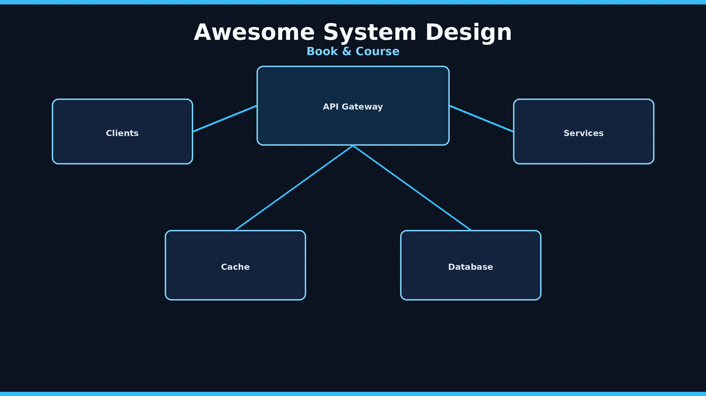

# 📚 Awesome System Design Book & Course: System Design

## ❣️ Support

There are many ways to support us; in exchange, you'll get this material in a proper format:

- ❤️ [shop.ditectrev.com, in EPUB or PDF formats](https://shop.ditectrev.com/product/TODO),
- ▶️ [Udemy, in an interactive video course format](https://www.udemy.com/course/TODO),
- 🆓 [Shorter, but free, part of our Udemy course is available on YouTube](https://www.youtube.com/playlist?list=TODO),
- 🖨️ [Amazon, printable physical book in paperback or hardcover (Kindle available, too)](https://www.amazon.com/dp/TODO),
- 📚 [Google Play Books, in PDF format](https://play.google.com/store/books/details?id=TODO),
- 🛍️ [Etsy, in PDF format](https://ditectrev.etsy.com/listing/TODO),
- 🛒 [eBay, in PDF format](https://www.ebay.com/itm/TODO),
- 🔄 [Patreon subscription allows you to get access to all of the materials in EPUB and PDF formats. You can also buy separate items on Patreon, but the subscription technically allows us to include all updates for EPUB and PDF formats. Hence, you get EPUB and PDF updates when you subscribe to Patreon](https://patreon.com/Ditectrev?utm_medium=unknown&utm_source=join_link&utm_campaign=creatorshare_creator&utm_content=copyLink).

💰 If you work for a company, you could probably easily claim this expense while learning this topic. For us, it's about being in the game or not.

⭐ Good ratings & reviews help us to survive. Please don't forget to leave a nice one when you purchase an item.

## ✨ This book & course is unlike any System Design book & course you will find online.

✋ Join a live online community and a book & course taught by industry experts and learn about System Design. We aim to build an ecosystem of Information Technology (IT) certifications and online courses in cooperation with the technology industry. We believe it will give our students 100% confidence in the pacing market in an open-source environment. We are just at the beginning of our way, so it's even better for you to join now!

## ⌛️ Short and to the point; why should you take the book & course:

1. Always happy to answer your questions 😊
2. Unhappy? Please raise a refund; we'll always accept it 💸
3. Learn about topics, such as 😱
   - Introduction to System Design:
     - What is System Design?;
     - What Problem System Design Solves;
     - System Design vs Software Design vs Architecture;
     - Building Blocks You Will Name;
   - Large-Scale Systems: Scalability, Availability, Reliability, and Performance:
     - Scalability;
     - Availability;
     - Fault Tolerance;
     - Reliability;
     - Performance;
     - Disaster Recovery;
   - Networking, Protocols, and Web Concepts:
     - TCP and UDP;
     - Domain Name System;
     - HTTP, HTTPS, and the Web Request Path;
     - Load Balancing;
   - API Design:
     - REST;
     - GraphQL;
     - gRPC and RPC;
     - API Gateways;
   - Databases and Storage:
     - SQL vs NoSQL;
     - Replication;
     - Sharding, Partitioning, and Federation;
   - Caching and Content Delivery Networks:
     - Eviction Policies;
     - Content Delivery Networks;
   - Message Queues, Streams, and Real-Time Communication:
     - Message Queues;
     - Publish-Subscribe and Event Streams;
     - Long Polling, WebSockets, and Server-Sent Events;
   - Architectural Patterns, Microservices, and Cloud-Native Architecture:
     - Monoliths, Modular Monoliths, and Microservices;
     - Event-Driven Architecture;
     - Cloud-Native Architecture;
   - Distributed Systems:
     - Consensus and Leader Election;
     - Split Brain and Network Partitions;
   - Algorithms and Data Structures for System Design:
     - Consistent Hashing;
     - Bloom Filters;
     - Rate-Limit Algorithms;
   - Security and Authentication:
     - OAuth 2.0 and OpenID Connect;
     - Encryption in Transit and at Rest;
   - Monitoring and Observability:
     - Logs, Metrics, and Traces;
     - Golden Signals;
   - Payment Systems:
     - Money Movement and Double-Entry Ledgers;
     - Idempotency Keys and Exactly-Once Charging;
   - AI and ML Systems:
     - Training vs Inference Architectures;
     - Vector Search and RAG;
     - LLM Inference, Batching, and Streaming;
   - System Design Interviews (Optional):
     - What is a System Design Interview?;
     - Product Interviews vs Infrastructure Interviews;
     - Junior vs Senior vs Staff Expectations;
   - The Interview Working Loop:
     - Clarify Functional and Non-Functional Requirements;
     - Back-of-the-Envelope Estimates;
     - High-Level Design First;
     - Diagramming Under Time Pressure;
   - Classic Warm-Up Problems:
     - Design a URL Shortener;
     - Design a Unique ID Generator;
     - Design a Rate Limiter;
     - Design Pastebin;
   - Social and Content Platforms:
     - Design Twitter;
     - Design Instagram;
     - Design a News Feed;
     - Design YouTube;
     - Design Netflix;
   - Messaging and Notifications:
     - Design WhatsApp;
     - Design a Notification System;
     - Design Zoom;
   - Marketplace, Maps, and Realtime:
     - Design Uber;
     - Design Airbnb;
     - Design Yelp;
     - Design Ticketmaster;
     - Design a Stock Exchange;
   - Storage, Search, and Collaboration:
     - Design Dropbox;
     - Design a Web Crawler;
     - Design Typeahead;
     - Design a Search Engine;
     - Design Google Docs;
   - Infrastructure and Platform Problems:
     - Design a Key-Value Store;
     - Design a Distributed Cache;
     - Design a Message Queue;
     - Design a Metrics System;
     - Design a Payment System;
     - Design an LLM Inference Platform;
   - Common Challenges and Debugging Tips;
   - Additional Resources and Reading Materials;
   - **Much More!**
4. Real Life examples ✅
5. The book & course explains the topic fully in-depth 🔬

## ☝️ Book & Course Updates

**[v1.0.0](../../releases/tag/v1.0.0): November 19, 2026.**

- Launch of the book.

**[v1.1.0](../../releases/tag/v1.1.0): December X, 2026.**

- Post-recording improvements.

**[v1.1.0](../../releases/tag/v1.1.0): December X, 2026.**

- Launch of the course.

## 🙋‍♀️ & 🙋‍♂️ Contribution

We are so thankful for every contribution, which makes sure we can deliver top-notch content. Whenever you find a missing resource, broken link in a [Table of Contents](#table-of-contents), the wrong answer, please submit an [issue](../../issues). Even better would be a [Pull Request (PR)](../../pulls).

## Who this book & course is for:

- 👨‍🎓 Enthusiasts of practical education;
- 👨‍🎓 Everyone who has heard about System Design and would like to know more;
- 👨‍🎓 Professionalists daily working with technology who want to have a basic grasp of System Design without burnout;
- 👨‍🎓 Sceptical Engineers about a book & course solely focused on System Design;
- 👨‍🎓 Self-paced Learners for whom expensive Bootcamps are unaffordable;
- 👨‍🎓 Students interested in Software Engineering and Distributed Systems;
- 👨‍🎓 Students willing to start a career as a Backend or Platform Engineer;
- 👨‍🎓 Specialists willing to know A to Z about System Design;

## Requirements

- 🤩 Excitement to learn!
- 0️⃣ Prior knowledge is required;
- ✅ You can learn System Design solely based on our book & course.

## Table of Contents

- [Introduction to System Design](#introduction-to-system-design)
  - [What is System Design?](#what-is-system-design)
  - [What Problem System Design Solves](#what-problem-system-design-solves)
  - [System Design vs Software Design vs Architecture](#system-design-vs-software-design-vs-architecture)
  - [Qualities You Design For](#qualities-you-design-for)
  - [Building Blocks You Will Name](#building-blocks-you-will-name)
    - [Cloud and Compute](#cloud-and-compute)
    - [Datastores, Caches, and Object Storage](#datastores-caches-and-object-storage)
    - [Async Paths, Edge, and Observability](#async-paths-edge-and-observability)
  - [How We Practice](#how-we-practice)
    - [Excalidraw as the Default Canvas](#excalidraw-as-the-default-canvas)
    - [diagrams.net and Cloud Icon Sets](#diagramsnet-and-cloud-icon-sets)
    - [Miro, FigJam, and Other Whiteboards You May Be Handed](#miro-figjam-and-other-whiteboards-you-may-be-handed)
  - [How this book is organized](#how-this-book-is-organized)
  - [Summary: Introduction to System Design](#summary-introduction-to-system-design)
- [Large-Scale Systems: Scalability, Availability, Reliability, and Performance](#large-scale-systems-scalability-availability-reliability-and-performance)
  - [What Large-Scale Means](#what-large-scale-means)
  - [Scalability](#scalability)
    - [Vertical Scaling](#vertical-scaling)
    - [Horizontal Scaling](#horizontal-scaling)
    - [Performance vs Scalability](#performance-vs-scalability)
  - [Availability](#availability)
    - [The Nines of Availability](#the-nines-of-availability)
    - [Availability in Sequence vs Parallel](#availability-in-sequence-vs-parallel)
    - [High Availability vs Fault Tolerance](#high-availability-vs-fault-tolerance)
  - [Fault Tolerance](#fault-tolerance)
    - [Single Points of Failure](#single-points-of-failure)
    - [Failover and Redundancy](#failover-and-redundancy)
    - [Active-Active vs Active-Passive](#active-active-vs-active-passive)
  - [Reliability](#reliability)
    - [Availability vs Reliability](#availability-vs-reliability)
    - [SLA, SLO, and SLI](#sla-slo-and-sli)
  - [Performance](#performance)
    - [Latency vs Throughput vs Bandwidth](#latency-vs-throughput-vs-bandwidth)
    - [Tail Latency and Percentiles](#tail-latency-and-percentiles)
    - [Numbers Worth Memorizing](#numbers-worth-memorizing)
  - [Disaster Recovery](#disaster-recovery)
    - [RPO, RTO, and Backup Strategies](#rpo-rto-and-backup-strategies)
    - [Multi-Region and Multi-Datacenter Failover](#multi-region-and-multi-datacenter-failover)
  - [Capacity Planning and Back-of-the-Envelope Math](#capacity-planning-and-back-of-the-envelope-math)
  - [Summary: Large-Scale Systems: Scalability, Availability, Reliability, and Performance](#summary-large-scale-systems-scalability-availability-reliability-and-performance)
- [Networking, Protocols, and Web Concepts](#networking-protocols-and-web-concepts)
  - [IP Addressing](#ip-addressing)
    - [IPv4 and IPv6](#ipv4-and-ipv6)
    - [Public vs Private Addresses](#public-vs-private-addresses)
  - [The OSI Model](#the-osi-model)
  - [TCP and UDP](#tcp-and-udp)
  - [Domain Name System](#domain-name-system)
    - [How DNS Resolution Works](#how-dns-resolution-works)
    - [Record Types and Caching](#record-types-and-caching)
  - [HTTP, HTTPS, and the Web Request Path](#http-https-and-the-web-request-path)
    - [Methods, Status Codes, and Headers](#methods-status-codes-and-headers)
    - [Cookies, Sessions, and CORS](#cookies-sessions-and-cors)
  - [TLS, SSL, and mTLS](#tls-ssl-and-mtls)
  - [Proxies](#proxies)
    - [Forward Proxy vs Reverse Proxy](#forward-proxy-vs-reverse-proxy)
    - [Load Balancer vs Reverse Proxy](#load-balancer-vs-reverse-proxy)
  - [Load Balancing](#load-balancing)
    - [Layer 4 vs Layer 7 Load Balancing](#layer-4-vs-layer-7-load-balancing)
    - [Routing Algorithms](#routing-algorithms)
    - [Health Checks, Sticky Sessions, and Failover](#health-checks-sticky-sessions-and-failover)
  - [Clustering vs Load Balancing](#clustering-vs-load-balancing)
  - [Checksums and Integrity on the Wire](#checksums-and-integrity-on-the-wire)
  - [Summary: Networking, Protocols, and Web Concepts](#summary-networking-protocols-and-web-concepts)
- [API Design](#api-design)
  - [What an API Must Make Obvious](#what-an-api-must-make-obvious)
  - [REST](#rest)
    - [Resources, Verbs, and Status Contracts](#resources-verbs-and-status-contracts)
    - [Pagination, Filtering, and Versioning](#pagination-filtering-and-versioning)
  - [GraphQL](#graphql)
  - [gRPC and RPC](#grpc-and-rpc)
  - [REST vs GraphQL vs gRPC](#rest-vs-graphql-vs-grpc)
  - [API Gateways](#api-gateways)
    - [Backend for Frontend](#backend-for-frontend)
  - [Webhooks](#webhooks)
  - [Idempotency in APIs](#idempotency-in-apis)
  - [Rate Limiting as an API Concern](#rate-limiting-as-an-api-concern)
  - [Error Contracts and Backward Compatibility](#error-contracts-and-backward-compatibility)
  - [Summary: API Design](#summary-api-design)
- [Databases and Storage](#databases-and-storage)
  - [What a Database Is in System Design](#what-a-database-is-in-system-design)
  - [Storage Layers](#storage-layers)
    - [File, Block, and Object Storage](#file-block-and-object-storage)
    - [RAID, NAS, and HDFS](#raid-nas-and-hdfs)
  - [SQL Databases](#sql-databases)
    - [Indexes, Materialized Views, and the N+1 Problem](#indexes-materialized-views-and-the-n1-problem)
    - [Normalization and Denormalization](#normalization-and-denormalization)
  - [NoSQL Databases](#nosql-databases)
    - [Key-Value, Document, Wide-Column, and Graph](#key-value-document-wide-column-and-graph)
  - [SQL vs NoSQL](#sql-vs-nosql)
  - [ACID, BASE, CAP, and PACELC](#acid-base-cap-and-pacelc)
  - [Transactions](#transactions)
    - [Local Transactions](#local-transactions)
    - [Distributed Transactions, Two-Phase Commit, and Sagas](#distributed-transactions-two-phase-commit-and-sagas)
  - [Replication](#replication)
    - [Single-Leader, Multi-Leader, and Leaderless](#single-leader-multi-leader-and-leaderless)
    - [Synchronous vs Asynchronous Replication](#synchronous-vs-asynchronous-replication)
  - [Sharding, Partitioning, and Federation](#sharding-partitioning-and-federation)
    - [Shard Keys That Age Well](#shard-keys-that-age-well)
    - [Resharding and Directory-Based Routing](#resharding-and-directory-based-routing)
  - [When to Pick SQL vs NoSQL](#when-to-pick-sql-vs-nosql)
  - [Summary: Databases and Storage](#summary-databases-and-storage)
- [Caching and Content Delivery Networks](#caching-and-content-delivery-networks)
  - [Why Caching Shows Up in Almost Every Design](#why-caching-shows-up-in-almost-every-design)
  - [Cache Hits, Misses, and Stampede](#cache-hits-misses-and-stampede)
  - [Where to Cache](#where-to-cache)
    - [Client, CDN, Application, and Database Caches](#client-cdn-application-and-database-caches)
  - [Write-Through, Write-Around, and Write-Back](#write-through-write-around-and-write-back)
  - [Eviction Policies](#eviction-policies)
  - [Distributed Cache and Hot Keys](#distributed-cache-and-hot-keys)
  - [Content Delivery Networks](#content-delivery-networks)
    - [Push CDNs vs Pull CDNs](#push-cdns-vs-pull-cdns)
    - [What a CDN Does Not Solve](#what-a-cdn-does-not-solve)
  - [Summary: Caching and Content Delivery Networks](#summary-caching-and-content-delivery-networks)
- [Message Queues, Streams, and Real-Time Communication](#message-queues-streams-and-real-time-communication)
  - [Synchronous vs Asynchronous Paths](#synchronous-vs-asynchronous-paths)
  - [Message Brokers](#message-brokers)
  - [Message Queues](#message-queues)
    - [At-Most-Once, At-Least-Once, and Exactly-Once](#at-most-once-at-least-once-and-exactly-once)
    - [Backpressure and Poison Messages](#backpressure-and-poison-messages)
  - [Publish-Subscribe and Event Streams](#publish-subscribe-and-event-streams)
    - [Queue vs Log vs Pub/Sub](#queue-vs-log-vs-pubsub)
  - [Task Queues](#task-queues)
  - [Long Polling, WebSockets, and Server-Sent Events](#long-polling-websockets-and-server-sent-events)
  - [WebRTC and Real-Time Media Paths](#webrtc-and-real-time-media-paths)
  - [Summary: Message Queues, Streams, and Real-Time Communication](#summary-message-queues-streams-and-real-time-communication)
- [Architectural Patterns, Microservices, and Cloud-Native Architecture](#architectural-patterns-microservices-and-cloud-native-architecture)
  - [N-Tier and Layered Architectures](#n-tier-and-layered-architectures)
  - [Monoliths, Modular Monoliths, and Microservices](#monoliths-modular-monoliths-and-microservices)
    - [When Microservices Are the Wrong Answer](#when-microservices-are-the-wrong-answer)
    - [Microservices vs SOA](#microservices-vs-soa)
    - [The Distributed Monolith](#the-distributed-monolith)
  - [Service Discovery and Service Mesh](#service-discovery-and-service-mesh)
  - [Circuit Breakers and Bulkheads](#circuit-breakers-and-bulkheads)
  - [Event-Driven Architecture](#event-driven-architecture)
  - [Event Sourcing](#event-sourcing)
  - [CQRS](#cqrs)
  - [Big Data Architecture Patterns](#big-data-architecture-patterns)
    - [Batch vs Stream Processing](#batch-vs-stream-processing)
    - [Lambda and Kappa](#lambda-and-kappa)
    - [Data Lakes, Warehouses, and Lakehouses](#data-lakes-warehouses-and-lakehouses)
    - [MapReduce and Its Descendants](#mapreduce-and-its-descendants)
  - [Cloud-Native Architecture](#cloud-native-architecture)
    - [VMs vs Containers](#vms-vs-containers)
    - [Orchestration, Twelve-Factor, and Stateless Services](#orchestration-twelve-factor-and-stateless-services)
    - [Managed Building Blocks vs Running Your Own](#managed-building-blocks-vs-running-your-own)
  - [Summary: Architectural Patterns, Microservices, and Cloud-Native Architecture](#summary-architectural-patterns-microservices-and-cloud-native-architecture)
- [Distributed Systems](#distributed-systems)
  - [Why Distributed Systems Fail Differently](#why-distributed-systems-fail-differently)
  - [Clocks, Time, and Ordering](#clocks-time-and-ordering)
  - [Consensus and Leader Election](#consensus-and-leader-election)
  - [Quorum, Gossip, and Membership](#quorum-gossip-and-membership)
  - [Distributed Locks and Coordination](#distributed-locks-and-coordination)
  - [Split Brain and Network Partitions](#split-brain-and-network-partitions)
  - [Idempotency, Dedup, and Exactly-Once Illusions](#idempotency-dedup-and-exactly-once-illusions)
  - [Multi-Datacenter Designs](#multi-datacenter-designs)
  - [Summary: Distributed Systems](#summary-distributed-systems)
- [Algorithms and Data Structures for System Design](#algorithms-and-data-structures-for-system-design)
  - [Which Algorithms Show Up in System Design](#which-algorithms-show-up-in-system-design)
  - [Consistent Hashing](#consistent-hashing)
  - [Bloom Filters](#bloom-filters)
  - [Count-Min Sketch and HyperLogLog](#count-min-sketch-and-hyperloglog)
  - [Tries and Prefix Indexes](#tries-and-prefix-indexes)
  - [Geohashes and Quadtrees](#geohashes-and-quadtrees)
  - [LSM Trees vs B-Trees](#lsm-trees-vs-b-trees)
  - [Merkle Trees](#merkle-trees)
  - [Rate-Limit Algorithms](#rate-limit-algorithms)
    - [Token Bucket, Leaky Bucket, and Sliding Window](#token-bucket-leaky-bucket-and-sliding-window)
  - [Summary: Algorithms and Data Structures for System Design](#summary-algorithms-and-data-structures-for-system-design)
- [Security and Authentication](#security-and-authentication)
  - [What Security Must Make Obvious](#what-security-must-make-obvious)
  - [Authentication vs Authorization](#authentication-vs-authorization)
  - [OAuth 2.0 and OpenID Connect](#oauth-20-and-openid-connect)
  - [Single Sign-On and SAML](#single-sign-on-and-saml)
  - [Sessions, Cookies, and Tokens](#sessions-cookies-and-tokens)
  - [Encryption in Transit and at Rest](#encryption-in-transit-and-at-rest)
  - [Secrets, Keys, and Least Privilege](#secrets-keys-and-least-privilege)
  - [DDoS, Abuse, and API Security](#ddos-abuse-and-api-security)
  - [Summary: Security and Authentication](#summary-security-and-authentication)
- [Monitoring and Observability](#monitoring-and-observability)
  - [Logs, Metrics, and Traces](#logs-metrics-and-traces)
  - [Golden Signals](#golden-signals)
  - [Alerting Without Pager Fatigue](#alerting-without-pager-fatigue)
  - [Dashboards You Can Sketch](#dashboards-you-can-sketch)
  - [Profiling and Continuous Profiling](#profiling-and-continuous-profiling)
  - [Summary: Monitoring and Observability](#summary-monitoring-and-observability)
- [Payment Systems](#payment-systems)
  - [What Makes Payments Different](#what-makes-payments-different)
  - [Money Movement and Double-Entry Ledgers](#money-movement-and-double-entry-ledgers)
  - [Idempotency Keys and Exactly-Once Charging](#idempotency-keys-and-exactly-once-charging)
  - [PSPs, Webhooks, and Reconciliation](#psps-webhooks-and-reconciliation)
  - [Wallets, Holds, and Settlement](#wallets-holds-and-settlement)
  - [PCI, Fraud, and Risk Controls](#pci-fraud-and-risk-controls)
  - [Summary: Payment Systems](#summary-payment-systems)
- [AI and ML Systems](#ai-and-ml-systems)
  - [Training vs Inference Architectures](#training-vs-inference-architectures)
  - [Feature Stores and Online vs Offline Features](#feature-stores-and-online-vs-offline-features)
  - [Recommendation and Ranking Pipelines](#recommendation-and-ranking-pipelines)
  - [Vector Search and RAG](#vector-search-and-rag)
  - [LLM Inference, Batching, and Streaming](#llm-inference-batching-and-streaming)
  - [GPU Scheduling, Cost, and Safety](#gpu-scheduling-cost-and-safety)
  - [Summary: AI and ML Systems](#summary-ai-and-ml-systems)
- [System Design Interviews (Optional)](#system-design-interviews-optional)
  - [What is a System Design Interview?](#what-is-a-system-design-interview)
  - [Product Interviews vs Infrastructure Interviews](#product-interviews-vs-infrastructure-interviews)
  - [Junior vs Senior vs Staff Expectations](#junior-vs-senior-vs-staff-expectations)
  - [What Interviewers Actually Score](#what-interviewers-actually-score)
  - [Summary: System Design Interviews (Optional)](#summary-system-design-interviews-optional)
- [The Interview Working Loop](#the-interview-working-loop)
  - [Clarify Functional and Non-Functional Requirements](#clarify-functional-and-non-functional-requirements)
  - [Back-of-the-Envelope Estimates](#back-of-the-envelope-estimates)
  - [Sketch the API and Data Model](#sketch-the-api-and-data-model)
  - [High-Level Design First](#high-level-design-first)
  - [Pick the Right Deep Dives](#pick-the-right-deep-dives)
  - [Wrap-Up, Trade-offs, and Failure Modes](#wrap-up-trade-offs-and-failure-modes)
  - [Diagramming Under Time Pressure](#diagramming-under-time-pressure)
    - [What to Draw in the First Five Minutes](#what-to-draw-in-the-first-five-minutes)
    - [Excalidraw, diagrams.net, and Whiteboard Habits](#excalidraw-diagramsnet-and-whiteboard-habits)
  - [Talking Out Loud Without Rambling](#talking-out-loud-without-rambling)
  - [Summary: The Interview Working Loop](#summary-the-interview-working-loop)
- [Classic Warm-Up Problems](#classic-warm-up-problems)
  - [Design a URL Shortener](#design-a-url-shortener)
    - [Requirements for a URL Shortener](#requirements-for-a-url-shortener)
    - [Hash vs Counter vs Base62](#hash-vs-counter-vs-base62)
    - [Redirect Path, 301 vs 302, and Analytics](#redirect-path-301-vs-302-and-analytics)
    - [Custom Aliases, Expiry, and Abuse](#custom-aliases-expiry-and-abuse)
  - [Design a Unique ID Generator](#design-a-unique-id-generator)
    - [Requirements for Unique IDs](#requirements-for-unique-ids)
    - [UUID vs Ticket Servers vs Snowflake](#uuid-vs-ticket-servers-vs-snowflake)
    - [Clock Drift and Datacenter IDs](#clock-drift-and-datacenter-ids)
  - [Design a Rate Limiter](#design-a-rate-limiter)
    - [Requirements for Rate Limiting](#requirements-for-rate-limiting)
    - [Distributed Rate Limits and Race Conditions](#distributed-rate-limits-and-race-conditions)
    - [Where the Rate Limiter Sits in the Path](#where-the-rate-limiter-sits-in-the-path)
  - [Design Pastebin](#design-pastebin)
    - [Requirements for Pastebin](#requirements-for-pastebin)
    - [Paste Metadata vs Blob Storage](#paste-metadata-vs-blob-storage)
    - [Expiry, Privacy, and Read-Heavy Traffic](#expiry-privacy-and-read-heavy-traffic)
  - [Summary: Classic Warm-Up Problems](#summary-classic-warm-up-problems)
- [Social and Content Platforms](#social-and-content-platforms)
  - [Design Twitter](#design-twitter)
    - [Requirements for Twitter](#requirements-for-twitter)
    - [Fan-out on Write vs Fan-out on Read](#fan-out-on-write-vs-fan-out-on-read)
    - [Home Timeline, User Timeline, and Search](#home-timeline-user-timeline-and-search)
    - [Celebrities, Trends, and Hot Partitions](#celebrities-trends-and-hot-partitions)
  - [Design Instagram](#design-instagram)
    - [Requirements for Instagram](#requirements-for-instagram)
    - [Upload Path, Thumbnails, and CDN](#upload-path-thumbnails-and-cdn)
    - [Follow Graph and Photo Feed](#follow-graph-and-photo-feed)
    - [Stories, Likes, and Counters](#stories-likes-and-counters)
  - [Design a News Feed](#design-a-news-feed)
    - [Requirements for a News Feed](#requirements-for-a-news-feed)
    - [Ranking, Freshness, and Personalization](#ranking-freshness-and-personalization)
    - [Feed Cache, Pagination, and Dedup](#feed-cache-pagination-and-dedup)
  - [Design YouTube](#design-youtube)
    - [Requirements for YouTube](#requirements-for-youtube)
    - [Upload, Transcoding, and Adaptive Bitrate](#upload-transcoding-and-adaptive-bitrate)
    - [Playback, CDN, and Thumbnails](#playback-cdn-and-thumbnails)
    - [Comments, Views, and Recommendations](#comments-views-and-recommendations)
  - [Design Netflix](#design-netflix)
    - [Requirements for Netflix](#requirements-for-netflix)
    - [Catalog, Playback, and Open Connect](#catalog-playback-and-open-connect)
    - [Personalization and A/B at Scale](#personalization-and-ab-at-scale)
  - [Summary: Social and Content Platforms](#summary-social-and-content-platforms)
- [Messaging and Notifications](#messaging-and-notifications)
  - [Design WhatsApp](#design-whatsapp)
    - [Requirements for WhatsApp](#requirements-for-whatsapp)
    - [One-to-One Messages and Delivery Receipts](#one-to-one-messages-and-delivery-receipts)
    - [Group Chat Fan-out](#group-chat-fan-out)
    - [Online Presence and Media Messages](#online-presence-and-media-messages)
  - [Design a Notification System](#design-a-notification-system)
    - [Requirements for Notifications](#requirements-for-notifications)
    - [Push, Email, SMS, and In-App Channels](#push-email-sms-and-in-app-channels)
    - [Priority, Batching, and Quiet Hours](#priority-batching-and-quiet-hours)
    - [Retries, Dedup, and User Preferences](#retries-dedup-and-user-preferences)
  - [Design Zoom](#design-zoom)
    - [Requirements for Zoom](#requirements-for-zoom)
    - [Signaling vs Media Paths](#signaling-vs-media-paths)
    - [SFU, MCU, and Bandwidth](#sfu-mcu-and-bandwidth)
    - [Recording, Chat, and Meeting State](#recording-chat-and-meeting-state)
  - [Summary: Messaging and Notifications](#summary-messaging-and-notifications)
- [Marketplace, Maps, and Realtime](#marketplace-maps-and-realtime)
  - [Design Uber](#design-uber)
    - [Requirements for Uber](#requirements-for-uber)
    - [Location Updates and Nearby Drivers](#location-updates-and-nearby-drivers)
    - [Matching, Dispatch, and Surge](#matching-dispatch-and-surge)
    - [Trip State, ETA, and Payments](#trip-state-eta-and-payments)
  - [Design Airbnb](#design-airbnb)
    - [Requirements for Airbnb](#requirements-for-airbnb)
    - [Search, Filters, and Availability](#search-filters-and-availability)
    - [Booking, Overbooking, and Idempotency](#booking-overbooking-and-idempotency)
    - [Host Calendar and Photos](#host-calendar-and-photos)
  - [Design Yelp](#design-yelp)
    - [Requirements for Yelp](#requirements-for-yelp)
    - [Geospatial Indexes and Nearby Search](#geospatial-indexes-and-nearby-search)
    - [Reviews, Photos, and Ranking](#reviews-photos-and-ranking)
  - [Design Ticketmaster](#design-ticketmaster)
    - [Requirements for Ticketmaster](#requirements-for-ticketmaster)
    - [Inventory, Holds, and Fair Queues](#inventory-holds-and-fair-queues)
    - [Flash Sales and Waiting Rooms](#flash-sales-and-waiting-rooms)
  - [Design a Stock Exchange](#design-a-stock-exchange)
    - [Requirements for a Stock Exchange](#requirements-for-a-stock-exchange)
    - [Matching Engine and Order Books](#matching-engine-and-order-books)
    - [Latency, Fairness, and Durability](#latency-fairness-and-durability)
  - [Summary: Marketplace, Maps, and Realtime](#summary-marketplace-maps-and-realtime)
- [Storage, Search, and Collaboration](#storage-search-and-collaboration)
  - [Design Dropbox](#design-dropbox)
    - [Requirements for Dropbox](#requirements-for-dropbox)
    - [Chunking, Dedup, and Sync](#chunking-dedup-and-sync)
    - [Metadata Service vs Block Store](#metadata-service-vs-block-store)
    - [Sharing, Versions, and Conflict](#sharing-versions-and-conflict)
  - [Design a Web Crawler](#design-a-web-crawler)
    - [Requirements for a Web Crawler](#requirements-for-a-web-crawler)
    - [Frontier, Politeness, and Robots](#frontier-politeness-and-robots)
    - [Dedup, DNS, and Storage](#dedup-dns-and-storage)
    - [Freshness and Recrawl Priority](#freshness-and-recrawl-priority)
  - [Design Typeahead](#design-typeahead)
    - [Requirements for Typeahead](#requirements-for-typeahead)
    - [Tries, Ranking, and Personalization](#tries-ranking-and-personalization)
    - [Caching Prefixes at the Edge](#caching-prefixes-at-the-edge)
  - [Design a Search Engine](#design-a-search-engine)
    - [Requirements for a Search Engine](#requirements-for-a-search-engine)
    - [Crawling, Indexing, and Ranking](#crawling-indexing-and-ranking)
    - [Serving, Sharding, and Freshness](#serving-sharding-and-freshness)
  - [Design Google Docs](#design-google-docs)
    - [Requirements for Google Docs](#requirements-for-google-docs)
    - [OT vs CRDT](#ot-vs-crdt)
    - [Presence, Cursors, and Persistence](#presence-cursors-and-persistence)
  - [Summary: Storage, Search, and Collaboration](#summary-storage-search-and-collaboration)
- [Infrastructure and Platform Problems](#infrastructure-and-platform-problems)
  - [Design a Key-Value Store](#design-a-key-value-store)
    - [Requirements for a Key-Value Store](#requirements-for-a-key-value-store)
    - [Partitioning, Replication, and Quorum](#partitioning-replication-and-quorum)
    - [Hinted Handoff, Gossip, and Rebalancing](#hinted-handoff-gossip-and-rebalancing)
  - [Design a Distributed Cache](#design-a-distributed-cache)
    - [Requirements for a Distributed Cache](#requirements-for-a-distributed-cache)
    - [Client Routing and Consistent Hashing Rings](#client-routing-and-consistent-hashing-rings)
    - [Replication, Failover, and Cache Warming](#replication-failover-and-cache-warming)
  - [Design a Message Queue](#design-a-message-queue)
    - [Requirements for a Message Queue](#requirements-for-a-message-queue)
    - [Topics, Partitions, and Consumer Groups](#topics-partitions-and-consumer-groups)
    - [Retention, Replay, and Dead-Letter Handling](#retention-replay-and-dead-letter-handling)
  - [Design a Metrics System](#design-a-metrics-system)
    - [Requirements for a Metrics System](#requirements-for-a-metrics-system)
    - [Ingestion, Aggregation, and Cardinality](#ingestion-aggregation-and-cardinality)
    - [Query Path, Downsampling, and Alerting](#query-path-downsampling-and-alerting)
  - [Design a Payment System](#design-a-payment-system)
    - [Requirements for a Payment System](#requirements-for-a-payment-system)
    - [Ledgers, Idempotency Keys, and Reconciliation](#ledgers-idempotency-keys-and-reconciliation)
    - [PSPs, Webhooks, and Failure Handling](#psps-webhooks-and-failure-handling)
  - [Design an LLM Inference Platform](#design-an-llm-inference-platform)
    - [Requirements for LLM Inference](#requirements-for-llm-inference)
    - [Token Streaming, Batching, and KV Cache](#token-streaming-batching-and-kv-cache)
    - [Rate Limits, Safety, and Cost Controls](#rate-limits-safety-and-cost-controls)
  - [Summary: Infrastructure and Platform Problems](#summary-infrastructure-and-platform-problems)
- [Common Challenges and Debugging Tips](#common-challenges-and-debugging-tips)
  - [Challenge: The Prompt is Huge and the Clock is Short](#challenge-the-prompt-is-huge-and-the-clock-is-short)
  - [Challenge: Estimates Were Wrong](#challenge-estimates-were-wrong)
  - [Challenge: You Deep-Dived the Wrong Bottleneck](#challenge-you-deep-dived-the-wrong-bottleneck)
  - [Challenge: The Interviewer Keeps Changing Requirements](#challenge-the-interviewer-keeps-changing-requirements)
  - [Challenge: You Went Silent at the Whiteboard](#challenge-you-went-silent-at-the-whiteboard)
  - [Challenge: Single Points of Failure You Missed](#challenge-single-points-of-failure-you-missed)
  - [Debug Order When a Design Falls Apart](#debug-order-when-a-design-falls-apart)
  - [A 30-Day System Design Practice Plan](#a-30-day-system-design-practice-plan)
  - [What Done Looks Like in a 45-Minute Loop](#what-done-looks-like-in-a-45-minute-loop)
  - [Summary: Common Challenges and Debugging Tips](#summary-common-challenges-and-debugging-tips)
- [Additional Resources and Reading Materials](#additional-resources-and-reading-materials)
  - [Recommended Tools and Software for System Design](#recommended-tools-and-software-for-system-design)
    - [Diagramming](#diagramming)
    - [Cloud Building Blocks](#cloud-building-blocks)
    - [Datastores, Caches, and Queues](#datastores-caches-and-queues)
  - [Further Reading and Industry Publications](#further-reading-and-industry-publications)
  - [Summary: Additional Resources and Reading Materials](#summary-additional-resources-and-reading-materials)

## Introduction to System Design

System design is how you choose components, contracts, and operational qualities so a product still works as load, data, and failure grow. This chapter defines the skill, names the problem it solves, separates it from software design and architecture, and shows the building blocks and canvases we will keep naming. We then show how the rest of this book is organized: foundations first, then an optional interview add-on, then applied designs such as Design Netflix and Design Twitter. The next chapter is Large-Scale Systems: Scalability, Availability, Reliability, and Performance.

### What is System Design?

**System design** is the work of choosing components, contracts, and operational qualities so a product can meet its requirements as load, data, and failure grow. A system is not one process. It is clients, DNS, load balancing, application services, datastores, caches, asynchronous pipelines, and the telemetry that tells you the path is sick.

The job on a product team is not to "use the cloud." The job is to wrap a request path you can test, operate, and change: who calls, what the contract is, where data lives, and what happens when a box dies.

A few words we will keep using:

- **Component:** a box on the path with a job — a load balancer, an application service, a datastore, a cache, a queue, an edge. You will name real products for these boxes later in this chapter.
- **Contract:** the API, the schema, the delivery guarantee, the timeout. Two services talk through a contract, not through hope.
- **Operational quality:** a non-functional requirement the path must hold: scale, availability, reliability, latency, durability. Large-Scale Systems: Scalability, Availability, Reliability, and Performance is the next chapter.
- **Trade-off:** two options, a criterion, a pick. You cannot maximize every quality at once.

**What system design is not:**

- Not software design inside one service. Classes, modules, and in-process APIs matter. They are a different skill. We separate the three layers in System Design vs Software Design vs Architecture.
- Not a logo collage. Naming [Kubernetes](https://kubernetes.io/) without a request path is not a design. "Reads go through [Redis](https://redis.io/) with a 30-second TTL because the feed is read-heavy and a slightly stale post is acceptable" is a design.
- Not a coding exercise. You may sketch a tiny interface or a schema. You will not implement a service in this book. There are no [CodeSandboxes](https://codesandbox.io/). You practice by drawing, estimating, and naming real products on purpose.

System design is trade-offs under constraints. "Put [Redis](https://redis.io/) and [Apache Kafka](https://kafka.apache.org/) everywhere" is not a design. The rest of this book trains the sentence that picks.

### What Problem System Design Solves

Without system design, a product is one process on one machine that only the happy path can describe. That works until traffic, data, or failure shows up. System design replaces that hope with a path you can scale, fail over, and operate.

**The daily problems system design is for:**

1. **Load**
   - One instance cannot take every request. A second instance needs a load balancer, a shared store, and a story for sessions.
   - System design is how you add capacity without rewriting the product: vertical first when it is cheaper, horizontal when a bigger box is not enough. Scalability is the next chapter.
2. **Data**
   - A single disk fills. A single primary cannot take every write. Blobs do not belong in a row store.
   - You choose [PostgreSQL](https://www.postgresql.org/) versus a cache versus object storage on purpose. Databases and Storage and Caching and Content Delivery Networks are those chapters.
3. **Failure**
   - Disks, processes, racks, and regions die. A dependency hangs. A deploy goes bad.
   - System design is redundancy, failover, timeouts, and the telemetry that tells you the path is sick — not a wish that hardware will be kind.
4. **Latency versus correctness**
   - Users feel tail latency. Finance and inventory feel stale writes.
   - You cannot always have both. A cache with a TTL, an asynchronous queue, a strongly consistent primary: each pick is a trade-off you can explain in a sentence.
5. **Change**
   - New features arrive. Traffic shape changes. Yesterday's bottleneck is not today's.
   - A contract you can version, a path you can split, and a quality you can measure are how you change the system without starting over.

**What you get once a path exists:**

- **A request you can trace.** Client → edge → load balancer → service → store, plus the async fork. Networking, Protocols, and Web Concepts is that path on the wire.
- **A place data lives on purpose.** Rows, blobs, caches, and logs are different jobs. Mixing them is how designs rot.
- **A failure story.** What dies, what still serves, what you postpone. Distributed Systems is why that story is surprising.
- **A way to operate it.** Logs, metrics, traces. Monitoring and Observability is the chapter.

A bigger virtual machine is not system design by itself. It is one lever. When that lever runs out, you need the rest of this book.

### System Design vs Software Design vs Architecture

Three layers show up in every later chapter. Mixing them up is the most common beginner trap, so we separate them now.

**1. Software design — inside one service**

- Modules, types, in-process APIs, tests, and how a single codebase is structured.
- The unit is a process you could run on a laptop. Latency is function calls. Failure is an exception you catch.
- This book does not teach that layer. You still sketch a tiny interface when a contract must be obvious. API Design is the contract between services, not the class diagram inside one of them.

**2. System design — the working path between services**

- Components, contracts, and operational qualities. The unit is a request path: who calls, what is stored, what is cached, what is async, what happens when a replica dies.
- You choose products on purpose: [PostgreSQL](https://www.postgresql.org/) versus [Redis](https://redis.io/), a queue versus [Apache Kafka](https://kafka.apache.org/), [NGINX](https://nginx.org/) or a cloud load balancer as the front door.
- This book is that layer. Foundations teach the levers. Applied designs at the end (Design a URL Shortener, Design Twitter, Design Netflix) use them on a full path.

**3. Architecture — the long-lived map**

- Domains, bounded contexts, which system owns which data, which team owns which path, what you will not build this year.
- Architectural Patterns, Microservices, and Cloud-Native Architecture is where monoliths, events, and [Kubernetes](https://kubernetes.io/) live. Architecture is the map. System design is how a request walks that map today.

**Working rule:** when we say software design, we mean inside one service. When we say system design, we mean the path and its qualities. When we say architecture, we mean the long-lived map those paths sit on. A clean module layout does not make a feed scale. A [Kubernetes](https://kubernetes.io/) cluster does not make a schema right. Name the layer you are in before you pick a box.

### Qualities You Design For

Functional requirements are what the product does: shorten a URL, fan out a post, charge a card. **Non-functional requirements** are the qualities the path must hold while it does that. Specs often start from the functional list; the skill starts from both. We teach the qualities first so later designs have words for the constraint.

The qualities we will spend the next chapter on:

- **Scalability.** The path still works as load and data grow. Vertical scaling is a bigger box. Horizontal scaling is more boxes. They are not the same, and performance is not a synonym for either.
- **Availability.** The path answers when a user asks. Nines, sequence versus parallel, high availability versus fault tolerance.
- **Fault tolerance.** What happens when a component dies: single points of failure, failover, active-active versus active-passive.
- **Reliability.** The path is correct over time, not only up. Availability versus reliability; SLA, SLO, and SLI.
- **Performance.** Latency, throughput, bandwidth, tail percentiles, and the numbers worth memorizing so estimates are not fiction.
- **Disaster recovery.** RPO, RTO, backups, multi-region. A second process in one rack is not a region story.

You cannot maximize all of them. A strongly consistent multi-region write path will cost latency. A cache that hides the primary will cost freshness. Write the qualities that matter for *this* path, then pick. Capacity planning and back-of-the-envelope math is how those picks get numbers. We do that in the next chapter, not as a 45-minute ritual.

### Building Blocks You Will Name

We teach these later. We link them now so "the cloud" is not a fog. Name a product when the choice matters. A box labeled "database" is fine on the first sketch; a box labeled [PostgreSQL](https://www.postgresql.org/) that you cannot explain is worse than the unlabeled box.

#### Cloud and Compute

**[Amazon Web Services (AWS)](https://aws.amazon.com/)**, **[Google Cloud](https://cloud.google.com/)**, and **[Microsoft Azure](https://azure.microsoft.com/)** are the three hosted platforms most teams will accept as a sketch. They sell compute, networking, stores, and managed building blocks. You do not need an account today. You do need to know they are vendors, not designs.

- **Primary function:** rent regions, instances, load balancers, and managed services so you do not rack hardware for the first path.
- **When we send you here:** when a later chapter names a managed building block (object storage, a load balancer, a managed queue) and you need a product you can point at.
- **What they are not:** not a reason to draw every product in the catalog. Reciting [AWS](https://aws.amazon.com/) names without a why is weaker than naming "blob store" and the trade-off.

**[Kubernetes](https://kubernetes.io/)** is how many teams run containers. Official site: [kubernetes.io](https://kubernetes.io/). Docs: [Kubernetes documentation](https://kubernetes.io/docs/). It is a later chapter (Cloud-Native Architecture), not a default first box. A request path that cannot be explained without a cluster is usually a path you have not designed yet.

**[NGINX](https://nginx.org/)** and **[Envoy](https://www.envoyproxy.io/)** are reverse proxies you can put in front of application servers. Cloud load balancers are the hosted equivalent. Load Balancing in Networking, Protocols, and Web Concepts is the chapter. For a first sketch, "load balancer" plus who it health-checks is enough.

#### Datastores, Caches, and Object Storage

**[PostgreSQL](https://www.postgresql.org/)** is the default relational answer in this book. Official site: [postgresql.org](https://www.postgresql.org/). Docs: [PostgreSQL documentation](https://www.postgresql.org/docs/). Use it when you need rows, transactions, and a schema you can query. SQL Databases is the later write-up.

**[Redis](https://redis.io/)** is the default cache and fast key-value answer. Official site: [redis.io](https://redis.io/). Docs: [Redis documentation](https://redis.io/docs/). Use it when reads dominate and a TTL is an acceptable lie. It is not a durable primary because you named it. Caching and Content Delivery Networks is the chapter.

**Object storage** is where blobs and media go. Products: [Amazon S3](https://aws.amazon.com/s3/), [Google Cloud Storage](https://cloud.google.com/storage), [Azure Blob Storage](https://azure.microsoft.com/products/storage/blobs). Metadata stays in a row store. The blob stays in object storage. Mixing those jobs is how photo and video paths explode a database.

Databases and Storage unpacks SQL versus NoSQL, replication, and sharding. This section only names the defaults so later sentences have somewhere to point.

#### Async Paths, Edge, and Observability

**[Apache Kafka](https://kafka.apache.org/)** is the log/stream name you will keep seeing. Official site: [kafka.apache.org](https://kafka.apache.org/). Docs: [Apache Kafka documentation](https://kafka.apache.org/documentation/). A simpler message queue is often the right first async box. Jumping to a log because the name is famous is the same mistake as putting [Redis](https://redis.io/) on every arrow. Message Queues, Streams, and Real-Time Communication is the chapter.

**[Cloudflare](https://www.cloudflare.com/)** is a CDN and edge product you can point at. Official site: [cloudflare.com](https://www.cloudflare.com/). Docs: [Cloudflare Docs](https://developers.cloudflare.com/). A CDN is not a cache for personalized, write-heavy data. What a CDN Does Not Solve lives under Caching and Content Delivery Networks.

**Observability** is how you prove the path is operable. **[Prometheus](https://prometheus.io/)** and **[Grafana](https://grafana.com/)** are the default open metrics-and-dashboard pair. **[Datadog](https://www.datadoghq.com/)** is a hosted equivalent. **[OpenTelemetry](https://opentelemetry.io/)** is how traces and metrics get a vendor-neutral shape. Monitoring and Observability is the chapter. A design with no "how would you know this is sick?" is unfinished.

### How We Practice

This book is tools-heavy and has no code snippets, so it has no [CodeSandboxes](https://codesandbox.io/). You practice by drawing the path, estimating the numbers that change the design, and naming products only when the choice matters. This section is a map, not a lab. You do not need a cloud account to finish this chapter.

**What you need for the main path:**

- A web browser.
- A canvas: [Excalidraw](https://excalidraw.com/) by default, [diagrams.net](https://www.diagrams.net/) for notes.
- No paid cloud plan. No [Kubernetes](https://kubernetes.io/) cluster. No local database to install.

**The canvases we will keep naming:**

#### [Excalidraw](https://excalidraw.com/) as the Default Canvas

**[Excalidraw](https://excalidraw.com/)**

- **Primary function:** a fast infinite canvas. Boxes, arrows, and handwriting without a stencil library getting in the way.
- **When we send you here:** after a foundations chapter, redraw the core picture from memory (request path, replication, cache placement). After an applied design, draw the whole path before you peek.
- **How you open it:** [excalidraw.com](https://excalidraw.com/). Developer docs: [Excalidraw documentation](https://docs.excalidraw.com/). Source: [excalidraw/excalidraw](https://github.com/excalidraw/excalidraw).
- **What it is not:** not an [AWS](https://aws.amazon.com/) / [Google Cloud](https://cloud.google.com/) / [Azure](https://azure.microsoft.com/) shape kit. For those libraries, use [diagrams.net](https://www.diagrams.net/).

#### [diagrams.net](https://www.diagrams.net/) and Cloud Icon Sets

**[diagrams.net](https://www.diagrams.net/)** (also called [draw.io](https://www.drawio.com/))

- **Primary function:** structured diagrams with official cloud shape libraries.
- **When we send you here:** study notes, take-home diagrams, and when you want [AWS Architecture Icons](https://aws.amazon.com/architecture/icons/), [Google Cloud icons](https://cloud.google.com/icons), or [Azure architecture icons](https://learn.microsoft.com/azure/architecture/icons/) on the page.
- **How you open it:** [app.diagrams.net](https://app.diagrams.net/). Product: [diagrams.net](https://www.diagrams.net/).
- **What it is not:** not the fastest first sketch. Prefer [Excalidraw](https://excalidraw.com/) unless you already need stencils.

Use the icon sets in [diagrams.net](https://www.diagrams.net/) when you write notes. Do not pause a working sketch to hunt a perfect [Amazon S3](https://aws.amazon.com/s3/) stencil. Pretty diagrams are not the skill. A readable path is.

#### [Miro](https://miro.com/), [FigJam](https://www.figma.com/figjam/), and Other Whiteboards You May Be Handed

**[Miro](https://miro.com/)** and **[FigJam](https://www.figma.com/figjam/)** (from [Figma](https://www.figma.com/)) are company whiteboards. **[CoderPad](https://coderpad.io/)** is often a coding pad with a drawing mode. **[Google Drawings](https://docs.google.com/drawings)** shows up when the loop is a shared doc. A physical whiteboard is still a canvas.

- **Primary function:** collaborative boards other people already opened.
- **When we send you here:** when your team, your recruiter, or a later optional interview chapter named the tool. Do not make them the study default.
- **How you open them:** [miro.com](https://miro.com/), [FigJam](https://www.figma.com/figjam/), [coderpad.io](https://coderpad.io/), [Google Drawings](https://docs.google.com/drawings).
- **What they are not:** not required for this book. The skill does not change with the canvas. Freezing because the tool is new is a communication problem, not a system design problem.

**Working loop we will repeat:**

1. Read the chapter (this README is the lesson).
2. Redraw the picture in [Excalidraw](https://excalidraw.com/) (or [diagrams.net](https://www.diagrams.net/) for notes).
3. Name real products only when the choice matters: [Redis](https://redis.io/) versus [PostgreSQL](https://www.postgresql.org/), [Apache Kafka](https://kafka.apache.org/) versus a simpler queue, [Cloudflare](https://www.cloudflare.com/) as an edge, [Prometheus](https://prometheus.io/) plus [Grafana](https://grafana.com/) or [Datadog](https://www.datadoghq.com/) as telemetry.
4. Change one constraint (load, data size, a region dying) and redraw. That is the skill. Timed 45-minute practice waits until the optional interview add-on.

### How this book is organized

Every later chapter is a working loop: read the lever, draw it, name a product on purpose. We stay tools-heavy. There are no [CodeSandboxes](https://codesandbox.io/) in this book. Chapter names in the Table of Contents are the contract; when we say Large-Scale Systems: Scalability, Availability, Reliability, and Performance, that is the next heading you will meet.

- **Foundations.** Qualities, networking, APIs, databases, caches, queues, patterns, distributed systems, algorithms, security, observability, payments, and AI systems. This is the skill.
- **System Design Interviews (Optional)** and **The Interview Working Loop.** Skip these if you are here to design systems at work. Read them if you also need a 45-minute conversation on a shared canvas.
- **Applied designs.** Classic Warm-Up Problems through Infrastructure and Platform Problems: Design a URL Shortener, Design Twitter, Design Netflix, Design a Key-Value Store, and the rest. They apply the foundations. They are not a substitute for the foundations.
- **Common Challenges and Debugging Tips** and **Additional Resources and Reading Materials.** Debug order, a 30-day practice plan, and the catalog.

We will not invent company case studies. Each chapter ends with `Summary: {that chapter's title}` and points to the next heading. There is no `Conclusion` heading.

Do not collect twenty cloud accounts today. Collect a canvas ([Excalidraw](https://excalidraw.com/)), then draw.

Your loop for the rest of today: finish this chapter, then in Large-Scale Systems: Scalability, Availability, Reliability, and Performance learn the qualities every later path is judged by.

### Summary: Introduction to System Design

System design is choosing components, contracts, and operational qualities so a path still works as load, data, and failure grow — not software design inside one service, not an architecture map, and not a cloud-logo collage. The problems it solves are load, data, failure, latency versus correctness, and change. The building blocks you will keep naming are products such as [Amazon Web Services (AWS)](https://aws.amazon.com/), [Google Cloud](https://cloud.google.com/), [Microsoft Azure](https://azure.microsoft.com/), [PostgreSQL](https://www.postgresql.org/), [Redis](https://redis.io/), [Apache Kafka](https://kafka.apache.org/), and [Cloudflare](https://www.cloudflare.com/). Practice on [Excalidraw](https://excalidraw.com/), keep [diagrams.net](https://www.diagrams.net/) for notes, and treat [Miro](https://miro.com/), [FigJam](https://www.figma.com/figjam/), and [CoderPad](https://coderpad.io/) as tools you may be handed. This book is foundations first, then an optional interview add-on, then applied designs. Next is **Large-Scale Systems: Scalability, Availability, Reliability, and Performance**.

## Large-Scale Systems: Scalability, Availability, Reliability, and Performance

Introduction to System Design named the qualities every later path is judged by. This chapter is those qualities, with numbers attached: what "large-scale" actually means, how you grow a path, how you keep it answering, how you keep it correct, how you make it fast enough, what you do when a region dies, and how back-of-the-envelope math keeps the sketch honest. We stay tools-heavy. There are no [CodeSandboxes](https://codesandbox.io/). You practice by drawing the path in [Excalidraw](https://excalidraw.com/) and naming products only when the choice matters. The next chapter is Networking, Protocols, and Web Concepts — the request path on the wire.

You cannot maximize every quality at once. Write the ones that matter for *this* path, then pick.

### What Large-Scale Means

**Large-scale** is not a slogan and not a user-count trophy. A path is large-scale when **one box, one disk, or one failure domain is no longer a complete story**. The questions change: how does load grow, where does data live, what dies together, and how far away is the user.

**The four axes you actually mean:**

1. **Load.** Requests per second, concurrent sessions, peak versus average. One instance of an application, one [Amazon EC2](https://aws.amazon.com/ec2/) size, or one [Google Compute Engine](https://cloud.google.com/compute) machine type stops being enough.
2. **Data.** Rows, blobs, logs, and indexes. A single disk fills. A single [PostgreSQL](https://www.postgresql.org/) primary cannot take every write. Blobs belong in object storage ([Amazon S3](https://aws.amazon.com/s3/), [Google Cloud Storage](https://cloud.google.com/storage), [Azure Blob Storage](https://azure.microsoft.com/products/storage/blobs)), not in a row.
3. **Failure domain.** What dies together: a process, a host, a rack, an availability zone, a region. [AWS Regions and Availability Zones](https://aws.amazon.com/about-aws/global-infrastructure/regions_az/), [Google Cloud locations](https://cloud.google.com/about/locations), and [Azure geographies](https://azure.microsoft.com/explore/global-infrastructure/geographies/) are the maps vendors publish. Two processes on one host are not two failure domains.
4. **Geography.** Users in more than one place. Light is fast and still slow across an ocean. A [Cloudflare](https://www.cloudflare.com/) edge or a [Amazon CloudFront](https://aws.amazon.com/cloudfront/) cache is a geography story, not a "we used a CDN" sticker.

**What large-scale is not:**

- Not "we will have a million users." Say the QPS, the data size, and the region story, or you have not scoped the path.
- Not a reason to draw [Kubernetes](https://kubernetes.io/) on slide one. Orchestration is a later chapter. Scale is a quality of the path.
- Not a reason to skip the single-box design. Vertical scaling is often the right first lever. We teach it before horizontal scaling on purpose.

**Working rule:** large-scale starts when you can name what a bigger box cannot fix. Until then, say the numbers and stay honest.

### Scalability

**Scalability** is whether the path still meets its other qualities as load and data grow. You add resources. You do not rewrite the product every time traffic doubles.

Two levers exist. They are not synonyms, and they are not equally cheap.

- **Vertical scaling** — a bigger box: more CPU, RAM, disk, IOPS.
- **Horizontal scaling** — more boxes: replicas behind a load balancer, shards, partitions.

Vendors sell both. [Amazon EC2](https://aws.amazon.com/ec2/) instance families, [Google Compute Engine](https://cloud.google.com/compute) machine types, and [Azure Virtual Machines](https://azure.microsoft.com/products/virtual-machines) are the vertical catalog. [AWS Auto Scaling](https://aws.amazon.com/autoscaling/), [Kubernetes Horizontal Pod Autoscaler](https://kubernetes.io/docs/tasks/run-application/horizontal-pod-autoscale/), and a load balancer ([AWS Elastic Load Balancing](https://aws.amazon.com/elasticloadbalancing/), [Google Cloud Load Balancing](https://cloud.google.com/load-balancing), [Azure Load Balancer](https://azure.microsoft.com/products/load-balancer), [NGINX](https://nginx.org/), [HAProxy](https://www.haproxy.org/), [Envoy](https://www.envoyproxy.io/)) are the horizontal catalog.

**Working rule:** say which lever you are pulling, why the other one is worse *here*, and what state the new box shares.

#### Vertical Scaling

**Vertical scaling** (scale up) means you give the same component more hardware. One [PostgreSQL](https://www.postgresql.org/) primary on a larger [Amazon RDS](https://aws.amazon.com/rds/) instance. One API process with more RAM. One disk with more IOPS.

**[Amazon EC2](https://aws.amazon.com/ec2/)**, **[Google Compute Engine](https://cloud.google.com/compute)**, and **[Azure Virtual Machines](https://azure.microsoft.com/products/virtual-machines)**

- **Primary function:** rent a machine whose size you can change. CPU, memory, network, and (on some families) local disk come in a menu.
- **When we send you here:** the path is one stateful box, the bottleneck is that box, and a larger size is cheaper than splitting state.
- **What they are not:** not infinite. Every family has a largest size. Licensing, RAM, and IOPS ceilings are real. A bigger primary is still one failure domain.

**Why vertical is the default first move:**

1. **The application does not change.** No load balancer, no shared session store, no shard key.
2. **Operations stay simple.** One primary to backup, one box to watch in [Amazon CloudWatch](https://aws.amazon.com/cloudwatch/), [Google Cloud Monitoring](https://cloud.google.com/monitoring), or [Azure Monitor](https://azure.microsoft.com/products/monitor).
3. **It is often cheaper at small scale.** Two small instances plus a load balancer plus a shared [Redis](https://redis.io/) can cost more than one medium instance, and fail in more ways.

**The ceilings you will hit:**

- A largest instance type. After that, money does not buy another core on that box.
- A single-writer datastore. [PostgreSQL](https://www.postgresql.org/) on one primary still serializes writes that touch the same rows, no matter how large the VM.
- Blast radius. The bigger the box, the more of the product dies with it.
- Deploy and reboot time. Vertical changes often mean a restart. Horizontal adds a replica beside a live one.

**Working rule:** scale up until the next size is more expensive, slower to change, or still a single point of failure you cannot accept. Then scale out.

#### Horizontal Scaling

**Horizontal scaling** (scale out) means you add instances of the same role and split work across them. Stateless API replicas behind a load balancer. Read replicas. Shards. Partitions of a log.

This only works if the new box can do useful work without owning all the state.

**What has to be true:**

1. **A front door that spreads traffic.** [AWS Elastic Load Balancing](https://aws.amazon.com/elasticloadbalancing/), [Google Cloud Load Balancing](https://cloud.google.com/load-balancing), [Azure Load Balancer](https://azure.microsoft.com/products/load-balancer), or software such as [NGINX](https://nginx.org/), [HAProxy](https://www.haproxy.org/), and [Envoy](https://www.envoyproxy.io/). Networking, Protocols, and Web Concepts is the load-balancing chapter. For this quality, you only need: health checks, and a story for what happens when an instance disappears.
2. **State that is shared or partitioned on purpose.** Sessions in [Redis](https://redis.io/) (or [Amazon ElastiCache](https://aws.amazon.com/elasticache/)), rows in a shared [PostgreSQL](https://www.postgresql.org/) (or [Amazon RDS](https://aws.amazon.com/rds/)), blobs in [Amazon S3](https://aws.amazon.com/s3/). Sticky sessions on the load balancer are a patch, not a design.
3. **A way to add and remove boxes without a meeting.** [AWS Auto Scaling](https://aws.amazon.com/autoscaling/) for VMs and target groups. [Kubernetes Horizontal Pod Autoscaler](https://kubernetes.io/docs/tasks/run-application/horizontal-pod-autoscale/) when you are already on [Kubernetes](https://kubernetes.io/). Autoscaling that cannot see a meaningful metric is a fan.

**[AWS Auto Scaling](https://aws.amazon.com/autoscaling/)**

- **Primary function:** add or remove instances from a group from a metric (CPU, request count, a custom metric in [Amazon CloudWatch](https://aws.amazon.com/cloudwatch/)).
- **When we send you here:** VM-shaped compute on [AWS](https://aws.amazon.com/), a load balancer in front, and a metric that actually tracks work.
- **What it is not:** not a substitute for a shard key. It will not split a single-writer primary for you.

**[Kubernetes Horizontal Pod Autoscaler](https://kubernetes.io/docs/tasks/run-application/horizontal-pod-autoscale/)**

- **Primary function:** change the replica count of a workload from CPU, memory, or custom metrics.
- **When we send you here:** the path is already containers on [Kubernetes](https://kubernetes.io/). Docs: [Kubernetes documentation](https://kubernetes.io/docs/).
- **What it is not:** not a reason to introduce [Kubernetes](https://kubernetes.io/) so you can scale. A managed load balancer plus [AWS Auto Scaling](https://aws.amazon.com/autoscaling/) is a complete horizontal story.

**What horizontal does not fix:**

- A hot key. Ten replicas still serialize on one popular row or one [Redis](https://redis.io/) slot.
- A chatty database. More app boxes can make the datastore worse.
- A stateful process that stores uploads on local disk. The next replica does not have the file.

**Working rule:** scale out the *stateless* hop first. Partition the *stateful* hop only when one box cannot hold the writes or the data. Databases and Storage is that later split.

#### Performance vs Scalability

**Performance** is how a path behaves at a given load: latency, throughput, resource cost per request. **Scalability** is whether those numbers stay acceptable when load and data grow. A fast system can be unscalable. A scalable system can be slow.

**The mix-up you will hear:**

- "It is slow, so we need to scale." Maybe. First ask whether the current box is idle. An N+1 query, a missing index, a lock, or a remote call in a loop is a performance bug. Adding replicas copies the bug.
- "It is fast, so it will scale." A single in-memory [Redis](https://redis.io/) on one host can be extremely fast and still be one disk, one NIC, and one failure domain.
- "We put it on [Kubernetes](https://kubernetes.io/), so it scales." Orchestration does not invent a shard key or a cache TTL.

**How you tell them apart on a sketch:**

1. Hold load constant. Can you make one request faster? That is performance: indexes, a [Redis](https://redis.io/) TTL, a [Cloudflare](https://www.cloudflare.com/) cache, a smaller payload, fewer hops.
2. Hold the code constant. Can you add resources and take more work? That is scalability: a bigger [Amazon RDS](https://aws.amazon.com/rds/) size, more API replicas behind [AWS Elastic Load Balancing](https://aws.amazon.com/elasticloadbalancing/), a second shard.

You usually need both. Tune the request you have. Then pick the lever that grows capacity. Performance later in this chapter is the vocabulary (latency, throughput, tails, numbers). Scalability is the growth story.

**Working rule:** fast ≠ scalable. Say which one you are fixing before you add a box.

### Availability

**Availability** is whether the path answers when a client asks. The usual forms:

- **Time-based:** uptime / (uptime + downtime). Simple for a single box.
- **Yield-based:** successful requests / valid requests. The form [Site Reliability Engineering](https://sre.google/sre-book/table-of-contents/) prefers for multi-replica services that are never fully "down" everywhere. Canonical write-up: [Embracing Risk](https://sre.google/sre-book/embracing-risk/).

A 200 that took 30 seconds may still count as available if your SLI is "HTTP not 5xx." It is not a performance win. Write the definition before you quote a percentage.

Vendors publish **service level agreements** for their building blocks ([AWS Service Level Agreements](https://aws.amazon.com/legal/service-level-agreements/), [Google Cloud SLAs](https://cloud.google.com/terms/sla), [Azure SLAs](https://www.microsoft.com/licensing/docs/view/Service-Level-Agreements-SLA-for-Online-Services)). Those are *their* promises about *their* products, not your product's availability. Your number is composed from every hop you added.

#### The Nines of Availability

People say "three nines" instead of 99.9%. Each extra nine is roughly **ten times less** allowed unavailability, not a rounding error. The [Google SRE availability table](https://sre.google/sre-book/availability-table/) is the sheet everyone else is quoting.

| Availability | Name | Allowed unavailability per year |
| --- | --- | --- |
| 90% | one nine | 36.5 days |
| 99% | two nines | 3.65 days |
| 99.9% | three nines | 8.76 hours |
| 99.95% | three and a half nines | 4.38 hours |
| 99.99% | four nines | 52.6 minutes |
| 99.999% | five nines | 5.26 minutes |

*Allowed unavailability in a year from the [Google SRE availability table](https://sre.google/sre-book/availability-table/), assuming no planned downtime.*

**How to use the table:**

- **99% (two nines)** is a weekend of downtime a year. Fine for an internal tool. Not fine for a checkout path.
- **99.9% (three nines)** is a working day of downtime a year. A common first SLO for a user-facing path that is not money movement.
- **99.99% (four nines)** is under an hour a year. Deploys, failovers, and paging have to be measured in minutes. [Embracing Risk](https://sre.google/sre-book/embracing-risk/) is explicit: 100% is not a target.
- **99.999% (five nines)** is a coffee break a year. You do not get there by adding one more replica in the same zone.

**Error budget.** If the SLO is 99.9%, the budget is the 0.1% you are allowed to spend on deploys, incidents, and experiments. [Service Level Objectives](https://sre.google/sre-book/service-level-objectives/) in the [Google SRE book](https://sre.google/sre-book/table-of-contents/) is the definition. Spend it on purpose. Hide it and you will spend it on accidents.

**Working rule:** pick nines from the user and the cost, not from a slide that says "highly available." Each extra nine is an architecture change, not a nicer dashboard.

#### Availability in Sequence vs Parallel

Hops **in sequence** multiply. Replicas **in parallel** recover what multiplication lost.

**Sequence (the request walks A, then B, then C):**

If each hop is independently available with probability `A`, `B`, `C`, the path is available with `A × B × C`. Three hops at 99.9% are about **99.7%** together, not 99.9%. Every extra synchronous dependency is a haircut. Timeouts, retries, and caches exist because of this arithmetic, not because they look like "production."

**Parallel (the request can use replica 1 *or* replica 2):**

If each replica fails independently with probability `F`, two replicas fail together with `F × F`. Two hops at 99% in parallel are about **99.99%**, if failover actually works and they do not share a failure domain. Two processes on one host share a host. Two instances in one availability zone share a zone.

**What "independent" actually requires:**

- Separate hosts, preferably separate [AWS Availability Zones](https://aws.amazon.com/about-aws/global-infrastructure/regions_az/) (or the [Google Cloud](https://cloud.google.com/about/locations) / [Azure](https://azure.microsoft.com/explore/global-infrastructure/geographies/) equivalent).
- Separate connection pools, disks, and deploy waves. A lockstep deploy of both replicas is one failure.
- A load balancer that **health-checks** and stops sending to the dead one. [AWS Elastic Load Balancing](https://aws.amazon.com/elasticloadbalancing/) target health, [Kubernetes](https://kubernetes.io/) [liveness and readiness probes](https://kubernetes.io/docs/tasks/configure-pod-container/configure-liveness-readiness-startup-probes/), and [Amazon Route 53](https://aws.amazon.com/route53/) health checks are that switch. A replica that is up in the config and dead in reality is still sequence math.

**Working rule:** count synchronous hops (they cost nines). Count independent replicas (they buy nines). Shared fate is still sequence, even if you drew two boxes.

#### High Availability vs Fault Tolerance

These phrases get used as synonyms. They are not.

**High availability (HA)** is a *target and a posture*: the path keeps answering through the failures you planned for, usually by hiding them behind redundancy and failover. An [Amazon RDS Multi-AZ](https://aws.amazon.com/rds/features/multi-az/) deployment, two API replicas in two zones, a load balancer with health checks — that is HA work. The user may not notice the failover. The system did fail; you masked it.

**Fault tolerance (FT)** is a *property of the design*: the path continues to provide *correct* service while a component is actually broken, not only after you have replaced it. Replicated writes with a quorum, a retry that cannot double-charge, a replica that was already serving. Fault Tolerance is the next heading; we separate the words here so you do not write "HA/FT" and sit down.

**Practical differences on a sketch:**

- HA often accepts a brief interruption (DNS failover, a 30-second [Amazon RDS](https://aws.amazon.com/rds/) failover, a crashed pod while [Kubernetes](https://kubernetes.io/) starts another). The SLO still holds if the budget allows it.
- FT means a client that retried, or a replica that was already in the set, still got a correct answer *during* the fault. That is harder. It is also how you spend money: extra replicas, extra regions, extra coordination.
- An HA pair that shares a disk is not fault tolerant to that disk. An FT replica set that returns stale data may still be "up." Availability versus reliability is coming.

Vendor checklists ([AWS Well-Architected Reliability Pillar](https://docs.aws.amazon.com/wellarchitected/latest/reliability-pillar/welcome.html), [Google Cloud Architecture Framework](https://cloud.google.com/architecture/framework), [Azure Well-Architected Framework](https://learn.microsoft.com/azure/well-architected/)) mix these words. You will not. On the sketch, write **what dies**, **what still serves**, and **whether the answer is still correct**.

**Working rule:** HA is "users still get an answer." Fault tolerance is "the answer is still right while something is broken." Buy them separately.

### Fault Tolerance

**Fault tolerance** is the story you tell when a component dies, hangs, or lies. Disks fail. Processes OOM. Zones flood. Dependencies time out. A design with no death story is a hope.

The loop is always the same:

1. Name the component and its failure domain.
2. Say what the client sees (error, retry, stale data, a queue).
3. Say what brings the path back (a replica, a failover, a human).

You will measure whether that story is true with [Prometheus](https://prometheus.io/) and [Grafana](https://grafana.com/), [Datadog](https://www.datadoghq.com/), [Amazon CloudWatch](https://aws.amazon.com/cloudwatch/), or [OpenTelemetry](https://opentelemetry.io/) traces. Monitoring and Observability is the chapter. A failover you cannot see in telemetry did not happen; you got lucky.

#### Single Points of Failure

A **single point of failure (SPOF)** is a component whose death takes the path with it. One [PostgreSQL](https://www.postgresql.org/) primary with no replica. One [Redis](https://redis.io/) without a replica or a cache-miss fallback. One availability zone. One [Amazon S3](https://aws.amazon.com/s3/) bucket in one region if that region *is* the product. One operator's laptop with the only credentials.

**How you hunt them on a sketch:**

- Put a finger on every box and every arrow. Kill it. If the user-facing request has nowhere to go, you found one.
- Shared fate counts. Two app boxes in one zone are one zone SPOF. A primary and a replica on one host are one host SPOF.
- Control planes count. A single load balancer instance, a single [Amazon Route 53](https://aws.amazon.com/route53/) record with no failover policy, a single CI that cannot roll back.
- People count. A runbook that lives in one head is a SPOF. This book will not pretend otherwise.

**What you do with one:**

1. **Remove it** — a replica, a second zone, a queue so a worker death does not drop the write.
2. **Shrink the blast radius** — timeouts, bulkheads (later, Architectural Patterns), so one dependency cannot stall every request.
3. **Name it on purpose.** A single-writer primary is often an accepted SPOF for writes, with a replica for reads and a failover plan. Pretending it is not there is worse than writing "writes die with the primary for 60 seconds."

Managed products hide some SPOFs and create others. [Amazon RDS Multi-AZ](https://aws.amazon.com/rds/features/multi-az/) removes the single-AZ disk as a write SPOF and leaves you a failover window. [Amazon S3](https://aws.amazon.com/s3/) is multi-AZ inside a region; it is not multi-region unless you turn on [S3 Replication](https://aws.amazon.com/s3/features/replication/). Read the failure domain the vendor actually sells.

**Working rule:** every box gets a kill test. The ones you keep as SPOFs get a sentence: what dies, how long, what the client sees.

#### Failover and Redundancy

**Redundancy** is extra capacity that can do the same job. **Failover** is the act of using it when the primary cannot.

Redundancy without failover is a spare in a warehouse. Failover without health checks is a coin flip.

**The pieces that have to exist:**

1. **A replica that is actually ready.** [Amazon RDS Multi-AZ](https://aws.amazon.com/rds/features/multi-az/) keeps a standby in another zone and fails over on host or AZ loss. [Redis](https://redis.io/) replication plus [Redis Sentinel](https://redis.io/docs/latest/operate/oss_and_stack/management/sentinel/) or [Amazon ElastiCache](https://aws.amazon.com/elasticache/) Multi-AZ is the cache analog. A replica that is 4 hours behind is not a failover target for a 30-second RTO.
2. **A detector.** Load balancer health checks, [Kubernetes](https://kubernetes.io/) [readiness probes](https://kubernetes.io/docs/tasks/configure-pod-container/configure-liveness-readiness-startup-probes/), [Amazon Route 53](https://aws.amazon.com/route53/) health checks, a metric alert in [Amazon CloudWatch](https://aws.amazon.com/cloudwatch/) or [Datadog](https://www.datadoghq.com/). If you cannot tell it is dead, you cannot fail over.
3. **A mover.** DNS failover ([Amazon Route 53](https://aws.amazon.com/route53/), [Google Cloud DNS](https://cloud.google.com/dns), [Azure Traffic Manager](https://azure.microsoft.com/products/traffic-manager), [Cloudflare](https://www.cloudflare.com/)), a load balancer that pulls a target, a [Kubernetes](https://kubernetes.io/) pod replacement, an [Amazon RDS](https://aws.amazon.com/rds/) Multi-AZ promotion. DNS TTLs are part of the failover time. Lie about that and your RTO is fiction.
4. **A client that survives the move.** Retries with backoff, idempotent writes (API Design later), a timeout shorter than the user's patience. Infinite retries against a dead dependency are how you turn one fault into a cascade.

**[Amazon RDS Multi-AZ](https://aws.amazon.com/rds/features/multi-az/)**

- **Primary function:** a synchronous standby in another availability zone and automatic failover for the primary endpoint.
- **When we send you here:** [PostgreSQL](https://www.postgresql.org/) or another engine on [Amazon RDS](https://aws.amazon.com/rds/), and you will not run your own replica promotion on the first path.
- **What it is not:** not multi-region. Not a zero-downtime promise. Failover is typically tens of seconds, and in-flight transactions break.

Practice failover. Restore a backup. Kill a replica in a test account. [AWS Fault Injection Service](https://aws.amazon.com/fis/) exists so you do not wait for a real zone to do the teaching. A runbook you never ran is a story.

**Working rule:** redundancy is a box. Failover is a tested path: detect, move, survive.

#### Active-Active vs Active-Passive

Two ways to spend the extra box.

**Active-passive (active-standby):** one side takes traffic. The other is ready (or almost ready) and takes over on failover. [Amazon RDS Multi-AZ](https://aws.amazon.com/rds/features/multi-az/) is this shape. A hot standby that already has the data is faster than a cold spare you boot from a snapshot. You pay for the standby the whole time. You get a simpler consistency story: one writer.

**Active-active:** both (or all) sides take traffic at once. API replicas behind [AWS Elastic Load Balancing](https://aws.amazon.com/elasticloadbalancing/) are the easy version — stateless workers, shared datastore. Multi-region active-active is the hard version: writes in more than one place, conflict, replication lag. [Amazon DynamoDB](https://aws.amazon.com/dynamodb/) [global tables](https://aws.amazon.com/dynamodb/global-tables/) and multi-primary [PostgreSQL](https://www.postgresql.org/) topologies exist. They are not the default. Distributed Systems is where conflict and quorum live.

**How you pick:**

| Shape | You buy | You pay |
| --- | --- | --- |
| Cold passive | Cheap spare | Long RTO; restore from backup |
| Hot passive | Fast failover, one writer | Idle capacity; failover still a blip |
| Active-active (same region) | Capacity and nines on the stateless hop | Shared state must already scale |
| Active-active (multi-region) | Regional survival, lower read latency | Conflict, lag, and a much harder data model |

**Working rule:** stateless hops want active-active. Stateful hops start active-passive with a tested failover. Multi-region active-active is a data-model decision, not a load-balancer checkbox.

### Reliability

**Reliability** is whether the path is *correct over time*, not only reachable. A checkout that is up and charges twice is available and not reliable. A store that is up and returns yesterday's inventory may still meet an availability SLI.

[Site Reliability Engineering](https://sre.google/sre-book/table-of-contents/) treats reliability as the quality you engineer with error budgets, SLIs, and the operational loop. You will not get it from a logo. You get it from a definition you can measure in [Prometheus](https://prometheus.io/), [Datadog](https://www.datadoghq.com/), or [Amazon CloudWatch](https://aws.amazon.com/cloudwatch/).

#### Availability vs Reliability

Keep the words apart on the sketch.

- **Availability:** did the path answer? (time up, or fraction of valid requests that got a non-error)
- **Reliability:** was the answer right, complete, and on the contract you promised? (correct writes, durable reads, no silent drops)

**Examples you will actually meet:**

- A load balancer that returns 200 from a stale cache while the primary is down: available, possibly acceptable, not the same as "the write succeeded."
- A queue that accepts a message and then drops it: the client got 202, the work never happened.
- A replica that is easy to reach and 15 minutes behind: available reads, wrong reads if the client needed the write they just did.
- Five nines of uptime with weekly data corruption is not a reliable store.

Durability (the bit did not disappear) sits next to reliability for stores. [Amazon S3](https://aws.amazon.com/s3/) quotes eleven nines of durability inside a region — that is "the object is still there," not "GET always works." Availability and durability are different contracts. Do not paste the durability number onto an availability SLO.

**Working rule:** up ≠ correct. Write both. Measure both.

#### SLA, SLO, and SLI

Three documents, three audiences. Mixing them is how you promise nines you cannot measure.

**SLI — Service Level Indicator.** The *thing you measure*. Ratio of successful probes, p99 latency, freshness of a replica, fraction of captured payments that later reconcile. [Service Level Objectives](https://sre.google/sre-book/service-level-objectives/) is the canonical chapter. You implement the measurement in [Prometheus](https://prometheus.io/) (plus [Grafana](https://grafana.com/) for the picture), [Datadog](https://www.datadoghq.com/), [Amazon CloudWatch](https://aws.amazon.com/cloudwatch/), [Google Cloud Monitoring](https://cloud.google.com/monitoring), [Azure Monitor](https://azure.microsoft.com/products/monitor), or traces via [OpenTelemetry](https://opentelemetry.io/). If you cannot query it, it is not an SLI.

**SLO — Service Level Objective.** The *target you aim at* for an SLI, internally. "99.9% of well-formed GETs in 300 ms over 30 days." The error budget is `1 − SLO`. [Implementing SLOs](https://sre.google/workbook/implementing-slos/) in the [SRE Workbook](https://sre.google/workbook/table-of-contents/) is the practical follow-on. Product and engineering share this number. It is how you decide whether to ship or freeze.

**SLA — Service Level Agreement.** The *contract with a customer* (or a vendor's contract with you). Miss it and money or legal consequences move. It is usually looser than the SLO so you have budget left. Vendor examples: [AWS Service Level Agreements](https://aws.amazon.com/legal/service-level-agreements/), [Google Cloud SLAs](https://cloud.google.com/terms/sla), [Azure SLAs](https://www.microsoft.com/licensing/docs/view/Service-Level-Agreements-SLA-for-Online-Services). Those compensate *their* downtime, not your composed path.

**A working set for a user-facing read path:**

1. Pick one availability SLI (yield) and one latency SLI (a percentile, not the mean).
2. Set SLOs a product person would actually defend.
3. Leave the SLA looser, or omit it if you have no customer contract yet.
4. Alert on budget burn, not on every blip. [PagerDuty](https://www.pagerduty.com/) (or the equivalent your team already pages with) is for budget-threatening faults, not for a single 5xx.

**Working rule:** SLI = measure. SLO = internal target plus error budget. SLA = external contract. Never let a vendor SLA stand in for your SLO.

### Performance

**Performance** is the quality users feel as delay and the quality operators feel as capacity. It is not a synonym for scalability. A path can be fast for one thousand QPS and fall over at two thousand. A path can be slow at one hundred QPS and still add boxes.

You will talk about three different quantities (latency, throughput, bandwidth), then about the tail, then about the physical numbers that keep estimates from being fiction.

#### Latency vs Throughput vs Bandwidth

Three words. Three different axes. Mixing them is how you "fix latency" by buying a fatter NIC.

**Latency** is time for one unit of work: a request, a disk read, a packet round trip. Users feel this. Units: ms, µs, ns. Lower is better.

**Throughput** is units of work per unit time: requests per second, records per second, transactions per second. Operators feel this as capacity. Units: QPS, RPS, TPS. Higher is better.

**Bandwidth** is raw volume per unit time on a link or a disk: Gbps, MB/s. It is a ceiling on throughput × payload size. A 1 Gbps NIC moves about 125 MB/s. That is not 125,000 requests/s unless each request is 1 KB and nothing else is on the wire.

**How they fight:**

- Batching **raises throughput** and usually **raises latency** for the first item in the batch. [Apache Kafka](https://kafka.apache.org/) producers batch for this reason.
- More concurrent in-flight requests can **raise throughput** until queues explode, then **latency** goes non-linear. That knee is the capacity number you wanted.
- A [Cloudflare](https://www.cloudflare.com/) or [Amazon CloudFront](https://aws.amazon.com/cloudfront/) cache cuts **latency** for hits and cuts **bandwidth** into the origin. It does not increase origin **throughput** except by subtracting work.

**Working rule:** say which axis you are moving. "Make it faster" is not a requirement. "p99 GET under 200 ms at 5k QPS" is.

#### Tail Latency and Percentiles

The **mean** is a liar. One slow request in a hundred is a rounding error on the average and the entire user experience for that user. Report **percentiles**.

- **p50 (median):** half of requests were faster. A healthy "typical" number.
- **p95 / p99 / p99.9:** the tail. This is what you SLO, because this is what humans and fan-out see.

**Why tails exist even when the median is fine:**

- Garbage collection, compaction, a noisy neighbor, a cold cache, a lock, a slow disk.
- **Fan-out:** one user request waits for *N* backend calls and takes the slowest. If each backend has a 1% chance of a slow call, a 50-way fan-out is slow often. Tail at scale is a coordination problem, not a mean problem.
- Retries: a timeout plus a retry can turn a slow tail into a stampede. Timeout < user patience, retry with jitter, cap the attempts.

Measure tails in [Prometheus](https://prometheus.io/) histograms, [Datadog](https://www.datadoghq.com/) distribution metrics, [Amazon CloudWatch](https://aws.amazon.com/cloudwatch/) percentile statistics, or [OpenTelemetry](https://opentelemetry.io/) traces. Averages in [Grafana](https://grafana.com/) are for finding out you need percentiles.

**Working rule:** SLO the tail (p99 or p99.9), not the mean. If the request fans out, the tail is the product.

#### Numbers Worth Memorizing

Back-of-the-envelope math is only as honest as the physical numbers you plug in. The set everyone else is using is Jeff Dean / Peter Norvig's "numbers every programmer should know," kept current as an interactive chart at [Colin Scott's latency visualization](https://colin-scott.github.io/personal_website/research/interactive_latency.html) and listed in [Peter Norvig's Teach Yourself Programming in Ten Years notes](https://norvig.com/21-days.html#answers). Orders of magnitude matter more than the last digit. They move as hardware moves; the *gaps* between memory, SSD, disk, and WAN do not disappear.

| Operation | Order of magnitude |
| --- | --- |
| L1 cache reference | 1 ns |
| Main memory reference | 100 ns |
| Round trip inside a datacenter | 0.5 ms |
| SSD random read | 0.1 ms |
| Disk seek | 10 ms |
| Read 1 MB sequentially from memory | 0.25 ms |
| Read 1 MB sequentially from SSD | 1 ms |
| Read 1 MB sequentially from disk | 20 ms |
| Round trip CA ↔ Europe | 100–150 ms |

*Orders of magnitude, not a benchmark of your cluster. Refresh the picture on [Colin Scott's latency visualization](https://colin-scott.github.io/personal_website/research/interactive_latency.html).*

**What this does to a design:**

- **Memory vs disk.** A [Redis](https://redis.io/) GET is a memory reference plus a network hop. A disk-backed [PostgreSQL](https://www.postgresql.org/) primary that misses cache pays seeks. Caching is not a fashion; it is a 100×–1000× gap.
- **In-datacenter vs WAN.** A same-zone call is sub-millisecond to a few milliseconds. A cross-region call is 50–150 ms before you wrote any code. Multi-region consistency pays this on every write.
- **Sequential vs random.** Streaming 1 MB is cheap relative to seeking all over a disk. Logs and scans like sequential. Point lookups like memory or SSD.
- **Packet vs payload.** Sending 1 KB on a 1 Gbps link is tens of microseconds of *wire* time and still loses to a WAN RTT. Chatty APIs die from round trips, not from megabytes.

You do not memorize every row for a quiz. You memorize the **gaps** so that "we will just call the other region on the read path" is a number, not a vibe.

**Working rule:** if the sketch crosses memory → SSD → disk → zone → region, write the order of magnitude on the arrow.

### Disaster Recovery

**Disaster recovery (DR)** is the plan for a failure domain you do not fail over inside of: a region, a provider outage, a corrupted dataset, a bad deploy that ate the data. High availability in one zone is not DR. A second process on the same host is not DR.

The [AWS Well-Architected Reliability Pillar](https://docs.aws.amazon.com/wellarchitected/latest/reliability-pillar/welcome.html), [Google Cloud Architecture Framework](https://cloud.google.com/architecture/framework), and [Azure Well-Architected Framework](https://learn.microsoft.com/azure/well-architected/) all separate *resiliency in a region* from *recovery across regions*. You should too.

#### RPO, RTO, and Backup Strategies

Two numbers, then a backup you have actually restored.

**RPO — Recovery Point Objective.** How much *data* you can lose, measured in time. RPO of 0 means every acknowledged write survives the disaster (synchronous replication to the DR site). RPO of 24 hours means yesterday's backup is an acceptable truth.

**RTO — Recovery Time Objective.** How long the path can stay wrong or down while you recover. RTO of 5 minutes is automatic failover. RTO of 24 hours is "we restore from backup on Monday."

These are product numbers. Engineering maps them onto a strategy:

| Rough RPO / RTO | Typical strategy | Tools you can point at |
| --- | --- | --- |
| Hours / hours | Periodic backups, restore into a new box | [AWS Backup](https://aws.amazon.com/backup/), [Azure Backup](https://azure.microsoft.com/products/backup), [Google Cloud Backup and DR](https://cloud.google.com/backup-disaster-recovery), [Amazon RDS](https://aws.amazon.com/rds/) snapshots |
| Minutes / minutes | Continuous replication, hot or warm standby | [Amazon RDS Multi-AZ](https://aws.amazon.com/rds/features/multi-az/) (in-region), cross-region read replicas, [S3 Replication](https://aws.amazon.com/s3/features/replication/) |
| ~0 / seconds | Synchronous multi-site, active-active | Multi-region datastores, conflict rules; this is a data-model tax |

**Backups are not a strategy until restore is a drill.**

- **What you back up:** databases ([Amazon RDS](https://aws.amazon.com/rds/) snapshots, [PostgreSQL](https://www.postgresql.org/) dumps), object stores (versioning on [Amazon S3](https://aws.amazon.com/s3/), [Google Cloud Storage](https://cloud.google.com/storage), [Azure Blob Storage](https://azure.microsoft.com/products/storage/blobs)), and the *config* that knows how to rebuild the path.
- **Where it lives:** a different failure domain than the primary. Same-zone snapshots die with the zone.
- **[AWS Backup](https://aws.amazon.com/backup/)** is a control plane for scheduling and restoring across [AWS](https://aws.amazon.com/) services. **[Azure Backup](https://azure.microsoft.com/products/backup)** and **[Google Cloud Backup and DR](https://cloud.google.com/backup-disaster-recovery)** are the sibling products. They do not pick your RPO for you.
- Encrypt, restrict who can delete, and test a restore on a schedule. An untested backup is a story you tell yourself.

**Working rule:** write RPO and RTO as times. Then pick the cheapest strategy that meets both. Then restore it once on purpose.

#### Multi-Region and Multi-Datacenter Failover

An **availability zone** is a failure domain inside a region (separate buildings, independent power, short metro latency). A **region** is a geography with its own control plane and a WAN RTT to other regions. [AWS Regions and Availability Zones](https://aws.amazon.com/about-aws/global-infrastructure/regions_az/), [Google Cloud locations](https://cloud.google.com/about/locations), [Azure geographies](https://azure.microsoft.com/explore/global-infrastructure/geographies/). Multi-AZ is the default HA move. Multi-region is the DR move, and it costs latency and consistency.

**Multi-AZ (usually the right first redundancy):**

- API replicas in at least two zones, a regional load balancer ([AWS Elastic Load Balancing](https://aws.amazon.com/elasticloadbalancing/), [Google Cloud Load Balancing](https://cloud.google.com/load-balancing), [Azure Load Balancer](https://azure.microsoft.com/products/load-balancer)).
- [Amazon RDS Multi-AZ](https://aws.amazon.com/rds/features/multi-az/) or the equivalent for the primary.
- [Amazon S3](https://aws.amazon.com/s3/) already replicates inside the region; do not confuse that with cross-region.

**Multi-region (when a region dying is in the threat model):**

1. **Data.** Asynchronous replica in the second region (nonzero RPO) or a multi-primary topology (conflicts). [S3 Replication](https://aws.amazon.com/s3/features/replication/) for blobs. A cross-region [Amazon RDS](https://aws.amazon.com/rds/) replica for rows. Active-active at this layer is a Distributed Systems chapter, not a checkbox.
2. **Traffic.** DNS or anycast failover: [Amazon Route 53](https://aws.amazon.com/route53/) (failover / latency policies), [Azure Traffic Manager](https://azure.microsoft.com/products/traffic-manager), [Azure Front Door](https://azure.microsoft.com/products/frontdoor), [AWS Global Accelerator](https://aws.amazon.com/global-accelerator/), [Cloudflare](https://www.cloudflare.com/). Health checks plus a TTL you can live with. A 60-second TTL is part of the RTO.
3. **Stateless compute.** You can run API replicas in two regions tomorrow. They are useless if the only [PostgreSQL](https://www.postgresql.org/) primary still lives in the dead region.
4. **Config, secrets, and identity.** The control plane you forgot is the SPOF you will discover during the incident.

**Active-passive multi-region** is the default DR shape: one region serves, the other is warm, DNS or a global front door swings. **Active-active multi-region** is a product that must read and write near the user in more than one geography. Do not "do active-active" to feel safe. Do it because the latency number on the WAN arrow is unacceptable and you have a conflict story.

**Working rule:** multi-AZ first. Multi-region when the threat is the region. Writes that cross a region buy a WAN RTT or a conflict. Draw that cost.

### Capacity Planning and Back-of-the-Envelope Math

Qualities without numbers are wishes. **Capacity planning** is the napkin that tells you whether one box, ten boxes, or a different design is the path. **Back-of-the-envelope math** is how we do it in this book: orders of magnitude, not a spreadsheet of 14 decimals. The optional interview add-on reuses this skill under a clock. The skill is the same at work.

You do not need a cloud account. You do need a canvas ([Excalidraw](https://excalidraw.com/)) and the numbers from Numbers Worth Memorizing. When you want a cost sanity check later, [AWS Pricing Calculator](https://calculator.aws/), [Google Cloud Pricing Calculator](https://cloud.google.com/products/calculator), and [Azure Pricing Calculator](https://azure.microsoft.com/pricing/calculator/) turn instance shapes into money. Money is a constraint. It is not the first line on the napkin.

**The four lines we always write:**

1. **QPS (throughput).** `peak QPS ≈ (daily active users × requests per user per day × peak factor) / 86,400`. 86,400 seconds in a day is ~10^5. Peak factor is often 2–5× average. If you cannot name requests per user, you cannot name QPS.
2. **Storage.** `bytes ≈ objects × average size × copies × retention`. Copies include replicas, backups, and versions. A 1 KB row and a 1 MB blob are different designs. Blobs go to [Amazon S3](https://aws.amazon.com/s3/) (or [Google Cloud Storage](https://cloud.google.com/storage), [Azure Blob Storage](https://azure.microsoft.com/products/storage/blobs)); metadata stays in [PostgreSQL](https://www.postgresql.org/).
3. **Bandwidth.** `bytes/s ≈ QPS × payload size` on each hop (client ↔ edge, edge ↔ origin, service ↔ datastore). Compare to NIC and disk sequential numbers. A 1 Gbps link is ~125 MB/s. Video and image paths die here first; JSON APIs usually die on QPS or datastore IOPS instead.
4. **Boxes.** `instances ≈ peak QPS / QPS per instance`, then add headroom (often 2×) so a zone or a deploy does not sit at 100%. QPS per instance comes from a rough budget: CPU, RAM, and the datastore in front of it — not from hope. Vertical versus horizontal is the lever you already picked.

**Rules that keep the napkin honest:**

- **Powers of ten.** 10^3 = thousand, 10^6 = million, 10^9 = billion. If two estimates disagree by 100×, one of them is wrong; find it before you draw [Kubernetes](https://kubernetes.io/).
- **Peak, not average.** SLOs fail at peak. Size for peak. Average is for the bill.
- **The datastore is usually the ceiling.** App replicas are cheap to add ([AWS Auto Scaling](https://aws.amazon.com/autoscaling/), [Kubernetes Horizontal Pod Autoscaler](https://kubernetes.io/docs/tasks/run-application/horizontal-pod-autoscale/)). A single [PostgreSQL](https://www.postgresql.org/) primary is not. Estimate writes/s on the primary before you estimate app pods.
- **Memory vs disk vs WAN.** If the working set fits in [Redis](https://redis.io/), latency is a network hop. If it does not, you are on SSD or disk numbers. If the hop is another region, you are on 100 ms.
- **Write the unit.** "A lot of traffic" is not a number. "5k QPS of 2 KB reads, p99 50 ms, one region" is a design input.

**Worked order of magnitude (so you see the shape, not a case study):**

- 10 million daily users, 10 reads per user per day, peak 3× average → about `10^7 × 10 × 3 / 10^5 ≈ 3,000` QPS at peak. An API that does 500 QPS per instance needs ~6 instances before headroom, ~12 after. That is a load balancer and [AWS Auto Scaling](https://aws.amazon.com/autoscaling/), not a rewrite.
- 10 million objects, 200 KB each, 3 copies (primary, replica, backup), 1 year retained → about `10^7 × 2×10^5 × 3 ≈ 6×10^12` bytes, a few terabytes. That is object storage, not a row in [PostgreSQL](https://www.postgresql.org/).
- Cross-region on every read at p99 50 ms **cannot work**. The WAN arrow is already ~100 ms. Cache near the user ([Cloudflare](https://www.cloudflare.com/), [Amazon CloudFront](https://aws.amazon.com/cloudfront/)) or keep the read in-region.

Draw the four numbers on the [Excalidraw](https://excalidraw.com/) sketch next to the boxes they constrain. If a box cannot name a number, it is still a logo.

**Working rule:** QPS, storage, bandwidth, boxes — in that order — with powers of ten. Then pick vertical vs horizontal vs a different data path.

### Summary: Large-Scale Systems: Scalability, Availability, Reliability, and Performance

Large-scale starts when one box, one disk, or one failure domain is no longer the whole story. **Scalability** is growth: vertical first ([Amazon EC2](https://aws.amazon.com/ec2/), [Amazon RDS](https://aws.amazon.com/rds/) sizes), then horizontal ([AWS Auto Scaling](https://aws.amazon.com/autoscaling/), [Kubernetes Horizontal Pod Autoscaler](https://kubernetes.io/docs/tasks/run-application/horizontal-pod-autoscale/), a load balancer). Fast is not scalable. **Availability** is whether the path answers — nines from the [Google SRE availability table](https://sre.google/sre-book/availability-table/), sequence multiplies, independent replicas recover, and HA is not the same as fault tolerance. **Fault tolerance** is the death story: SPOFs, redundancy plus tested failover ([Amazon RDS Multi-AZ](https://aws.amazon.com/rds/features/multi-az/), health checks, [Amazon Route 53](https://aws.amazon.com/route53/)), active-passive versus active-active. **Reliability** is correctness over time, measured as SLIs, targeted as SLOs, contracted as SLAs ([Service Level Objectives](https://sre.google/sre-book/service-level-objectives/), [Prometheus](https://prometheus.io/), [Datadog](https://www.datadoghq.com/), vendor [AWS Service Level Agreements](https://aws.amazon.com/legal/service-level-agreements/)). **Performance** is latency, throughput, and bandwidth as separate axes; SLO the tail; memorize the gaps on [Colin Scott's latency visualization](https://colin-scott.github.io/personal_website/research/interactive_latency.html). **Disaster recovery** is RPO, RTO, backups you restore ([AWS Backup](https://aws.amazon.com/backup/)), and multi-region as a WAN-and-data decision, not a second process. **Capacity planning** is QPS, storage, bandwidth, and boxes on a napkin — [Excalidraw](https://excalidraw.com/) for the picture, a pricing calculator when money is the constraint. Next is **Networking, Protocols, and Web Concepts**.
